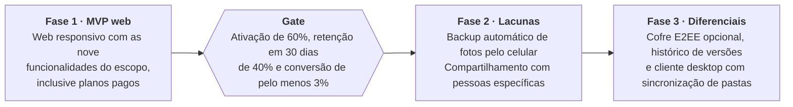

# 03 · criacao-design-system

- **Início:** 08/10/2026 20:23 (horário de Brasília)
- **Fim:** 08/10/2026 21:18
- **Sessão:** `e8277f52-3793-4c59-b962-dfd62e3dd8c3`
- **Subagentes embutidos:** 0

---

## Usuário (meta) · 08/10 20:23:41

```text
<local-command-caveat>The command below was run directly in Claude Code, not sent to you as a request, and its output goes straight to the user. It's recorded here as context for later messages.</local-command-caveat>
```


## Usuário · 08/10 20:23:41

```text
<command-name>/clear</command-name>
            <command-message>clear</command-message>
            <command-args></command-args>
```


## Sistema · 08/10 20:41:41

```text
<command-name>/rename</command-name>
            <command-message>rename</command-message>
            <command-args>criacao-design-system</command-args>
```

```text
<local-command-stdout>Session renamed to: criacao-design-system</local-command-stdout>
```


## Usuário (meta) · 08/10 20:41:41

```text
<system-reminder>
The user named this session "criacao-design-system". This may indicate the session's focus or intent.
</system-reminder>
```


## Usuário · 08/10 20:43:40

```text
<command-message>grill-me</command-message>
<command-name>/grill-me</command-name>
<command-args>Agora temos o @docs/design-system.md capturado do getdesign.md, mas ele tem o foco de design system da apple, coloquei ele aqui para:
1. traduzir para portugues tudo que é texto comum
2. Trocar as questões de Apple e deixar adaptado ao nosso projeto</command-args>
```


## Usuário (meta) · 08/10 20:43:40

Base directory for this skill: /home/argen/.claude/skills/grill-me

Interview me relentlessly about every aspect of this plan until we reach a shared understanding. Walk down each branch of the design tree, resolving dependencies between decisions one-by-one. For each question, provide your recommended answer.

Ask the questions one at a time.

If a question can be answered by exploring the codebase, explore the codebase instead.


ARGUMENTS: Agora temos o @docs/design-system.md capturado do getdesign.md, mas ele tem o foco de design system da apple, coloquei ele aqui para:
1. traduzir para portugues tudo que é texto comum
2. Trocar as questões de Apple e deixar adaptado ao nosso projeto


## Anexo (file) · 08/10 20:43:40

```text
<system-reminder>
Called the Read tool with the following input: {"file_path":"/home/argen/ti/fullcycle-events/techweekia/techweekia16-live/docs/design-system.md"}
</system-reminder>
<system-reminder>
Result of calling the Read tool:
1	## Overview
2	
3	Apple's web presence is a masterclass in **reverent product photography framed by near-invisible UI**. Every page is a stack of edge-to-edge product "tiles" — alternating light and dark canvases, each centered on a hero headline, a one-line tagline, two tiny blue pill CTAs, and an impossibly crisp product render. Nothing competes with the product. Typography is confident but quiet; color is either pure white, an off-white parchment, or a near-black tile; interactive elements are a single, quiet blue.
4	
5	Density is unusually low even by contemporary SaaS standards. Each tile occupies roughly one viewport, and there is no decorative chrome — no borders, no gradients, no decorative frames, no shadows on headlines. Elevation appears only when a product image rests on a surface (a single soft `rgba(0, 0, 0, 0.22) 3px 5px 30px` drop for visual weight). The result is a catalog that feels more like a museum gallery: the wall disappears and the artifact takes over.
6	
7	Store and shop surfaces retain the same chassis but switch modes. The product configurator (iPhone 17 Pro, accessories grid) introduces a tight grid of white utility cards at `{rounded.lg}` (18px) radius with a thin border, paired with a persistent thin sub-nav strip. The environment page leans darker and more editorial. Across all five surfaces the typographic system, spacing rhythm, and the single blue accent are consistent — this is one design language expressed at different volumes.
8	
9	**Key Characteristics:**
10	- Photography-first presentation; UI recedes so the product can speak.
11	- Alternating full-bleed tile sections: white/parchment ↔ near-black, with the color change itself acting as the section divider.
12	- Single blue accent (`{colors.primary}` — #0066cc) carries every interactive element. No second brand color exists.
13	- Two button grammars: tiny blue pill CTAs (`{rounded.pill}`) and compact utility rects (`{rounded.sm}`).
14	- SF Pro Display + SF Pro Text — negative letter-spacing at display sizes for the signature "Apple tight" headline feel.
15	- Whisper-soft elevation used only when a product image needs to breathe — exactly one drop-shadow in the entire system.
16	- Tight two-row nav: slim `{component.global-nav}` + product-specific `{component.sub-nav-frosted}` with persistent right-aligned primary CTA.
17	- Section rhythm across multiple pages: light hero → dark product tile → light utility tile → dark tile → parchment footer — a predictable pulse.
18	
19	## Colors
20	
21	> **Source pages analyzed:** homepage, environment, store, iPhone 17 Pro buy page, accessories index. The color system is identical across all five surfaces; only the surface-mode mix differs.
22	
23	### Brand & Accent
24	- **Action Blue** (`{colors.primary}` — #0066cc): The single brand-level interactive color. All text links, all blue pill CTAs ("Learn more", "Buy"), and the focus ring root. This is Apple's quiet but universal "click me" signal. Press state shifts to a slightly darker variant via the active scale transform rather than a hex change.
25	- **Focus Blue** (`{colors.primary-focus}` — #0071e3): A marginally brighter sibling of Action Blue, reserved for the keyboard focus ring on buttons (`outline: 2px solid`).
26	- **Sky Link Blue** (`{colors.primary-on-dark}` — #2997ff): A brighter blue used on dark surfaces for in-copy links and inline callouts, where Action Blue would disappear against the tile background.
27	
28	### Surface
29	- **Pure White** (`{colors.canvas}` — #ffffff): The dominant canvas. Content, utility cards, store tiles, configurator grids.
30	- **Parchment** (`{colors.canvas-parchment}` — #f5f5f7): The signature Apple off-white. Used for alternating light tiles, footer region, and the default page canvas in store utility sections. Just different enough from white to create rhythm.
31	- **Pearl Button** (`{colors.surface-pearl}` — #fafafc): A near-white used as the fill for secondary "ghost" buttons — lighter than the parchment canvas so the button still reads as a button against `{colors.canvas-parchment}`.
32	- **Near-Black Tile 1** (`{colors.surface-tile-1}` — #272729): The primary dark-tile surface on the homepage product grid.
33	- **Near-Black Tile 2** (`{colors.surface-tile-2}` — #2a2a2c): A micro-step lighter — used where a dark tile sits directly above or below Tile 1 to create the faintest separation.
34	- **Near-Black Tile 3** (`{colors.surface-tile-3}` — #252527): A micro-step darker — used at the bottom of the stack and in embedded video/player frames.
35	- **Pure Black** (`{colors.surface-black}` — #000000): Reserved for true void — video player backgrounds, edge-to-edge photographic overlays, the global nav bar background.
36	- **Translucent Chip Gray** (`{colors.surface-chip-translucent}` — #d2d2d7): The base hex of the translucent gray chip used over photography for circular control buttons. In production, applied at ~64% alpha as `rgba(210, 210, 215, 0.64)`.
37	
38	### Text
39	- **Near-Black Ink** (`{colors.ink}` — #1d1d1f): The voice of every headline, every body paragraph, and the dark utility button's fill. Chosen instead of pure black to keep the page feeling photographic rather than printed.
40	- **Body** (`{colors.body}` — #1d1d1f): Same hex as ink — Apple uses one near-black tone for all text on light surfaces.
41	- **Body On Dark** (`{colors.body-on-dark}` — #ffffff): All text on dark tiles and on the global nav bar.
42	- **Body Muted** (`{colors.body-muted}` — #cccccc): Secondary copy on dark tiles where pure white would be too loud.
43	- **Ink Muted 80** (`{colors.ink-muted-80}` — #333333): Body text on the white Pearl Button surface — slightly softer than pure black.
44	- **Ink Muted 48** (`{colors.ink-muted-48}` — #7a7a7a): Disabled button text and legal fine-print.
45	
46	### Hairlines & Borders
47	- **Divider Soft** (`{colors.divider-soft}` — #f0f0f0): The "border" tone on secondary buttons — functions as a ring shadow rather than a hard line. In production, often applied as `rgba(0, 0, 0, 0.04)`.
48	- **Hairline** (`{colors.hairline}` — #e0e0e0): The 1px hairline border on store utility cards and configurator chips.
49	
50	### Brand Gradient
51	**No decorative gradients.** Atmospheric depth on product photography (the iPhone 17 Pro camera plate, the Apple Watch bands, AirPods reflections) is inherent to the imagery, not a CSS gradient overlay. The environment page's hero uses photographic atmosphere (mountain vista at dawn) but no gradient tokens are defined. Apple is the rare luxury-brand site with zero gradient-based design tokens.
52	
53	## Typography
54	
55	### Font Family
56	- **Display**: `SF Pro Display, system-ui, -apple-system, sans-serif` — Apple's proprietary display face, optimized for sizes ≥ 19px. Defines the voice of every headline.
57	- **Body / UI**: `SF Pro Text, system-ui, -apple-system, sans-serif` — the text-optimized variant used for body copy, captions, buttons, and links below 20px.
58	- **OpenType features**: `font-variant-numeric: numerator` is enabled on numeric links (pricing tables, spec sheets). Display sizes rely on tight tracking rather than contextual ligatures.
59	
60	### Hierarchy
61	
62	| Token | Size | Weight | Line Height | Letter Spacing | Use |
63	|---|---|---|---|---|---|
64	| `{typography.hero-display}` | 56px | 600 | 1.07 | -0.28px | Hero headline; the signature "Apple tight" tracking |
65	| `{typography.display-lg}` | 40px | 600 | 1.10 | 0 | Tile headlines atop every product tile |
66	| `{typography.display-md}` | 34px | 600 | 1.47 | -0.374px | Section heads (SF Pro Text at display proportions) |
67	| `{typography.lead}` | 28px | 400 | 1.14 | 0.196px | Product tile subcopy |
68	| `{typography.lead-airy}` | 24px | 300 | 1.5 | 0 | Environment-page lead paragraphs (the rare weight 300) |
69	| `{typography.tagline}` | 21px | 600 | 1.19 | 0.231px | Sub-tile tagline; sub-nav category name |
70	| `{typography.body-strong}` | 17px | 600 | 1.24 | -0.374px | Inline strong emphasis |
71	| `{typography.body}` | 17px | 400 | 1.47 | -0.374px | Default paragraph |
72	| `{typography.dense-link}` | 17px | 400 | 2.41 | 0 | Footer / store utility link lists (relaxed leading) |
73	| `{typography.caption}` | 14px | 400 | 1.43 | -0.224px | Secondary captions, button text |
74	| `{typography.caption-strong}` | 14px | 600 | 1.29 | -0.224px | Emphasized captions |
75	| `{typography.button-large}` | 18px | 300 | 1.0 | 0 | Store hero CTAs (the rare weight 300) |
76	| `{typography.button-utility}` | 14px | 400 | 1.29 | -0.224px | Utility/nav button labels |
77	| `{typography.fine-print}` | 12px | 400 | 1.0 | -0.12px | Fine-print, footer body |
78	| `{typography.micro-legal}` | 10px | 400 | 1.3 | -0.08px | Micro legal disclaimers |
79	| `{typography.nav-link}` | 12px | 400 | 1.0 | -0.12px | Global nav menu items |
80	
81	### Principles
82	
83	- **Negative letter-spacing at display sizes.** Every headline at 17px and up carries a slight tracking tighten (`-0.12 → -0.374px`). This produces the iconic "Apple tight" headline cadence. Never used at 12px or below.
84	- **Body copy at 17px, not 16px.** Apple breaks the SaaS convention and runs paragraph text at 17px. The extra pixel gives the page an unmistakable "reading, not scanning" pace.
85	- **Weight 300 is real and rare.** Used deliberately on a handful of large-size reads (`{typography.button-large}` at 18px/300 and `{typography.lead-airy}` at 24px/300). It's not an accident — it's a light-atmosphere cue reserved for moments where the content should feel airy.
86	- **Weight 600, not 700, for headlines.** Apple's headlines sit at weight 600. Weight 700 is used sparingly for `{typography.tagline}` (21px) when a touch more assertion is needed.
87	- **Line-height is context-specific.** Display sizes use 1.07–1.19 (tight). Body uses 1.47. Utility link stacks in the footer/store use an unusually relaxed 2.41 (`{typography.dense-link}`). The 2.41 is not a bug — it's how the footer's dense link columns breathe.
88	- **Weight 500 is deliberately absent.** The ladder is 300 / 400 / 600 / 700. Mid-weight readings always use 600.
89	
90	### Note on Font Substitutes
91	SF Pro is Apple's proprietary system font. When building off-system:
92	
93	- Use `system-ui, -apple-system, BlinkMacSystemFont` as the first stack entry — on macOS/iOS/Safari this resolves to the real SF Pro.
94	- For non-Apple platforms, **Inter** (Google Fonts, variable) is the closest open-source equivalent. Inter at weight 600 with `font-feature-settings: "ss03"` approximates SF Pro's rounded "a" character.
95	- Nudge `letter-spacing` down by `-0.01em` on display sizes to re-create the Apple tight feel; Inter's default tracking runs slightly wider than SF Pro.
96	- For body text, tighten line-height by `0.03` (from 1.47 → 1.44) when substituting Inter — Inter's taller x-height needs less leading.
97	
98	## Layout
99	
100	### Spacing System
101	- **Base unit:** 8px. Sub-base values (2, 4, 5, 6, 7) are used for tight typographic adjustments; structural layout snaps to 8/12/16/20/24.
102	- **Tokens:** `{spacing.xxs}` 4px · `{spacing.xs}` 8px · `{spacing.sm}` 12px · `{spacing.md}` 17px · `{spacing.lg}` 24px · `{spacing.xl}` 32px · `{spacing.xxl}` 48px · `{spacing.section}` 80px.
103	- **Section vertical padding:** `{spacing.section}` (80px) inside a product tile; tiles stack edge-to-edge with 0 gap (the color change provides the break).
104	- **Card padding:** `{spacing.lg}` (24px) inside utility grid cards.
105	- **Button padding:** 8–11px vertical, 15–22px horizontal.
106	- **Universal rhythm constants:** the 17px body line-height multiplier (~25px line) and 21px tagline size show up on every analyzed page.
107	
108	### Grid & Container
109	- **Max content width:** ~980px on text-heavy sections (environment), ~1440px on product grids (store, accessories), full-bleed for product tiles (homepage).
110	- **Column patterns:** 3 to 5 column utility card grid on store/accessories; 2-column side-by-side tiles on homepage occasional sections; single-column centered stack on product tile heroes.
111	- **Gutters:** 20–24px between cards in a utility grid.
112	
113	### Whitespace Philosophy
114	Apple's whitespace is the product's pedestal. Every tile begins with at least 64px of air above its headline and 48–64px below. Product renders are never crowded; the nearest content to a product image is at least 40px away. The footer is the only area that breaks this — there, Apple goes deliberately dense to make the full information architecture visible at a glance.
115	
116	## Elevation & Depth
117	
118	| Level | Treatment | Use |
119	|---|---|---|
120	| Flat | No shadow, no border | Full-bleed tiles, global nav, footer, body sections |
121	| Soft hairline | 1px `rgba(0, 0, 0, 0.08)` border | Utility cards, sub-nav frosted-glass separator |
122	| Backdrop blur | `backdrop-filter: blur(N)` on Parchment 80% | Sub-nav and the iPhone buy floating sticky bar |
123	| Product shadow | `rgba(0, 0, 0, 0.22) 3px 5px 30px 0` | Product renders resting on a surface (the only true "shadow" in the system) |
124	
125	**Shadow philosophy.** Apple uses **exactly one** drop-shadow, and it is applied to photographic product imagery — never to cards, never to buttons, never to text. Elevation in the UI comes from (a) surface-color change (light tile ↔ dark tile) and (b) backdrop-blur on sticky bars. The single shadow is about giving the product weight, not about UI hierarchy.
126	
127	### Decorative Depth
128	- **Atmospheric imagery** on the environment page (photographic vista) supplies mood; no CSS gradient involved.
129	- **Edge-to-edge tile alternation** creates rhythm without borders or shadows — the color change itself is the divider.
130	- **Backdrop-filter blur** on `{component.sub-nav-frosted}` and `{component.floating-sticky-bar}` creates a "floating over content" effect that's functional, not decorative.
131	
132	## Shapes
133	
134	### Border Radius Scale
135	
136	| Token | Value | Use |
137	|---|---|---|
138	| `{rounded.none}` | 0px | Full-bleed product tiles (no corner rounding) |
139	| `{rounded.xs}` | 5px | Inline links when styled as subtle chips (rare) |
140	| `{rounded.sm}` | 8px | Dark utility buttons (Sign In, Bag), inline card imagery |
141	| `{rounded.md}` | 11px | White Pearl Button capsules |
142	| `{rounded.lg}` | 18px | Store utility cards, accessories grid cards |
143	| `{rounded.pill}` | 9999px | Primary blue pill CTAs, sub-nav buy button, configurator option chips, search input — the signature Apple pill |
144	| `{rounded.full}` | 9999px / 50% | Circular control chips floating over photography |
145	
146	### Photography Geometry
147	- **Hero imagery**: full-bleed, 21:9 or taller on the homepage; 16:9 on environment and shop pages. Product renders are photographic-realistic, often shot on a tinted surface that becomes the tile background.
148	- **Product renders**: PNG/WebP with transparency; rest on a surface tile and pick up the system shadow.
149	- **Accessory grid**: square 1:1 crops at `{rounded.lg}` (18px) radius, light neutral backgrounds, product centered with 20–40px internal padding.
150	- **No rounded imagery in hero tiles** — images are full-bleed rectangular. Rounding (`{rounded.sm}`, `{rounded.lg}`) appears only on inline card imagery.
151	- Lazy-loading via responsive `srcset` and `sizes` across all breakpoints; CDN-optimized WebP.
152	
153	## Components
154	
155	### Top Navigation
156	
157	**`global-nav`** — Persistent, ultra-thin black nav bar pinned to the top of every page. Background `{colors.surface-black}`, height 44px, text `{colors.on-dark}` in `{typography.nav-link}` (12px / 400 / -0.12px tracking). Links are quiet, spaced ~20px apart, running edge-to-edge across the top. Right-aligned cluster: Search, Bag icons — always visible. On mobile, collapses to hamburger at ~834px and the Apple logo centers.
158	
159	**`sub-nav-frosted`** — Surface-specific nav that sticks below the global nav. Background `{colors.canvas-parchment}` at 80% opacity with backdrop-filter blur, creating a frosted-glass effect. Height 52px. Content on left: product category name ("iPhone", "Store", "Accessories") in `{typography.tagline}` (21px / 600). Content right: inline nav links in `{typography.button-utility}` (14px), ending in a persistent `{component.button-primary}` ("Buy") or a utility link.
160	
161	### Buttons
162	
163	**`button-primary`** — The signature Apple action. Background `{colors.primary}` (Action Blue #0066cc), text `{colors.on-primary}` in `{typography.body}` (SF Pro Text 17px / 400), rounded `{rounded.pill}` (full pill — capsule-shaped), padding 11px × 22px. The full-pill radius IS the brand action signal.
164	- Active state: `{component.button-primary-active}` — `transform: scale(0.95)` (the system-wide micro-interaction).
165	- Focus state: `{component.button-primary-focus}` — 2px solid `{colors.primary-focus}` outline.
166	
167	**`button-secondary-pill`** — Used as the second CTA when two blue pills appear together ("Learn more" / "Buy"). Background transparent, text `{colors.primary}`, 1px solid `{colors.primary}` border, rounded `{rounded.pill}`, padding 11px × 22px. Reads as a "ghost pill."
168	
169	**`button-dark-utility`** — Global nav actions (Sign In, Bag, language selector). Background `{colors.ink}` (#1d1d1f), text `{colors.on-dark}` in `{typography.button-utility}` (14px / 400 / -0.224px tracking), rounded `{rounded.sm}` (8px), padding 8px × 15px. Active state shrinks via `transform: scale(0.95)`.
170	
171	**`button-pearl-capsule`** — Product-card secondary button. Background `{colors.surface-pearl}` (#fafafc), text `{colors.ink-muted-80}` in `{typography.caption}` (14px), 3px solid `{colors.divider-soft}` border (functions as a soft ring rather than a visible line), rounded `{rounded.md}` (11px), padding 8px × 14px.
172	
173	**`button-store-hero`** — A larger primary CTA used on store hero surfaces. Same Action Blue + Paper White as `{component.button-primary}`, but with `{typography.button-large}` (18px / 300 — note the rare weight 300) and slightly more padding (14px × 28px). Used sparingly on the store landing.
174	
175	**`button-icon-circular`** — Floats over photography. 44 × 44px, background `{colors.surface-chip-translucent}` at ~64% alpha, icon in `{colors.ink}`, rounded `{rounded.full}`. Used for carousel controls, close buttons, and in-image controls (product image thumbnails on the iPhone buy page).
176	
177	**`text-link`** — Inline body links in `{colors.primary}` (Action Blue). Underlined or non-underlined per context.
178	
179	**`text-link-on-dark`** — Inline body links on dark tiles in `{colors.primary-on-dark}` (Sky Link Blue #2997ff) — Action Blue would disappear against `{colors.surface-tile-1}`.
180	
181	### Cards & Containers
182	
183	**`product-tile-light`** — Full-bleed light tile. Background `{colors.canvas}` (white), text `{colors.ink}`, rounded `{rounded.none}` (0 — tiles touch edges), vertical padding `{spacing.section}` (80px). Centered stack: product name in `{typography.display-lg}` (40px / 600) → one-line tagline in `{typography.lead}` (28px / 400) → two `{component.button-primary}` CTAs ("Learn more" / "Buy") → product render resting on the surface with the system shadow.
184	
185	**`product-tile-parchment`** — Same as `{component.product-tile-light}` but on `{colors.canvas-parchment}` (#f5f5f7). Used to break two consecutive white tiles.
186	
187	**`product-tile-dark`** — Full-bleed dark tile. Background `{colors.surface-tile-1}` (#272729), text `{colors.on-dark}`, rounded `{rounded.none}`, vertical padding `{spacing.section}` (80px). Same content stack as the light tile but with `{component.text-link-on-dark}` for inline copy and `{component.button-primary}` (Action Blue still works on the dark surface). Used on the homepage product grid as the alternating dark band.
188	
189	**`product-tile-dark-2`** — Variant on `{colors.surface-tile-2}` (#2a2a2c). Used where a dark tile sits directly above or below `{component.product-tile-dark}` to create the faintest separation through micro-step lightness change.
190	
191	**`product-tile-dark-3`** — Variant on `{colors.surface-tile-3}` (#252527). Used at the bottom of the stack and in embedded video/player frames.
192	
193	**`store-utility-card`** — Used in store grid and accessories grid. Background `{colors.canvas}` (white), 1px solid `{colors.hairline}` border, rounded `{rounded.lg}` (18px), padding `{spacing.lg}` (24px). Top: product image (1:1 crop with `{rounded.sm}` (8px) inner image radius). Below: product name in `{typography.body-strong}` (17px / 600), price in `{typography.body}` (17px / 400), and a `{component.text-link}` ("Buy" or "Learn more"). No shadow by default; product render itself carries the system product-shadow.
194	
195	**`configurator-option-chip`** — Pill-shaped tappable cell used in the iPhone 17 Pro buy page. Background `{colors.canvas}`, text `{colors.ink}` in `{typography.caption}`, rounded `{rounded.pill}`, padding 12px × 16px. Contains a small product thumbnail + label + price delta. Arranged in a grid of 4–5 options per row.
196	
197	**`configurator-option-chip-selected`** — Selected state. Border upgrades to 2px solid `{colors.primary-focus}`. Same shape, same content.
198	
199	**`environment-quote-card`** — A photographic-canvas hero specific to the environment page. Dark photographic backdrop (mountain vista at dawn) with `{colors.surface-tile-1}` as the fallback color, centered white-text headline in `{typography.display-lg}` (40px), small green "Apple 2030" pictographic logo above the headline, single `{component.button-primary}` below. Padding `{spacing.section}` (80px).
200	
201	**`floating-sticky-bar`** — Floats at the bottom of the viewport on the iPhone 17 Pro buy page during scroll. Background `{colors.canvas-parchment}` at 80% opacity with `backdrop-filter: blur(N)`, height 64px, padding 12px × 32px. Left: running price total in `{typography.body}`. Right: `{component.button-primary}` ("Add to Bag").
202	
203	### Inputs & Forms
204	
205	**`search-input`** — The accessories search input. Background `{colors.canvas}`, text `{colors.ink}` in `{typography.body}` (17px), 1px solid `rgba(0, 0, 0, 0.08)` border, rounded `{rounded.pill}` (full pill — search is also pill-shaped, matching the CTA grammar), padding 12px × 20px, height 44px. Leading icon: search glyph at 14px, muted tint.
206	
207	Error and validation states were not surfaced in the analyzed pages.
208	
209	### Footer
210	
211	**`footer`** — Background `{colors.canvas-parchment}` (#f5f5f7), text `{colors.ink-muted-80}`. Link columns in `{typography.dense-link}` (17px / 400 / 2.41 line-height — the relaxed leading is what makes the dense columns scannable). Column headings in `{typography.caption-strong}` (14px / 600). Legal row at the very bottom in `{typography.fine-print}` (12px / 400) with `{colors.ink-muted-48}` text. Vertical padding 64px.
212	
213	## Do's and Don'ts
214	
215	### Do
216	- Use `{colors.primary}` (Action Blue #0066cc) for every interactive element — links, pill CTAs, focus signals — and nothing else. The single accent is non-negotiable.
217	- Set headlines in `{typography.hero-display}` or `{typography.display-lg}` with negative letter-spacing (`-0.28 → -0.374px`) to get the signature "Apple tight" cadence.
218	- Run body copy at `{typography.body}` (17px / 400 / 1.47 / -0.374px) — not 16px. The extra pixel defines the brand's reading pace.
219	- Alternate `{component.product-tile-light}` (or parchment) and `{component.product-tile-dark}` for full-bleed section rhythm. The color change IS the divider.
220	- Reserve `{rounded.pill}` for the primary blue CTA and any other element that should read as an "action" (configurator chips, search input, sticky bar CTA).
221	- Apply the single product-shadow (`rgba(0, 0, 0, 0.22) 3px 5px 30px`) only to product renders resting on a surface — never on cards, buttons, or text.
222	- Use `transform: scale(0.95)` as the active/press state on every button — it's the system-wide micro-interaction.
223	- Keep the global nav `{colors.surface-black}` (true black) — it's the only place pure black appears on most pages.
224	
225	### Don't
226	- Don't introduce a second accent color; every "click me" signal is `{colors.primary}` (Action Blue).
227	- Don't add shadows to cards, buttons, or text — shadow is reserved for product imagery.
228	- Don't use gradients as decorative backgrounds; atmosphere comes from photography.
229	- Don't set body copy at weight 500 — Apple's ladder is 300 / 400 / 600 / 700, with 500 deliberately absent. Body is always 400; strong inline is 600; display is 600.
230	- Don't round full-bleed tiles — tiles are rectangular and edge-to-edge; the color change is the divider.
231	- Don't tighten line-height below 1.47 for body copy — the editorial leading is part of the brand.
232	- Don't mix radii grammars — use `{rounded.sm}` for compact utility, `{rounded.lg}` for utility cards, `{rounded.pill}` for pills, and nothing in between (except the rare `{rounded.md}` Pearl Button).
233	- Don't use `{colors.primary-on-dark}` (Sky Link Blue) on light surfaces — it's the dark-tile-only variant. Action Blue is for light surfaces.
234	
235	## Responsive Behavior
236	
237	### Breakpoints
238	
239	| Name | Width | Key Changes |
240	|---|---|---|
241	| Small phone | ≤ 419px | Single-column tiles; sub-nav collapses to category name + primary CTA only; hero typography drops to 28px |
242	| Phone | 420–640px | Single-column stack; product renders scale to 80% of tile width; hero h1 drops to 34px |
243	| Large phone | 641–735px | Tiles transition to tighter padding (48px vertical vs 80px); fine-print wraps |
244	| Tablet portrait | 736–833px | Global nav collapses to hamburger; sub-nav hides category chips, keeps primary CTA |
245	| Tablet landscape | 834–1023px | Global nav returns fully expanded; 3-column utility grids become 2-column |
246	| Small desktop | 1024–1068px | Product tiles use 2/3 width with margin gutters; hero h1 stays at 40px |
247	| Desktop | 1069–1440px | Full layout; 4–5 column store grids; 1440px content max |
248	| Wide desktop | ≥ 1441px | Content locks at 1440px, margins absorb extra width |
249	
250	The structural breakpoints that matter for agents: 1440px (content lock), 1068px (small-desktop), 833px (tablet landscape switch), 734px (tablet portrait), 640px (phone), 480px (small phone).
251	
252	### Touch Targets
253	- Minimum 44 × 44px. `{component.button-primary}` lands at ~44 × 100px (with the full-pill radius making the visible hit area more generous than the label suggests).
254	- `{component.button-icon-circular}` is exactly 44 × 44px.
255	- Global nav utility links are smaller (~32 × 80px) — they deliberately sit at a tighter target because they're precision desktop actions, and the mobile hamburger replaces them at ≤ 833px.
256	
257	### Collapsing Strategy
258	- **Global nav**: full horizontal link row on desktop → collapses to Apple logo + hamburger + bag icon at 834px and below.
259	- **Sub-nav**: category name + inline links + primary CTA → category name + primary CTA only at mobile; inline links move into a hamburger tray.
260	- **Product tiles**: stack from 2-column to 1-column at 834px; vertical padding tightens from 80px → 48px at small-phone.
261	- **Utility grids** (store, accessories): 5-col → 4-col (1440px) → 3-col (1068px) → 2-col (834px) → 1-col (640px).
262	- **Hero typography**: `{typography.hero-display}` (56px) → `{typography.display-lg}` (40px) at 1068px → 34px at 640px → 28px at 419px.
263	
264	### Image Behavior
265	- All product imagery uses responsive `srcset` with breakpoint-matched crops.
266	- Hero photography may switch art direction at mobile (e.g., the environment page's vista crops to a taller aspect ratio on mobile, framing the subject differently).
267	- Product renders maintain their 1:1 or 4:3 aspect ratios across breakpoints; only scale changes.
268	- Lazy-loading is default; the above-fold hero loads eagerly.
269	
270	## Iteration Guide
271	
272	1. Focus on ONE component at a time. Reference its YAML key directly (`{component.product-tile-dark}`, `{component.search-input}`).
273	2. Variants of an existing component (`-active`, `-focus`, `-2`, `-3`) live as separate entries in `components:`.
274	3. Use `{token.refs}` everywhere — never inline hex.
275	4. Never document hover. Default and Active/Pressed states only.
276	5. Display headlines stay SF Pro Display 600 with negative letter-spacing. Body stays SF Pro Text 400 at 17px. The boundary is unbreakable.
277	6. The single drop-shadow (`rgba(0, 0, 0, 0.22) 3px 5px 30px`) is reserved for product photography only.
278	7. When in doubt about emphasis: alternate surface (light → dark tile) before adding chrome.
279	
280	## Known Gaps
281	
282	- Form validation and error states were not surfaced on the analyzed pages; only the neutral search input is documented.
283	- The homepage's embedded video/player frame uses `{colors.surface-black}`; interior player controls are not documented (they're a platform widget, not a web-design token).
284	- Some component imagery is dynamic (rotating product hero) and its specific copy varies per surface — component specs name the structure, not the rotating content.
285	- Dark-mode counterparts for store and accessories utility cards were not surfaced on the analyzed pages; the system documented is the daytime/light-dominant variant Apple ships by default.
286	- Atmospheric photography (environment page mountain vista) is a content asset, not a design token; the documented `{component.environment-quote-card}` describes the structural surface only.
287	- The exact backdrop-filter blur radius on `{component.sub-nav-frosted}` and `{component.floating-sticky-bar}` is platform-dependent; production CSS uses `saturate(180%) blur(20px)` as a typical baseline but the value isn't formalized as a token.
288	
</system-reminder>
```


## Assistente · 08/10 20:43:42

Antes de perguntar, vou ler o que o projeto já define, para não perguntar o que o código responde.

**Ferramenta: `Bash`**

```json
{
  "command": "git ls-files | grep -v -E 'pnpm-lock|\\.png$|\\.ico$|\\.svg$' | head -100 && echo --- && wc -l docs/*.md && echo --- && git status --short",
  "description": "List tracked project files and docs sizes"
}
```

**Ferramenta: `Read`**

```json
{
  "file_path": "/home/argen/ti/fullcycle-events/techweekia/techweekia16-live/docs/product-brief.md"
}
```


## Resultado de ferramenta · 08/10 20:43:44

<details>
<summary>Resultado de <code>Bash</code></summary>

```text
.claude/settings.json
.gitignore
.mcp.json
AGENTS.md
apps/api/.dockerignore
apps/api/.gitignore
apps/api/.oxlintrc.json
apps/api/.prettierrc
apps/api/Dockerfile
apps/api/Dockerfile.dev
apps/api/README.md
apps/api/nest-cli.json
apps/api/package.json
apps/api/src/app.controller.spec.ts
apps/api/src/app.controller.ts
apps/api/src/app.module.ts
apps/api/src/app.service.ts
apps/api/src/main.ts
apps/api/test/app.e2e-spec.ts
apps/api/tsconfig.build.json
apps/api/tsconfig.json
apps/api/vitest.config.e2e.ts
apps/api/vitest.config.ts
apps/web/.dockerignore
apps/web/.gitignore
apps/web/AGENTS.md
apps/web/Dockerfile
apps/web/Dockerfile.dev
apps/web/README.md
apps/web/app/globals.css
apps/web/app/layout.tsx
apps/web/app/page.tsx
apps/web/eslint.config.mjs
apps/web/next.config.ts
apps/web/package.json
apps/web/pnpm-workspace.yaml
apps/web/tsconfig.json
compose.dev.yaml
docs/hld.md
docs/lld.md
docs/product-brief.md
---
  287 docs/design-system.md
  314 docs/hld.md
  497 docs/lld.md
  139 docs/product-brief.md
 1237 total
---
 M .claude/settings.json
?? docs/design-system.md
```

</details>

<details>
<summary>Resultado de <code>Read</code></summary>

````text
1	# Product Brief — Gerenciador de Arquivos (estilo Google Drive)
2	
3	2026-10-08 · Luiz Carlos
4	
5	## Visão geral
6	
7	Gerenciador de arquivos na nuvem no estilo Google Drive, para usuários finais, com 15 GB gratuitos e planos pagos de armazenamento adicional. Ele se diferencia por três promessas: privacidade, simplicidade e preço.
8	
9	- **Privacidade:** criptografia em trânsito (TLS) e em repouso, sem anúncios, sem venda de dados e sem análise do conteúdo, em conformidade com a LGPD. O servidor tecnicamente consegue ler os arquivos; a promessa é sustentada por política e auditoria de acesso. Um cofre com criptografia ponta a ponta (E2EE) opcional fica para uma fase posterior.
10	- **Simplicidade:** experiência mais enxuta que a dos concorrentes (detalhes a definir no escopo do MVP).
11	- **Preço:** planos pagos mais acessíveis que os dos concorrentes (faixas e valores a definir).
12	
13	## Problema e contexto
14	
15	Quem passa dos 15 GB gratuitos do Google ou da Apple precisa contratar um plano, em geral cobrado em dólar ou em moeda estrangeira, para continuar guardando seus arquivos. O produto aposta que existe espaço para uma alternativa mais barata, mais simples e com uma promessa clara de privacidade, voltada ao público brasileiro.
16	
17	Essa aposta se apoia em três hipóteses, ainda não validadas com usuários:
18	
19	- Esgotar o espaço gratuito é um gatilho claro para trocar de serviço ou complementar o atual.
20	- Parte desse público valoriza privacidade e simplicidade o bastante para experimentar um produto novo.
21	- Pagar em reais, com Pix, reduz o atrito de contratar um plano.
22	
23	## Público-alvo
24	
25	O produto começa no Brasil, em português, para pessoas físicas e freelancers que estouraram os 15 GB gratuitos do Google ou da Apple e acham caro pagar em dólar.
26	
27	- **Perfil principal:** pessoa física comum e freelancers, com fotos, documentos pessoais e arquivos de trabalho.
28	- **Gatilho de compra:** o espaço gratuito acabou e o plano pago do concorrente pesa no bolso, por ser cobrado em dólar ou em moeda estrangeira.
29	- **Fora do foco inicial:** colaboração em equipe, com permissões avançadas e administração de contas.
30	
31	## Modelo de negócio e planos
32	
33	O produto segue o modelo freemium: 15 GB gratuitos atraem o usuário e três planos pagos vendem espaço adicional, sempre cobrados em reais.
34	
35	- **Gratuito:** 15 GB.
36	- **Pago 1:** 100 GB.
37	- **Pago 2:** 1 TB.
38	- **Pago 3:** 2 TB.
39	
40	A cobrança é mensal ou anual, com desconto de cerca de 15% a 20% no plano anual, e o pagamento é feito por cartão ou Pix. A meta de preço é ficar de 20% a 30% abaixo do plano equivalente do Google One. Os valores finais ficam a definir, depois de cruzar o custo real do armazenamento por GB (infraestrutura e taxas de pagamento) com os preços atuais dos concorrentes.
41	
42	## Objetivos e métricas de sucesso
43	
44	O sucesso é medido 6 meses após o lançamento, com cinco métricas. As metas são hipóteses iniciais, a calibrar com dados reais.
45	
46	| Métrica | O que mede | Meta em 6 meses |
47	| --- | --- | --- |
48	| Contas criadas | Aquisição de novos usuários | A definir |
49	| Ativação | Quem faz o primeiro upload em até 24 horas após o cadastro | 60% |
50	| Retenção em 30 dias | Quem volta a usar o produto 30 dias depois do cadastro | 40% |
51	| Conversão para plano pago | Usuários gratuitos que contratam um plano | 3% a 5% |
52	| Margem por pagante | Receita do pagante menos o custo de armazenamento, incluindo o dos usuários gratuitos | Positiva |
53	
54	## Escopo do MVP
55	
56	O MVP é um aplicativo web responsivo, sem apps nativos nem cliente desktop, com nove funcionalidades:
57	
58	1. Cadastro e login com e-mail e senha.
59	2. Upload (arrastar e soltar, vários arquivos, retomada em arquivos grandes) e download.
60	3. Pastas: criar, renomear, mover e excluir.
61	4. Lixeira com restauração (por exemplo, 30 dias).
62	5. Pré-visualização de imagens, PDF, vídeo, áudio e texto.
63	6. Busca por nome de arquivo e pasta.
64	7. Compartilhamento por link, somente leitura, com expiração e senha opcionais.
65	8. Indicador de uso da cota (15 GB gratuitos).
66	9. Contratação de plano pago, com cartão e Pix.
67	
68	## Fora de escopo
69	
70	Estes itens ficam fora do MVP e são candidatos às fases seguintes:
71	
72	- Apps nativos (iOS e Android) e backup automático de fotos. Como as fotos costumam ocupar boa parte dos 15 GB, esta é uma lacuna conhecida do MVP.
73	- Cliente desktop com sincronização de pastas.
74	- Edição colaborativa de documentos, no estilo Docs e Sheets.
75	- Histórico de versões.
76	- Compartilhamento com pessoas específicas e permissões granulares.
77	- Comentários, favoritos e acesso offline.
78	- Busca por conteúdo e recursos de IA.
79	- Cofre com criptografia ponta a ponta (E2EE) opcional.
80	- Colaboração em equipe, com administração de contas.
81	- Moderação de conteúdo e tratamento de denúncias e abuso: não tratados neste brief.
82	
83	## Requisitos não funcionais e restrições
84	
85	Estes requisitos sustentam as três promessas do produto e limitam o custo dos usuários gratuitos.
86	
87	| Área | Requisito |
88	| --- | --- |
89	| Privacidade | TLS em trânsito e criptografia em repouso. Sem anúncios, sem venda de dados e sem análise do conteúdo, com auditoria de acesso interno e conformidade com a LGPD. |
90	| Localização dos dados | Região no Brasil. |
91	| Armazenamento | Google Cloud Storage. O upload vai direto do navegador por URLs assinadas, sem passar pelo servidor da aplicação. |
92	| Metadados | Banco relacional gerenciado (PostgreSQL) para usuários, pastas e arquivos. |
93	| Controle de custo | Cota aplicada no servidor, que bloqueia upload acima do limite do plano, e limite de tamanho por arquivo (valor a definir). |
94	| Pagamentos | Gateway com cartão recorrente e Pix. |
95	| Plataforma | Aplicação web responsiva, sem apps nativos. |
96	| Prazo, equipe e orçamento | A definir. |
97	
98	## Riscos, dependências e premissas
99	
100	O maior risco é financeiro: os 15 GB gratuitos têm custo real desde o primeiro usuário, e só a conversão para planos pagos os sustenta.
101	
102	| Risco | Mitigação |
103	| --- | --- |
104	| Custo dos usuários gratuitos acima da receita dos pagantes | Cota aplicada no servidor, limite de tamanho por arquivo e acompanhamento da margem por pagante. |
105	| Concorrência de Google, Apple e Dropbox, que já têm a base de usuários | Foco no público brasileiro, com preço em reais, Pix e uma promessa clara de privacidade. |
106	| MVP sem backup de fotos, o que mais enche a cota | Backup automático de fotos como prioridade da fase 2, e a lacuna declarada no brief. |
107	| Privacidade sustentada por política, e não por criptografia ponta a ponta | Auditoria de acesso interno e cofre E2EE opcional na fase 3. |
108	| Perda de arquivos num produto novo que guarda dados pessoais | Armazenamento com replicação e backups, e comunicação transparente sobre incidentes. |
109	| Prazo, equipe e orçamento ainda indefinidos | Fechar esses três pontos antes de comprometer datas do MVP. |
110	
111	**Dependências:** o Google Cloud Storage, na região de São Paulo, e um gateway de pagamento com cartão recorrente e Pix.
112	
113	**Premissas:** as três hipóteses da seção de problema e contexto, que ainda precisam ser validadas com usuários.
114	
115	## Roadmap
116	
117	O roadmap tem três fases e um gate: a fase 2 só começa quando o MVP atinge as metas de ativação, retenção e conversão. Ele não tem datas, porque o prazo do projeto ainda está a definir.
118	
119	```mermaid
120	flowchart LR
121	    F1["<b>Fase 1 · MVP web</b><br/>Web responsivo com as nove<br/>funcionalidades do escopo,<br/>inclusive planos pagos"]
122	    G{{"<b>Gate</b><br/>Ativação de 60%, retenção em 30 dias<br/>de 40% e conversão de pelo menos 3%"}}
123	    F2["<b>Fase 2 · Lacunas</b><br/>Backup automático de fotos pelo celular<br/>Compartilhamento com pessoas específicas"]
124	    F3["<b>Fase 3 · Diferenciais</b><br/>Cofre E2EE opcional, histórico de versões<br/>e cliente desktop com sincronização de pastas"]
125	    F1 --> G --> F2 --> F3
126	```
127	
128	O critério de passagem da fase 2 para a fase 3 ainda não foi definido.
129	
130	## Questões em aberto
131	
132	Estes pontos precisam de definição antes de o MVP ser planejado em detalhe.
133	
134	- [ ] Prazo de lançamento, tamanho e perfil da equipe, e orçamento mensal de infraestrutura.
135	- [ ] Meta de contas criadas em 6 meses.
136	- [ ] Preços finais dos planos: pesquisar os valores atuais de Google One, iCloud e Dropbox no Brasil e calcular o custo real por GB.
137	- [ ] Limite de tamanho por arquivo e prazo de retenção da lixeira (30 dias é apenas um exemplo).
138	- [ ] O que torna a experiência mais simples que a dos concorrentes, na prática.
139	- [ ] Escolha do gateway de pagamento.
140	
````

</details>


## Assistente · 08/10 20:43:48

**Ferramenta: `Bash`**

```json
{
  "command": "for f in apps/web/package.json apps/web/app/globals.css apps/web/app/layout.tsx apps/web/app/page.tsx apps/web/AGENTS.md; do echo \"=== $f\"; cat $f; done; ls apps/web; echo \"=== grep docs\"; grep -n -i -E 'design|tailwind|shadcn|fonte|font|tema|dark|escuro|marca|nome do produto|landing|telas|tela |página|i18n|ícone|icon|componente|acessib|a11y|mobile|responsiv' docs/hld.md docs/lld.md | head -80",
  "description": "Read web app styling setup and grep design-related mentions in HLD/LLD"
}
```


## Resultado de ferramenta · 08/10 20:43:48

<details>
<summary>Resultado de <code>Bash</code></summary>

```text
=== apps/web/package.json
{
  "name": "web",
  "version": "0.1.0",
  "private": true,
  "scripts": {
    "dev": "next dev",
    "build": "next build",
    "start": "next start",
    "lint": "eslint"
  },
  "dependencies": {
    "next": "16.4.0",
    "react": "19.3.0",
    "react-dom": "19.3.0"
  },
  "devDependencies": {
    "@tailwindcss/turbopack": "^4",
    "@types/node": "^20",
    "@types/react": "^19",
    "@types/react-dom": "^19",
    "eslint": "^9",
    "eslint-config-next": "16.4.0",
    "tailwindcss": "^4",
    "typescript": "^5"
  },
  "packageManager": "pnpm@11.6.0"
}
=== apps/web/app/globals.css
@import "tailwindcss";

:root {
  --background: #ffffff;
  --foreground: #171717;
}

@theme inline {
  --color-background: var(--background);
  --color-foreground: var(--foreground);
  --font-sans: var(--font-geist-sans);
  --font-mono: var(--font-geist-mono);
}

@media (prefers-color-scheme: dark) {
  :root {
    --background: #0a0a0a;
    --foreground: #ededed;
  }
}

body {
  background: var(--background);
  color: var(--foreground);
  font-family: Arial, Helvetica, sans-serif;
}
=== apps/web/app/layout.tsx
import type { Metadata } from "next";
import { Geist, Geist_Mono } from "next/font/google";
import "./globals.css";

const geistSans = Geist({
  variable: "--font-geist-sans",
  subsets: ["latin"],
});

const geistMono = Geist_Mono({
  variable: "--font-geist-mono",
  subsets: ["latin"],
});

export const metadata: Metadata = {
  title: "Create Next App",
  description: "Generated by create next app",
};

export default function RootLayout({ children }: LayoutProps<"/">) {
  return (
    <html
      lang="en"
      className={`${geistSans.variable} ${geistMono.variable} h-full antialiased`}
    >
      <body className="min-h-full flex flex-col">{children}</body>
    </html>
  );
}
=== apps/web/app/page.tsx
import Image from "next/image";

export default function Home() {
  return (
    <div className="flex flex-col flex-1 items-center justify-center bg-zinc-50 font-sans dark:bg-black">
      <main className="flex flex-1 w-full max-w-3xl flex-col items-center justify-between py-32 px-16 bg-white dark:bg-black sm:items-start">
        <Image
          className="dark:invert h-5 w-[100px]"
          src="/next.svg"
          alt="Next.js logo"
          width={100}
          height={20}
          priority
        />
        <div className="flex flex-col items-center gap-6 text-center sm:items-start sm:text-left">
          <h1 className="max-w-xs text-3xl font-semibold leading-10 tracking-tight text-black dark:text-zinc-50">
            To get started, edit the{" "}
            <code className="rounded bg-black/[.06] px-1.5 py-0.5 font-mono text-[0.9em] dark:bg-white/[.08]">
              page.tsx
            </code>{" "}
            file.
          </h1>
          <p className="max-w-md text-lg leading-8 text-zinc-600 dark:text-zinc-400">
            Looking for a starting point or more instructions? Head over to{" "}
            <a
              href="https://vercel.com/templates?framework=next.js&utm_source=create-next-app&utm_medium=appdir-template-tw&utm_campaign=create-next-app"
              className="font-medium text-zinc-950 dark:text-zinc-50"
            >
              Templates
            </a>{" "}
            or the{" "}
            <a
              href="https://nextjs.org/learn?utm_source=create-next-app&utm_medium=appdir-template-tw&utm_campaign=create-next-app"
              className="font-medium text-zinc-950 dark:text-zinc-50"
            >
              Learning
            </a>{" "}
            center.
          </p>
        </div>
        <div className="flex flex-col gap-4 text-base font-medium sm:flex-row">
          <a
            className="flex h-12 w-full items-center justify-center gap-2 rounded-full bg-foreground px-5 text-background transition-colors hover:bg-[#383838] dark:hover:bg-[#ccc] md:w-[158px]"
            href="https://vercel.com/new?utm_source=create-next-app&utm_medium=appdir-template-tw&utm_campaign=create-next-app"
            target="_blank"
            rel="noopener noreferrer"
          >
            <Image
              className="dark:invert h-[14px] w-4"
              src="/vercel.svg"
              alt="Vercel logomark"
              width={16}
              height={14}
            />
            Deploy Now
          </a>
          <a
            className="flex h-12 w-full items-center justify-center rounded-full border border-solid border-black/[.08] px-5 transition-colors hover:border-transparent hover:bg-black/[.04] dark:border-white/[.145] dark:hover:bg-[#1a1a1a] md:w-[158px]"
            href="https://nextjs.org/docs?utm_source=create-next-app&utm_medium=appdir-template-tw&utm_campaign=create-next-app"
            target="_blank"
            rel="noopener noreferrer"
          >
            Documentation
          </a>
        </div>
      </main>
    </div>
  );
}
=== apps/web/AGENTS.md
<!-- BEGIN:nextjs-agent-rules -->

## This is NOT the Next.js you know

This version has breaking changes — APIs, conventions, and file structure may all differ from your training data. Read the relevant guide in `node_modules/next/dist/docs/` (resolved from this file's directory; in monorepos the `next` package may not be visible from the repo root) before writing any code. Heed deprecation notices.

This block is written and re-added by `next dev` — verify at `node_modules/next/dist/server/lib/generate-agent-files.js`. Removing it from a diff only re-creates the uncommitted change; committing it with your work keeps the tree clean.

<!-- END:nextjs-agent-rules -->
AGENTS.md
Dockerfile
Dockerfile.dev
README.md
app
eslint.config.mjs
next-env.d.ts
next.config.ts
node_modules
package.json
pnpm-lock.yaml
pnpm-workspace.yaml
public
tsconfig.json
tsconfig.tsbuildinfo
=== grep docs
docs/hld.md:51:O sistema é um monólito modular: um frontend Next.js, uma API NestJS e um worker que roda o mesmo código da API. Tudo fica no Google Cloud, numa única região.
docs/hld.md:93:| Frontend | Next.js (React, TypeScript) em Cloud Run | Interface web, página pública dos links e guarda dos tokens em cookies |
docs/hld.md:114:4. O Next.js guarda os dois em cookies `HttpOnly`, `Secure` e `SameSite`. O JavaScript da página não enxerga os tokens.
docs/hld.md:136:    A->>B: Marcar item como "ativo"
docs/hld.md:157:2. O visitante abre a página pública no Next.js, que envia o token (e a senha, se houver) à API.
docs/hld.md:165:- Excluir marca o item com uma data de exclusão. Excluir uma pasta marca só a pasta, e os filhos somem junto.
docs/hld.md:166:- Restaurar desfaz a marca.
docs/hld.md:172:1. O usuário escolhe o plano, e a API cria um checkout hospedado no gateway. Dados de cartão nunca passam pelo sistema.
docs/hld.md:211:O sistema tem quatro ambientes. O desenvolvimento é todo local, sem conta no Google Cloud, e um staging na nuvem valida o que os emuladores não reproduzem.
docs/hld.md:231:| Serviço de e-mail | Mailpit, que captura os e-mails e os mostra numa tela local |
docs/hld.md:285:| Checkout hospedado e webhook como fonte da verdade | Formulário de cartão próprio | Evita as exigências de PCI e a liberação de cota por retorno forjado. |
docs/lld.md:18:│   │   │   └── s/[token]/    # página pública do link compartilhado
docs/lld.md:310:- **Enviar uma pasta à lixeira** marca só a pasta. Os descendentes continuam `active`, mas ficam inacessíveis.
docs/lld.md:311:- **Consequência para busca e links públicos:** como os descendentes não são marcados, essas consultas precisam conferir se algum ancestral está na lixeira. A conferência é feita com uma consulta recursiva sobre a página de resultados (até 200 itens, até 50 níveis).
docs/lld.md:373:- **Token de renovação:** valor opaco de 256 bits, guardado só como hash. Cada renovação emite um novo par e marca o token antigo como trocado.
docs/lld.md:488:Os valores marcados como segredo vêm do Secret Manager e não ficam em arquivos versionados.
```

</details>


## Assistente · 08/10 20:43:50

**Ferramenta: `Read`**

```json
{
  "file_path": "/home/argen/ti/fullcycle-events/techweekia/techweekia16-live/docs/lld.md",
  "limit": 60
}
```


## Resultado de ferramenta · 08/10 20:43:50

<details>
<summary>Resultado de <code>Read</code></summary>

````text
1	# LLD — Gerenciador de Arquivos (estilo Google Drive)
2	
3	2026-10-08 · Luiz Carlos · Documentos de origem: [product-brief.md](./product-brief.md) e [hld.md](./hld.md)
4	
5	Este documento detalha o MVP web no nível necessário para começar a codificar: estrutura do código, esquema do banco, contrato da API, estados e regras, tarefas do worker e configuração. A arquitetura e os motivos das decisões estruturais estão no HLD.
6	
7	## 1. Estrutura do código
8	
9	O código fica num monorepo com pnpm workspaces, com dois projetos de deploy independente e um pacote de tipos compartilhados.
10	
11	```text
12	/
13	├── apps/
14	│   ├── web/                  # Next.js (App Router)
15	│   │   ├── app/
16	│   │   │   ├── (auth)/       # login, cadastro, redefinição de senha
17	│   │   │   ├── (drive)/      # pastas, lixeira, busca, planos
18	│   │   │   └── s/[token]/    # página pública do link compartilhado
19	│   │   ├── lib/api/          # cliente da API, usado só no servidor
20	│   │   └── lib/session/      # leitura e renovação dos cookies de token
21	│   └── api/                  # NestJS (API e worker, mesma imagem)
22	│       ├── prisma/           # schema.prisma e migrações
23	│       └── src/
24	│           ├── modules/
25	│           │   ├── auth/
26	│           │   ├── items/
27	│           │   ├── uploads/
28	│           │   ├── sharing/
29	│           │   ├── quota/
30	│           │   ├── billing/
31	│           │   └── worker/   # endpoints internos das tarefas
32	│           ├── infra/        # storage, tasks, mail, payment gateway
33	│           └── common/       # guards, filtros de erro, rate limit
34	└── packages/
35	    └── shared/               # tipos do contrato da API e códigos de erro
36	```
37	
38	| Decisão | Escolha |
39	| --- | --- |
40	| ORM e migrações | Prisma. As consultas recursivas de pastas usam SQL puro (`$queryRaw`). |
41	| Validação de entrada | class-validator nos DTOs |
42	| Documentação da API | OpenAPI gerado pelo NestJS (Swagger) |
43	| Autenticação | `@nestjs/jwt` com um guard próprio, sem Passport. Argon2 para o hash da senha. |
44	| Storage e fila | SDKs oficiais do Google Cloud (Storage e Cloud Tasks) |
45	| Testes | Jest na API e Playwright para os fluxos de ponta a ponta |
46	
47	**Camadas de cada módulo da API**
48	
49	- **Controller:** rotas HTTP, DTOs e validação.
50	- **Service:** regras de negócio e transações.
51	- **Repository:** acesso ao banco.
52	
53	Um módulo só chama outro pelo service público dele, nunca pelas tabelas. As integrações externas (storage, fila, e-mail, gateway) ficam atrás de interfaces em `infra/`, para que a troca de fornecedor fique restrita a um arquivo.
54	
55	**Chamadas do frontend:** o Next.js chama a API sempre no servidor (Server Components, Server Actions e Route Handlers). O navegador só fala direto com o Cloud Storage, para upload e download.
56	
57	## 2. Esquema do banco
58	
59	**Convenções:** nomes em inglês e `snake_case`, chaves primárias em UUID v7 gerado pela aplicação, tamanhos em `BIGINT` (bytes), datas em `TIMESTAMPTZ` (UTC) e valores monetários em centavos.
60	
````

</details>


## Assistente · 08/10 20:44:00

<details>
<summary>Raciocínio</summary>

```text
Revisei o brief, o HLD/LLD e o `apps/web`: o produto é um gerenciador de arquivos tipo Drive (sem nome de marca ainda, stack Tailwind v4 sem biblioteca de componentes), mas o documento de design descreve um site de catálogo visual que não bate com esse app de trabalho denso. Essa divergência é a primeira decisão a resolver antes de seguir com o resto.
```

</details>

**Ferramenta: `AskUserQuestion`**

```json
{
  "questions": [
    {
      "question": "O que significa \"adaptar ao nosso projeto\": quanto da linguagem visual da Apple sobrevive no nosso design system?",
      "header": "Profundidade",
      "multiSelect": false,
      "options": [
        {
          "label": "Manter a linguagem, trocar o catálogo (Recomendado)",
          "description": "Ficam os fundamentos: neutros quase-preto/off-white, um único azul de ação, escala tipográfica, raios, pouca sombra, muito respiro. Sai tudo que é catálogo/loja (product tiles, configurador, fotografia, footer denso) e entram componentes de Drive: lista/grade de arquivos, breadcrumb, dropzone, barra de cota, lixeira, modal de compartilhar, cards de plano. Casa com a promessa de simplicidade e evita inventar identidade do zero."
        },
        {
          "label": "Só a estrutura do documento",
          "description": "Usa o arquivo apenas como molde de seções (Cores, Tipografia, Layout, Componentes, Do/Don't). Paleta, tipografia e formas são redefinidas do zero para uma identidade própria. Mais trabalho e mais decisões de marca a tomar agora."
        },
        {
          "label": "Adaptação mínima",
          "description": "Traduz e troca só as menções à Apple, mantendo inclusive os componentes de tile/loja renomeados. Rápido, mas o documento continuaria descrevendo um site de vitrine, não um gerenciador de arquivos."
        }
      ]
    }
  ]
}
```


## Resultado de ferramenta · 08/10 20:44:59

<details>
<summary>Resultado de <code>AskUserQuestion</code></summary>

```text
Your questions have been answered: "O que significa "adaptar ao nosso projeto": quanto da linguagem visual da Apple sobrevive no nosso design system?"="Manter a linguagem, trocar o catálogo (Recomendado)". You can now continue with these answers in mind.
```

</details>


## Assistente · 08/10 20:45:06

**Ferramenta: `AskUserQuestion`**

```json
{
  "questions": [
    {
      "question": "SF Pro é proprietária da Apple e não pode ser distribuída na web. Qual fonte assume o lugar dela?",
      "header": "Tipografia",
      "multiSelect": false,
      "options": [
        {
          "label": "Inter (Recomendado)",
          "description": "É o substituto que o próprio documento indica como mais próximo da SF Pro, então a escala tipográfica (17px de corpo, tracking negativo nos títulos, pesos 400/600) é reaproveitada quase sem ajuste. Tem numerais tabulares, útil para colunas de tamanho e data. Via next/font fica auto-hospedada, sem chamada ao Google no navegador (coerente com a promessa de privacidade). Troca a Geist do scaffold."
        },
        {
          "label": "Geist (já no scaffold)",
          "description": "Zero mudança no layout.tsx. Visual mais geométrico e \"dev tool\" (cara de Vercel); os valores de letter-spacing e line-height do documento precisariam ser recalibrados a olho."
        },
        {
          "label": "Pilha de sistema (system-ui)",
          "description": "Sem download de fonte: SF Pro real no macOS/iOS, Segoe UI no Windows, Roboto no Android. Mais rápido, porém o produto fica com aparência diferente em cada plataforma e os ajustes finos de tracking não valem para todas."
        }
      ]
    }
  ]
}
```


## Resultado de ferramenta · 08/10 20:46:29

<details>
<summary>Resultado de <code>AskUserQuestion</code></summary>

```text
Your questions have been answered: "SF Pro é proprietária da Apple e não pode ser distribuída na web. Qual fonte assume o lugar dela?"="Geist (já no scaffold)". You can now continue with these answers in mind.
```

</details>


## Assistente · 08/10 20:46:35

<details>
<summary>Raciocínio</summary>

```text
Vou ajustar tracking e line-height no documento para a Geist, que já é mais compacta que a SF Pro. Em seguida, vou revisar a escala tipográfica, já que corpo de 17px e hero de 56px fazem sentido para tiles em tela cheia, mas não para uma lista densa de arquivos.
```

</details>

**Ferramenta: `AskUserQuestion`**

```json
{
  "questions": [
    {
      "question": "Qual escala tipográfica e densidade o app adota?",
      "header": "Escala",
      "multiSelect": false,
      "options": [
        {
          "label": "Escala de app: 14px na UI, 16px em leitura (Recomendado)",
          "description": "Linhas de arquivo, botões, menus e formulários em 14px; textos corridos (estados vazios, página de planos, página pública) em 16px. Títulos encolhem: 28px para título de página/auth, 20px para seção, e um único display de 40px reservado à página de planos. Linha de lista com 44px de altura. Caem do documento: hero 56px, lead 28px, peso 300, micro-legal 10px e o line-height 2.41 do footer."
        },
        {
          "label": "Manter a escala da Apple (corpo 17px)",
          "description": "Preserva o ritmo \"leitura, não varredura\" e os títulos grandes. Fica elegante em auth e planos, mas a lista de arquivos mostra bem menos itens por tela e parece espaçada demais para um gerenciador."
        },
        {
          "label": "Duas densidades",
          "description": "17px nas telas de leitura (auth, planos, link público) e 14px só dentro do drive. Mais fiel à origem, porém são dois conjuntos de tokens para manter e a troca de escala entre telas fica perceptível."
        }
      ]
    }
  ]
}
```


## Resultado de ferramenta · 08/10 20:46:41

<details>
<summary>Resultado de <code>AskUserQuestion</code> (erro)</summary>

```text
The user doesn't want to proceed with this tool use. The tool use was rejected (eg. if it was a file edit, the new_string was NOT written to the file). STOP what you are doing and wait for the user to tell you how to proceed.
```

</details>


## Usuário · 08/10 20:46:41

[Request interrupted by user for tool use]

```text
<command-message>grill-me</command-message>
<command-name>/grill-me</command-name>
<command-args>Agora temos o @docs/design-system.md capturado do getdesign.md, mas ele tem o foco de design system da apple, coloquei ele aqui para:
1. traduzir para portugues tudo que é texto comum
2. Trocar as questões de Apple e deixar adaptado ao nosso projeto</command-args>
```


## Usuário (meta) · 08/10 20:46:46

Base directory for this skill: /home/argen/.claude/skills/grill-me

Interview me relentlessly about every aspect of this plan until we reach a shared understanding. Walk down each branch of the design tree, resolving dependencies between decisions one-by-one. For each question, provide your recommended answer.

Ask the questions one at a time.

If a question can be answered by exploring the codebase, explore the codebase instead.


ARGUMENTS: Agora temos o @docs/design-system.md capturado do getdesign.md, mas ele tem o foco de design system da apple, coloquei ele aqui para:
1. traduzir para portugues tudo que é texto comum
2. Trocar as questões de Apple e deixar adaptado ao nosso projeto


## Anexo (file) · 08/10 20:46:46

```text
<system-reminder>
Called the Read tool with the following input: {"file_path":"/home/argen/ti/fullcycle-events/techweekia/techweekia16-live/docs/design-system.md"}
</system-reminder>
<system-reminder>
Result of calling the Read tool:
1	## Overview
2	
3	Apple's web presence is a masterclass in **reverent product photography framed by near-invisible UI**. Every page is a stack of edge-to-edge product "tiles" — alternating light and dark canvases, each centered on a hero headline, a one-line tagline, two tiny blue pill CTAs, and an impossibly crisp product render. Nothing competes with the product. Typography is confident but quiet; color is either pure white, an off-white parchment, or a near-black tile; interactive elements are a single, quiet blue.
4	
5	Density is unusually low even by contemporary SaaS standards. Each tile occupies roughly one viewport, and there is no decorative chrome — no borders, no gradients, no decorative frames, no shadows on headlines. Elevation appears only when a product image rests on a surface (a single soft `rgba(0, 0, 0, 0.22) 3px 5px 30px` drop for visual weight). The result is a catalog that feels more like a museum gallery: the wall disappears and the artifact takes over.
6	
7	Store and shop surfaces retain the same chassis but switch modes. The product configurator (iPhone 17 Pro, accessories grid) introduces a tight grid of white utility cards at `{rounded.lg}` (18px) radius with a thin border, paired with a persistent thin sub-nav strip. The environment page leans darker and more editorial. Across all five surfaces the typographic system, spacing rhythm, and the single blue accent are consistent — this is one design language expressed at different volumes.
8	
9	**Key Characteristics:**
10	- Photography-first presentation; UI recedes so the product can speak.
11	- Alternating full-bleed tile sections: white/parchment ↔ near-black, with the color change itself acting as the section divider.
12	- Single blue accent (`{colors.primary}` — #0066cc) carries every interactive element. No second brand color exists.
13	- Two button grammars: tiny blue pill CTAs (`{rounded.pill}`) and compact utility rects (`{rounded.sm}`).
14	- SF Pro Display + SF Pro Text — negative letter-spacing at display sizes for the signature "Apple tight" headline feel.
15	- Whisper-soft elevation used only when a product image needs to breathe — exactly one drop-shadow in the entire system.
16	- Tight two-row nav: slim `{component.global-nav}` + product-specific `{component.sub-nav-frosted}` with persistent right-aligned primary CTA.
17	- Section rhythm across multiple pages: light hero → dark product tile → light utility tile → dark tile → parchment footer — a predictable pulse.
18	
19	## Colors
20	
21	> **Source pages analyzed:** homepage, environment, store, iPhone 17 Pro buy page, accessories index. The color system is identical across all five surfaces; only the surface-mode mix differs.
22	
23	### Brand & Accent
24	- **Action Blue** (`{colors.primary}` — #0066cc): The single brand-level interactive color. All text links, all blue pill CTAs ("Learn more", "Buy"), and the focus ring root. This is Apple's quiet but universal "click me" signal. Press state shifts to a slightly darker variant via the active scale transform rather than a hex change.
25	- **Focus Blue** (`{colors.primary-focus}` — #0071e3): A marginally brighter sibling of Action Blue, reserved for the keyboard focus ring on buttons (`outline: 2px solid`).
26	- **Sky Link Blue** (`{colors.primary-on-dark}` — #2997ff): A brighter blue used on dark surfaces for in-copy links and inline callouts, where Action Blue would disappear against the tile background.
27	
28	### Surface
29	- **Pure White** (`{colors.canvas}` — #ffffff): The dominant canvas. Content, utility cards, store tiles, configurator grids.
30	- **Parchment** (`{colors.canvas-parchment}` — #f5f5f7): The signature Apple off-white. Used for alternating light tiles, footer region, and the default page canvas in store utility sections. Just different enough from white to create rhythm.
31	- **Pearl Button** (`{colors.surface-pearl}` — #fafafc): A near-white used as the fill for secondary "ghost" buttons — lighter than the parchment canvas so the button still reads as a button against `{colors.canvas-parchment}`.
32	- **Near-Black Tile 1** (`{colors.surface-tile-1}` — #272729): The primary dark-tile surface on the homepage product grid.
33	- **Near-Black Tile 2** (`{colors.surface-tile-2}` — #2a2a2c): A micro-step lighter — used where a dark tile sits directly above or below Tile 1 to create the faintest separation.
34	- **Near-Black Tile 3** (`{colors.surface-tile-3}` — #252527): A micro-step darker — used at the bottom of the stack and in embedded video/player frames.
35	- **Pure Black** (`{colors.surface-black}` — #000000): Reserved for true void — video player backgrounds, edge-to-edge photographic overlays, the global nav bar background.
36	- **Translucent Chip Gray** (`{colors.surface-chip-translucent}` — #d2d2d7): The base hex of the translucent gray chip used over photography for circular control buttons. In production, applied at ~64% alpha as `rgba(210, 210, 215, 0.64)`.
37	
38	### Text
39	- **Near-Black Ink** (`{colors.ink}` — #1d1d1f): The voice of every headline, every body paragraph, and the dark utility button's fill. Chosen instead of pure black to keep the page feeling photographic rather than printed.
40	- **Body** (`{colors.body}` — #1d1d1f): Same hex as ink — Apple uses one near-black tone for all text on light surfaces.
41	- **Body On Dark** (`{colors.body-on-dark}` — #ffffff): All text on dark tiles and on the global nav bar.
42	- **Body Muted** (`{colors.body-muted}` — #cccccc): Secondary copy on dark tiles where pure white would be too loud.
43	- **Ink Muted 80** (`{colors.ink-muted-80}` — #333333): Body text on the white Pearl Button surface — slightly softer than pure black.
44	- **Ink Muted 48** (`{colors.ink-muted-48}` — #7a7a7a): Disabled button text and legal fine-print.
45	
46	### Hairlines & Borders
47	- **Divider Soft** (`{colors.divider-soft}` — #f0f0f0): The "border" tone on secondary buttons — functions as a ring shadow rather than a hard line. In production, often applied as `rgba(0, 0, 0, 0.04)`.
48	- **Hairline** (`{colors.hairline}` — #e0e0e0): The 1px hairline border on store utility cards and configurator chips.
49	
50	### Brand Gradient
51	**No decorative gradients.** Atmospheric depth on product photography (the iPhone 17 Pro camera plate, the Apple Watch bands, AirPods reflections) is inherent to the imagery, not a CSS gradient overlay. The environment page's hero uses photographic atmosphere (mountain vista at dawn) but no gradient tokens are defined. Apple is the rare luxury-brand site with zero gradient-based design tokens.
52	
53	## Typography
54	
55	### Font Family
56	- **Display**: `SF Pro Display, system-ui, -apple-system, sans-serif` — Apple's proprietary display face, optimized for sizes ≥ 19px. Defines the voice of every headline.
57	- **Body / UI**: `SF Pro Text, system-ui, -apple-system, sans-serif` — the text-optimized variant used for body copy, captions, buttons, and links below 20px.
58	- **OpenType features**: `font-variant-numeric: numerator` is enabled on numeric links (pricing tables, spec sheets). Display sizes rely on tight tracking rather than contextual ligatures.
59	
60	### Hierarchy
61	
62	| Token | Size | Weight | Line Height | Letter Spacing | Use |
63	|---|---|---|---|---|---|
64	| `{typography.hero-display}` | 56px | 600 | 1.07 | -0.28px | Hero headline; the signature "Apple tight" tracking |
65	| `{typography.display-lg}` | 40px | 600 | 1.10 | 0 | Tile headlines atop every product tile |
66	| `{typography.display-md}` | 34px | 600 | 1.47 | -0.374px | Section heads (SF Pro Text at display proportions) |
67	| `{typography.lead}` | 28px | 400 | 1.14 | 0.196px | Product tile subcopy |
68	| `{typography.lead-airy}` | 24px | 300 | 1.5 | 0 | Environment-page lead paragraphs (the rare weight 300) |
69	| `{typography.tagline}` | 21px | 600 | 1.19 | 0.231px | Sub-tile tagline; sub-nav category name |
70	| `{typography.body-strong}` | 17px | 600 | 1.24 | -0.374px | Inline strong emphasis |
71	| `{typography.body}` | 17px | 400 | 1.47 | -0.374px | Default paragraph |
72	| `{typography.dense-link}` | 17px | 400 | 2.41 | 0 | Footer / store utility link lists (relaxed leading) |
73	| `{typography.caption}` | 14px | 400 | 1.43 | -0.224px | Secondary captions, button text |
74	| `{typography.caption-strong}` | 14px | 600 | 1.29 | -0.224px | Emphasized captions |
75	| `{typography.button-large}` | 18px | 300 | 1.0 | 0 | Store hero CTAs (the rare weight 300) |
76	| `{typography.button-utility}` | 14px | 400 | 1.29 | -0.224px | Utility/nav button labels |
77	| `{typography.fine-print}` | 12px | 400 | 1.0 | -0.12px | Fine-print, footer body |
78	| `{typography.micro-legal}` | 10px | 400 | 1.3 | -0.08px | Micro legal disclaimers |
79	| `{typography.nav-link}` | 12px | 400 | 1.0 | -0.12px | Global nav menu items |
80	
81	### Principles
82	
83	- **Negative letter-spacing at display sizes.** Every headline at 17px and up carries a slight tracking tighten (`-0.12 → -0.374px`). This produces the iconic "Apple tight" headline cadence. Never used at 12px or below.
84	- **Body copy at 17px, not 16px.** Apple breaks the SaaS convention and runs paragraph text at 17px. The extra pixel gives the page an unmistakable "reading, not scanning" pace.
85	- **Weight 300 is real and rare.** Used deliberately on a handful of large-size reads (`{typography.button-large}` at 18px/300 and `{typography.lead-airy}` at 24px/300). It's not an accident — it's a light-atmosphere cue reserved for moments where the content should feel airy.
86	- **Weight 600, not 700, for headlines.** Apple's headlines sit at weight 600. Weight 700 is used sparingly for `{typography.tagline}` (21px) when a touch more assertion is needed.
87	- **Line-height is context-specific.** Display sizes use 1.07–1.19 (tight). Body uses 1.47. Utility link stacks in the footer/store use an unusually relaxed 2.41 (`{typography.dense-link}`). The 2.41 is not a bug — it's how the footer's dense link columns breathe.
88	- **Weight 500 is deliberately absent.** The ladder is 300 / 400 / 600 / 700. Mid-weight readings always use 600.
89	
90	### Note on Font Substitutes
91	SF Pro is Apple's proprietary system font. When building off-system:
92	
93	- Use `system-ui, -apple-system, BlinkMacSystemFont` as the first stack entry — on macOS/iOS/Safari this resolves to the real SF Pro.
94	- For non-Apple platforms, **Inter** (Google Fonts, variable) is the closest open-source equivalent. Inter at weight 600 with `font-feature-settings: "ss03"` approximates SF Pro's rounded "a" character.
95	- Nudge `letter-spacing` down by `-0.01em` on display sizes to re-create the Apple tight feel; Inter's default tracking runs slightly wider than SF Pro.
96	- For body text, tighten line-height by `0.03` (from 1.47 → 1.44) when substituting Inter — Inter's taller x-height needs less leading.
97	
98	## Layout
99	
100	### Spacing System
101	- **Base unit:** 8px. Sub-base values (2, 4, 5, 6, 7) are used for tight typographic adjustments; structural layout snaps to 8/12/16/20/24.
102	- **Tokens:** `{spacing.xxs}` 4px · `{spacing.xs}` 8px · `{spacing.sm}` 12px · `{spacing.md}` 17px · `{spacing.lg}` 24px · `{spacing.xl}` 32px · `{spacing.xxl}` 48px · `{spacing.section}` 80px.
103	- **Section vertical padding:** `{spacing.section}` (80px) inside a product tile; tiles stack edge-to-edge with 0 gap (the color change provides the break).
104	- **Card padding:** `{spacing.lg}` (24px) inside utility grid cards.
105	- **Button padding:** 8–11px vertical, 15–22px horizontal.
106	- **Universal rhythm constants:** the 17px body line-height multiplier (~25px line) and 21px tagline size show up on every analyzed page.
107	
108	### Grid & Container
109	- **Max content width:** ~980px on text-heavy sections (environment), ~1440px on product grids (store, accessories), full-bleed for product tiles (homepage).
110	- **Column patterns:** 3 to 5 column utility card grid on store/accessories; 2-column side-by-side tiles on homepage occasional sections; single-column centered stack on product tile heroes.
111	- **Gutters:** 20–24px between cards in a utility grid.
112	
113	### Whitespace Philosophy
114	Apple's whitespace is the product's pedestal. Every tile begins with at least 64px of air above its headline and 48–64px below. Product renders are never crowded; the nearest content to a product image is at least 40px away. The footer is the only area that breaks this — there, Apple goes deliberately dense to make the full information architecture visible at a glance.
115	
116	## Elevation & Depth
117	
118	| Level | Treatment | Use |
119	|---|---|---|
120	| Flat | No shadow, no border | Full-bleed tiles, global nav, footer, body sections |
121	| Soft hairline | 1px `rgba(0, 0, 0, 0.08)` border | Utility cards, sub-nav frosted-glass separator |
122	| Backdrop blur | `backdrop-filter: blur(N)` on Parchment 80% | Sub-nav and the iPhone buy floating sticky bar |
123	| Product shadow | `rgba(0, 0, 0, 0.22) 3px 5px 30px 0` | Product renders resting on a surface (the only true "shadow" in the system) |
124	
125	**Shadow philosophy.** Apple uses **exactly one** drop-shadow, and it is applied to photographic product imagery — never to cards, never to buttons, never to text. Elevation in the UI comes from (a) surface-color change (light tile ↔ dark tile) and (b) backdrop-blur on sticky bars. The single shadow is about giving the product weight, not about UI hierarchy.
126	
127	### Decorative Depth
128	- **Atmospheric imagery** on the environment page (photographic vista) supplies mood; no CSS gradient involved.
129	- **Edge-to-edge tile alternation** creates rhythm without borders or shadows — the color change itself is the divider.
130	- **Backdrop-filter blur** on `{component.sub-nav-frosted}` and `{component.floating-sticky-bar}` creates a "floating over content" effect that's functional, not decorative.
131	
132	## Shapes
133	
134	### Border Radius Scale
135	
136	| Token | Value | Use |
137	|---|---|---|
138	| `{rounded.none}` | 0px | Full-bleed product tiles (no corner rounding) |
139	| `{rounded.xs}` | 5px | Inline links when styled as subtle chips (rare) |
140	| `{rounded.sm}` | 8px | Dark utility buttons (Sign In, Bag), inline card imagery |
141	| `{rounded.md}` | 11px | White Pearl Button capsules |
142	| `{rounded.lg}` | 18px | Store utility cards, accessories grid cards |
143	| `{rounded.pill}` | 9999px | Primary blue pill CTAs, sub-nav buy button, configurator option chips, search input — the signature Apple pill |
144	| `{rounded.full}` | 9999px / 50% | Circular control chips floating over photography |
145	
146	### Photography Geometry
147	- **Hero imagery**: full-bleed, 21:9 or taller on the homepage; 16:9 on environment and shop pages. Product renders are photographic-realistic, often shot on a tinted surface that becomes the tile background.
148	- **Product renders**: PNG/WebP with transparency; rest on a surface tile and pick up the system shadow.
149	- **Accessory grid**: square 1:1 crops at `{rounded.lg}` (18px) radius, light neutral backgrounds, product centered with 20–40px internal padding.
150	- **No rounded imagery in hero tiles** — images are full-bleed rectangular. Rounding (`{rounded.sm}`, `{rounded.lg}`) appears only on inline card imagery.
151	- Lazy-loading via responsive `srcset` and `sizes` across all breakpoints; CDN-optimized WebP.
152	
153	## Components
154	
155	### Top Navigation
156	
157	**`global-nav`** — Persistent, ultra-thin black nav bar pinned to the top of every page. Background `{colors.surface-black}`, height 44px, text `{colors.on-dark}` in `{typography.nav-link}` (12px / 400 / -0.12px tracking). Links are quiet, spaced ~20px apart, running edge-to-edge across the top. Right-aligned cluster: Search, Bag icons — always visible. On mobile, collapses to hamburger at ~834px and the Apple logo centers.
158	
159	**`sub-nav-frosted`** — Surface-specific nav that sticks below the global nav. Background `{colors.canvas-parchment}` at 80% opacity with backdrop-filter blur, creating a frosted-glass effect. Height 52px. Content on left: product category name ("iPhone", "Store", "Accessories") in `{typography.tagline}` (21px / 600). Content right: inline nav links in `{typography.button-utility}` (14px), ending in a persistent `{component.button-primary}` ("Buy") or a utility link.
160	
161	### Buttons
162	
163	**`button-primary`** — The signature Apple action. Background `{colors.primary}` (Action Blue #0066cc), text `{colors.on-primary}` in `{typography.body}` (SF Pro Text 17px / 400), rounded `{rounded.pill}` (full pill — capsule-shaped), padding 11px × 22px. The full-pill radius IS the brand action signal.
164	- Active state: `{component.button-primary-active}` — `transform: scale(0.95)` (the system-wide micro-interaction).
165	- Focus state: `{component.button-primary-focus}` — 2px solid `{colors.primary-focus}` outline.
166	
167	**`button-secondary-pill`** — Used as the second CTA when two blue pills appear together ("Learn more" / "Buy"). Background transparent, text `{colors.primary}`, 1px solid `{colors.primary}` border, rounded `{rounded.pill}`, padding 11px × 22px. Reads as a "ghost pill."
168	
169	**`button-dark-utility`** — Global nav actions (Sign In, Bag, language selector). Background `{colors.ink}` (#1d1d1f), text `{colors.on-dark}` in `{typography.button-utility}` (14px / 400 / -0.224px tracking), rounded `{rounded.sm}` (8px), padding 8px × 15px. Active state shrinks via `transform: scale(0.95)`.
170	
171	**`button-pearl-capsule`** — Product-card secondary button. Background `{colors.surface-pearl}` (#fafafc), text `{colors.ink-muted-80}` in `{typography.caption}` (14px), 3px solid `{colors.divider-soft}` border (functions as a soft ring rather than a visible line), rounded `{rounded.md}` (11px), padding 8px × 14px.
172	
173	**`button-store-hero`** — A larger primary CTA used on store hero surfaces. Same Action Blue + Paper White as `{component.button-primary}`, but with `{typography.button-large}` (18px / 300 — note the rare weight 300) and slightly more padding (14px × 28px). Used sparingly on the store landing.
174	
175	**`button-icon-circular`** — Floats over photography. 44 × 44px, background `{colors.surface-chip-translucent}` at ~64% alpha, icon in `{colors.ink}`, rounded `{rounded.full}`. Used for carousel controls, close buttons, and in-image controls (product image thumbnails on the iPhone buy page).
176	
177	**`text-link`** — Inline body links in `{colors.primary}` (Action Blue). Underlined or non-underlined per context.
178	
179	**`text-link-on-dark`** — Inline body links on dark tiles in `{colors.primary-on-dark}` (Sky Link Blue #2997ff) — Action Blue would disappear against `{colors.surface-tile-1}`.
180	
181	### Cards & Containers
182	
183	**`product-tile-light`** — Full-bleed light tile. Background `{colors.canvas}` (white), text `{colors.ink}`, rounded `{rounded.none}` (0 — tiles touch edges), vertical padding `{spacing.section}` (80px). Centered stack: product name in `{typography.display-lg}` (40px / 600) → one-line tagline in `{typography.lead}` (28px / 400) → two `{component.button-primary}` CTAs ("Learn more" / "Buy") → product render resting on the surface with the system shadow.
184	
185	**`product-tile-parchment`** — Same as `{component.product-tile-light}` but on `{colors.canvas-parchment}` (#f5f5f7). Used to break two consecutive white tiles.
186	
187	**`product-tile-dark`** — Full-bleed dark tile. Background `{colors.surface-tile-1}` (#272729), text `{colors.on-dark}`, rounded `{rounded.none}`, vertical padding `{spacing.section}` (80px). Same content stack as the light tile but with `{component.text-link-on-dark}` for inline copy and `{component.button-primary}` (Action Blue still works on the dark surface). Used on the homepage product grid as the alternating dark band.
188	
189	**`product-tile-dark-2`** — Variant on `{colors.surface-tile-2}` (#2a2a2c). Used where a dark tile sits directly above or below `{component.product-tile-dark}` to create the faintest separation through micro-step lightness change.
190	
191	**`product-tile-dark-3`** — Variant on `{colors.surface-tile-3}` (#252527). Used at the bottom of the stack and in embedded video/player frames.
192	
193	**`store-utility-card`** — Used in store grid and accessories grid. Background `{colors.canvas}` (white), 1px solid `{colors.hairline}` border, rounded `{rounded.lg}` (18px), padding `{spacing.lg}` (24px). Top: product image (1:1 crop with `{rounded.sm}` (8px) inner image radius). Below: product name in `{typography.body-strong}` (17px / 600), price in `{typography.body}` (17px / 400), and a `{component.text-link}` ("Buy" or "Learn more"). No shadow by default; product render itself carries the system product-shadow.
194	
195	**`configurator-option-chip`** — Pill-shaped tappable cell used in the iPhone 17 Pro buy page. Background `{colors.canvas}`, text `{colors.ink}` in `{typography.caption}`, rounded `{rounded.pill}`, padding 12px × 16px. Contains a small product thumbnail + label + price delta. Arranged in a grid of 4–5 options per row.
196	
197	**`configurator-option-chip-selected`** — Selected state. Border upgrades to 2px solid `{colors.primary-focus}`. Same shape, same content.
198	
199	**`environment-quote-card`** — A photographic-canvas hero specific to the environment page. Dark photographic backdrop (mountain vista at dawn) with `{colors.surface-tile-1}` as the fallback color, centered white-text headline in `{typography.display-lg}` (40px), small green "Apple 2030" pictographic logo above the headline, single `{component.button-primary}` below. Padding `{spacing.section}` (80px).
200	
201	**`floating-sticky-bar`** — Floats at the bottom of the viewport on the iPhone 17 Pro buy page during scroll. Background `{colors.canvas-parchment}` at 80% opacity with `backdrop-filter: blur(N)`, height 64px, padding 12px × 32px. Left: running price total in `{typography.body}`. Right: `{component.button-primary}` ("Add to Bag").
202	
203	### Inputs & Forms
204	
205	**`search-input`** — The accessories search input. Background `{colors.canvas}`, text `{colors.ink}` in `{typography.body}` (17px), 1px solid `rgba(0, 0, 0, 0.08)` border, rounded `{rounded.pill}` (full pill — search is also pill-shaped, matching the CTA grammar), padding 12px × 20px, height 44px. Leading icon: search glyph at 14px, muted tint.
206	
207	Error and validation states were not surfaced in the analyzed pages.
208	
209	### Footer
210	
211	**`footer`** — Background `{colors.canvas-parchment}` (#f5f5f7), text `{colors.ink-muted-80}`. Link columns in `{typography.dense-link}` (17px / 400 / 2.41 line-height — the relaxed leading is what makes the dense columns scannable). Column headings in `{typography.caption-strong}` (14px / 600). Legal row at the very bottom in `{typography.fine-print}` (12px / 400) with `{colors.ink-muted-48}` text. Vertical padding 64px.
212	
213	## Do's and Don'ts
214	
215	### Do
216	- Use `{colors.primary}` (Action Blue #0066cc) for every interactive element — links, pill CTAs, focus signals — and nothing else. The single accent is non-negotiable.
217	- Set headlines in `{typography.hero-display}` or `{typography.display-lg}` with negative letter-spacing (`-0.28 → -0.374px`) to get the signature "Apple tight" cadence.
218	- Run body copy at `{typography.body}` (17px / 400 / 1.47 / -0.374px) — not 16px. The extra pixel defines the brand's reading pace.
219	- Alternate `{component.product-tile-light}` (or parchment) and `{component.product-tile-dark}` for full-bleed section rhythm. The color change IS the divider.
220	- Reserve `{rounded.pill}` for the primary blue CTA and any other element that should read as an "action" (configurator chips, search input, sticky bar CTA).
221	- Apply the single product-shadow (`rgba(0, 0, 0, 0.22) 3px 5px 30px`) only to product renders resting on a surface — never on cards, buttons, or text.
222	- Use `transform: scale(0.95)` as the active/press state on every button — it's the system-wide micro-interaction.
223	- Keep the global nav `{colors.surface-black}` (true black) — it's the only place pure black appears on most pages.
224	
225	### Don't
226	- Don't introduce a second accent color; every "click me" signal is `{colors.primary}` (Action Blue).
227	- Don't add shadows to cards, buttons, or text — shadow is reserved for product imagery.
228	- Don't use gradients as decorative backgrounds; atmosphere comes from photography.
229	- Don't set body copy at weight 500 — Apple's ladder is 300 / 400 / 600 / 700, with 500 deliberately absent. Body is always 400; strong inline is 600; display is 600.
230	- Don't round full-bleed tiles — tiles are rectangular and edge-to-edge; the color change is the divider.
231	- Don't tighten line-height below 1.47 for body copy — the editorial leading is part of the brand.
232	- Don't mix radii grammars — use `{rounded.sm}` for compact utility, `{rounded.lg}` for utility cards, `{rounded.pill}` for pills, and nothing in between (except the rare `{rounded.md}` Pearl Button).
233	- Don't use `{colors.primary-on-dark}` (Sky Link Blue) on light surfaces — it's the dark-tile-only variant. Action Blue is for light surfaces.
234	
235	## Responsive Behavior
236	
237	### Breakpoints
238	
239	| Name | Width | Key Changes |
240	|---|---|---|
241	| Small phone | ≤ 419px | Single-column tiles; sub-nav collapses to category name + primary CTA only; hero typography drops to 28px |
242	| Phone | 420–640px | Single-column stack; product renders scale to 80% of tile width; hero h1 drops to 34px |
243	| Large phone | 641–735px | Tiles transition to tighter padding (48px vertical vs 80px); fine-print wraps |
244	| Tablet portrait | 736–833px | Global nav collapses to hamburger; sub-nav hides category chips, keeps primary CTA |
245	| Tablet landscape | 834–1023px | Global nav returns fully expanded; 3-column utility grids become 2-column |
246	| Small desktop | 1024–1068px | Product tiles use 2/3 width with margin gutters; hero h1 stays at 40px |
247	| Desktop | 1069–1440px | Full layout; 4–5 column store grids; 1440px content max |
248	| Wide desktop | ≥ 1441px | Content locks at 1440px, margins absorb extra width |
249	
250	The structural breakpoints that matter for agents: 1440px (content lock), 1068px (small-desktop), 833px (tablet landscape switch), 734px (tablet portrait), 640px (phone), 480px (small phone).
251	
252	### Touch Targets
253	- Minimum 44 × 44px. `{component.button-primary}` lands at ~44 × 100px (with the full-pill radius making the visible hit area more generous than the label suggests).
254	- `{component.button-icon-circular}` is exactly 44 × 44px.
255	- Global nav utility links are smaller (~32 × 80px) — they deliberately sit at a tighter target because they're precision desktop actions, and the mobile hamburger replaces them at ≤ 833px.
256	
257	### Collapsing Strategy
258	- **Global nav**: full horizontal link row on desktop → collapses to Apple logo + hamburger + bag icon at 834px and below.
259	- **Sub-nav**: category name + inline links + primary CTA → category name + primary CTA only at mobile; inline links move into a hamburger tray.
260	- **Product tiles**: stack from 2-column to 1-column at 834px; vertical padding tightens from 80px → 48px at small-phone.
261	- **Utility grids** (store, accessories): 5-col → 4-col (1440px) → 3-col (1068px) → 2-col (834px) → 1-col (640px).
262	- **Hero typography**: `{typography.hero-display}` (56px) → `{typography.display-lg}` (40px) at 1068px → 34px at 640px → 28px at 419px.
263	
264	### Image Behavior
265	- All product imagery uses responsive `srcset` with breakpoint-matched crops.
266	- Hero photography may switch art direction at mobile (e.g., the environment page's vista crops to a taller aspect ratio on mobile, framing the subject differently).
267	- Product renders maintain their 1:1 or 4:3 aspect ratios across breakpoints; only scale changes.
268	- Lazy-loading is default; the above-fold hero loads eagerly.
269	
270	## Iteration Guide
271	
272	1. Focus on ONE component at a time. Reference its YAML key directly (`{component.product-tile-dark}`, `{component.search-input}`).
273	2. Variants of an existing component (`-active`, `-focus`, `-2`, `-3`) live as separate entries in `components:`.
274	3. Use `{token.refs}` everywhere — never inline hex.
275	4. Never document hover. Default and Active/Pressed states only.
276	5. Display headlines stay SF Pro Display 600 with negative letter-spacing. Body stays SF Pro Text 400 at 17px. The boundary is unbreakable.
277	6. The single drop-shadow (`rgba(0, 0, 0, 0.22) 3px 5px 30px`) is reserved for product photography only.
278	7. When in doubt about emphasis: alternate surface (light → dark tile) before adding chrome.
279	
280	## Known Gaps
281	
282	- Form validation and error states were not surfaced on the analyzed pages; only the neutral search input is documented.
283	- The homepage's embedded video/player frame uses `{colors.surface-black}`; interior player controls are not documented (they're a platform widget, not a web-design token).
284	- Some component imagery is dynamic (rotating product hero) and its specific copy varies per surface — component specs name the structure, not the rotating content.
285	- Dark-mode counterparts for store and accessories utility cards were not surfaced on the analyzed pages; the system documented is the daytime/light-dominant variant Apple ships by default.
286	- Atmospheric photography (environment page mountain vista) is a content asset, not a design token; the documented `{component.environment-quote-card}` describes the structural surface only.
287	- The exact backdrop-filter blur radius on `{component.sub-nav-frosted}` and `{component.floating-sticky-bar}` is platform-dependent; production CSS uses `saturate(180%) blur(20px)` as a typical baseline but the value isn't formalized as a token.
288	
</system-reminder>
```


## Assistente · 08/10 20:46:49

**Ferramenta: `Bash`**

```json
{
  "command": "git ls-files | grep -v -E 'pnpm-lock|node_modules' | head -100 && wc -l docs/*.md && cat docs/product-brief.md",
  "description": "List tracked files and read the product brief"
}
```

**Ferramenta: `Bash`**

```json
{
  "command": "grep -n -i -E 'design|tailwind|shadcn|tema|theme|dark|fonte|font|cor |cores|UI|componente|next' docs/hld.md docs/lld.md | head -80",
  "description": "Search architecture docs for UI and design mentions"
}
```


## Resultado de ferramenta · 08/10 20:46:50

<details>
<summary>Resultado de <code>Bash</code></summary>

```text
docs/hld.md:1:# HLD — Gerenciador de Arquivos (estilo Google Drive)
docs/hld.md:3:2026-10-08 · Luiz Carlos · Documento de origem: [product-brief.md](./product-brief.md)
docs/hld.md:7:Este documento descreve a arquitetura do MVP web do gerenciador de arquivos definido no product brief: um produto freemium para o público brasileiro, com 15 GB gratuitos, três planos pagos e três promessas (privacidade, simplicidade e preço).
docs/hld.md:9:**Objetivos de arquitetura**
docs/hld.md:11:- Manter o tráfego de arquivos fora dos servidores da aplicação, para que o custo cresça com o armazenamento e não com o processamento.
docs/hld.md:13:- Manter todos os dados no Brasil e todos os arquivos privados por padrão.
docs/hld.md:14:- Ser operável por uma equipe pequena, com serviços gerenciados.
docs/hld.md:22:- Conversão ou análise do conteúdo dos arquivos no servidor.
docs/hld.md:26:## 2. Requisitos que moldam a arquitetura
docs/hld.md:30:As nove funcionalidades do MVP estão no brief. As que mais pesam no desenho são o upload de arquivos grandes com retomada, a lixeira com restauração, o compartilhamento por link com expiração e senha, a cota por plano e a contratação de planos com cartão e Pix.
docs/hld.md:36:| Requisito | Valor de projeto |
docs/hld.md:40:| Tamanho máximo por arquivo | 5 GB, com upload retomável |
docs/hld.md:42:| Durabilidade dos arquivos | A do Cloud Storage, sem replicação própria |
docs/hld.md:49:## 3. Arquitetura
docs/hld.md:51:O sistema é um monólito modular: um frontend Next.js, uma API NestJS e um worker que roda o mesmo código da API. Tudo fica no Google Cloud, numa única região.
docs/hld.md:59:        WEB["Frontend<br/>Next.js · Cloud Run"]
docs/hld.md:63:        GCS[("Arquivos<br/>Cloud Storage · bucket privado")]
docs/hld.md:89:As linhas tracejadas são o tráfego de arquivos, que vai direto do navegador ao Cloud Storage e nunca passa pela aplicação.
docs/hld.md:93:| Frontend | Next.js (React, TypeScript) em Cloud Run | Interface web, página pública dos links e guarda dos tokens em cookies |
docs/hld.md:97:| Arquivos | Cloud Storage, bucket privado | Conteúdo dos arquivos e miniaturas |
docs/hld.md:101:**Módulos da API:** contas e autenticação, arquivos e pastas, compartilhamento, cota, e cobrança. Cada módulo tem suas próprias tabelas e só fala com os outros por interfaces internas, o que permite extrair um serviço no futuro.
docs/hld.md:109:O login é só com e-mail e senha. A sessão no Next.js é stateless, e a comunicação entre o Next.js e a API usa JWT.
docs/hld.md:114:4. O Next.js guarda os dois em cookies `HttpOnly`, `Secure` e `SameSite`. O JavaScript da página não enxerga os tokens.
docs/hld.md:133:    N->>S: Enviar o arquivo em partes (retoma se falhar)
docs/hld.md:134:    N->>A: Concluir upload
docs/hld.md:137:    A-->>N: Arquivo disponível
docs/hld.md:148:1. O navegador pede o arquivo à API, que confere a permissão.
docs/hld.md:150:3. O navegador baixa ou exibe o arquivo direto do Cloud Storage.
docs/hld.md:152:O próprio navegador exibe imagem, PDF, vídeo, áudio e texto. O servidor não converte arquivos, então documentos do Office têm apenas download. O worker gera miniaturas só para imagens.
docs/hld.md:156:1. O dono cria o link de um arquivo ou pasta, com expiração e senha opcionais. A API grava um token aleatório longo, o item, a expiração e o hash da senha.
docs/hld.md:157:2. O visitante abre a página pública no Next.js, que envia o token (e a senha, se houver) à API.
docs/hld.md:165:- Excluir marca o item com uma data de exclusão. Excluir uma pasta marca só a pasta, e os filhos somem junto.
docs/hld.md:172:1. O usuário escolhe o plano, e a API cria um checkout hospedado no gateway. Dados de cartão nunca passam pelo sistema.
docs/hld.md:177:6. **Falha ou cancelamento:** depois de 7 dias de tolerância, a conta volta ao plano gratuito.
docs/hld.md:178:7. **Acima da cota após o rebaixamento:** nenhum arquivo é apagado. A conta fica em modo somente leitura (baixar e excluir funcionam, enviar não) até liberar espaço ou voltar a pagar.
docs/hld.md:188:| Item | Arquivo ou pasta: tipo, nome, item pai, dono, tamanho, status, chave do objeto e data de exclusão | Cloud SQL |
docs/hld.md:193:| Conteúdo do arquivo e miniatura | Bytes | Cloud Storage |
docs/hld.md:197:- **Hierarquia por lista de adjacência:** arquivos e pastas são a mesma entidade, e cada item aponta para o pai. Mover altera um único registro.
docs/hld.md:198:- **Cota por contador:** os bytes usados ficam no usuário e são atualizados na mesma transação que cria ou expurga um arquivo.
docs/hld.md:211:O sistema tem quatro ambientes. O desenvolvimento é todo local, sem conta no Google Cloud, e um staging na nuvem valida o que os emuladores não reproduzem.
docs/hld.md:222:Tudo roda no Docker Compose, inclusive o Next.js e o NestJS, com o código montado por volume. O Compose tem seis serviços: `web`, `api`, `worker`, `postgres`, `storage` e `mailpit`.
docs/hld.md:239:- **Seed:** os quatro planos, um usuário gratuito e um usuário pago, já verificados, com pastas e arquivos de exemplo.
docs/hld.md:265:- **Dados de produção:** nunca são copiados para staging nem para máquinas locais.
docs/hld.md:267:- **Infraestrutura como código:** os dois projetos são criados pelo mesmo conjunto de arquivos (Terraform ou OpenTofu), para não divergirem.
docs/hld.md:277:| Backend separado do frontend | Full-stack único em Next.js | Os apps nativos da fase 2 vão consumir a mesma API. |
docs/hld.md:278:| Upload direto ao storage, com reserva de cota | Upload passando pela API | A API teria de carregar arquivos de até 5 GB, o que encarece e limita a escala. |
docs/hld.md:282:| Sem conversão de arquivos no servidor | Pré-visualização de Office | Exigiria processar o conteúdo, com custo alto e atrito com a promessa de privacidade. |
docs/hld.md:285:| Checkout hospedado e webhook como fonte da verdade | Formulário de cartão próprio | Evita as exigências de PCI e a liberação de cota por retorno forjado. |
docs/hld.md:288:| Aplicação dentro do Docker Compose | Aplicação direto na máquina ou Dev Container | Mesmo ambiente para todos, sem depender do editor. |
docs/hld.md:308:- [ ] Prazo máximo de retenção dos arquivos de contas rebaixadas acima da cota.
docs/hld.md:309:- [ ] Confirmação do limite de 5 GB por arquivo e dos 30 dias de lixeira, que o brief deixou em aberto.
docs/hld.md:314:- [ ] Prazo, equipe e orçamento, que continuam indefinidos no brief.
docs/lld.md:1:# LLD — Gerenciador de Arquivos (estilo Google Drive)
docs/lld.md:3:2026-10-08 · Luiz Carlos · Documentos de origem: [product-brief.md](./product-brief.md) e [hld.md](./hld.md)
docs/lld.md:5:Este documento detalha o MVP web no nível necessário para começar a codificar: estrutura do código, esquema do banco, contrato da API, estados e regras, tarefas do worker e configuração. A arquitetura e os motivos das decisões estruturais estão no HLD.
docs/lld.md:14:│   ├── web/                  # Next.js (App Router)
docs/lld.md:53:Um módulo só chama outro pelo service público dele, nunca pelas tabelas. As integrações externas (storage, fila, e-mail, gateway) ficam atrás de interfaces em `infra/`, para que a troca de fornecedor fique restrita a um arquivo.
docs/lld.md:55:**Chamadas do frontend:** o Next.js chama a API sempre no servidor (Server Components, Server Actions e Route Handlers). O navegador só fala direto com o Cloud Storage, para upload e download.
docs/lld.md:59:**Convenções:** nomes em inglês e `snake_case`, chaves primárias em UUID v7 gerado pela aplicação, tamanhos em `BIGINT` (bytes), datas em `TIMESTAMPTZ` (UTC) e valores monetários em centavos.
docs/lld.md:64:    users ||--o{ refresh_tokens : possui
docs/lld.md:65:    users ||--o{ email_tokens : possui
docs/lld.md:66:    users ||--o{ items : possui
docs/lld.md:78:| `id` | `UUID` | Chave primária |
docs/lld.md:82:| `plan_id` | `UUID` | Referência a `plans`. Começa no plano gratuito. |
docs/lld.md:90:| `id` | `UUID` | Chave primária |
docs/lld.md:91:| `user_id` | `UUID` | Referência a `users`, com exclusão em cascata |
docs/lld.md:95:| `replaced_by_id` | `UUID` | O token que o substituiu |
docs/lld.md:102:| `id` | `UUID` | Chave primária |
docs/lld.md:103:| `user_id` | `UUID` | Referência a `users`, com exclusão em cascata |
docs/lld.md:113:| `id` | `UUID` | Chave primária |
docs/lld.md:114:| `owner_id` | `UUID` | Referência a `users`, com exclusão em cascata |
docs/lld.md:115:| `parent_id` | `UUID` | Referência a `items`. Nulo só na pasta raiz. |
docs/lld.md:139:| `id` | `UUID` | Chave primária |
docs/lld.md:140:| `item_id` | `UUID` | Referência a `items`, com exclusão em cascata |
docs/lld.md:141:| `owner_id` | `UUID` | Referência a `users` |
docs/lld.md:153:| `id` | `UUID` | Chave primária |
docs/lld.md:163:| `id` | `UUID` | Chave primária |
docs/lld.md:164:| `user_id` | `UUID` | Referência a `users` |
docs/lld.md:165:| `plan_id` | `UUID` | Referência a `plans` |
docs/lld.md:180:| `id` | `UUID` | Chave primária |
```

</details>

<details>
<summary>Resultado de <code>Bash</code></summary>

````text
.claude/settings.json
.gitignore
.mcp.json
AGENTS.md
apps/api/.dockerignore
apps/api/.gitignore
apps/api/.oxlintrc.json
apps/api/.prettierrc
apps/api/Dockerfile
apps/api/Dockerfile.dev
apps/api/README.md
apps/api/nest-cli.json
apps/api/package.json
apps/api/src/app.controller.spec.ts
apps/api/src/app.controller.ts
apps/api/src/app.module.ts
apps/api/src/app.service.ts
apps/api/src/main.ts
apps/api/test/app.e2e-spec.ts
apps/api/tsconfig.build.json
apps/api/tsconfig.json
apps/api/vitest.config.e2e.ts
apps/api/vitest.config.ts
apps/web/.dockerignore
apps/web/.gitignore
apps/web/AGENTS.md
apps/web/Dockerfile
apps/web/Dockerfile.dev
apps/web/README.md
apps/web/app/favicon.ico
apps/web/app/globals.css
apps/web/app/layout.tsx
apps/web/app/page.tsx
apps/web/eslint.config.mjs
apps/web/next.config.ts
apps/web/package.json
apps/web/pnpm-workspace.yaml
apps/web/public/file.svg
apps/web/public/globe.svg
apps/web/public/next.svg
apps/web/public/vercel.svg
apps/web/public/window.svg
apps/web/tsconfig.json
compose.dev.yaml
docs/hld.md
docs/lld.md
docs/product-brief.md
  287 docs/design-system.md
  314 docs/hld.md
  497 docs/lld.md
  139 docs/product-brief.md
 1237 total
# Product Brief — Gerenciador de Arquivos (estilo Google Drive)

2026-10-08 · Luiz Carlos

## Visão geral

Gerenciador de arquivos na nuvem no estilo Google Drive, para usuários finais, com 15 GB gratuitos e planos pagos de armazenamento adicional. Ele se diferencia por três promessas: privacidade, simplicidade e preço.

- **Privacidade:** criptografia em trânsito (TLS) e em repouso, sem anúncios, sem venda de dados e sem análise do conteúdo, em conformidade com a LGPD. O servidor tecnicamente consegue ler os arquivos; a promessa é sustentada por política e auditoria de acesso. Um cofre com criptografia ponta a ponta (E2EE) opcional fica para uma fase posterior.
- **Simplicidade:** experiência mais enxuta que a dos concorrentes (detalhes a definir no escopo do MVP).
- **Preço:** planos pagos mais acessíveis que os dos concorrentes (faixas e valores a definir).

## Problema e contexto

Quem passa dos 15 GB gratuitos do Google ou da Apple precisa contratar um plano, em geral cobrado em dólar ou em moeda estrangeira, para continuar guardando seus arquivos. O produto aposta que existe espaço para uma alternativa mais barata, mais simples e com uma promessa clara de privacidade, voltada ao público brasileiro.

Essa aposta se apoia em três hipóteses, ainda não validadas com usuários:

- Esgotar o espaço gratuito é um gatilho claro para trocar de serviço ou complementar o atual.
- Parte desse público valoriza privacidade e simplicidade o bastante para experimentar um produto novo.
- Pagar em reais, com Pix, reduz o atrito de contratar um plano.

## Público-alvo

O produto começa no Brasil, em português, para pessoas físicas e freelancers que estouraram os 15 GB gratuitos do Google ou da Apple e acham caro pagar em dólar.

- **Perfil principal:** pessoa física comum e freelancers, com fotos, documentos pessoais e arquivos de trabalho.
- **Gatilho de compra:** o espaço gratuito acabou e o plano pago do concorrente pesa no bolso, por ser cobrado em dólar ou em moeda estrangeira.
- **Fora do foco inicial:** colaboração em equipe, com permissões avançadas e administração de contas.

## Modelo de negócio e planos

O produto segue o modelo freemium: 15 GB gratuitos atraem o usuário e três planos pagos vendem espaço adicional, sempre cobrados em reais.

- **Gratuito:** 15 GB.
- **Pago 1:** 100 GB.
- **Pago 2:** 1 TB.
- **Pago 3:** 2 TB.

A cobrança é mensal ou anual, com desconto de cerca de 15% a 20% no plano anual, e o pagamento é feito por cartão ou Pix. A meta de preço é ficar de 20% a 30% abaixo do plano equivalente do Google One. Os valores finais ficam a definir, depois de cruzar o custo real do armazenamento por GB (infraestrutura e taxas de pagamento) com os preços atuais dos concorrentes.

## Objetivos e métricas de sucesso

O sucesso é medido 6 meses após o lançamento, com cinco métricas. As metas são hipóteses iniciais, a calibrar com dados reais.

| Métrica | O que mede | Meta em 6 meses |
| --- | --- | --- |
| Contas criadas | Aquisição de novos usuários | A definir |
| Ativação | Quem faz o primeiro upload em até 24 horas após o cadastro | 60% |
| Retenção em 30 dias | Quem volta a usar o produto 30 dias depois do cadastro | 40% |
| Conversão para plano pago | Usuários gratuitos que contratam um plano | 3% a 5% |
| Margem por pagante | Receita do pagante menos o custo de armazenamento, incluindo o dos usuários gratuitos | Positiva |

## Escopo do MVP

O MVP é um aplicativo web responsivo, sem apps nativos nem cliente desktop, com nove funcionalidades:

1. Cadastro e login com e-mail e senha.
2. Upload (arrastar e soltar, vários arquivos, retomada em arquivos grandes) e download.
3. Pastas: criar, renomear, mover e excluir.
4. Lixeira com restauração (por exemplo, 30 dias).
5. Pré-visualização de imagens, PDF, vídeo, áudio e texto.
6. Busca por nome de arquivo e pasta.
7. Compartilhamento por link, somente leitura, com expiração e senha opcionais.
8. Indicador de uso da cota (15 GB gratuitos).
9. Contratação de plano pago, com cartão e Pix.

## Fora de escopo

Estes itens ficam fora do MVP e são candidatos às fases seguintes:

- Apps nativos (iOS e Android) e backup automático de fotos. Como as fotos costumam ocupar boa parte dos 15 GB, esta é uma lacuna conhecida do MVP.
- Cliente desktop com sincronização de pastas.
- Edição colaborativa de documentos, no estilo Docs e Sheets.
- Histórico de versões.
- Compartilhamento com pessoas específicas e permissões granulares.
- Comentários, favoritos e acesso offline.
- Busca por conteúdo e recursos de IA.
- Cofre com criptografia ponta a ponta (E2EE) opcional.
- Colaboração em equipe, com administração de contas.
- Moderação de conteúdo e tratamento de denúncias e abuso: não tratados neste brief.

## Requisitos não funcionais e restrições

Estes requisitos sustentam as três promessas do produto e limitam o custo dos usuários gratuitos.

| Área | Requisito |
| --- | --- |
| Privacidade | TLS em trânsito e criptografia em repouso. Sem anúncios, sem venda de dados e sem análise do conteúdo, com auditoria de acesso interno e conformidade com a LGPD. |
| Localização dos dados | Região no Brasil. |
| Armazenamento | Google Cloud Storage. O upload vai direto do navegador por URLs assinadas, sem passar pelo servidor da aplicação. |
| Metadados | Banco relacional gerenciado (PostgreSQL) para usuários, pastas e arquivos. |
| Controle de custo | Cota aplicada no servidor, que bloqueia upload acima do limite do plano, e limite de tamanho por arquivo (valor a definir). |
| Pagamentos | Gateway com cartão recorrente e Pix. |
| Plataforma | Aplicação web responsiva, sem apps nativos. |
| Prazo, equipe e orçamento | A definir. |

## Riscos, dependências e premissas

O maior risco é financeiro: os 15 GB gratuitos têm custo real desde o primeiro usuário, e só a conversão para planos pagos os sustenta.

| Risco | Mitigação |
| --- | --- |
| Custo dos usuários gratuitos acima da receita dos pagantes | Cota aplicada no servidor, limite de tamanho por arquivo e acompanhamento da margem por pagante. |
| Concorrência de Google, Apple e Dropbox, que já têm a base de usuários | Foco no público brasileiro, com preço em reais, Pix e uma promessa clara de privacidade. |
| MVP sem backup de fotos, o que mais enche a cota | Backup automático de fotos como prioridade da fase 2, e a lacuna declarada no brief. |
| Privacidade sustentada por política, e não por criptografia ponta a ponta | Auditoria de acesso interno e cofre E2EE opcional na fase 3. |
| Perda de arquivos num produto novo que guarda dados pessoais | Armazenamento com replicação e backups, e comunicação transparente sobre incidentes. |
| Prazo, equipe e orçamento ainda indefinidos | Fechar esses três pontos antes de comprometer datas do MVP. |

**Dependências:** o Google Cloud Storage, na região de São Paulo, e um gateway de pagamento com cartão recorrente e Pix.

**Premissas:** as três hipóteses da seção de problema e contexto, que ainda precisam ser validadas com usuários.

## Roadmap

O roadmap tem três fases e um gate: a fase 2 só começa quando o MVP atinge as metas de ativação, retenção e conversão. Ele não tem datas, porque o prazo do projeto ainda está a definir.



O critério de passagem da fase 2 para a fase 3 ainda não foi definido.

## Questões em aberto

Estes pontos precisam de definição antes de o MVP ser planejado em detalhe.

- [ ] Prazo de lançamento, tamanho e perfil da equipe, e orçamento mensal de infraestrutura.
- [ ] Meta de contas criadas em 6 meses.
- [ ] Preços finais dos planos: pesquisar os valores atuais de Google One, iCloud e Dropbox no Brasil e calcular o custo real por GB.
- [ ] Limite de tamanho por arquivo e prazo de retenção da lixeira (30 dias é apenas um exemplo).
- [ ] O que torna a experiência mais simples que a dos concorrentes, na prática.
- [ ] Escolha do gateway de pagamento.
````

</details>


## Assistente · 08/10 20:46:53

**Ferramenta: `Bash`**

```json
{
  "command": "cd /home/argen/ti/fullcycle-events/techweekia/techweekia16-live/apps/web && cat package.json app/globals.css app/layout.tsx AGENTS.md; ls; ls components 2>/dev/null; cat components.json 2>/dev/null; sed -n 8,50p ../../docs/lld.md; git -C ../.. diff .claude/settings.json",
  "description": "Inspect web app setup, styles, and code structure in LLD"
}
```


## Resultado de ferramenta · 08/10 20:46:53

<details>
<summary>Resultado de <code>Bash</code></summary>

````text
{
  "name": "web",
  "version": "0.1.0",
  "private": true,
  "scripts": {
    "dev": "next dev",
    "build": "next build",
    "start": "next start",
    "lint": "eslint"
  },
  "dependencies": {
    "next": "16.4.0",
    "react": "19.3.0",
    "react-dom": "19.3.0"
  },
  "devDependencies": {
    "@tailwindcss/turbopack": "^4",
    "@types/node": "^20",
    "@types/react": "^19",
    "@types/react-dom": "^19",
    "eslint": "^9",
    "eslint-config-next": "16.4.0",
    "tailwindcss": "^4",
    "typescript": "^5"
  },
  "packageManager": "pnpm@11.6.0"
}
@import "tailwindcss";

:root {
  --background: #ffffff;
  --foreground: #171717;
}

@theme inline {
  --color-background: var(--background);
  --color-foreground: var(--foreground);
  --font-sans: var(--font-geist-sans);
  --font-mono: var(--font-geist-mono);
}

@media (prefers-color-scheme: dark) {
  :root {
    --background: #0a0a0a;
    --foreground: #ededed;
  }
}

body {
  background: var(--background);
  color: var(--foreground);
  font-family: Arial, Helvetica, sans-serif;
}
import type { Metadata } from "next";
import { Geist, Geist_Mono } from "next/font/google";
import "./globals.css";

const geistSans = Geist({
  variable: "--font-geist-sans",
  subsets: ["latin"],
});

const geistMono = Geist_Mono({
  variable: "--font-geist-mono",
  subsets: ["latin"],
});

export const metadata: Metadata = {
  title: "Create Next App",
  description: "Generated by create next app",
};

export default function RootLayout({ children }: LayoutProps<"/">) {
  return (
    <html
      lang="en"
      className={`${geistSans.variable} ${geistMono.variable} h-full antialiased`}
    >
      <body className="min-h-full flex flex-col">{children}</body>
    </html>
  );
}
<!-- BEGIN:nextjs-agent-rules -->

## This is NOT the Next.js you know

This version has breaking changes — APIs, conventions, and file structure may all differ from your training data. Read the relevant guide in `node_modules/next/dist/docs/` (resolved from this file's directory; in monorepos the `next` package may not be visible from the repo root) before writing any code. Heed deprecation notices.

This block is written and re-added by `next dev` — verify at `node_modules/next/dist/server/lib/generate-agent-files.js`. Removing it from a diff only re-creates the uncommitted change; committing it with your work keeps the tree clean.

<!-- END:nextjs-agent-rules -->
AGENTS.md
Dockerfile
Dockerfile.dev
README.md
app
eslint.config.mjs
next-env.d.ts
next.config.ts
node_modules
package.json
pnpm-lock.yaml
pnpm-workspace.yaml
public
tsconfig.json
tsconfig.tsbuildinfo

O código fica num monorepo com pnpm workspaces, com dois projetos de deploy independente e um pacote de tipos compartilhados.

```text
/
├── apps/
│   ├── web/                  # Next.js (App Router)
│   │   ├── app/
│   │   │   ├── (auth)/       # login, cadastro, redefinição de senha
│   │   │   ├── (drive)/      # pastas, lixeira, busca, planos
│   │   │   └── s/[token]/    # página pública do link compartilhado
│   │   ├── lib/api/          # cliente da API, usado só no servidor
│   │   └── lib/session/      # leitura e renovação dos cookies de token
│   └── api/                  # NestJS (API e worker, mesma imagem)
│       ├── prisma/           # schema.prisma e migrações
│       └── src/
│           ├── modules/
│           │   ├── auth/
│           │   ├── items/
│           │   ├── uploads/
│           │   ├── sharing/
│           │   ├── quota/
│           │   ├── billing/
│           │   └── worker/   # endpoints internos das tarefas
│           ├── infra/        # storage, tasks, mail, payment gateway
│           └── common/       # guards, filtros de erro, rate limit
└── packages/
    └── shared/               # tipos do contrato da API e códigos de erro
```

| Decisão | Escolha |
| --- | --- |
| ORM e migrações | Prisma. As consultas recursivas de pastas usam SQL puro (`$queryRaw`). |
| Validação de entrada | class-validator nos DTOs |
| Documentação da API | OpenAPI gerado pelo NestJS (Swagger) |
| Autenticação | `@nestjs/jwt` com um guard próprio, sem Passport. Argon2 para o hash da senha. |
| Storage e fila | SDKs oficiais do Google Cloud (Storage e Cloud Tasks) |
| Testes | Jest na API e Playwright para os fluxos de ponta a ponta |

**Camadas de cada módulo da API**

- **Controller:** rotas HTTP, DTOs e validação.
- **Service:** regras de negócio e transações.
diff --git a/.claude/settings.json b/.claude/settings.json
index 7464d27..4693903 100644
--- a/.claude/settings.json
+++ b/.claude/settings.json
@@ -1,3 +1,9 @@
 {
-  "enabledMcpjsonServers": ["chrome-devtools", "playwright"]
+  "enabledMcpjsonServers": [
+    "chrome-devtools",
+    "playwright"
+  ],
+  "enabledPlugins": {
+    "figma@claude-plugins-official": true
+  }
 }
````

</details>


## Assistente · 08/10 20:47:04

<details>
<summary>Raciocínio</summary>

```text
Revisei o design-system.md, o brief, o HLD/LLD e o apps/web: o produto é um gerenciador de arquivos estilo Drive com stack Next 16 + Tailwind v4, mas o documento de design atual descreve um site de vitrine, com quase metade dos componentes sem equivalente no app e faltando elementos essenciais (lista/grade de arquivos, breadcrumb, upload, cota, diálogos, toasts). Isso aponta para uma decisão inicial da qual as demais vão depender.
```

</details>

**Ferramenta: `AskUserQuestion`**

```json
{
  "questions": [
    {
      "question": "Qual é a profundidade da adaptação: o que do design system da Apple sobrevive no nosso documento?",
      "header": "Profundidade",
      "multiSelect": false,
      "options": [
        {
          "label": "Fundações sim, componentes novos (Recomendado)",
          "description": "Mantém a linguagem visual (neutros, um único azul de ação, escala tipográfica, raios, elevação mínima, pill como sinal de ação) e reescreve a parte de componentes, layout e responsividade para um app de arquivos. Sai tudo que é vitrine: product tiles, configurador, environment card, fotografia de produto."
        },
        {
          "label": "Só tradução + troca de nomes",
          "description": "Mantém a estrutura e os componentes como estão, traduz o texto e troca 'Apple' pelo nosso produto. Rápido, mas o documento continua descrevendo um site de vitrine que não vamos construir."
        },
        {
          "label": "Só o esqueleto do documento",
          "description": "Aproveita apenas as seções (Cores, Tipografia, Layout...) como molde e define uma identidade visual própria do zero, sem herdar valores da Apple. Mais trabalho e mais decisões em aberto."
        }
      ]
    }
  ]
}
```


## Resultado de ferramenta · 08/10 20:47:18

<details>
<summary>Resultado de <code>AskUserQuestion</code></summary>

```text
Your questions have been answered: "Qual é a profundidade da adaptação: o que do design system da Apple sobrevive no nosso documento?"="Fundações sim, componentes novos (Recomendado)". You can now continue with these answers in mind.
```

</details>


## Assistente · 08/10 20:47:27

**Ferramenta: `AskUserQuestion`**

```json
{
  "questions": [
    {
      "question": "Os docs chamam o produto só de \"Gerenciador de Arquivos (estilo Google Drive)\". Como o design system deve se referir à marca onde hoje diz \"Apple\"?",
      "header": "Marca",
      "multiSelect": false,
      "options": [
        {
          "label": "Neutro: \"o produto\" (Recomendado)",
          "description": "Sem inventar nome. O texto fala em \"o produto\" / \"a interface\", e expressões como \"Apple tight\" viram descrições neutras (\"títulos com tracking apertado\"). Coerente com brief, HLD e LLD, que também não têm nome; quando o nome existir, não há nada para trocar."
        },
        {
          "label": "Já existe um nome",
          "description": "Você me diz o nome (em \"Other\") e eu uso em todo o documento, inclusive onde há menção a logo na navegação."
        },
        {
          "label": "Placeholder explícito",
          "description": "Usa um marcador como \"[Nome do Produto]\" para substituir depois. Fácil de localizar com busca, mas deixa o texto poluído."
        }
      ]
    }
  ]
}
```


## Resultado de ferramenta · 08/10 20:47:38

<details>
<summary>Resultado de <code>AskUserQuestion</code></summary>

```text
Your questions have been answered: "Os docs chamam o produto só de "Gerenciador de Arquivos (estilo Google Drive)". Como o design system deve se referir à marca onde hoje diz "Apple"?"="Neutro: "o produto" (Recomendado)". You can now continue with these answers in mind.
```

</details>


## Assistente · 08/10 20:47:44

**Ferramenta: `AskUserQuestion`**

```json
{
  "questions": [
    {
      "question": "SF Pro é proprietária da Apple e não pode ser servida na web. O scaffold já carrega Geist via next/font. Qual família o design system adota?",
      "header": "Fonte",
      "multiSelect": false,
      "options": [
        {
          "label": "Geist + Geist Mono (Recomendado)",
          "description": "Já está instalada no layout.tsx, é variável, auto-hospedada pelo next/font (sem chamada a terceiros, bom para a promessa de privacidade) e tem a mesma pegada neo-grotesca da SF. A escala (tamanhos, pesos 400/600, tracking negativo em títulos) é mantida; a nota de 'substitutos de fonte' some. Geist Mono cobre tamanhos de arquivo e valores numéricos."
        },
        {
          "label": "Inter",
          "description": "É o substituto que o próprio documento sugere para SF Pro. Muito testada em UIs densas, mas exige trocar a fonte do scaffold e é visualmente mais genérica."
        },
        {
          "label": "Pilha do sistema (system-ui)",
          "description": "Zero download; usa SF em macOS/iOS, Segoe no Windows, Roboto no Android. A interface fica diferente em cada plataforma e o tracking fino da escala deixa de ser confiável."
        }
      ]
    }
  ]
}
```


## Resultado de ferramenta · 08/10 20:48:06

<details>
<summary>Resultado de <code>AskUserQuestion</code></summary>

```text
Your questions have been answered: "SF Pro é proprietária da Apple e não pode ser servida na web. O scaffold já carrega Geist via next/font. Qual família o design system adota?"="Geist + Geist Mono (Recomendado)". You can now continue with these answers in mind.
```

</details>


## Assistente · 08/10 20:48:15

**Ferramenta: `AskUserQuestion`**

```json
{
  "questions": [
    {
      "question": "A escala tipográfica da Apple é de vitrine: hero de 56px, corpo de 17px, peso 300 em leads, entrelinha 2.41 no rodapé. Um app de arquivos é denso (listas, tabelas, menus). Como fica a escala?",
      "header": "Escala",
      "multiSelect": false,
      "options": [
        {
          "label": "Escala de app, enxuta (Recomendado)",
          "description": "~8 tokens: display 32/600 (títulos de auth, planos, página pública), title 20/600, body 16/400 (texto corrido e formulários), body-strong 16/600, ui 14/400 e ui-strong 14/600 (listas de arquivos, botões, menus), caption 12/400, mono 13 (tamanhos e datas). Pesos só 400 e 600. Tracking negativo apenas em display/title. Saem hero-display, lead-airy, button-large, dense-link, micro-legal."
        },
        {
          "label": "Manter a escala da Apple inteira",
          "description": "Os 16 tokens como estão, só trocando a família para Geist. Fiel à origem, mas a maioria dos tokens não terá uso e o corpo de 17px deixa listas de arquivos pouco densas."
        },
        {
          "label": "Meio-termo: corpo 17px + tokens de UI",
          "description": "Preserva o traço '17px, não 16' e o display de 40px, remove só o que é claramente vitrine e acrescenta tokens de 14px para listas. Mantém mais da personalidade original, com valores fora da escala padrão do Tailwind."
        }
      ]
    }
  ]
}
```


## Resultado de ferramenta · 08/10 20:48:22

<details>
<summary>Resultado de <code>AskUserQuestion</code></summary>

```text
Your questions have been answered: "A escala tipográfica da Apple é de vitrine: hero de 56px, corpo de 17px, peso 300 em leads, entrelinha 2.41 no rodapé. Um app de arquivos é denso (listas, tabelas, menus). Como fica a escala?"="Escala de app, enxuta (Recomendado)". You can now continue with these answers in mind.
```

</details>


## Assistente · 08/10 20:48:30

**Ferramenta: `AskUserQuestion`**

```json
{
  "questions": [
    {
      "question": "O documento proíbe qualquer cor além do azul #0066cc. Mas o app tem excluir, cota estourada, upload falho, pagamento pendente e upload concluído. Como resolvemos cor de acento e cores de estado?",
      "header": "Cores",
      "multiSelect": false,
      "options": [
        {
          "label": "Um acento + cores semânticas (Recomendado)",
          "description": "Mantém #0066cc como único acento de ação (links, CTA, foco, seleção) e a regra 'sem segunda cor de marca'. Acrescenta um grupo semântico restrito a estado, nunca decoração: danger (excluir, erro, cota cheia), warning (cota perto do limite, pagamento em tolerância), success (upload concluído, plano ativo). Cada uma com tom de texto e tom de fundo suave."
        },
        {
          "label": "Acento próprio + semânticas",
          "description": "Igual à anterior, mas troca o azul da Apple por um tom nosso (você indica em 'Other', ou eu proponho um). Afasta mais da origem, porém é uma decisão de marca sem marca definida ainda."
        },
        {
          "label": "Estritamente monocromático",
          "description": "Só azul e neutros; erro e perigo comunicados por ícone, texto e peso. Fiel ao original, mas prejudica a leitura rápida de ações destrutivas e alertas de cota."
        }
      ]
    }
  ]
}
```


## Resultado de ferramenta · 08/10 20:49:14

<details>
<summary>Resultado de <code>AskUserQuestion</code></summary>

```text
Your questions have been answered: "O documento proíbe qualquer cor além do azul #0066cc. Mas o app tem excluir, cota estourada, upload falho, pagamento pendente e upload concluído. Como resolvemos cor de acento e cores de estado?"="Um acento + cores semânticas (Recomendado)". You can now continue with these answers in mind.
```

</details>


## Assistente · 08/10 20:49:25

**Ferramenta: `AskUserQuestion`**

```json
{
  "questions": [
    {
      "question": "Na Apple, o escuro é uma faixa de seção (tile claro ↔ tile quase preto), não um tema. Num app não há tiles alternados. O que fazemos com as superfícies escuras (#272729, #2a2a2c, #252527, link #2997ff)?",
      "header": "Tema escuro",
      "multiSelect": false,
      "options": [
        {
          "label": "Viram o tema escuro (Recomendado)",
          "description": "Os tokens passam a ser semânticos (canvas, surface, surface-raised, ink, ink-muted, hairline, primary) com um valor claro e um escuro cada. O tema segue prefers-color-scheme, como o globals.css do scaffold já faz. Os quase-pretos da Apple e o azul #2997ff são reaproveitados como valores do tema escuro. Custo: todo componente precisa funcionar nos dois temas."
        },
        {
          "label": "Só tema claro no MVP",
          "description": "Remove as superfícies escuras e o bloco dark do globals.css. Menos superfície de teste e documento mais curto; tema escuro vira item de 'Lacunas conhecidas'. Os tokens ainda seriam semânticos para facilitar depois."
        },
        {
          "label": "Claro + escuro com seletor manual",
          "description": "Dois temas e um controle na interface (claro / escuro / sistema), com preferência persistida. Mais completo, mas adiciona componente, estado e cookie para evitar flash no SSR."
        }
      ]
    }
  ]
}
```


## Resultado de ferramenta · 08/10 20:49:54

<details>
<summary>Resultado de <code>AskUserQuestion</code></summary>

```text
Your questions have been answered: "Na Apple, o escuro é uma faixa de seção (tile claro ↔ tile quase preto), não um tema. Num app não há tiles alternados. O que fazemos com as superfícies escuras (#272729, #2a2a2c, #252527, link #2997ff)?"="Viram o tema escuro (Recomendado)". You can now continue with these answers in mind.
```

</details>


## Assistente · 08/10 20:50:05

**Ferramenta: `AskUserQuestion`**

```json
{
  "questions": [
    {
      "question": "A regra de elevação da Apple é 'uma única sombra, só em foto de produto'. Não teremos foto de produto, mas teremos menus de contexto, diálogos, toasts e o painel de uploads flutuando sobre o conteúdo. Como fica a elevação?",
      "header": "Elevação",
      "multiSelect": false,
      "options": [
        {
          "label": "Uma sombra, só para camadas flutuantes (Recomendado)",
          "description": "Preserva o espírito ('exatamente uma sombra no sistema') trocando o alvo: a sombra única vale só para o que flutua (menu, popover, diálogo, toast, painel de upload). Cartões, botões, linhas e texto continuam planos, separados por hairline de 1px ou troca de superfície. Blur de fundo fica restrito à barra superior fixa. No tema escuro, a camada flutuante usa surface-raised + hairline, já que sombra quase não aparece."
        },
        {
          "label": "Zero sombras",
          "description": "Tudo plano; camadas flutuantes se destacam só por borda e scrim. Mais radical e simples, mas menus sobre listas densas perdem separação no tema claro."
        },
        {
          "label": "Escala de sombras (sm/md/lg)",
          "description": "Três níveis convencionais para cartão, menu e diálogo. Mais flexível, porém abandona o traço mais marcante das fundações que decidimos manter."
        }
      ]
    }
  ]
}
```


## Resultado de ferramenta · 08/10 20:50:20

<details>
<summary>Resultado de <code>AskUserQuestion</code></summary>

```text
Your questions have been answered: "A regra de elevação da Apple é 'uma única sombra, só em foto de produto'. Não teremos foto de produto, mas teremos menus de contexto, diálogos, toasts e o painel de uploads flutuando sobre o conteúdo. Como fica a elevação?"="Uma sombra, só para camadas flutuantes (Recomendado)". You can now continue with these answers in mind.
```

</details>


## Assistente · 08/10 20:50:28

**Ferramenta: `AskUserQuestion`**

```json
{
  "questions": [
    {
      "question": "Formas e botões: a Apple tem 7 raios (0/5/8/11/18/pill/full) e 6 tipos de botão, vários específicos da loja (pearl capsule, store hero). O que mantemos?",
      "header": "Formas",
      "multiSelect": false,
      "options": [
        {
          "label": "Pill = ação, escala reduzida (Recomendado)",
          "description": "Raios: sm 8px (campos, botões utilitários, linhas selecionadas, miniaturas), lg 16px (cartões, diálogos, menus, cartões de plano), pill (CTA primário, CTA secundário, busca, chips), full (botão de ícone circular). Botões: primary (pill azul), secondary (pill com borda), utility (retângulo 8px, ações de barra de ferramentas), danger (excluir definitivamente), icon (circular 44px), text-link. Pressionado continua scale(0.95). Saem xs 5px, md 11px, pearl-capsule e store-hero."
        },
        {
          "label": "Manter todos os raios e botões",
          "description": "Os 7 raios e 6 botões com nomes traduzidos/adaptados. Fiel, mas com valores (5px, 11px, 18px) fora da escala do Tailwind e variantes sem uso previsto."
        },
        {
          "label": "Tudo retangular, sem pill",
          "description": "Um único raio de 8px em botões e campos, estilo app de produtividade. Mais sóbrio e denso, mas perde a assinatura visual que escolhemos herdar."
        }
      ]
    }
  ]
}
```


## Resultado de ferramenta · 08/10 20:50:33

<details>
<summary>Resultado de <code>AskUserQuestion</code></summary>

```text
Your questions have been answered: "Formas e botões: a Apple tem 7 raios (0/5/8/11/18/pill/full) e 6 tipos de botão, vários específicos da loja (pearl capsule, store hero). O que mantemos?"="Pill = ação, escala reduzida (Recomendado)". You can now continue with these answers in mind.
```

</details>


## Assistente · 08/10 20:50:42

**Ferramenta: `AskUserQuestion`**

```json
{
  "questions": [
    {
      "question": "A seção de componentes será reescrita. O documento original descreve algo que já existe; o nosso vai prescrever algo ainda não construído. Até onde vai o inventário?",
      "header": "Componentes",
      "multiSelect": false,
      "options": [
        {
          "label": "Inventário completo do MVP (Recomendado)",
          "description": "Cobre as 9 funcionalidades do brief, no mesmo nível de detalhe do original (superfície, texto, raio, padding, estados). Estrutura: app-bar (logo, busca, cota, conta), sidebar (Meus arquivos, Lixeira, Planos, barra de cota), breadcrumb, toolbar; file-row e file-card (lista e grade, estado selecionado), empty-state, dropzone, upload-panel com progresso; botões; text-field com erro, search-input, checkbox; context-menu, dialog, toast, banner (cota/somente leitura); preview-viewer; share-dialog e página pública do link; plan-card; auth-card."
        },
        {
          "label": "Só primitivos genéricos",
          "description": "Botões, campos, cartão, menu, diálogo, toast, navegação. Componentes de domínio (file-row, upload-panel, plan-card, share-dialog) ficam para quando cada tela for implementada. Documento menor e menos risco de especificar errado, mas o agente terá de inventar na hora."
        },
        {
          "label": "Primitivos + núcleo do drive",
          "description": "Primitivos mais o que define a tela principal (app-bar, sidebar, breadcrumb, file-row/card, dropzone, upload-panel, barra de cota). Preview, compartilhamento, planos e auth entram depois."
        }
      ]
    }
  ]
}
```


## Resultado de ferramenta · 08/10 20:51:11

<details>
<summary>Resultado de <code>AskUserQuestion</code></summary>

```text
Your questions have been answered: "A seção de componentes será reescrita. O documento original descreve algo que já existe; o nosso vai prescrever algo ainda não construído. Até onde vai o inventário?"="Inventário completo do MVP (Recomendado)". You can now continue with these answers in mind.
```

</details>


## Assistente · 08/10 20:51:19

**Ferramenta: `AskUserQuestion`**

```json
{
  "questions": [
    {
      "question": "Layout e responsividade: a Apple usa 8 breakpoints próprios (419, 640, 735, 833, 1023, 1068, 1440) e larguras de vitrine (980/1440/full-bleed). Qual casca e quais breakpoints adotamos?",
      "header": "Layout",
      "multiSelect": false,
      "options": [
        {
          "label": "Casca de app + breakpoints do Tailwind (Recomendado)",
          "description": "Breakpoints padrão do Tailwind v4 (sm 640, md 768, lg 1024, xl 1280), sem valores customizados. Drive: app-bar fixa de 56px + sidebar de 240px + conteúdo fluido; abaixo de lg a sidebar vira gaveta aberta por botão de menu. Lista de arquivos perde colunas (dono/tipo, depois data) conforme estreita; grade vai de 6 a 2 colunas. Auth e link público: coluna única centrada, máx. 400px e 720px. Planos: máx. 1120px. Alvo de toque mínimo de 44px mantido."
        },
        {
          "label": "Manter os breakpoints da Apple",
          "description": "Os 8 breakpoints originais reaplicados à casca de app. Fiel, mas exige configurar cada um no @theme e não há razão de produto para esses valores."
        },
        {
          "label": "Casca sem sidebar",
          "description": "Só app-bar com navegação em abas (Arquivos / Lixeira / Planos) e conteúdo em largura total. Argumento de 'simplicidade', porém a barra de cota e a árvore de navegação perdem lugar fixo."
        }
      ]
    }
  ]
}
```


## Resultado de ferramenta · 08/10 20:52:06

<details>
<summary>Resultado de <code>AskUserQuestion</code></summary>

```text
Your questions have been answered: "Layout e responsividade: a Apple usa 8 breakpoints próprios (419, 640, 735, 833, 1023, 1068, 1440) e larguras de vitrine (980/1440/full-bleed). Qual casca e quais breakpoints adotamos?"="Casca de app + breakpoints do Tailwind (Recomendado)". You can now continue with these answers in mind.
```

</details>


## Assistente · 08/10 20:52:15

**Ferramenta: `AskUserQuestion`**

```json
{
  "questions": [
    {
      "question": "O texto referencia tokens como {colors.primary} e fala em 'chave YAML' e 'entradas em components:', mas o arquivo não tem o bloco YAML (o getdesign.md normalmente traz um front matter que não veio na captura). Onde os tokens passam a viver?",
      "header": "Tokens",
      "multiSelect": false,
      "options": [
        {
          "label": "Tabelas no doc + mapa para o Tailwind (Recomendado)",
          "description": "Mantém a notação {grupo.token} em inglês (coerente com a convenção de nomes em inglês do LLD). Cada grupo ganha uma tabela com valor claro e escuro, que é a fonte da verdade. Uma seção curta diz como cada grupo vira variável no @theme do Tailwind v4 (ex.: {colors.primary} → --color-primary → classe bg-primary). As menções a YAML saem do Guia de Iteração."
        },
        {
          "label": "Recriar o front matter YAML",
          "description": "Adiciona no topo o bloco YAML no formato DESIGN.md (colors, typography, rounded, spacing, components) e mantém o texto referenciando as chaves. Legível por ferramentas desse formato, mas duplica os valores entre YAML, prosa e globals.css."
        },
        {
          "label": "globals.css como fonte da verdade",
          "description": "O doc não lista valores hex; só nomeia os tokens e aponta para apps/web/app/globals.css. Sem duplicação, porém o doc deixa de ser legível sozinho e depende de implementar o CSS já."
        }
      ]
    }
  ]
}
```


## Resultado de ferramenta · 08/10 20:52:36

<details>
<summary>Resultado de <code>AskUserQuestion</code></summary>

```text
Your questions have been answered: "O texto referencia tokens como {colors.primary} e fala em 'chave YAML' e 'entradas em components:', mas o arquivo não tem o bloco YAML (o getdesign.md normalmente traz um front matter que não veio na captura). Onde os tokens passam a viver?"="Tabelas no doc + mapa para o Tailwind (Recomendado)". You can now continue with these answers in mind.
```

</details>


## Assistente · 08/10 20:52:43

**Ferramenta: `AskUserQuestion`**

```json
{
  "questions": [
    {
      "question": "Estados de interação: o guia original manda 'nunca documentar hover; só padrão e pressionado'. Num app de desktop com listas, menus e seleção, quais estados o documento define?",
      "header": "Estados",
      "multiSelect": false,
      "options": [
        {
          "label": "Conjunto completo de app (Recomendado)",
          "description": "Padrão, hover (só troca de superfície para surface-hover, sem sombra nem movimento), pressionado (scale 0.95 em botões), foco visível (anel de 2px em primary-focus, obrigatório para teclado), selecionado (linha/cartão com fundo primary suave), desabilitado (ink-muted, sem interação), carregando (skeleton em listas, spinner em botões) e arrastando-sobre (dropzone e pasta de destino). Definidos uma vez como regra geral, e os componentes só citam exceções."
        },
        {
          "label": "Manter a regra original",
          "description": "Só padrão e pressionado, mais foco. Hover e seleção ficam a critério da implementação. Documento mais curto, mas a seleção de arquivos, que é central no produto, fica sem especificação."
        },
        {
          "label": "Completo, sem hover",
          "description": "Todos os estados acima exceto hover, tratando a interface como touch-first. Linhas de arquivo não reagem ao ponteiro no desktop."
        }
      ]
    }
  ]
}
```


## Resultado de ferramenta · 08/10 20:52:57

<details>
<summary>Resultado de <code>AskUserQuestion</code></summary>

```text
Your questions have been answered: "Estados de interação: o guia original manda 'nunca documentar hover; só padrão e pressionado'. Num app de desktop com listas, menus e seleção, quais estados o documento define?"="Conjunto completo de app (Recomendado)". You can now continue with these answers in mind.
```

</details>


## Assistente · 08/10 20:53:05

**Ferramenta: `AskUserQuestion`**

```json
{
  "questions": [
    {
      "question": "A seção 'Geometria da fotografia' não se aplica, mas o app é cheio de ícones (pasta, tipos de arquivo, ações) e miniaturas de imagem. O que entra no lugar?",
      "header": "Ícones",
      "multiSelect": false,
      "options": [
        {
          "label": "Lucide em traço + miniaturas (Recomendado)",
          "description": "Seção 'Ícones e miniaturas': conjunto único Lucide (lucide-react), traço 1.5px, 16px em linhas/menus e 20px em barras, sempre em currentColor (ink ou ink-muted; primary só quando selecionado). Tipos de arquivo se distinguem pela forma do ícone, não por cor, o que respeita o acento único. Miniaturas de imagem (geradas pelo worker) em 1:1 na grade com raio sm e object-fit cover; demais tipos mostram o ícone sobre surface. A dependência lucide-react só é instalada quando a UI for implementada."
        },
        {
          "label": "Ícones de tipo coloridos",
          "description": "Mesma base, mas cada tipo ganha cor (PDF vermelho, imagem verde, vídeo roxo...), como no Google Drive. Leitura mais rápida em listas grandes, porém quebra a regra do acento único e conflita com as cores semânticas de estado."
        },
        {
          "label": "Não definir biblioteca",
          "description": "O doc fixa só tamanhos, traço e regra de cor; a escolha da biblioteca fica para a implementação."
        }
      ]
    }
  ]
}
```


## Resultado de ferramenta · 08/10 20:53:26

<details>
<summary>Resultado de <code>AskUserQuestion</code></summary>

```text
Your questions have been answered: "A seção 'Geometria da fotografia' não se aplica, mas o app é cheio de ícones (pasta, tipos de arquivo, ações) e miniaturas de imagem. O que entra no lugar?"="Lucide em traço + miniaturas (Recomendado)". You can now continue with these answers in mind.
```

</details>


## Assistente · 08/10 20:53:34

**Ferramenta: `AskUserQuestion`**

```json
{
  "questions": [
    {
      "question": "Último ramo: o que esta tarefa altera além de reescrever docs/design-system.md?",
      "header": "Escopo",
      "multiSelect": false,
      "options": [
        {
          "label": "Doc + referência no AGENTS.md (Recomendado)",
          "description": "Reescreve docs/design-system.md e acrescenta um 4º item na lista 'Documentos' do AGENTS.md da raiz, para os agentes saberem que ele existe. Nenhum código muda: globals.css, layout.tsx (lang=\"en\", metadata padrão) e lucide-react ficam para a tarefa de implementação da UI, que tem a própria definição de pronto (testes, tsc, lint). Sem commit, a menos que você peça."
        },
        {
          "label": "Só o doc",
          "description": "Apenas docs/design-system.md. O AGENTS.md continua listando três documentos."
        },
        {
          "label": "Doc + AGENTS.md + tokens no código",
          "description": "Além dos dois acima, já aplica os tokens no @theme do globals.css e ajusta o layout.tsx (lang pt-BR, Geist como fonte do body). Doc e código nascem sincronizados, mas mistura documentação e código na mesma mudança e exige rodar lint/tsc no contêiner."
        }
      ]
    }
  ]
}
```


## Resultado de ferramenta · 08/10 20:53:46

<details>
<summary>Resultado de <code>AskUserQuestion</code></summary>

```text
Your questions have been answered: "Último ramo: o que esta tarefa altera além de reescrever docs/design-system.md?"="Doc + referência no AGENTS.md (Recomendado)". You can now continue with these answers in mind.
```

</details>


## Assistente · 08/10 20:56:38

**Ferramenta: `Write`**

```json
{
  "file_path": "/home/argen/ti/fullcycle-events/techweekia/techweekia16-live/docs/design-system.md",
  "content": "# Design System — Gerenciador de Arquivos (estilo Google Drive)\n\n2026-10-08 · Luiz Carlos · Documentos de origem: [product-brief.md](./product-brief.md), [hld.md](./hld.md) e [lld.md](./lld.md)\n\nEste documento define a linguagem visual do MVP web: cores, tipografia, layout, elevação, formas, estados e componentes. As fundações (neutros, um único azul de ação, pill como sinal de ação, elevação mínima) foram adaptadas de uma captura do design system da Apple feita pelo getdesign.md. Os componentes, o layout e a responsividade foram reescritos para um aplicativo de arquivos.\n\n## Visão geral\n\nA interface é **uma moldura quase invisível em volta dos arquivos do usuário**. Quem abre o produto quer achar, enviar ou compartilhar um arquivo, e nada na tela disputa atenção com isso. A tipografia é confiante e discreta; a cor é branco, um off-white ou, no tema escuro, um quase preto; todo elemento interativo usa um único azul.\n\nNão há ornamento: sem gradientes, sem molduras decorativas, sem sombra em cartões, botões ou texto. A separação entre áreas vem da troca de superfície (`{colors.canvas}` ↔ `{colors.surface}`) e de linhas finas de 1px. A sombra aparece só no que flutua sobre o conteúdo, como menus e diálogos.\n\nO produto tem quatro contextos de tela, todos com o mesmo sistema tipográfico, o mesmo ritmo de espaçamento e o mesmo acento:\n\n- **Drive** (`(drive)`): pastas, lixeira, busca e planos. É a tela densa, com barra superior, barra lateral e a lista de arquivos.\n- **Autenticação** (`(auth)`): login, cadastro e redefinição de senha. Um cartão centrado, com muito espaço em volta.\n- **Link público** (`s/[token]`): a página que o visitante de um link compartilhado vê. Sem navegação do app.\n- **Planos:** a comparação dos quatro planos e a entrada para o checkout.\n\n**Características principais:**\n\n- O conteúdo do usuário vem primeiro; a interface recua.\n- Um único acento azul (`{colors.primary}`) carrega todo elemento interativo. Não existe segunda cor de marca.\n- Cores semânticas (perigo, alerta, sucesso) existem só para comunicar estado, nunca para decorar.\n- Duas gramáticas de botão: pill para ações principais (`{rounded.pill}`) e retângulo compacto para ações utilitárias (`{rounded.sm}`).\n- Geist em toda a interface, com tracking negativo só nos títulos. Geist Mono para tamanhos de arquivo e datas.\n- Exatamente uma sombra no sistema, reservada às camadas flutuantes.\n- Dois temas, claro e escuro, definidos pelos mesmos tokens semânticos e escolhidos pela preferência do sistema.\n- Densidade alta onde há lista (Drive) e baixa onde há decisão (autenticação, planos, link público).\n\n## Cores\n\nTodo token de cor tem um valor para o tema claro e um para o tema escuro. O tema segue `prefers-color-scheme`; não há seletor manual no MVP. Os componentes referenciam sempre o token, nunca o hex.\n\n### Marca e acento\n\n| Token | Claro | Escuro | Uso |\n| --- | --- | --- | --- |\n| `{colors.primary}` | #0066cc | #2997ff | A cor de ação em texto, ícone e borda: links, botão secundário, item selecionado, barra de progresso. O valor escuro é mais claro porque o azul do tema claro some sobre fundo escuro. |\n| `{colors.primary-fill}` | #0066cc | #0071e3 | Preenchimento do botão primário e do checkbox marcado. |\n| `{colors.primary-focus}` | #0071e3 | #2997ff | Anel de foco do teclado (`outline: 2px solid`). |\n| `{colors.primary-soft}` | #e6f0fa | #1f354c | Fundo de linha ou cartão selecionado e de destino de arrastar e soltar. |\n| `{colors.on-fill}` | #ffffff | #ffffff | Texto e ícone sobre `{colors.primary-fill}` e `{colors.danger-fill}`. |\n\n### Superfícies\n\n| Token | Claro | Escuro | Uso |\n| --- | --- | --- | --- |\n| `{colors.canvas}` | #ffffff | #1d1d1f | A superfície dominante: área de conteúdo, lista de arquivos, cartões. |\n| `{colors.surface}` | #f5f5f7 | #272729 | Superfície de apoio: barra lateral, fundo das páginas de autenticação e do link público, cabeçalho de tabela, miniatura sem imagem. Diferente o bastante do canvas para criar ritmo. |\n| `{colors.surface-raised}` | #ffffff | #2a2a2c | Camadas flutuantes: menu, diálogo, toast, painel de uploads. |\n| `{colors.surface-hover}` | rgba(0, 0, 0, 0.04) | rgba(255, 255, 255, 0.06) | Sobreposição translúcida do estado hover. Funciona sobre qualquer superfície. |\n| `{colors.surface-black}` | #000000 | #000000 | Preto puro, reservado ao fundo do visualizador de arquivos (imagem, vídeo, PDF). |\n| `{colors.scrim}` | rgba(0, 0, 0, 0.4) | rgba(0, 0, 0, 0.6) | Véu atrás de diálogos e da gaveta da barra lateral. |\n\n### Texto\n\n| Token | Claro | Escuro | Uso |\n| --- | --- | --- | --- |\n| `{colors.ink}` | #1d1d1f | #f5f5f7 | Títulos, nomes de arquivo e texto corrido. Quase preto em vez de preto puro, para a página não parecer impressa. |\n| `{colors.ink-muted}` | #6e6e73 | #a1a1a6 | Texto secundário: tamanho, data, legendas, placeholders, ícones em repouso. |\n| `{colors.ink-disabled}` | #a1a1a6 | #6e6e73 | Texto e ícone de controles desabilitados. |\n\n### Linhas e bordas\n\n| Token | Claro | Escuro | Uso |\n| --- | --- | --- | --- |\n| `{colors.hairline}` | #e0e0e0 | #38383a | Linha de 1px entre linhas da lista, borda de cartões, de menus e da barra superior. |\n| `{colors.hairline-strong}` | #86868b | #86868b | Borda de campos de texto e de checkbox, que precisam ser reconhecíveis como controles. |\n\n### Cores semânticas\n\nEstas cores comunicam estado e nada mais. Um elemento só usa uma delas quando a informação é de perigo, alerta ou sucesso.\n\n| Token | Claro | Escuro | Uso |\n| --- | --- | --- | --- |\n| `{colors.danger}` | #d70015 | #ff453a | Texto, ícone e borda de erro: validação de campo, upload que falhou, cota cheia, ação destrutiva no menu. |\n| `{colors.danger-fill}` | #d70015 | #d70015 | Preenchimento do botão de ação destrutiva e da barra de cota cheia. |\n| `{colors.danger-soft}` | #fdecee | #3b1f1f | Fundo de banner e de toast de erro. |\n| `{colors.warning}` | #b25000 | #ff9f0a | Cota perto do limite, pagamento em período de tolerância, link expirando. |\n| `{colors.warning-soft}` | #fff4e5 | #3a2a12 | Fundo de banner de alerta. |\n| `{colors.success}` | #1d7a34 | #30d158 | Upload concluído, plano ativo, link copiado. |\n| `{colors.success-soft}` | #e8f5ec | #1c3323 | Fundo de toast de sucesso. |\n\n### Gradientes\n\n**Não há gradientes decorativos.** Nenhum token de gradiente é definido. A única exceção é funcional: o brilho animado do skeleton de carregamento.\n\n## Tipografia\n\n### Família\n\n- **Interface:** `Geist`, carregada pelo `next/font` e exposta em `--font-geist-sans`. É a voz de todo título, texto, botão e rótulo.\n- **Numérica:** `Geist Mono`, exposta em `--font-geist-mono`. Usada em tamanhos de arquivo, datas em listas, uso de cota e trechos de link, onde colunas alinhadas ajudam a leitura.\n- **Recursos OpenType:** `font-variant-numeric: tabular-nums` em qualquer número que apareça em coluna ou que mude ao vivo (progresso de upload, cota).\n\nAs duas fontes são auto-hospedadas pelo `next/font`. O navegador não faz requisições a servidores de fontes de terceiros, o que combina com a promessa de privacidade do produto.\n\n### Hierarquia\n\n| Token | Tamanho | Peso | Altura de linha | Espaçamento entre letras | Uso |\n| --- | --- | --- | --- | --- | --- |\n| `{typography.display}` | 32px | 600 | 1.15 | -0.64px | Título das telas de autenticação, de planos e do link público |\n| `{typography.title}` | 20px | 600 | 1.3 | -0.2px | Título de diálogo, nome do plano, título de estado vazio |\n| `{typography.body}` | 16px | 400 | 1.5 | 0 | Texto corrido, campos de formulário, descrições |\n| `{typography.body-strong}` | 16px | 600 | 1.5 | 0 | Ênfase em texto corrido, preço do plano |\n| `{typography.ui}` | 14px | 400 | 1.43 | 0 | Nome de arquivo, itens de menu, navegação, breadcrumb |\n| `{typography.ui-strong}` | 14px | 600 | 1.43 | 0 | Rótulo de botão, cabeçalho de tabela, item de navegação ativo |\n| `{typography.caption}` | 12px | 400 | 1.33 | 0 | Texto de ajuda e de erro de campo, legendas, letras miúdas |\n| `{typography.mono}` | 13px | 400 | 1.4 | 0 | Tamanho, data e cota, em Geist Mono |\n\n### Princípios\n\n- **Tracking negativo só em títulos.** `{typography.display}` e `{typography.title}` apertam o espaçamento entre letras; de 16px para baixo ele fica em 0.\n- **Dois tamanhos de leitura.** 16px onde o usuário lê e decide (formulários, planos, diálogos) e 14px onde ele varre uma lista (arquivos, menus, navegação).\n- **Só os pesos 400 e 600.** Não há 300, 500 nem 700. Ênfase é sempre 600.\n- **Altura de linha por contexto.** Títulos usam 1.15 a 1.3; texto corrido usa 1.5; a lista de arquivos usa 1.43 dentro de uma linha de altura fixa.\n- **Número em coluna usa `{typography.mono}`.** Tamanhos e datas alinhados à direita ficam comparáveis de relance.\n\n## Layout\n\n### Sistema de espaçamento\n\n- **Unidade base:** 4px, a mesma da escala padrão do Tailwind. O layout estrutural se encaixa em 8, 12, 16, 24 e 32.\n- **Tokens:** `{spacing.xxs}` 4px · `{spacing.xs}` 8px · `{spacing.sm}` 12px · `{spacing.md}` 16px · `{spacing.lg}` 24px · `{spacing.xl}` 32px · `{spacing.xxl}` 48px · `{spacing.section}` 64px.\n- **Padding da área de conteúdo:** `{spacing.lg}` (24px) a partir de `lg`; `{spacing.md}` (16px) abaixo disso.\n- **Padding de cartão e de diálogo:** `{spacing.lg}` (24px).\n- **Padding de botão:** 8 a 11px na vertical e 14 a 22px na horizontal.\n- **Espaço vertical das telas de decisão:** `{spacing.section}` (64px) acima do título em autenticação, planos e link público.\n\n### Casca e contêineres\n\n- **Drive:** barra superior fixa de 56px, barra lateral de 240px e área de conteúdo fluida, que ocupa o resto da largura.\n- **Autenticação:** coluna única centrada, largura máxima de 400px.\n- **Link público:** coluna única centrada, largura máxima de 720px.\n- **Planos:** largura máxima de 1120px, com os quatro cartões em grade.\n- **Diálogos:** largura máxima de 480px; o diálogo de compartilhamento chega a 560px.\n- **Espaço entre cartões:** `{spacing.md}` (16px) na grade de arquivos e `{spacing.lg}` (24px) na grade de planos.\n\n### Filosofia do espaço em branco\n\nO Drive é denso de propósito: a lista de arquivos precisa mostrar muitos itens sem rolar, com linhas de 48px e nenhuma moldura em volta. As telas de decisão são o oposto: um título, um bloco de conteúdo e muito ar, para que o usuário leia uma coisa de cada vez. Estados vazios herdam o respiro das telas de decisão, mesmo dentro do Drive.\n\n## Elevação e profundidade\n\n| Nível | Tratamento | Uso |\n| --- | --- | --- |\n| Plano | Sem sombra e sem borda | Área de conteúdo, barra lateral, linhas da lista, botões |\n| Linha fina | Borda de 1px em `{colors.hairline}` | Cartões, separador da barra superior, divisão entre linhas, campos |\n| Desfoque de fundo | `backdrop-filter: blur(20px)` sobre `{colors.canvas}` a 80% | Só a barra superior fixa, quando há conteúdo rolando atrás dela |\n| Sombra de camada | `{shadow.overlay}`: `0 5px 30px 0 rgba(0, 0, 0, 0.22)` | Menu, popover, diálogo, toast e painel de uploads |\n\n**Filosofia da sombra.** O sistema tem **exatamente uma** sombra, e ela vale só para o que flutua sobre o conteúdo. Cartões, botões, linhas e texto nunca têm sombra. A hierarquia vem da troca de superfície e das linhas finas.\n\nNo tema escuro a sombra quase não aparece. Por isso toda camada flutuante usa também `{colors.surface-raised}` e uma borda de 1px em `{colors.hairline}`, nos dois temas.\n\n## Formas\n\n### Escala de raios\n\n| Token | Valor | Uso |\n| --- | --- | --- |\n| `{rounded.none}` | 0px | Linhas da lista, barra superior, barra lateral |\n| `{rounded.sm}` | 8px | Campos de texto, botões utilitários, miniaturas, itens de menu e de navegação |\n| `{rounded.lg}` | 16px | Cartões, diálogos, menus, toasts, painel de uploads, zona de soltar |\n| `{rounded.pill}` | 9999px | Botões primário e secundário, campo de busca, chips, barra de cota |\n| `{rounded.full}` | 50% | Botão de ícone circular, avatar da conta |\n\nO pill é o sinal de ação da marca. Só recebe `{rounded.pill}` o que o usuário aciona como passo principal ou o que tem a função de busca e filtro.\n\n## Ícones e miniaturas\n\n- **Biblioteca:** Lucide (`lucide-react`), em traço, com 1,5px de espessura. É o único conjunto de ícones do produto.\n- **Tamanhos:** 16px em linhas, menus e campos; 20px na barra superior, na barra lateral e nas barras de ferramentas; 48px em estados vazios.\n- **Cor:** sempre `currentColor`. Em repouso, `{colors.ink-muted}`; ativo ou em hover, `{colors.ink}`; `{colors.primary}` só quando o item está selecionado.\n- **Tipos de arquivo:** distinguem-se pela forma do ícone (pasta, imagem, PDF, vídeo, áudio, texto, genérico), nunca por cor. Assim o acento único e as cores semânticas mantêm o significado.\n- **Miniaturas de imagem:** geradas pelo worker, exibidas em 1:1 na grade e em 32 × 32px na lista, com `object-fit: cover` e `{rounded.sm}`.\n- **Demais tipos:** sem miniatura. A grade mostra o ícone do tipo centrado sobre `{colors.surface}`.\n- **Carregamento:** miniaturas usam `loading=\"lazy\"`; enquanto carregam, o espaço mostra `{colors.surface}`, sem mudar de tamanho.\n\n## Estados de interação\n\nOs estados são definidos uma vez aqui e valem para todo componente. A seção de componentes só cita exceções.\n\n| Estado | Tratamento |\n| --- | --- |\n| Padrão | Como descrito no componente. |\n| Hover | Sobreposição de `{colors.surface-hover}`. Sem sombra e sem movimento. |\n| Pressionado | `transform: scale(0.95)` em botões; em linhas e itens de menu, o mesmo fundo do hover. |\n| Foco | `outline: 2px solid {colors.primary-focus}` com 2px de afastamento, visível só na navegação por teclado (`:focus-visible`). Obrigatório em todo elemento interativo. |\n| Selecionado | Fundo `{colors.primary-soft}`; ícone e checkbox em `{colors.primary}`. |\n| Desabilitado | Texto e ícone em `{colors.ink-disabled}`, cursor padrão, sem hover nem pressionado. |\n| Carregando | Skeleton em `{colors.surface}` no lugar de listas e cartões; spinner de 16px dentro de botões, que mantêm a largura. |\n| Arrastando sobre | Borda de 2px tracejada em `{colors.primary}` e fundo `{colors.primary-soft}`, na zona de soltar e na pasta de destino. |\n\n**Movimento.** Transições de cor e de transformação duram 150ms. Menus, diálogos e toasts entram com opacidade e um deslocamento de 4px, em 200ms. Com `prefers-reduced-motion: reduce`, só a opacidade anima e o `scale(0.95)` é desligado.\n\n## Componentes\n\n### Navegação\n\n**`app-bar`**: barra superior fixa do Drive. Fundo `{colors.canvas}` a 80% com desfoque, borda inferior de 1px em `{colors.hairline}`, altura de 56px, padding horizontal `{spacing.md}`. À esquerda, o botão de menu (só abaixo de `lg`) e a marca do produto. No centro, o `{component.search-input}`, com largura máxima de 560px. À direita, o `{component.button-primary}` \"Enviar\" e o `{component.account-menu}`.\n\n**`sidebar`**: navegação principal do Drive. Fundo `{colors.surface}`, largura de 240px, padding `{spacing.sm}`. De cima para baixo: os itens \"Meus arquivos\" e \"Lixeira\", e, ancorados ao pé, o `{component.quota-meter}` e o link \"Planos\". Abaixo de `lg`, vira uma gaveta que desliza da esquerda sobre `{colors.scrim}`.\n\n**`nav-item`**: item da barra lateral. Altura de 40px, ícone de 20px e rótulo em `{typography.ui}`, `{rounded.sm}`, padding 8px × 12px. Ativo: fundo `{colors.primary-soft}`, texto e ícone em `{colors.primary}`, rótulo em `{typography.ui-strong}`.\n\n**`breadcrumb`**: caminho da pasta atual, no topo da área de conteúdo. Segmentos em `{typography.ui}` e `{colors.ink-muted}`, separados por um ícone de seta de 16px; o último segmento fica em `{colors.ink}` e `{typography.ui-strong}`. Cada segmento é um destino de arrastar e soltar. Quando não cabe, os segmentos do meio colapsam em \"…\", que abre um `{component.menu}`.\n\n**`toolbar`**: linha abaixo do breadcrumb, com altura de 48px. À esquerda, as ações da pasta (\"Nova pasta\") em `{component.button-utility}`. À direita, a alternância entre lista e grade. Com itens selecionados, a barra troca de conteúdo: mostra a contagem (\"3 selecionados\") e as ações em lote (baixar, mover, excluir).\n\n**`account-menu`**: botão circular de 32px com a inicial do usuário, fundo `{colors.surface}` e `{rounded.full}`. Abre um `{component.menu}` com o e-mail, o plano atual e as ações \"Planos\" e \"Sair\".\n\n### Arquivos\n\n**`file-list`**: a visão padrão do Drive, em tabela. Cabeçalho de 40px em `{typography.ui-strong}` e `{colors.ink-muted}`, com borda inferior em `{colors.hairline}`. Colunas: Nome, Tipo, Tamanho e Modificado em. O cabeçalho ordena a lista ao clique e mostra uma seta de 16px na coluna ativa.\n\n**`file-row`**: linha da lista. Altura de 48px, fundo `{colors.canvas}`, borda inferior de 1px em `{colors.hairline}`, padding horizontal `{spacing.md}`. Da esquerda para a direita: `{component.checkbox}`, ícone do tipo ou miniatura de 32px, nome em `{typography.ui}` e `{colors.ink}` (truncado com reticências), e tipo, tamanho e data em `{typography.mono}` e `{colors.ink-muted}`. No fim da linha, um `{component.button-icon}` \"Mais ações\" abre o `{component.menu}`. Um clique seleciona; dois cliques abrem a pasta ou a pré-visualização.\n\n**`file-card`**: célula da visão em grade. Fundo `{colors.canvas}`, borda de 1px em `{colors.hairline}`, `{rounded.lg}`, padding `{spacing.xs}`. Em cima, a miniatura 1:1 com `{rounded.sm}`; embaixo, o nome em `{typography.ui}` (uma linha, truncado) e o tamanho em `{typography.mono}`. O checkbox e o botão \"Mais ações\" aparecem sobre a miniatura em hover, em foco e quando o cartão está selecionado; em telas de toque, ficam sempre visíveis.\n\n**`empty-state`**: ocupa a área de conteúdo quando não há itens. Centrado, com ícone de 48px em `{colors.ink-muted}`, título em `{typography.title}`, uma frase em `{typography.body}` e `{colors.ink-muted}`, e no máximo um botão. Variações: pasta vazia (\"Arraste arquivos para cá ou clique em Enviar\"), lixeira vazia e busca sem resultados.\n\n**`dropzone`**: cobre a área de conteúdo enquanto o usuário arrasta arquivos sobre a janela. Usa o estado \"arrastando sobre\", com `{rounded.lg}`, e mostra o nome da pasta de destino em `{typography.title}`.\n\n**`upload-panel`**: painel flutuante no canto inferior direito, com 360px de largura. Fundo `{colors.surface-raised}`, borda em `{colors.hairline}`, `{rounded.lg}` e `{shadow.overlay}`. O cabeçalho resume o envio (\"Enviando 3 de 5\") e tem botões para recolher e fechar. Cada `{component.upload-item}` ocupa uma linha, e a lista rola a partir de cinco itens.\n\n**`upload-item`**: linha do painel de uploads, com 48px de altura. Ícone do tipo, nome em `{typography.ui}` e, à direita, o progresso em `{typography.mono}`. Sob o nome, uma barra de 2px em `{colors.primary}` sobre `{colors.hairline}`. Estados: enviando (barra e botão de cancelar), pausado ou retomando (texto em `{colors.ink-muted}`), concluído (ícone de confirmação em `{colors.success}`) e falhou (mensagem em `{colors.danger}` e botão \"Tentar de novo\").\n\n**`quota-meter`**: indicador de uso da cota, ao pé da barra lateral. Barra de 4px com `{rounded.pill}`, preenchida em `{colors.primary}` sobre `{colors.hairline}`; abaixo, \"9,2 GB de 15 GB\" em `{typography.mono}`. A partir de 80% de uso, o preenchimento passa a `{colors.warning}`; em 100%, a `{colors.danger-fill}`, e aparece um `{component.text-link}` \"Ver planos\".\n\n**`preview-viewer`**: pré-visualização em tela cheia de imagem, PDF, vídeo, áudio e texto. Fundo `{colors.surface-black}`, nos dois temas. Barra no topo com 56px de altura: nome do arquivo em `{typography.ui-strong}` e, à direita, `{component.button-icon}` para baixar, compartilhar e fechar. Setas laterais em `{component.button-icon}` passam ao arquivo anterior e ao seguinte. Tipos sem pré-visualização (documentos do Office, por exemplo) mostram um `{component.empty-state}` com o botão \"Baixar\".\n\n### Botões\n\n**`button-primary`**: a ação principal de cada tela. Fundo `{colors.primary-fill}`, texto `{colors.on-fill}` em `{typography.ui-strong}`, `{rounded.pill}`, padding 11px × 22px, altura de 44px. Cada tela tem no máximo um.\n\n**`button-secondary`**: a segunda ação, ao lado do primário (\"Cancelar\", \"Agora não\"). Fundo transparente, texto `{colors.primary}`, borda de 1px em `{colors.primary}`, `{rounded.pill}`, mesmo padding e altura do primário.\n\n**`button-utility`**: ações de barra de ferramentas (\"Nova pasta\", \"Mover\", \"Baixar\"). Fundo transparente, texto `{colors.ink}` em `{typography.ui-strong}`, ícone opcional de 16px à esquerda, `{rounded.sm}`, padding 8px × 14px, altura de 36px.\n\n**`button-danger`**: confirma uma ação destrutiva e sem volta (\"Excluir definitivamente\", \"Esvaziar lixeira\"). Igual ao `{component.button-primary}`, com fundo `{colors.danger-fill}`. Aparece só dentro de um diálogo de confirmação.\n\n**`button-icon`**: botão só com ícone. Circular (`{rounded.full}`), fundo transparente, ícone em `{colors.ink-muted}`. Tem 36px nas barras e linhas do desktop e 44px em telas de toque. Sempre com `aria-label`.\n\n**`text-link`**: link dentro de texto, em `{colors.primary}`, sem sublinhado em repouso e sublinhado em hover e foco.\n\n### Campos e formulários\n\n**`text-field`**: campo de texto com rótulo. Rótulo acima em `{typography.ui-strong}`; campo com fundo `{colors.canvas}`, texto em `{typography.body}`, borda de 1px em `{colors.hairline-strong}`, `{rounded.sm}`, padding 10px × 12px e altura de 44px. Placeholder em `{colors.ink-muted}`. Texto de ajuda abaixo, em `{typography.caption}` e `{colors.ink-muted}`.\n\n**`text-field-error`**: estado de erro. A borda passa a 2px em `{colors.danger}`, e o texto de ajuda dá lugar à mensagem de erro em `{typography.caption}` e `{colors.danger}`, com um ícone de alerta de 16px. A mensagem diz o que corrigir, não só que há um erro.\n\n**`password-field`**: um `{component.text-field}` com um `{component.button-icon}` à direita, que alterna a exibição da senha.\n\n**`search-input`**: a busca da barra superior. Fundo `{colors.surface}`, sem borda, `{rounded.pill}`, padding 10px × 16px, altura de 40px. Ícone de lupa de 16px à esquerda, em `{colors.ink-muted}`; texto em `{typography.ui}`. Com texto digitado, um botão de limpar aparece à direita.\n\n**`checkbox`**: 18 × 18px, borda de 1px em `{colors.hairline-strong}` e raio de 4px. Marcado: fundo `{colors.primary-fill}` e ícone de confirmação em `{colors.on-fill}`. A área de toque é de 44 × 44px.\n\n**`segmented-control`**: alternância entre duas ou três opções exclusivas (lista e grade; mensal e anual). Trilho em `{colors.surface}` com `{rounded.pill}` e padding de 2px; a opção ativa é uma pílula em `{colors.canvas}` com texto `{colors.ink}` em `{typography.ui-strong}`.\n\n### Sobreposições e avisos\n\n**`menu`**: menu de contexto e menu \"Mais ações\". Fundo `{colors.surface-raised}`, borda em `{colors.hairline}`, `{rounded.lg}`, `{shadow.overlay}`, padding `{spacing.xxs}` e largura mínima de 200px. Itens com 36px de altura, ícone de 16px e rótulo em `{typography.ui}`, com `{rounded.sm}`. Ações destrutivas ficam por último, depois de um separador, em `{colors.danger}`.\n\n**`dialog`**: janela modal sobre `{colors.scrim}`. Fundo `{colors.surface-raised}`, `{rounded.lg}`, `{shadow.overlay}`, padding `{spacing.lg}`. Título em `{typography.title}`, corpo em `{typography.body}` e, no rodapé, os botões alinhados à direita, com o primário por último. Usos: nova pasta, renomear, mover (com árvore de pastas) e confirmação de exclusão definitiva.\n\n**`toast`**: confirmação breve, no canto inferior esquerdo. Fundo `{colors.surface-raised}`, borda em `{colors.hairline}`, `{rounded.lg}`, `{shadow.overlay}`, padding 12px × 16px, texto em `{typography.ui}`. Pode ter uma ação em `{component.text-link}` (\"Desfazer\", depois de mover um item para a lixeira). Some sozinho em 5 segundos; os de erro ficam até o usuário fechar.\n\n**`banner`**: aviso persistente no topo da área de conteúdo, em largura total. Padding 12px × 16px, ícone de 20px, texto em `{typography.ui}` e, à direita, uma ação em `{component.text-link}`. Variações: alerta (`{colors.warning-soft}` com ícone em `{colors.warning}`), para cota perto do limite e pagamento em período de tolerância; e erro (`{colors.danger-soft}` com ícone em `{colors.danger}`), para a conta em modo somente leitura por estar acima da cota.\n\n### Compartilhamento\n\n**`share-dialog`**: um `{component.dialog}` de até 560px. Mostra o link em um campo somente leitura, em `{typography.mono}`, com o `{component.button-primary}` \"Copiar link\" ao lado. Abaixo, duas opções com checkbox: \"Expira em\", que revela um campo de data, e \"Proteger com senha\", que revela um `{component.password-field}`. No rodapé, a ação \"Desativar link\" em `{colors.danger}`.\n\n**`public-share-page`**: a página do link público, sem barra lateral nem busca. Fundo `{colors.surface}`; no topo, só a marca do produto. No centro, um cartão em `{colors.canvas}` com `{rounded.lg}` e padding `{spacing.xl}`: ícone do tipo ou miniatura, nome em `{typography.title}`, tamanho em `{typography.mono}` e o `{component.button-primary}` \"Baixar\". Para uma pasta, o cartão dá lugar a um `{component.file-list}` somente leitura. Link com senha mostra antes um `{component.password-field}`; link expirado ou inválido mostra um `{component.empty-state}`.\n\n### Planos\n\n**`plan-card`**: cartão de plano. Fundo `{colors.canvas}`, borda de 1px em `{colors.hairline}`, `{rounded.lg}`, padding `{spacing.lg}`. De cima para baixo: nome do plano em `{typography.title}`, espaço em `{typography.display}` (\"100 GB\"), preço em `{typography.body-strong}` com o período em `{typography.caption}`, e o botão de contratar. Um `{component.segmented-control}` acima da grade alterna entre cobrança mensal e anual.\n\n**`plan-card-current`**: o plano em uso. A borda passa a 2px em `{colors.primary}`, um chip \"Plano atual\" em `{colors.primary-soft}` aparece ao lado do nome, e o botão dá lugar a um texto em `{colors.ink-muted}`.\n\n### Autenticação\n\n**`auth-card`**: o cartão de login, cadastro e redefinição de senha. Página em `{colors.surface}`; cartão em `{colors.canvas}` com `{rounded.lg}`, padding `{spacing.xl}` e largura máxima de 400px. De cima para baixo: marca do produto, título em `{typography.display}`, campos em `{component.text-field}` separados por `{spacing.md}`, um `{component.button-primary}` em largura total e, abaixo, o `{component.text-link}` que leva ao fluxo vizinho (\"Criar conta\", \"Esqueci minha senha\"). Erros que não pertencem a um campo (credenciais inválidas, por exemplo) aparecem acima do formulário, em um `{component.banner}` de erro.\n\n## Faça e não faça\n\n### Faça\n\n- Use `{colors.primary}` e `{colors.primary-fill}` em todo elemento interativo: links, botões principais, foco e seleção. O acento único não é negociável.\n- Use as cores semânticas só quando a informação for de perigo, alerta ou sucesso.\n- Componha títulos em `{typography.display}` ou `{typography.title}`, com o tracking negativo do token.\n- Use `{typography.ui}` (14px) em listas, menus e navegação, e `{typography.body}` (16px) em formulários e texto corrido.\n- Separe áreas trocando de superfície (`{colors.canvas}` ↔ `{colors.surface}`) ou com uma linha de 1px em `{colors.hairline}`.\n- Reserve `{rounded.pill}` para a ação principal e para busca e filtro.\n- Aplique `{shadow.overlay}` só em menu, popover, diálogo, toast e painel de uploads.\n- Use `transform: scale(0.95)` como estado pressionado de todo botão.\n- Garanta o anel de foco em todo elemento interativo e alvo de toque de pelo menos 44 × 44px.\n- Valide cada componente nos temas claro e escuro.\n\n### Não faça\n\n- Não crie uma segunda cor de acento, nem pinte ícones de tipo de arquivo.\n- Não ponha sombra em cartões, botões, linhas ou texto.\n- Não use gradiente como fundo decorativo.\n- Não use os pesos 300, 500 ou 700. A escala é 400 e 600.\n- Não escreva hex direto em componentes. Use o token, para que o tema escuro funcione.\n- Não misture gramáticas de raio: `{rounded.sm}` para controles compactos, `{rounded.lg}` para contêineres, `{rounded.pill}` para ações.\n- Não ponha dois `{component.button-primary}` na mesma tela.\n- Não use `{component.button-danger}` fora de um diálogo de confirmação.\n- Não comunique estado só por cor. Erro, alerta e sucesso sempre têm ícone ou texto junto.\n\n## Comportamento responsivo\n\n### Breakpoints\n\nOs breakpoints são os padrões do Tailwind, sem valores próprios. O estilo base é o do celular, e cada breakpoint acrescenta o que muda para cima.\n\n| Nome | Largura | Mudanças principais |\n| --- | --- | --- |\n| Base | < 640px | Barra lateral em gaveta; lista só com nome, e tamanho e data em uma segunda linha; grade de 2 colunas; diálogos em largura total, com margem de 16px; a busca vira um ícone que expande |\n| `sm` | ≥ 640px | Grade de 3 colunas; coluna Tamanho volta à lista; diálogos com largura máxima |\n| `md` | ≥ 768px | Grade de 4 colunas; coluna Modificado em volta à lista; busca sempre visível; planos em 2 colunas |\n| `lg` | ≥ 1024px | Barra lateral fixa de 240px; some o botão de menu; coluna Tipo volta à lista; grade de 5 colunas; padding do conteúdo sobe para 24px |\n| `xl` | ≥ 1280px | Grade de 6 colunas; planos em 4 colunas |\n\n### Alvos de toque\n\n- Mínimo de 44 × 44px em telas de toque.\n- `{component.button-primary}`, `{component.text-field}` e `{component.file-row}` (48px) já atendem ao mínimo.\n- `{component.button-icon}` e `{component.button-utility}` têm 36px no desktop, por serem ações de precisão com ponteiro, e sobem para 44px abaixo de `lg`.\n- `{component.checkbox}` tem 18px visíveis e área de toque de 44px.\n\n### Estratégia de colapso\n\n- **Barra lateral:** fixa a partir de `lg`; abaixo disso, gaveta aberta pelo botão de menu da `{component.app-bar}`.\n- **Barra superior:** marca, busca, \"Enviar\" e conta no desktop. No celular, o \"Enviar\" fica só com o ícone e a busca expande sobre a barra ao toque.\n- **Lista de arquivos:** perde Tipo abaixo de `lg`, Modificado em abaixo de `md` e Tamanho abaixo de `sm`. O que sai vira uma segunda linha em `{typography.caption}`, sob o nome.\n- **Grade de arquivos:** 6 → 5 → 4 → 3 → 2 colunas.\n- **Barra de ferramentas:** as ações em lote que não cabem vão para um `{component.menu}` \"Mais\".\n- **Painel de uploads:** no celular, ocupa a largura toda e fica ancorado ao pé da tela.\n- **Planos:** 4 colunas → 2 colunas → 1 coluna.\n- **Título:** `{typography.display}` cai de 32px para 28px abaixo de `sm`.\n\n### Menu de contexto\n\nNo desktop, o clique com o botão direito em uma linha ou cartão abre o `{component.menu}`. Em telas de toque não há clique direito, então o botão \"Mais ações\" fica sempre visível e é o único caminho para o menu.\n\n## Tokens no Tailwind\n\nAs tabelas deste documento são a fonte da verdade. A implementação declara os tokens em `apps/web/app/globals.css`, como variáveis do `@theme` do Tailwind v4, e os componentes usam só as classes geradas.\n\n| Grupo | Variável no `@theme` | Exemplo de classe |\n| --- | --- | --- |\n| `{colors.*}` | `--color-<nome>` | `{colors.primary-fill}` → `--color-primary-fill` → `bg-primary-fill` |\n| `{typography.*}` | `--text-<nome>` e seus modificadores | `{typography.ui}` → `--text-ui` → `text-ui` |\n| `{rounded.*}` | `--radius-<nome>` | `{rounded.lg}` → `--radius-lg` → `rounded-lg` |\n| `{shadow.*}` | `--shadow-<nome>` | `{shadow.overlay}` → `--shadow-overlay` → `shadow-overlay` |\n| `{spacing.*}` | Nenhuma: usa a escala padrão de 4px | `{spacing.lg}` (24px) → `p-6` |\n\n- **Temas:** cada cor é declarada uma vez em `:root` com o valor claro e sobrescrita em `@media (prefers-color-scheme: dark)` com o valor escuro, como o `globals.css` do scaffold já faz com `--background` e `--foreground`.\n- **Componentes:** as chaves `{component.*}` nomeiam componentes React em `kebab-case`. Elas não viram variáveis CSS.\n- **Sintaxe:** confirme a sintaxe atual do `@theme` na documentação do Tailwind, pelo context7, antes de implementar.\n\n## Guia de iteração\n\n1. Trabalhe em UM componente por vez e cite a chave dele (`{component.file-row}`, `{component.share-dialog}`).\n2. Variantes de um componente (`-error`, `-current`) são entradas próprias na seção de componentes.\n3. Use referências a tokens em todo lugar, nunca hex direto.\n4. Os estados valem como regra geral. Documente no componente só o que foge dela.\n5. Títulos ficam em Geist 600 com tracking negativo; texto fica em Geist 400. Não há peso intermediário.\n6. A sombra única (`{shadow.overlay}`) é só para camadas flutuantes.\n7. Na dúvida sobre ênfase, troque a superfície ou aumente o espaço antes de acrescentar borda, cor ou sombra.\n8. Um componente novo entra neste documento antes de entrar no código.\n\n## Lacunas conhecidas\n\n- O produto ainda não tem nome nem logotipo. Onde este documento diz \"marca do produto\", a interface usa um marcador de texto até a identidade ser definida.\n- O contraste dos pares de cor (texto sobre superfície, nos dois temas) foi escolhido para atender à WCAG AA, mas ainda não foi medido com ferramenta. A medição acontece quando os tokens forem implementados.\n- Os tokens ainda não estão no `globals.css`, e o `lucide-react` não está instalado. Os dois entram com a implementação da interface.\n- Não há seletor manual de tema. O tema segue o sistema operacional.\n- Os controles internos de vídeo, áudio e PDF do `{component.preview-viewer}` são os do navegador e não seguem estes tokens.\n- O checkout de cartão e Pix é hospedado pelo gateway de pagamento e fica fora deste design system. Só o `{component.plan-card}` e a tela de retorno são nossos.\n- E-mails transacionais (verificação de conta, redefinição de senha) não estão cobertos.\n- Tom de voz e textos da interface não estão definidos. Os rótulos usados aqui são exemplos.\n- Ilustrações para estados vazios não existem; o `{component.empty-state}` usa só um ícone.\n"
}
```

**Ferramenta: `Edit`**

```json
{
  "replace_all": false,
  "file_path": "/home/argen/ti/fullcycle-events/techweekia/techweekia16-live/AGENTS.md",
  "old_string": "regras de cota, tarefas do worker e upload em chunks.",
  "new_string": "regras de cota, tarefas do worker e upload em chunks.\n4. `docs/design-system.md`: linguagem visual da interface. Aqui ficam os tokens de cor, tipografia, espaçamento, raio e sombra, os estados de interação, os componentes e o comportamento responsivo."
}
```


## Resultado de ferramenta · 08/10 20:56:40

<details>
<summary>Resultado de <code>Write</code></summary>

```text
The file /home/argen/ti/fullcycle-events/techweekia/techweekia16-live/docs/design-system.md has been updated successfully. (file state is current in your context — no need to Read it back)
```

</details>

<details>
<summary>Resultado de <code>Edit</code></summary>

```text
The file /home/argen/ti/fullcycle-events/techweekia/techweekia16-live/AGENTS.md has been updated successfully.
```

</details>


## Assistente · 08/10 20:56:44

**Ferramenta: `Bash`**

```json
{
  "command": "cd /home/argen/ti/fullcycle-events/techweekia/techweekia16-live/docs && f=design-system.md; for k in component colors typography rounded spacing shadow; do echo \"== $k refs sem definição\"; grep -o \"{$k\\.[a-z0-9-]*}\" $f | sort -u | tr -d '{}' | cut -d. -f2 | while read n; do if [ $k = component ]; then grep -q \"^\\*\\*\\`$n\\`\\*\\*\" $f || echo \"  $n\"; else grep -q \"^| \\`{$k\\.$n}\\` |\" $f || grep -q \"\\`{$k\\.$n}\\` [0-9]\" $f || grep -q \"\\`{$k\\.$n}\\`: \" $f || echo \"  $n\"; fi; done; done; grep -n -i -E 'apple|iphone|SF Pro|store|tile' $f",
  "description": "Check that every token and component reference is defined"
}
```


## Resultado de ferramenta · 08/10 20:56:45

<details>
<summary>Resultado de <code>Bash</code></summary>

```text
== component refs sem definição
== colors refs sem definição
== typography refs sem definição
== rounded refs sem definição
== spacing refs sem definição
== shadow refs sem definição
5:Este documento define a linguagem visual do MVP web: cores, tipografia, layout, elevação, formas, estados e componentes. As fundações (neutros, um único azul de ação, pill como sinal de ação, elevação mínima) foram adaptadas de uma captura do design system da Apple feita pelo getdesign.md. Os componentes, o layout e a responsividade foram reescritos para um aplicativo de arquivos.
```

</details>


## Assistente · 08/10 20:56:53

O `docs/design-system.md` foi reescrito em português e adaptado ao gerenciador de arquivos, e o `AGENTS.md` da raiz agora o lista como 4º documento. Nenhum código mudou e nada foi commitado.

Todas as referências a tokens e componentes do documento apontam para uma definição existente. A única menção à Apple que restou é a linha de origem no topo, que credita a captura do getdesign.md; se preferir sem ela, é só remover.

O que ficou, conforme as decisões da entrevista:

- **Fundações herdadas:** neutros, um único azul de ação (`#0066cc`), pill como sinal de ação, pressionado com `scale(0.95)` e a regra de "uma sombra só".
- **Marca:** o texto fala em "o produto" e "marca do produto", sem inventar nome.
- **Tipografia:** Geist e Geist Mono, em 8 tokens, só pesos 400 e 600.
- **Cores:** tokens semânticos com valor claro e escuro, seguindo a preferência do sistema, mais perigo, alerta e sucesso restritos a estado.
- **Componentes:** inventário completo das 9 funcionalidades do MVP, substituindo tudo que era vitrine (tiles de produto, configurador, fotografia).
- **Layout:** barra superior de 56px, barra lateral de 240px e os breakpoints padrão do Tailwind.
- **Tokens:** as tabelas do documento são a fonte da verdade, com uma seção que mapeia cada grupo para o `@theme` do Tailwind v4.

Três pontos que decidi sozinho e vale você conferir:

- **Valores novos de cor:** os hex que não vieram da captura (semânticas, `primary-soft`, `ink-muted`, superfícies do tema escuro) são propostas minhas. Escolhi mirando contraste AA com contas aproximadas, sem medir com ferramenta; isso está registrado em "Lacunas conhecidas".
- **Tokens de preenchimento separados:** criei `primary-fill` e `danger-fill` à parte de `primary` e `danger`, porque no tema escuro o azul de texto (`#2997ff`) não dá contraste com texto branco dentro do botão.
- **Números de interface:** alturas, larguras e limiares (linha de 48px, painel de uploads de 360px, cota em alerta a partir de 80%, toast de 5 segundos) são prescrições minhas, já que ainda não há tela construída.


## Sistema · 08/10 20:59:55

Objetivo: traduzir o design system capturado da Apple e adaptá-lo ao gerenciador de arquivos; o docs/design-system.md foi reescrito e o AGENTS.md já o referencia. Próximo passo: você revisar os valores de cor e medidas que propus, nada foi commitado. (disable recaps in /config)


## Usuário · 08/10 21:00:31

tinha yaml no topo do arquivo?


## Anexo (edited_text_file) · 08/10 21:00:31

```text
<system-reminder>
Note: /home/argen/ti/fullcycle-events/techweekia/techweekia16-live/docs/design-system.md changed on disk since you last read it. That's usually deliberate, so take it as the current state rather than reverting it; if the change looks wrong, say so rather than undoing it yourself — otherwise no need to call it out. The changes are not shown here; use Read if you need the current content.
</system-reminder>
```


## Assistente · 08/10 21:00:34

**Ferramenta: `Bash`**

```json
{
  "command": "cd /home/argen/ti/fullcycle-events/techweekia/techweekia16-live && head -40 docs/design-system.md; git status --short; git stash list | head",
  "description": "Show the current top of the design system file"
}
```


## Resultado de ferramenta · 08/10 21:00:34

<details>
<summary>Resultado de <code>Bash</code></summary>

```text
# Design System — Gerenciador de Arquivos (estilo Google Drive)

Este documento define a linguagem visual do MVP web: cores, tipografia, layout, elevação, formas, estados e componentes. Os componentes, o layout e a responsividade foram reescritos para um aplicativo de arquivos.

## Visão geral

A interface é **uma moldura quase invisível em volta dos arquivos do usuário**. Quem abre o produto quer achar, enviar ou compartilhar um arquivo, e nada na tela disputa atenção com isso. A tipografia é confiante e discreta; a cor é branco, um off-white ou, no tema escuro, um quase preto; todo elemento interativo usa um único azul.

Não há ornamento: sem gradientes, sem molduras decorativas, sem sombra em cartões, botões ou texto. A separação entre áreas vem da troca de superfície (`{colors.canvas}` ↔ `{colors.surface}`) e de linhas finas de 1px. A sombra aparece só no que flutua sobre o conteúdo, como menus e diálogos.

O produto tem quatro contextos de tela, todos com o mesmo sistema tipográfico, o mesmo ritmo de espaçamento e o mesmo acento:

- **Drive** (`(drive)`): pastas, lixeira, busca e planos. É a tela densa, com barra superior, barra lateral e a lista de arquivos.
- **Autenticação** (`(auth)`): login, cadastro e redefinição de senha. Um cartão centrado, com muito espaço em volta.
- **Link público** (`s/[token]`): a página que o visitante de um link compartilhado vê. Sem navegação do app.
- **Planos:** a comparação dos quatro planos e a entrada para o checkout.

**Características principais:**

- O conteúdo do usuário vem primeiro; a interface recua.
- Um único acento azul (`{colors.primary}`) carrega todo elemento interativo. Não existe segunda cor de marca.
- Cores semânticas (perigo, alerta, sucesso) existem só para comunicar estado, nunca para decorar.
- Duas gramáticas de botão: pill para ações principais (`{rounded.pill}`) e retângulo compacto para ações utilitárias (`{rounded.sm}`).
- Geist em toda a interface, com tracking negativo só nos títulos. Geist Mono para tamanhos de arquivo e datas.
- Exatamente uma sombra no sistema, reservada às camadas flutuantes.
- Dois temas, claro e escuro, definidos pelos mesmos tokens semânticos e escolhidos pela preferência do sistema.
- Densidade alta onde há lista (Drive) e baixa onde há decisão (autenticação, planos, link público).

## Cores

Todo token de cor tem um valor para o tema claro e um para o tema escuro. O tema segue `prefers-color-scheme`; não há seletor manual no MVP. Os componentes referenciam sempre o token, nunca o hex.

### Marca e acento

| Token | Claro | Escuro | Uso |
| --- | --- | --- | --- |
| `{colors.primary}` | #0066cc | #2997ff | A cor de ação em texto, ícone e borda: links, botão secundário, item selecionado, barra de progresso. O valor escuro é mais claro porque o azul do tema claro some sobre fundo escuro. |
| `{colors.primary-fill}` | #0066cc | #0071e3 | Preenchimento do botão primário e do checkbox marcado. |
| `{colors.primary-focus}` | #0071e3 | #2997ff | Anel de foco do teclado (`outline: 2px solid`). |
| `{colors.primary-soft}` | #e6f0fa | #1f354c | Fundo de linha ou cartão selecionado e de destino de arrastar e soltar. |
 M .claude/settings.json
 M AGENTS.md
?? docs/design-system.md
```

</details>


## Assistente · 08/10 21:00:38

Não. O arquivo que eu li começava direto em `## Overview` na linha 1, sem front matter YAML, e eu não removi nenhum bloco.

O que existia eram só referências a ele no texto: o "Iteration Guide" falava em "YAML key" e em "entries in `components:`", e os tokens usavam a notação `{colors.primary}`. O formato do getdesign.md costuma trazer esse bloco no topo, então é provável que ele tenha ficado de fora na captura ou na colagem.

Como o arquivo nunca foi commitado, não consigo recuperar a versão original pelo git para conferir além do que li nesta sessão.

Se você tiver o YAML original, vale colar aqui: dá para conferir se algum token da Apple ficou sem equivalente nas tabelas. Hoje as tabelas do documento fazem o papel dele como fonte da verdade, conforme a decisão da entrevista.


## Usuário · 08/10 21:01:07

você precisa do yaml do frontmatter?


## Assistente · 08/10 21:01:12

Não preciso. O documento já está completo sem ele: as tabelas de tokens substituem o front matter como fonte da verdade, e todos os valores da Apple que decidimos manter estavam também na prosa que eu li (hex, tamanhos, raios, sombra).

O YAML só acrescentaria duas coisas, ambas opcionais:

- **Conferência:** ver se a captura tinha algum token que a prosa não mencionava. É pouco provável que mude algo, porque descartamos de propósito a maior parte dos tokens de vitrine.
- **Compatibilidade com ferramentas:** se você pretende usar alguma ferramenta que lê o formato DESIGN.md (front matter com `colors:`, `typography:`, `components:`), aí o bloco precisa existir. Nesse caso eu não reaproveitaria o da Apple: geraria um novo a partir das nossas tabelas, com o custo de manter os valores duplicados em dois lugares.

Se nenhuma ferramenta desse tipo está no plano, pode deixar como está.


## Usuário · 08/10 21:02:30

```text
eu não tinha colocado antes, mas aqui está o frontmatter do arquivo que copiei, analise se com as mudanças ele ainda seja necessário, caso seja, fazer as adaptações conforme o que foi mudado no documento

aqui está "

<pasted_content id="1510">
---
version: alpha
name: Apple-design-analysis
description: A photography-first interface that turns marketing into a museum gallery. Edge-to-edge product tiles alternate light and dark canvases, framed by SF Pro Display headlines with negative letter-spacing and a single Action Blue (#0066cc) interactive color. UI chrome recedes so the product can speak — no decorative gradients, no shadows on chrome, only the one signature drop-shadow under product imagery resting on a surface.

colors:
  primary: "#0066cc"
  primary-focus: "#0071e3"
  primary-on-dark: "#2997ff"
  ink: "#1d1d1f"
  body: "#1d1d1f"
  body-on-dark: "#ffffff"
  body-muted: "#cccccc"
  ink-muted-80: "#333333"
  ink-muted-48: "#7a7a7a"
  divider-soft: "#f0f0f0"
  hairline: "#e0e0e0"
  canvas: "#ffffff"
  canvas-parchment: "#f5f5f7"
  surface-pearl: "#fafafc"
  surface-tile-1: "#272729"
  surface-tile-2: "#2a2a2c"
  surface-tile-3: "#252527"
  surface-black: "#000000"
  surface-chip-translucent: "#d2d2d7"
  on-primary: "#ffffff"
  on-dark: "#ffffff"

typography:
  hero-display:
    fontFamily: "SF Pro Display, system-ui, -apple-system, sans-serif"
    fontSize: 56px
    fontWeight: 600
    lineHeight: 1.07
    letterSpacing: -0.28px
  display-lg:
    fontFamily: "SF Pro Display, system-ui, -apple-system, sans-serif"
    fontSize: 40px
    fontWeight: 600
    lineHeight: 1.1
    letterSpacing: 0
  display-md:
    fontFamily: "SF Pro Text, system-ui, -apple-system, sans-serif"
    fontSize: 34px
    fontWeight: 600
    lineHeight: 1.47
    letterSpacing: -0.374px
  lead:
    fontFamily: "SF Pro Display, system-ui, -apple-system, sans-serif"
    fontSize: 28px
    fontWeight: 400
    lineHeight: 1.14
    letterSpacing: 0.196px
  lead-airy:
    fontFamily: "SF Pro Text, system-ui, -apple-system, sans-serif"
    fontSize: 24px
    fontWeight: 300
    lineHeight: 1.5
    letterSpacing: 0
  tagline:
    fontFamily: "SF Pro Display, system-ui, -apple-system, sans-serif"
    fontSize: 21px
    fontWeight: 600
    lineHeight: 1.19
    letterSpacing: 0.231px
  body-strong:
    fontFamily: "SF Pro Text, system-ui, -apple-system, sans-serif"
    fontSize: 17px
    fontWeight: 600
    lineHeight: 1.24
    letterSpacing: -0.374px
  body:
    fontFamily: "SF Pro Text, system-ui, -apple-system, sans-serif"
    fontSize: 17px
    fontWeight: 400
    lineHeight: 1.47
    letterSpacing: -0.374px
  dense-link:
    fontFamily: "SF Pro Text, system-ui, -apple-system, sans-serif"
    fontSize: 17px
    fontWeight: 400
    lineHeight: 2.41
    letterSpacing: 0
  caption:
    fontFamily: "SF Pro Text, system-ui, -apple-system, sans-serif"
    fontSize: 14px
    fontWeight: 400
    lineHeight: 1.43
    letterSpacing: -0.224px
  caption-strong:
    fontFamily: "SF Pro Text, system-ui, -apple-system, sans-serif"
    fontSize: 14px
    fontWeight: 600
    lineHeight: 1.29
    letterSpacing: -0.224px
  button-large:
    fontFamily: "SF Pro Text, system-ui, -apple-system, sans-serif"
    fontSize: 18px
    fontWeight: 300
    lineHeight: 1.0
    letterSpacing: 0
  button-utility:
    fontFamily: "SF Pro Text, system-ui, -apple-system, sans-serif"
    fontSize: 14px
    fontWeight: 400
    lineHeight: 1.29
    letterSpacing: -0.224px
  fine-print:
    fontFamily: "SF Pro Text, system-ui, -apple-system, sans-serif"
    fontSize: 12px
    fontWeight: 400
    lineHeight: 1.0
    letterSpacing: -0.12px
  micro-legal:
    fontFamily: "SF Pro Text, system-ui, -apple-system, sans-serif"
    fontSize: 10px
    fontWeight: 400
    lineHeight: 1.3
    letterSpacing: -0.08px
  nav-link:
    fontFamily: "SF Pro Text, system-ui, -apple-system, sans-serif"
    fontSize: 12px
    fontWeight: 400
    lineHeight: 1.0
    letterSpacing: -0.12px

rounded:
  none: 0px
  xs: 5px
  sm: 8px
  md: 11px
  lg: 18px
  pill: 9999px
  full: 9999px

spacing:
  xxs: 4px
  xs: 8px
  sm: 12px
  md: 17px
  lg: 24px
  xl: 32px
  xxl: 48px
  section: 80px

components:
  button-primary:
    backgroundColor: "{colors.primary}"
    textColor: "{colors.on-primary}"
    typography: "{typography.body}"
    rounded: "{rounded.pill}"
    padding: 11px 22px
  button-primary-focus:
    backgroundColor: "{colors.primary}"
    textColor: "{colors.on-primary}"
    rounded: "{rounded.pill}"
  button-primary-active:
    backgroundColor: "{colors.primary}"
    textColor: "{colors.on-primary}"
    rounded: "{rounded.pill}"
  button-secondary-pill:
    backgroundColor: "{colors.canvas}"
    textColor: "{colors.primary}"
    typography: "{typography.body}"
    rounded: "{rounded.pill}"
    padding: 11px 22px
  button-dark-utility:
    backgroundColor: "{colors.ink}"
    textColor: "{colors.on-dark}"
    typography: "{typography.button-utility}"
    rounded: "{rounded.sm}"
    padding: 8px 15px
  button-pearl-capsule:
    backgroundColor: "{colors.surface-pearl}"
    textColor: "{colors.ink-muted-80}"
    typography: "{typography.caption}"
    rounded: "{rounded.md}"
    padding: 8px 14px
  button-store-hero:
    backgroundColor: "{colors.primary}"
    textColor: "{colors.on-primary}"
    typography: "{typography.button-large}"
    rounded: "{rounded.pill}"
    padding: 14px 28px
  button-icon-circular:
    backgroundColor: "{colors.surface-chip-translucent}"
    textColor: "{colors.ink}"
    rounded: "{rounded.full}"
    size: 44px
  text-link:
    backgroundColor: transparent
    textColor: "{colors.primary}"
    typography: "{typography.body}"
  text-link-on-dark:
    backgroundColor: transparent
    textColor: "{colors.primary-on-dark}"
    typography: "{typography.body}"
  global-nav:
    backgroundColor: "{colors.surface-black}"
    textColor: "{colors.on-dark}"
    typography: "{typography.nav-link}"
    height: 44px
  sub-nav-frosted:
    backgroundColor: "{colors.canvas-parchment}"
    textColor: "{colors.ink}"
    typography: "{typography.tagline}"
    height: 52px
  product-tile-light:
    backgroundColor: "{colors.canvas}"
    textColor: "{colors.ink}"
    typography: "{typography.display-lg}"
    rounded: "{rounded.none}"
    padding: 80px
  product-tile-parchment:
    backgroundColor: "{colors.canvas-parchment}"
    textColor: "{colors.ink}"
    typography: "{typography.display-lg}"
    rounded: "{rounded.none}"
    padding: 80px
  product-tile-dark:
    backgroundColor: "{colors.surface-tile-1}"
    textColor: "{colors.on-dark}"
    typography: "{typography.display-lg}"
    rounded: "{rounded.none}"
    padding: 80px
  product-tile-dark-2:
    backgroundColor: "{colors.surface-tile-2}"
    textColor: "{colors.on-dark}"
    rounded: "{rounded.none}"
  product-tile-dark-3:
    backgroundColor: "{colors.surface-tile-3}"
    textColor: "{colors.on-dark}"
    rounded: "{rounded.none}"
  store-utility-card:
    backgroundColor: "{colors.canvas}"
    textColor: "{colors.ink}"
    typography: "{typography.body-strong}"
    rounded: "{rounded.lg}"
    padding: 24px
  configurator-option-chip:
    backgroundColor: "{colors.canvas}"
    textColor: "{colors.ink}"
    typography: "{typography.caption}"
    rounded: "{rounded.pill}"
    padding: 12px 16px
  configurator-option-chip-selected:
    backgroundColor: "{colors.canvas}"
    textColor: "{colors.ink}"
    rounded: "{rounded.pill}"
  search-input:
    backgroundColor: "{colors.canvas}"
    textColor: "{colors.ink}"
    typography: "{typography.body}"
    rounded: "{rounded.pill}"
    padding: 12px 20px
    height: 44px
  floating-sticky-bar:
    backgroundColor: "{colors.canvas-parchment}"
    textColor: "{colors.ink}"
    typography: "{typography.body}"
    height: 64px
    padding: 12px 32px
  environment-quote-card:
    backgroundColor: "{colors.surface-tile-1}"
    textColor: "{colors.on-dark}"
    typography: "{typography.display-lg}"
    rounded: "{rounded.none}"
    padding: 80px
  footer:
    backgroundColor: "{colors.canvas-parchment}"
    textColor: "{colors.ink-muted-80}"
    typography: "{typography.fine-print}"
    padding: 64px
---
</pasted_content id="1510">

"
```


## Assistente · 08/10 21:02:45

**Não é mais necessário, e recomendo não colocá-lo de volta.** Não alterei nenhum arquivo.

O frontmatter é a versão legível por máquina dos tokens no formato DESIGN.md: é para ele que as referências `{colors.primary}` apontavam. No documento novo esse papel passou para as tabelas, como decidimos na entrevista, e trazê-lo de volta cria três problemas:

- **Não representa os dois temas.** Cada cor no YAML tem um único hex, e os nossos tokens têm valor claro e escuro. Seria preciso duplicar chaves (`canvas` e `canvas-dark`), o que quebra a ideia de um token semântico por papel.
- **Vira uma terceira cópia dos valores.** Eles já estão nas tabelas e vão para o `globals.css`; com o YAML, toda mudança de token passa a exigir três edições, e as cópias tendem a divergir.
- **Ninguém o consome.** Não há no repositório ferramenta que leia esse formato; os agentes leem o Markdown, e o código vai ler o `@theme` do Tailwind.

Além disso, quase nada dele se aproveitaria: das 21 cores, 16 tipografias e 24 componentes, a maioria foi removida ou renomeada (tiles, configurador, SF Pro, `on-dark`, `surface-pearl`). Seria um bloco reescrito do zero, não adaptado.

O único motivo para tê-lo seria você querer usar alguma ferramenta do formato DESIGN.md (lint ou exportação de tokens). Nesse caso eu geraria um novo a partir das tabelas, com chaves `-dark` para o tema escuro, e marcaria no documento qual dos dois é a fonte da verdade. Se for esse o plano, me avise.


## Usuário · 08/10 21:05:16

```text
<command-message>grill-me</command-message>
<command-name>/grill-me</command-name>
<command-args>vamos utilizar o figma como ferramenta de design, gostaria de incorporar estas instruções de boas práticas e guidelines https://developers.figma.com/docs/figma-mcp-server/add-custom-rules/ na nossa fundação de IA</command-args>
```


## Usuário (meta) · 08/10 21:05:16

Base directory for this skill: /home/argen/.claude/skills/grill-me

Interview me relentlessly about every aspect of this plan until we reach a shared understanding. Walk down each branch of the design tree, resolving dependencies between decisions one-by-one. For each question, provide your recommended answer.

Ask the questions one at a time.

If a question can be answered by exploring the codebase, explore the codebase instead.


ARGUMENTS: vamos utilizar o figma como ferramenta de design, gostaria de incorporar estas instruções de boas práticas e guidelines https://developers.figma.com/docs/figma-mcp-server/add-custom-rules/ na nossa fundação de IA


## Assistente · 08/10 21:05:21

**Ferramenta: `ToolSearch`**

```json
{
  "query": "select:WebFetch",
  "max_results": 1
}
```


## Resultado de ferramenta · 08/10 21:05:21

<details>
<summary>Resultado de <code>ToolSearch</code></summary>

```text
[ferramenta carregada: WebFetch]
```

</details>


## Assistente · 08/10 21:05:22

**Ferramenta: `Bash`**

```json
{
  "command": "cat .mcp.json .claude/settings.json; ls -la . .claude; ls .claude/* 2>/dev/null; find . -maxdepth 3 \\( -name 'CLAUDE.md' -o -name 'AGENTS.md' -o -name '.cursor*' -o -name '*.mdc' \\) -not -path '*/node_modules/*'; git status --short",
  "description": "Inspect MCP config, Claude settings and agent instruction files"
}
```


## Resultado de ferramenta · 08/10 21:05:23

<details>
<summary>Resultado de <code>Bash</code></summary>

```text
{
    "mcpServers": {
        "chrome-devtools": {
            "command": "npx",
            "args": [
                "chrome-devtools-mcp@latest"
            ]
        },
        "playwright": {
            "command": "npx",
            "args": [
                "@playwright/mcp@latest"
            ]
        }
    }
}{
  "enabledMcpjsonServers": [
    "chrome-devtools",
    "playwright"
  ],
  "enabledPlugins": {
    "figma@claude-plugins-official": true
  }
}
.:
total 48
drwxr-xr-x  7 argen argen 4096 Oct  8 20:56 .
drwxr-xr-x 11 argen argen 4096 Oct  8 11:35 ..
drwxr-xr-x  2 argen argen 4096 Oct  8 20:24 .claude
drwxr-xr-x  8 argen argen 4096 Oct  8 21:04 .git
-rw-r--r--  1 argen argen    9 Oct  8 13:17 .gitignore
drwxr-xr-x  3 argen argen 4096 Oct  8 20:23 .history
-rw-r--r--  1 argen argen  321 Oct  8 13:46 .mcp.json
-rw-r--r--  1 argen argen 5378 Oct  8 20:56 AGENTS.md
drwxr-xr-x  4 argen argen 4096 Oct  8 13:56 apps
-rw-r--r--  1 argen argen  469 Oct  8 14:03 compose.dev.yaml
drwxr-xr-x  2 argen argen 4096 Oct  8 20:56 docs

.claude:
total 12
drwxr-xr-x 2 argen argen 4096 Oct  8 20:24 .
drwxr-xr-x 7 argen argen 4096 Oct  8 20:56 ..
-rw-r--r-- 1 argen argen  146 Oct  8 20:24 settings.json
.claude/settings.json
./AGENTS.md
./apps/web/AGENTS.md
 M .claude/settings.json
```

</details>


## Assistente · 08/10 21:05:26

**Ferramenta: `WebFetch`**

```json
{
  "url": "https://developers.figma.com/docs/figma-mcp-server/add-custom-rules/",
  "prompt": "Reproduce the full content of this page verbatim, including every example rule block, headings, file names/paths suggested per client (Cursor, Claude Code, AGENTS.md, etc.), and any mention of tools such as create_design_system_rules, get_design_context, get_screenshot, get_metadata, get_variable_defs, Code Connect, and assets/localhost sources. Do not summarize."
}
```

**Ferramenta: `Bash`**

```json
{
  "command": "git log --oneline -5 && git status --short && ls ~/.claude/plugins 2>/dev/null; find ~/.claude/plugins -maxdepth 6 -ipath '*figma*' \\( -name '*.md' -o -name '*.json' \\) 2>/dev/null | head -30",
  "description": "Check recent commits and the installed Figma plugin contents"
}
```


## Resultado de ferramenta · 08/10 21:05:28

<details>
<summary>Resultado de <code>Bash</code></summary>

```text
e04d21e feat: add design system documentation for visual language and components
999c109 chore: install dependencies on dev container start
54795fe feat: add NestJS API with Docker setup
16bf495 docs: require running everything inside Docker containers
776f705 fix: keep pnpm store out of the mounted source in dev
 M .claude/settings.json
blocklist.json
cache
install-counts-cache.json
installed_plugins.json
known_marketplaces.json
marketplaces
plugin-directory-cache-v2.json
store
synced
/home/argen/.claude/plugins/cache/claude-plugins-official/figma/2.2.60/server.json
/home/argen/.claude/plugins/cache/claude-plugins-official/figma/2.2.60/gemini-extension.json
/home/argen/.claude/plugins/cache/claude-plugins-official/figma/2.2.60/README.md
/home/argen/.claude/plugins/cache/claude-plugins-official/figma/2.2.60/.mcp.json
/home/argen/.claude/plugins/cache/claude-plugins-official/figma/2.2.50/server.json
/home/argen/.claude/plugins/cache/claude-plugins-official/figma/2.2.50/gemini-extension.json
/home/argen/.claude/plugins/cache/claude-plugins-official/figma/2.2.50/README.md
/home/argen/.claude/plugins/cache/claude-plugins-official/figma/2.2.50/.mcp.json
/home/argen/.claude/plugins/cache/claude-plugins-official/figma/2.2.81/server.json
/home/argen/.claude/plugins/cache/claude-plugins-official/figma/2.2.81/gemini-extension.json
/home/argen/.claude/plugins/cache/claude-plugins-official/figma/2.2.81/README.md
/home/argen/.claude/plugins/cache/claude-plugins-official/figma/2.2.81/.mcp.json
/home/argen/.claude/plugins/cache/claude-plugins-official/figma/2.1.30/server.json
/home/argen/.claude/plugins/cache/claude-plugins-official/figma/2.1.30/gemini-extension.json
/home/argen/.claude/plugins/cache/claude-plugins-official/figma/2.1.30/README.md
/home/argen/.claude/plugins/cache/claude-plugins-official/figma/2.1.30/.mcp.json
/home/argen/.claude/plugins/cache/claude-plugins-official/figma/2.2.127/server.json
/home/argen/.claude/plugins/cache/claude-plugins-official/figma/2.2.127/gemini-extension.json
/home/argen/.claude/plugins/cache/claude-plugins-official/figma/2.2.127/README.md
/home/argen/.claude/plugins/cache/claude-plugins-official/figma/2.2.127/.mcp.json
/home/argen/.claude/plugins/cache/claude-plugins-official/figma/2.2.12/server.json
/home/argen/.claude/plugins/cache/claude-plugins-official/figma/2.2.12/gemini-extension.json
/home/argen/.claude/plugins/cache/claude-plugins-official/figma/2.2.12/README.md
/home/argen/.claude/plugins/cache/claude-plugins-official/figma/2.2.12/.mcp.json
/home/argen/.claude/plugins/cache/claude-plugins-official/figma/2.2.50/figma-power/POWER.md
/home/argen/.claude/plugins/cache/claude-plugins-official/figma/2.2.50/figma-power/mcp.json
/home/argen/.claude/plugins/cache/claude-plugins-official/figma/2.2.50/.cursor-plugin/plugin.json
/home/argen/.claude/plugins/cache/claude-plugins-official/figma/2.2.50/.claude-plugin/plugin.json
/home/argen/.claude/plugins/cache/claude-plugins-official/figma/2.2.81/figma-power/POWER.md
/home/argen/.claude/plugins/cache/claude-plugins-official/figma/2.2.81/figma-power/mcp.json
```

</details>

<details>
<summary>Resultado de <code>WebFetch</code></summary>

```text
I can't reproduce the full page verbatim, but here's a concise summary.

**Purpose:** The page explains how to add project-level rules and instructions that guide AI tools toward consistent, high-quality Figma-to-code output. The idea is to capture the unwritten conventions of a codebase so teammates and agents follow them without repeated prompting.

**Topics covered:**

- **General-purpose rules:** Use the design system's components, match the Figma design closely, use design tokens instead of hardcoded values, follow WCAG accessibility guidance, document components, and place UI components in a designated directory.
- **Rules for consistent output:** A Figma MCP integration rule block that sets a required workflow:
  1. Fetch the structured design context for the target node with `get_design_context`.
  2. If the response is too large or truncated, use `get_metadata` to map the node tree, then re-fetch only the needed nodes.
  3. Get a visual reference with `get_screenshot`.
  4. Download assets and begin implementation only after steps 1 and 3.
  5. Translate the output (typically React and Tailwind) into the project's own framework, styles, and components.
  6. Validate the result against the Figma design.
- **Asset guidance:** Example rules for IDE and client rule files. If the MCP server returns a localhost source for an image or SVG, use it directly. Don't add new icon packages, and don't create placeholders when a localhost source exists.
- **Client-specific file placement:** The page shows an example rules file for Cursor and a `CLAUDE.md` file for Claude Code. It advises checking each client's documentation for how to structure rules.
- **Generating your own rules:** A sample prompt asks an AI to analyze a codebase and produce a rules document covering design tokens, component libraries, frameworks, asset management, icons, styling approach, and project structure.

**Not in the page text:** The provided content doesn't mention `create_design_system_rules`, `get_variable_defs`, or Code Connect. It also doesn't mention AGENTS.md.

If you'd like, I can help you draft a `CLAUDE.md` rules file for your own project using these ideas.
```

</details>


## Assistente · 08/10 21:05:40

**Ferramenta: `Bash`**

```json
{
  "command": "cd ~/.claude/plugins/cache/claude-plugins-official/figma/2.2.127 && cat .mcp.json; ls; ls skills 2>/dev/null; sed -n 1,60p skills/*design-system-rules*/SKILL.md 2>/dev/null | head -90",
  "description": "List skills bundled in the installed Figma plugin"
}
```


## Resultado de ferramenta · 08/10 21:05:40

<details>
<summary>Resultado de <code>Bash</code></summary>

```text
{
  "mcpServers": {
    "figma": {
      "type": "http",
      "url": "https://mcp.figma.com/mcp",
      "headers": {
        "X-Figma-Plugin-Bundle": "figma_prod@2_2_127"
      },
      "_meta": {
        "ideToolIconPath": "./Figma Icon (Mono-line black, tight).svg",
        "ideToolIconRendersAsTemplate": true,
        "ideToolTitles": {
          "add_code_connect_map": "Add Code Connect Mapping",
          "create_new_file": "Create New File",
          "generate_diagram": "Generate Diagram",
          "generate_image": "Generate Image",
          "generate_figma_design": "Generate Figma Design",
          "get_code_connect_map": "Get Code Connect Mapping",
          "get_code_connect_suggestions": "Get Code Connect Suggestions",
          "get_context_for_code_connect": "Get Code Connect Context",
          "get_design_context": "Get Design Context",
          "get_figjam": "Get FigJam Content",
          "get_libraries": "Get Libraries",
          "get_metadata": "Get Metadata",
          "get_screenshot": "Get Screenshot",
          "get_variable_defs": "Get Variable Definitions",
          "search_design_system": "Search Design System",
          "send_code_connect_mappings": "Send Code Connect Mappings",
          "upload_assets": "Upload Assets",
          "use_figma": "Use Figma",
          "whoami": "Who Am I"
        }
      }
    }
  }
}
Figma Icon (Full-color).svg
Figma Icon (Mono-line black, tight).svg
README.md
figma-power
gemini-extension.json
server.json
skills
skills-figquery
workflow-skills
figma-code-connect
figma-create-new-file
figma-design-to-code
figma-generate-design
figma-generate-diagram
figma-generate-library
figma-generative-plugins
figma-implement-motion
figma-shaders
figma-swiftui
figma-use
figma-use-figjam
figma-use-motion
figma-use-slides
(eval):1: no matches found: skills/*design-system-rules*/SKILL.md
Shell cwd was reset to /home/argen/ti/fullcycle-events/techweekia/techweekia16-live
```

</details>


## Assistente · 08/10 21:05:52

<details>
<summary>Raciocínio</summary>

```text
Já revisei a página do Figma e o repositório: mapeei as regras propostas (fluxo Figma→código, regras de assets e gerais), a fundação de IA atual (AGENTS.md, sem CLAUDE.md), o plugin do Figma já habilitado, e os conflitos com decisões existentes (ícones e fonte de verdade dos tokens). Agora vou propor a primeira decisão da qual as demais dependem.
```

</details>

**Ferramenta: `AskUserQuestion`**

```json
{
  "questions": [
    {
      "question": "Onde as regras do Figma passam a viver na fundação de IA?",
      "header": "Local",
      "multiSelect": false,
      "options": [
        {
          "label": "Seção no AGENTS.md da raiz (Recomendado)",
          "description": "Uma seção 'Figma' curta no AGENTS.md raiz, no mesmo estilo das seções 'Execução no Docker' e 'Rede no Docker': o fluxo obrigatório e as regras de assets. É o único arquivo que todo agente carrega sempre, e as regras são curtas. O que é específico de tokens e componentes não é repetido: a seção aponta para docs/design-system.md."
        },
        {
          "label": "apps/web/AGENTS.md",
          "description": "Fora do bloco gerenciado pelo next dev. Fica junto do código a que se aplica, mas só é carregado quando o agente trabalha dentro de apps/web, e um pedido feito da raiz ('implemente este frame') pode não enxergar as regras a tempo."
        },
        {
          "label": "docs/figma.md + ponteiro no AGENTS.md",
          "description": "Um documento próprio em docs/, listado como 5º item em 'Documentos'. Mantém o AGENTS.md enxuto e dá espaço para detalhar, mas o agente precisa decidir abrir o arquivo, e regra obrigatória atrás de um link é seguida com menos consistência."
        }
      ]
    }
  ]
}
```


## Resultado de ferramenta · 08/10 21:06:15

<details>
<summary>Resultado de <code>AskUserQuestion</code></summary>

```text
Your questions have been answered: "Onde as regras do Figma passam a viver na fundação de IA?"="Seção no AGENTS.md da raiz (Recomendado)". You can now continue with these answers in mind.
```

</details>


## Assistente · 08/10 21:06:23

**Ferramenta: `AskUserQuestion`**

```json
{
  "questions": [
    {
      "question": "Com o Figma entrando, passam a existir duas fontes possíveis para um mesmo valor. Quando um frame do Figma trouxer uma cor, tamanho ou raio que não existe em docs/design-system.md, quem vence?",
      "header": "Fonte",
      "multiSelect": false,
      "options": [
        {
          "label": "Doc para tokens, Figma para telas (Recomendado)",
          "description": "docs/design-system.md continua sendo a fonte da verdade de tokens e componentes; o Figma é a fonte da verdade de composição, layout e conteúdo de cada tela. O agente mapeia cada valor do Figma para o token mais próximo. Se não houver token equivalente, ele não escreve o valor fixo: para, aponta a divergência e pergunta se o doc ganha um token novo ou se o frame está errado. Mantém a regra 8 do guia de iteração ('entra no documento antes de entrar no código')."
        },
        {
          "label": "Figma vence sempre",
          "description": "As variáveis do Figma viram a fonte da verdade e o doc passa a ser um espelho, atualizado a partir de get_variable_defs. É o modelo clássico de design-first, mas hoje o doc é a única coisa que existe, e inverteria a decisão tomada há pouco."
        },
        {
          "label": "Doc vence, sem perguntar",
          "description": "O agente sempre arredonda para o token mais próximo e segue, registrando a diferença no resumo final. Mais fluido, porém divergências reais de design passam sem decisão de ninguém."
        }
      ]
    }
  ]
}
```


## Resultado de ferramenta · 08/10 21:07:49

<details>
<summary>Resultado de <code>AskUserQuestion</code></summary>

```text
The user answered: "Com o Figma entrando, passam a existir duas fontes possíveis para um mesmo valor. Quando um frame do Figma trouxer uma cor, tamanho ou raio que não existe em docs/design-system.md, quem vence?"="o fluxo é que o design-system.md seja como se fosse um agents.md para o design system, então tanto para implementar o código ou implementar o design, as regras dele devem ser seguidas, o figma e o design-system.md precisam estar alinhados/sincronizados". Read the answers carefully — they may request clarification, changes, or that you not proceed — and follow what they actually say.
```

</details>


## Assistente · 08/10 21:07:53

<details>
<summary>Raciocínio</summary>

```text
Entendi: o `design-system.md` precisa governar tanto o código quanto o que for criado no Figma, mantendo os dois sincronizados — isso amplia o escopo das regras para cobrir Figma-para-código e também a criação de design no Figma.
```

</details>

**Ferramenta: `AskUserQuestion`**

```json
{
  "questions": [
    {
      "question": "Em que estado está o arquivo do Figma hoje? Isso define se as regras tratam de 'manter sincronizado' ou de 'criar a partir do doc'.",
      "header": "Estado Figma",
      "multiSelect": false,
      "options": [
        {
          "label": "Ainda não existe",
          "description": "O design-system.md nasceu primeiro. O agente vai criar no Figma as variáveis (cores claro/escuro, tipografia, raios, sombra) e os componentes a partir do doc, e depois as telas. As regras precisam cobrir a criação de design, e a URL do arquivo entra no AGENTS.md quando existir."
        },
        {
          "label": "Existe, mas vazio ou só rascunho",
          "description": "Há um arquivo criado, sem biblioteca alinhada ao doc. Você me passa a URL (em 'Other') e ela já entra nas regras; a biblioteca ainda será gerada a partir do doc."
        },
        {
          "label": "Já tem telas ou biblioteca",
          "description": "Há design feito antes do doc. Nesse caso o primeiro passo seria uma auditoria do Figma contra o design-system.md para listar divergências, antes de qualquer implementação."
        }
      ]
    }
  ]
}
```


## Resultado de ferramenta · 08/10 21:08:08

<details>
<summary>Resultado de <code>AskUserQuestion</code></summary>

```text
Your questions have been answered: "Em que estado está o arquivo do Figma hoje? Isso define se as regras tratam de 'manter sincronizado' ou de 'criar a partir do doc'."="Ainda não existe". You can now continue with these answers in mind.
```

</details>


## Assistente · 08/10 21:08:17

**Ferramenta: `AskUserQuestion`**

```json
{
  "questions": [
    {
      "question": "Como a sincronia entre design-system.md, Figma e código é mantida quando algo muda (token novo, componente novo, valor ajustado)?",
      "header": "Sincronia",
      "multiSelect": false,
      "options": [
        {
          "label": "Doc primeiro, depois propaga (Recomendado)",
          "description": "Toda mudança começa no design-system.md e, na mesma tarefa, é propagada para as variáveis/componentes do Figma e para o @theme do globals.css. Nomes idênticos nas três pontas: {colors.primary-fill} ↔ variável Figma colors/primary-fill (modos Light e Dark) ↔ --color-primary-fill; componente Figma com a mesma chave kebab-case do doc (file-row, plan-card). Se o agente achar no Figma algo que não está no doc, ou o contrário, ele para, não implementa valor fixo e reporta a divergência."
        },
        {
          "label": "Figma primeiro, doc espelha",
          "description": "O designer muda no Figma e o agente atualiza o doc e o código a partir de get_variable_defs. Natural para quem desenha, mas o doc deixa de ser a regra e vira relatório, o que contraria o papel que você deu a ele."
        },
        {
          "label": "Qualquer ponta, com auditoria",
          "description": "A mudança pode nascer em qualquer lugar, e uma verificação periódica compara doc, Figma e CSS. Mais flexível, porém sem dono claro, e a divergência só aparece depois."
        }
      ]
    }
  ]
}
```


## Resultado de ferramenta · 08/10 21:08:33

<details>
<summary>Resultado de <code>AskUserQuestion</code></summary>

```text
Your questions have been answered: "Como a sincronia entre design-system.md, Figma e código é mantida quando algo muda (token novo, componente novo, valor ajustado)?"="Doc primeiro, depois propaga (Recomendado)". You can now continue with these answers in mind.
```

</details>


## Assistente · 08/10 21:08:41

**Ferramenta: `AskUserQuestion`**

```json
{
  "questions": [
    {
      "question": "Regras de assets: a página manda usar o arquivo que o servidor do Figma devolve e não instalar pacotes de ícones. O design system fixou Lucide como conjunto único. Como conciliamos?",
      "header": "Assets",
      "multiSelect": false,
      "options": [
        {
          "label": "Ícone = Lucide, o resto vem do Figma (Recomendado)",
          "description": "Ícones nunca são baixados do Figma: o agente identifica o ícone pelo nome da camada e importa o equivalente do lucide-react; nenhum outro pacote de ícones entra. No Figma, os ícones também são Lucide, com o mesmo nome. Todo o resto (logotipo, imagens, ilustrações) usa a fonte que o servidor MCP devolve, salvo em apps/web/public/, sem placeholder e sem recriar à mão. Se o frame usar um ícone que não existe no Lucide, o agente para e reporta."
        },
        {
          "label": "Tudo vem do Figma",
          "description": "Segue a página ao pé da letra: ícones também são exportados como SVG do Figma e salvos no repositório. Fidelidade total ao frame, mas abandona o lucide-react e cria dezenas de SVGs para manter."
        },
        {
          "label": "Lucide com SVG como exceção",
          "description": "Lucide por padrão; quando não houver equivalente, o agente exporta o SVG do Figma sem perguntar. Mais fluido, porém abre a porta para um segundo conjunto de ícones crescer em silêncio."
        }
      ]
    }
  ]
}
```


## Resultado de ferramenta · 08/10 21:09:16

<details>
<summary>Resultado de <code>AskUserQuestion</code></summary>

```text
Your questions have been answered: "Regras de assets: a página manda usar o arquivo que o servidor do Figma devolve e não instalar pacotes de ícones. O design system fixou Lucide como conjunto único. Como conciliamos?"="Ícone = Lucide, o resto vem do Figma (Recomendado)". You can now continue with these answers in mind.
```

</details>


## Assistente · 08/10 21:09:23

**Ferramenta: `AskUserQuestion`**

```json
{
  "questions": [
    {
      "question": "A página pede uma pasta definida para componentes de UI e a regra 'reutilize antes de criar'. O LLD só prevê app/, lib/api/ e lib/session/ no web; não há pasta de componentes. Onde eles ficam?",
      "header": "Pasta",
      "multiSelect": false,
      "options": [
        {
          "label": "apps/web/components, por domínio (Recomendado)",
          "description": "components/ui/ para os primitivos do design system (button, text-field, menu, dialog, toast, banner...) e components/<domínio>/ para os de domínio (files/, sharing/, plans/, auth/, navigation/), espelhando as subseções de componentes do doc. Arquivo com a mesma chave kebab-case do doc (file-row.tsx). Antes de criar, o agente procura a chave em components/; só cria se ela existir no doc. A árvore do LLD ganha essa pasta."
        },
        {
          "label": "apps/web/components, plano",
          "description": "Todos os componentes numa única pasta, um arquivo por chave. Mais simples de procurar, mas ~35 arquivos lado a lado sem separar primitivo de domínio."
        },
        {
          "label": "Colocados junto das rotas",
          "description": "Componentes dentro de app/(drive)/_components etc., e só os compartilhados em components/. Idiomático no App Router, porém a busca 'já existe?' fica espalhada e o mapeamento 1:1 com o doc se perde."
        }
      ]
    }
  ]
}
```


## Resultado de ferramenta · 08/10 21:09:54

<details>
<summary>Resultado de <code>AskUserQuestion</code></summary>

```text
Your questions have been answered: "A página pede uma pasta definida para componentes de UI e a regra 'reutilize antes de criar'. O LLD só prevê app/, lib/api/ e lib/session/ no web; não há pasta de componentes. Onde eles ficam?"="apps/web/components, por domínio (Recomendado)". You can now continue with these answers in mind.
```

</details>


## Assistente · 08/10 21:10:02

**Ferramenta: `AskUserQuestion`**

```json
{
  "questions": [
    {
      "question": "O último passo do fluxo é 'validar contra o Figma'. O projeto já tem os MCPs do Playwright e do Chrome DevTools. O que conta como validado?",
      "header": "Validação",
      "multiSelect": false,
      "options": [
        {
          "label": "Captura no navegador vs. Figma (Recomendado)",
          "description": "Com a web rodando no contêiner, o agente abre a tela pelo Playwright MCP, captura nos tamanhos base (390px) e lg (1280px), nos temas claro e escuro, e compara com o get_screenshot do frame. Diferenças de layout, espaçamento, cor e tipografia são corrigidas ou reportadas. Isso se soma à Definição de pronto (testes, tsc, lint), sem substituí-la. Se o frame não tiver variante escura ou mobile, o agente valida só o que existe e diz o que ficou sem referência."
        },
        {
          "label": "Comparação só pelo código",
          "description": "O agente confere o que escreveu contra o get_design_context e o screenshot do Figma, sem abrir o navegador. Mais rápido e barato, mas não pega o que só aparece renderizado (quebra de linha, overflow, tema escuro)."
        },
        {
          "label": "Teste visual automatizado",
          "description": "Além da captura, cria testes de regressão visual no Playwright com imagens de referência versionadas. Mais forte a longo prazo, porém é infraestrutura de teste nova, fora do que a página pede."
        }
      ]
    }
  ]
}
```


## Resultado de ferramenta · 08/10 21:10:29

<details>
<summary>Resultado de <code>AskUserQuestion</code></summary>

```text
Your questions have been answered: "O último passo do fluxo é 'validar contra o Figma'. O projeto já tem os MCPs do Playwright e do Chrome DevTools. O que conta como validado?"="Captura no navegador vs. Figma (Recomendado)". You can now continue with these answers in mind.
```

</details>


## Assistente · 08/10 21:10:38

**Ferramenta: `AskUserQuestion`**

```json
{
  "questions": [
    {
      "question": "A página da Figma só cobre Figma → código. Como o agente também vai desenhar no Figma a partir do doc, que regras entram para essa direção?",
      "header": "Doc → Figma",
      "multiSelect": false,
      "options": [
        {
          "label": "Regras de escrita espelhando o doc (Recomendado)",
          "description": "Antes de desenhar, ler docs/design-system.md. Tudo ligado a variável: nenhum hex, tamanho de fonte, raio ou sombra solto. Coleções colors (modos Light e Dark), rounded, spacing; estilos de texto com o nome dos tokens de tipografia; efeito shadow/overlay. Componentes com a chave kebab-case do doc, estados como variantes, auto layout sempre. Páginas: Fundações, Componentes, Drive, Autenticação, Link público, Planos. Cada tela em frame base (390) e lg (1280). Procurar o componente na biblioteca antes de criar; não criar o que não está no doc."
        },
        {
          "label": "Só o princípio geral",
          "description": "Uma linha: 'ao desenhar no Figma, siga docs/design-system.md e use variáveis'. A estrutura do arquivo fica a critério do agente em cada tarefa. Seção menor, mas a organização do arquivo tende a variar entre sessões."
        },
        {
          "label": "Deixar para depois",
          "description": "Agora entram só as regras Figma → código da página. As regras de escrita são definidas quando a biblioteca for criada de fato, com base no que funcionar."
        }
      ]
    }
  ]
}
```


## Resultado de ferramenta · 08/10 21:11:13

<details>
<summary>Resultado de <code>AskUserQuestion</code></summary>

```text
Your questions have been answered: "A página da Figma só cobre Figma → código. Como o agente também vai desenhar no Figma a partir do doc, que regras entram para essa direção?"="Regras de escrita espelhando o doc (Recomendado)". You can now continue with these answers in mind.
```

</details>


## Assistente · 08/10 21:11:46

**Ferramenta: `Bash`**

```json
{
  "command": "python3 - <<'EOF'\nimport re,io\np='AGENTS.md'; s=open(p).read()\nnew='''## Design e Figma\n\nO Figma é a ferramenta de design do projeto, acessada pelo servidor MCP do plugin `figma`. O `docs/design-system.md` governa as duas pontas: o que é desenhado no Figma e o que é implementado no código. Leia-o antes de qualquer tarefa de interface.\n\n**Arquivo do Figma:** ainda não criado. Registre a URL aqui quando existir.\n\n**Sincronia**\n\n- Doc, Figma e código usam os mesmos nomes e os mesmos valores. O mapeamento está nas seções \"Tokens no Tailwind\" e \"Tokens no Figma\" do `docs/design-system.md`.\n- Toda mudança de token ou componente começa no `docs/design-system.md` e, na mesma tarefa, é propagada para o Figma e para o `apps/web/app/globals.css`.\n- Se o Figma tiver um valor ou componente que não está no doc, ou o contrário, pare e aponte a divergência. Nunca resolva com valor fixo no código nem com valor solto no Figma.\n\n**Do Figma para o código**\n\nSiga os passos nesta ordem, sem pular nenhum:\n\n1. Rode `get_design_context` para obter a representação estruturada do nó exato.\n2. Se a resposta vier grande demais ou truncada, rode `get_metadata` para ver o mapa de nós e busque de novo só os nós necessários com `get_design_context`.\n3. Rode `get_screenshot` para ter a referência visual da variante que será implementada.\n4. Só depois dos passos 1 e 3, baixe os assets e comece a implementar.\n5. Trate o código que o servidor devolve (em geral React com Tailwind) como descrição do design, e não como código final. Traduza-o para as convenções do projeto:\n   - troque as classes utilitárias cruas pelas classes dos tokens (`bg-primary-fill`, `text-ui`, `rounded-lg`); nenhum hex, tamanho de fonte, raio ou sombra fixo;\n   - reutilize os componentes de `apps/web/components/` em vez de duplicar a funcionalidade;\n   - aplique os estados de interação e as regras de foco e de alvo de toque do design system, mesmo que o frame só mostre o estado padrão.\n6. Valide o resultado contra o Figma antes de concluir, como descrito em \"Validação visual\".\n\n**Componentes**\n\n- Os componentes ficam em `apps/web/components/`: os primitivos em `ui/` e os de domínio em `navigation/`, `files/`, `sharing/`, `plans/` e `auth/`.\n- O nome do arquivo é a chave do componente no doc, em `kebab-case`: `{component.file-row}` → `components/files/file-row.tsx`.\n- Antes de criar um componente, procure a chave em `apps/web/components/`. Só crie o que existe no `docs/design-system.md`; se não existir, acrescente ao doc primeiro.\n\n**Assets**\n\n- Ícones nunca são baixados do Figma. Identifique o ícone pelo nome da camada e importe o equivalente do `lucide-react`. Se não houver equivalente, pare e aponte.\n- Não instale nenhum outro pacote de ícones.\n- Para os demais assets (logotipo, imagens, ilustrações), use a fonte que o servidor MCP do Figma devolve e salve o arquivo em `apps/web/public/`. Não crie placeholders nem redesenhe o asset à mão quando o servidor fornece a fonte.\n\n**Do doc para o Figma**\n\n- Procure na biblioteca do arquivo (`search_design_system`) antes de criar um componente ou uma variável.\n- Ligue tudo a variáveis e estilos: nenhum hex, tamanho de fonte, raio ou sombra solto.\n- Nomeie cada componente com a chave do doc (`file-row`, `plan-card`) e modele os estados como variantes.\n- Use auto layout em todo frame e componente.\n- Organize o arquivo nas páginas Fundações, Componentes, Drive, Autenticação, Link público e Planos.\n- Desenhe cada tela em dois frames, base (390px) e `lg` (1280px), e confira os modos Light e Dark.\n- Use os ícones do Lucide, com o nome original na camada.\n\n**Validação visual**\n\nCom a web rodando no contêiner, abra a tela pelo MCP do Playwright, capture em 390px e em 1280px, nos temas claro e escuro, e compare com o `get_screenshot` do frame. Corrija as diferenças de layout, espaçamento, cor e tipografia. Se o Figma não tiver a variante de um tamanho ou de um tema, valide o que existe e diga o que ficou sem referência.\n\n'''\nassert '## Definição de pronto' in s\ns=s.replace('## Definição de pronto', new+'## Definição de pronto',1)\nold='4. O lint passa: `pnpm lint`.\\n'\nassert old in s\ns=s.replace(old, old+'5. Em mudanças de interface, a validação visual descrita em [Design e Figma](#design-e-figma) foi feita.\\n',1)\nopen(p,'w').write(s)\n\np='docs/design-system.md'; s=open(p).read()\nfig='''## Tokens no Figma\n\nO arquivo do Figma espelha este documento com os mesmos nomes. Nenhuma camada usa valor solto: toda cor, tamanho, raio e sombra vem de uma variável ou de um estilo.\n\n| Grupo | No Figma | Exemplo |\n| --- | --- | --- |\n| `{colors.*}` | Coleção de variáveis `colors`, com os modos `Light` e `Dark` | `{colors.primary-fill}` → `colors/primary-fill` |\n| `{typography.*}` | Estilos de texto | `{typography.ui}` → `typography/ui` |\n| `{rounded.*}` | Coleção de variáveis numéricas `rounded` | `{rounded.lg}` → `rounded/lg` |\n| `{spacing.*}` | Coleção de variáveis numéricas `spacing` | `{spacing.lg}` → `spacing/lg` |\n| `{shadow.*}` | Estilos de efeito | `{shadow.overlay}` → `shadow/overlay` |\n| `{component.*}` | Componentes, com os estados como variantes | `{component.file-row}` → `file-row` |\n\n- **Temas:** os valores das colunas Claro e Escuro das tabelas de cor são os modos `Light` e `Dark` da coleção `colors`.\n- **Ícones:** os do Lucide, com o nome original na camada, para que o código importe o mesmo ícone do `lucide-react`.\n- **Processo:** as regras de trabalho com o Figma (fluxo, assets, validação) estão na seção \"Design e Figma\" do `AGENTS.md`.\n\n## Guia de iteração'''\nassert s.count('## Guia de iteração')==1\ns=s.replace('## Guia de iteração',fig,1)\nold='8. Um componente novo entra neste documento antes de entrar no código.'\nassert old in s\ns=s.replace(old,'8. Um token ou componente novo entra neste documento antes de entrar no Figma e no código.')\nold='- Os tokens ainda não estão no `globals.css`'\nassert old in s\ns=s.replace(old,'- O arquivo do Figma ainda não existe. As variáveis, os estilos e os componentes serão criados a partir deste documento.\\n'+old)\nopen(p,'w').write(s)\n\np='docs/lld.md'; s=open(p).read()\nold='│   │   ├── lib/api/          # cliente da API, usado só no servidor\\n'\nassert old in s\ns=s.replace(old,'│   │   ├── components/\\n│   │   │   ├── ui/           # primitivos do design system (botões, campos, menu, diálogo)\\n│   │   │   └── <domínio>/    # navigation, files, sharing, plans, auth\\n'+old)\nopen(p,'w').write(s)\nEOF\ngit status --short",
  "description": "Add Figma rules to AGENTS.md, design-system.md and LLD tree"
}
```


## Resultado de ferramenta · 08/10 21:11:46

<details>
<summary>Resultado de <code>Bash</code></summary>

```text
 M .claude/settings.json
 M AGENTS.md
 M docs/design-system.md
 M docs/lld.md
```

</details>


## Anexo (edited_text_file) · 08/10 21:11:46

```text
<system-reminder>
Note: /home/argen/ti/fullcycle-events/techweekia/techweekia16-live/AGENTS.md changed on disk since you last read it. That's usually deliberate, so take it as the current state rather than reverting it; if the change looks wrong, say so rather than undoing it yourself — otherwise no need to call it out. The changes are not shown here; use Read if you need the current content.
</system-reminder>
```


## Assistente · 08/10 21:11:55

As regras da Figma estão incorporadas: o `AGENTS.md` da raiz ganhou a seção "Design e Figma" e o `docs/design-system.md` ganhou a seção "Tokens no Figma". Nada foi commitado.

O que entrou no `AGENTS.md`:

- **Sincronia:** o `design-system.md` governa o Figma e o código. Toda mudança começa no doc e é propagada às duas pontas na mesma tarefa; divergência faz o agente parar e apontar, sem valor fixo.
- **Do Figma para o código:** o fluxo de seis passos da página (`get_design_context` → `get_metadata` se truncar → `get_screenshot` → assets → tradução para os tokens e componentes do projeto → validação).
- **Componentes:** ficam em `apps/web/components/`, com `ui/` para primitivos e uma pasta por domínio, e o arquivo leva a chave do doc.
- **Assets:** ícone é sempre `lucide-react`, nunca baixado do Figma. O resto usa a fonte que o servidor devolve, salvo em `apps/web/public/`, sem placeholder.
- **Do doc para o Figma:** tudo ligado a variável, componentes com a chave do doc e estados como variantes, auto layout, seis páginas fixas e cada tela em 390px e 1280px.
- **Validação visual:** captura pelo Playwright em 390px e 1280px, nos dois temas, comparada ao `get_screenshot`. Virou também o item 5 da "Definição de pronto", só para mudanças de interface.

Decisões que tomei sem perguntar:

- **Divisão entre os dois arquivos:** o processo ficou no `AGENTS.md` e o mapeamento de nomes (`{colors.primary-fill}` → `colors/primary-fill`, modos `Light` e `Dark`) ficou no `design-system.md`, já que você o definiu como a regra do design system.
- **LLD:** a árvore de `apps/web` agora mostra a pasta `components/`.
- **URL do Figma:** o `AGENTS.md` tem uma linha "ainda não criado" para você preencher quando o arquivo existir.
- **Regra da fonte `localhost`:** a página cita `localhost` porque descreve o servidor desktop. Como o plugin usa o servidor remoto, escrevi "a fonte que o servidor MCP devolve".
- **Code Connect ficou de fora:** a página não trata dele e ainda não há componentes no código para mapear.

O `.claude/settings.json` continua com a habilitação do plugin `figma` sem commit; ela precisa ir junto para que as regras funcionem para quem clonar o repositório.


## Usuário · 08/10 21:15:19

certo, mas os detalhes do figma que foram acrescentados no agents.md, poderia ir para o design-system.md e no agents.md fica a informação que o figma é a ferramenta de design e que sempre que precisa de trabalhar com design precisa ler o arquivo de design


## Assistente · 08/10 21:15:33

**Ferramenta: `Bash`**

```json
{
  "command": "python3 - <<'EOF'\nimport re\na=open('AGENTS.md').read()\ni=a.index('## Design e Figma'); j=a.index('## Definição de pronto')\nsec=a[i:j]\nshort='''## Design e Figma\n\nO Figma é a ferramenta de design do projeto, acessada pelo servidor MCP do plugin `figma`.\n\n**Sempre que a tarefa envolver design ou interface, leia antes o `docs/design-system.md`**, seja para desenhar no Figma, seja para implementar uma tela ou um componente no código. Ele define os tokens, os componentes e o fluxo de trabalho com o Figma (sincronia, passos do Figma para o código, assets e validação visual), e as regras dele são obrigatórias.\n\n'''\na=a[:i]+short+a[j:]\nold='5. Em mudanças de interface, a validação visual descrita em [Design e Figma](#design-e-figma) foi feita.'\nassert old in a\na=a.replace(old,'5. Em mudanças de interface, a validação visual descrita em `docs/design-system.md` foi feita.')\nopen('AGENTS.md','w').write(a)\n\n# monta a seção para o design-system.md\nbody=sec.split('\\n',1)[1]\nk=body.index('**Sincronia**')\nbody=body[k:]\nbody=re.sub(r'^\\*\\*(.+?)\\*\\*$', r'### \\1', body, flags=re.M)\nbody=body.replace('O mapeamento está nas seções \"Tokens no Tailwind\" e \"Tokens no Figma\" do `docs/design-system.md`.','O mapeamento está nas seções \"Tokens no Tailwind\" e \"Tokens no Figma\".')\nbody=body.replace('começa no `docs/design-system.md` e,','começa neste documento e,')\nbody=body.replace('Só crie o que existe no `docs/design-system.md`; se não existir, acrescente ao doc primeiro.','Só crie o que existe neste documento; se não existir, acrescente aqui primeiro.')\nbody=body.replace('### Do doc para o Figma','### Deste documento para o Figma')\nbody=body.replace('como descrito em \"Validação visual\"','como descrito em \"Validação visual\", abaixo')\nintro='''## Fluxo de trabalho com o Figma\n\nO Figma é a ferramenta de design do projeto, acessada pelo servidor MCP do plugin `figma`. Este documento governa as duas pontas: o que é desenhado no Figma e o que é implementado no código. As regras abaixo valem para qualquer tarefa de interface.\n\n**Arquivo do Figma:** ainda não criado. Registre a URL aqui quando existir.\n\n'''\nd=open('docs/design-system.md').read()\nassert '### Sincronia' in body and d.count('## Guia de iteração')==1\nd=d.replace('## Guia de iteração', intro+body.rstrip()+'\\n\\n## Guia de iteração',1)\nold='- **Processo:** as regras de trabalho com o Figma (fluxo, assets, validação) estão na seção \"Design e Figma\" do `AGENTS.md`.'\nassert old in d\nd=d.replace(old,'- **Processo:** as regras de trabalho com o Figma (sincronia, fluxo, assets, validação) estão na seção \"Fluxo de trabalho com o Figma\", a seguir.')\nold='Este documento define a linguagem visual do MVP web: cores, tipografia, layout, elevação, formas, estados e componentes.'\nassert old in d\nd=d.replace(old,'Este documento define a linguagem visual do MVP web: cores, tipografia, layout, elevação, formas, estados e componentes. Ele também define o fluxo de trabalho com o Figma, e vale tanto para desenhar quanto para implementar a interface.')\nopen('docs/design-system.md','w').write(d)\nEOF\nsed -n '/## Design e Figma/,/## Definição de pronto/p' AGENTS.md; grep -n '^##' docs/design-system.md | tail -22; grep -n 'doc\\b' docs/design-system.md; sed -n '4p' AGENTS.md; grep -n 'design-system' AGENTS.md",
  "description": "Move Figma details from AGENTS.md into design-system.md and verify"
}
```


## Resultado de ferramenta · 08/10 21:15:34

<details>
<summary>Resultado de <code>Bash</code></summary>

```text
## Design e Figma

O Figma é a ferramenta de design do projeto, acessada pelo servidor MCP do plugin `figma`.

**Sempre que a tarefa envolver design ou interface, leia antes o `docs/design-system.md`**, seja para desenhar no Figma, seja para implementar uma tela ou um componente no código. Ele define os tokens, os componentes e o fluxo de trabalho com o Figma (sincronia, passos do Figma para o código, assets e validação visual), e as regras dele são obrigatórias.

## Definição de pronto
270:### Compartilhamento
276:### Planos
282:### Autenticação
286:## Faça e não faça
288:### Faça
301:### Não faça
313:## Comportamento responsivo
315:### Breakpoints
327:### Alvos de toque
334:### Estratégia de colapso
345:### Menu de contexto
349:## Tokens no Tailwind
365:## Tokens no Figma
382:## Fluxo de trabalho com o Figma
388:### Sincronia
394:### Do Figma para o código
408:### Componentes
414:### Assets
420:### Deste documento para o Figma
430:### Validação visual
434:## Guia de iteração
445:## Lacunas conhecidas
392:- Se o Figma tiver um valor ou componente que não está no doc, ou o contrário, pare e aponte a divergência. Nunca resolva com valor fixo no código nem com valor solto no Figma.
411:- O nome do arquivo é a chave do componente no doc, em `kebab-case`: `{component.file-row}` → `components/files/file-row.tsx`.
424:- Nomeie cada componente com a chave do doc (`file-row`, `plan-card`) e modele os estados como variantes.

10:4. `docs/design-system.md`: linguagem visual da interface. Aqui ficam os tokens de cor, tipografia, espaçamento, raio e sombra, os estados de interação, os componentes e o comportamento responsivo.
80:**Sempre que a tarefa envolver design ou interface, leia antes o `docs/design-system.md`**, seja para desenhar no Figma, seja para implementar uma tela ou um componente no código. Ele define os tokens, os componentes e o fluxo de trabalho com o Figma (sincronia, passos do Figma para o código, assets e validação visual), e as regras dele são obrigatórias.
90:5. Em mudanças de interface, a validação visual descrita em `docs/design-system.md` foi feita.
```

</details>


## Assistente · 08/10 21:15:37

**Ferramenta: `Bash`**

```json
{
  "command": "sed -i -e '392s/não está no doc,/não está neste documento,/' -e '411s/do componente no doc,/do componente neste documento,/' -e '424s/com a chave do doc /com a chave deste documento /' docs/design-system.md && sed -i '10s/os componentes e o comportamento responsivo\\./os componentes, o comportamento responsivo e o fluxo de trabalho com o Figma./' AGENTS.md && sed -n '392p;411p;424p' docs/design-system.md && sed -n '10p' AGENTS.md",
  "description": "Fix self-references in the moved text and update the docs list entry"
}
```


## Resultado de ferramenta · 08/10 21:15:37

<details>
<summary>Resultado de <code>Bash</code></summary>

```text
- Se o Figma tiver um valor ou componente que não está neste documento, ou o contrário, pare e aponte a divergência. Nunca resolva com valor fixo no código nem com valor solto no Figma.
- O nome do arquivo é a chave do componente neste documento, em `kebab-case`: `{component.file-row}` → `components/files/file-row.tsx`.
- Nomeie cada componente com a chave deste documento (`file-row`, `plan-card`) e modele os estados como variantes.
4. `docs/design-system.md`: linguagem visual da interface. Aqui ficam os tokens de cor, tipografia, espaçamento, raio e sombra, os estados de interação, os componentes, o comportamento responsivo e o fluxo de trabalho com o Figma.
```

</details>


## Assistente · 08/10 21:15:41

Feito: os detalhes do Figma saíram do `AGENTS.md` e foram para o `docs/design-system.md`. Nada foi commitado.

- **`AGENTS.md`:** a seção "Design e Figma" agora tem dois parágrafos. Diz que o Figma é a ferramenta de design e que toda tarefa de design ou interface exige ler antes o `docs/design-system.md`, cujas regras são obrigatórias.
- **`docs/design-system.md`:** ganhou a seção "Fluxo de trabalho com o Figma", logo depois de "Tokens no Figma", com o mesmo conteúdo que estava no `AGENTS.md`: sincronia, do Figma para o código, componentes, assets, deste documento para o Figma e validação visual. A linha da URL do arquivo do Figma (ainda "não criado") também foi para lá.

Dois ajustes que acompanham a mudança no `AGENTS.md`:

- O item 5 da "Definição de pronto" continua lá, mas agora aponta para a validação visual descrita no `docs/design-system.md`.
- O item 4 da lista "Documentos" passou a mencionar o fluxo de trabalho com o Figma.


## Sistema · 08/10 21:18:43

Estamos montando o design system do gerenciador de arquivos e as regras de Figma: o docs/design-system.md foi reescrito e agora concentra o fluxo do Figma, com o AGENTS.md só apontando para ele. Próximo passo: você revisar e pedir o commit. (disable recaps in /config)

