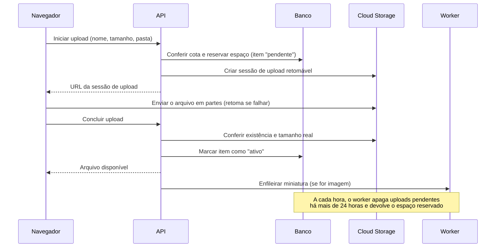
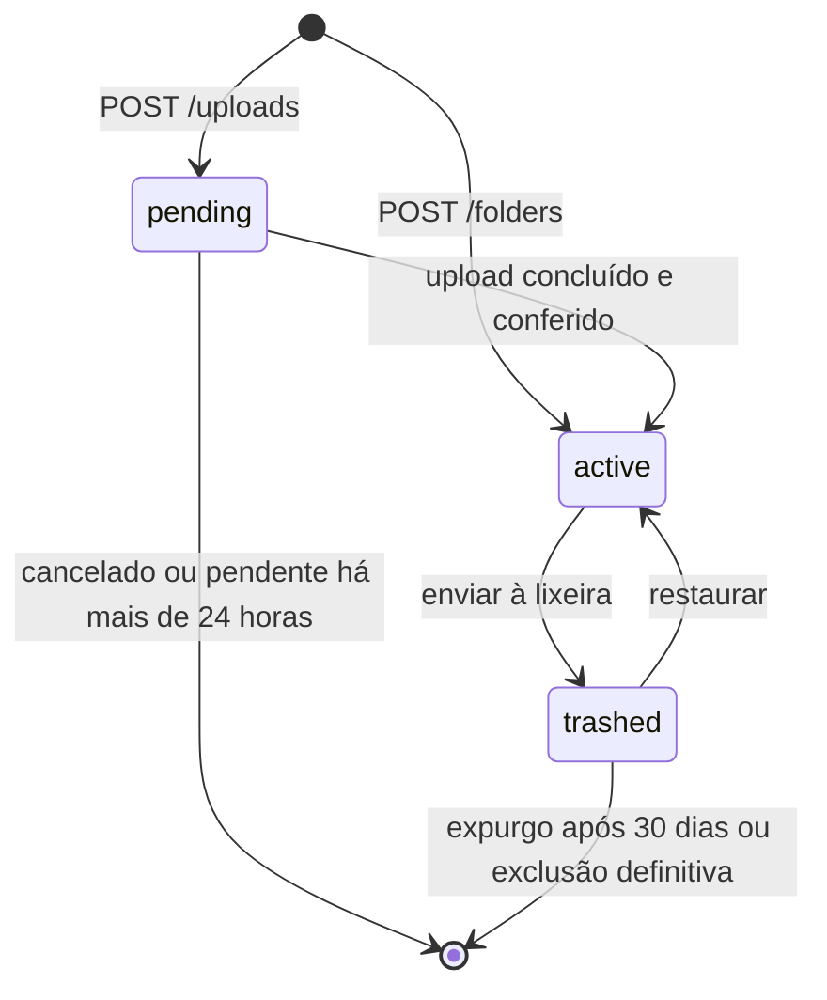

# 15 · prd-tickets-func-02

- **Início:** 09/10/2026 07:30 (horário de Brasília)
- **Fim:** 09/10/2026 07:45
- **Sessão:** `072b94b1-86dd-49c8-b4cd-470f860dd885`
- **Subagentes embutidos:** 0

---

## Usuário (meta) · 09/10 07:30:07

```text
<local-command-caveat>The command below was run directly in Claude Code, not sent to you as a request, and its output goes straight to the user. It's recorded here as context for later messages.</local-command-caveat>
```


## Usuário · 09/10 07:30:07

```text
<command-name>/clear</command-name>
            <command-message>clear</command-message>
            <command-args></command-args>
```

```text
<command-message>prd</command-message>
<command-name>/prd</command-name>
<command-args>da funcionalidade 02</command-args>
```


## Usuário (meta) · 09/10 07:30:43

Base directory for this skill: /home/argen/ti/fullcycle-events/techweekia/techweekia16-live/.claude/skills/prd

# Product Requirements Document (PRD)

## Overview

Design comprehensive, production-grade Product Requirements Documents (PRDs) that bridge the gap between business vision and technical execution. This skill works for modern software systems, ensuring that requirements are clearly defined.

## When to Use

Use this skill when:

- Starting a new product or feature development cycle
- Translating a vague idea into a concrete technical specification
- Defining requirements for AI-powered features
- Stakeholders need a unified "source of truth" for project scope
- User asks to "write a PRD", "document requirements", or "plan a feature"

---

## Operational Workflow

### Phase 1: Discovery (The Interview)

Before writing a single line of the PRD, you **MUST** interrogate the user to fill knowledge gaps. Do not assume context.

**Ask about:**

- **The Core Problem**: Why are we building this now?
- **Success Metrics**: How do we know it worked?
- **Constraints**: Budget, tech stack, or deadline?

### Phase 2: Analysis & Scoping

Synthesize the user's input. Identify dependencies and hidden complexities.

- Map out the **User Flow**.
- Define **Non-Goals** to protect the timeline.

### Phase 3: Technical Drafting

Generate the document using the **Strict PRD Schema** below.

---

## PRD Quality Standards

### Requirements Quality

Use concrete, measurable criteria. Avoid "fast", "easy", or "intuitive".

```diff
# Vague (BAD)
- The search should be fast and return relevant results.
- The UI must look modern and be easy to use.

# Concrete (GOOD)
+ The search must return results within 200ms for a 10k record dataset.
+ The search algorithm must achieve >= 85% Precision@10 in benchmark evals.
+ The UI must follow the 'Vercel/Next.js' design system and achieve 100% Lighthouse Accessibility score.
```

---

## Strict PRD Schema

You **MUST** follow this exact structure for the output:

### 1. Executive Summary

- **Problem Statement**: 1-2 sentences on the pain point.
- **Proposed Solution**: 1-2 sentences on the fix.
- **Success Criteria**: 3-5 measurable KPIs.

### 2. User Experience & Functionality

- **User Personas**: Who is this for?
- **User Stories**: `As a [user], I want to [action] so that [benefit].`
- **Acceptance Criteria**: Bulleted list of "Done" definitions for each story.
- **Non-Goals**: What are we NOT building?

### 3. AI System Requirements (If Applicable)

- **Tool Requirements**: What tools and APIs are needed?
- **Evaluation Strategy**: How to measure output quality and accuracy.

### 4. Technical Specifications

- **Architecture Overview**: Data flow and component interaction.
- **Integration Points**: APIs, DBs, and Auth.
- **Security & Privacy**: Data handling and compliance.

### 5. Risks & Roadmap

- **Phased Rollout**: MVP -> v1.1 -> v2.0.
- **Technical Risks**: Latency, cost, or dependency failures.

---

## Implementation Guidelines

### DO (Always)

- **Define Testing**: For AI systems, specify how to test and validate output quality.
- **Iterate**: Present a draft and ask for feedback on specific sections.

### DON'T (Avoid)

- **Skip Discovery**: Never write a PRD without asking at least 2 clarifying questions first.
- **Hallucinate Constraints**: If the user didn't specify a tech stack, ask or label it as `TBD`.

---

## Example: Intelligent Search System

### 1. Executive Summary

**Problem**: Users struggle to find specific documentation snippets in massive repositories.
**Solution**: An intelligent search system that provides direct answers with source citations.
**Success**:

- Reduce search time by 50%.
- Citation accuracy >= 95%.

### 2. User Stories

- **Story**: As a developer, I want to ask natural language questions so I don't have to guess keywords.
- **AC**:
  - Supports multi-turn clarification.
  - Returns code blocks with "Copy" button.

### 3. AI System Architecture

- **Tools Required**: `codesearch`, `grep`, `webfetch`.

### 4. Evaluation

- **Benchmark**: Test with 50 common developer questions.
- **Pass Rate**: 90% must match expected citations.


ARGUMENTS: da funcionalidade 02


## Assistente · 09/10 07:30:47

**Ferramenta: `Bash`**

```json
{
  "command": "ls docs && grep -n -i -E \"^#|funcionalidade|F0?2|02\" docs/product-brief.md | head -80",
  "description": "List docs and find feature 02 in the product brief"
}
```

**Ferramenta: `ToolSearch`**

```json
{
  "query": "select:mcp__linear-server__list_issues,mcp__linear-server__get_issue,mcp__linear-server__save_issue",
  "max_results": 5
}
```


## Resultado de ferramenta · 09/10 07:30:47

<details>
<summary>Resultado de <code>ToolSearch</code></summary>

```text
[ferramenta carregada: mcp__linear-server__list_issues]
[ferramenta carregada: mcp__linear-server__get_issue]
[ferramenta carregada: mcp__linear-server__save_issue]
```

</details>

<details>
<summary>Resultado de <code>Bash</code></summary>

```text
design-system.md
hld.md
lld.md
product-brief.md
1:# Product Brief — Gerenciador de Arquivos (estilo Google Drive)
3:2026-10-08 · Luiz Carlos
5:## Visão geral
13:## Problema e contexto
23:## Público-alvo
31:## Modelo de negócio e planos
42:## Objetivos e métricas de sucesso
54:## Escopo do MVP
56:O MVP é um aplicativo web responsivo, sem apps nativos nem cliente desktop, com nove funcionalidades:
68:## Fora de escopo
83:## Requisitos não funcionais e restrições
98:## Riscos, dependências e premissas
115:## Roadmap
121:    F1["<b>Fase 1 · MVP web</b><br/>Web responsivo com as nove<br/>funcionalidades do escopo,<br/>inclusive planos pagos"]
123:    F2["<b>Fase 2 · Lacunas</b><br/>Backup automático de fotos pelo celular<br/>Compartilhamento com pessoas específicas"]
125:    F1 --> G --> F2 --> F3
130:## Questões em aberto
```

</details>


## Assistente · 09/10 07:30:49

**Ferramenta: `Read`**

```json
{
  "file_path": "/home/argen/ti/fullcycle-events/techweekia/techweekia16-live/docs/product-brief.md"
}
```


## Resultado de ferramenta · 09/10 07:30:49

<details>
<summary>Resultado de <code>Read</code></summary>

````text
1	# Product Brief — Gerenciador de Arquivos (estilo Google Drive)
2	
3	2026-10-08 · Luiz Carlos
4	
5	## Visão geral
6	
7	Gerenciador de arquivos na nuvem no estilo Google Drive, para usuários finais, com 15 GB gratuitos e planos pagos de armazenamento adicional. Ele se diferencia por três promessas: privacidade, simplicidade e preço.
8	
9	- **Privacidade:** criptografia em trânsito (TLS) e em repouso, sem anúncios, sem venda de dados e sem análise do conteúdo, em conformidade com a LGPD. O servidor tecnicamente consegue ler os arquivos; a promessa é sustentada por política e auditoria de acesso. Um cofre com criptografia ponta a ponta (E2EE) opcional fica para uma fase posterior.
10	- **Simplicidade:** experiência mais enxuta que a dos concorrentes (detalhes a definir no escopo do MVP).
11	- **Preço:** planos pagos mais acessíveis que os dos concorrentes (faixas e valores a definir).
12	
13	## Problema e contexto
14	
15	Quem passa dos 15 GB gratuitos do Google ou da Apple precisa contratar um plano, em geral cobrado em dólar ou em moeda estrangeira, para continuar guardando seus arquivos. O produto aposta que existe espaço para uma alternativa mais barata, mais simples e com uma promessa clara de privacidade, voltada ao público brasileiro.
16	
17	Essa aposta se apoia em três hipóteses, ainda não validadas com usuários:
18	
19	- Esgotar o espaço gratuito é um gatilho claro para trocar de serviço ou complementar o atual.
20	- Parte desse público valoriza privacidade e simplicidade o bastante para experimentar um produto novo.
21	- Pagar em reais, com Pix, reduz o atrito de contratar um plano.
22	
23	## Público-alvo
24	
25	O produto começa no Brasil, em português, para pessoas físicas e freelancers que estouraram os 15 GB gratuitos do Google ou da Apple e acham caro pagar em dólar.
26	
27	- **Perfil principal:** pessoa física comum e freelancers, com fotos, documentos pessoais e arquivos de trabalho.
28	- **Gatilho de compra:** o espaço gratuito acabou e o plano pago do concorrente pesa no bolso, por ser cobrado em dólar ou em moeda estrangeira.
29	- **Fora do foco inicial:** colaboração em equipe, com permissões avançadas e administração de contas.
30	
31	## Modelo de negócio e planos
32	
33	O produto segue o modelo freemium: 15 GB gratuitos atraem o usuário e três planos pagos vendem espaço adicional, sempre cobrados em reais.
34	
35	- **Gratuito:** 15 GB.
36	- **Pago 1:** 100 GB.
37	- **Pago 2:** 1 TB.
38	- **Pago 3:** 2 TB.
39	
40	A cobrança é mensal ou anual, com desconto de cerca de 15% a 20% no plano anual, e o pagamento é feito por cartão ou Pix. A meta de preço é ficar de 20% a 30% abaixo do plano equivalente do Google One. Os valores finais ficam a definir, depois de cruzar o custo real do armazenamento por GB (infraestrutura e taxas de pagamento) com os preços atuais dos concorrentes.
41	
42	## Objetivos e métricas de sucesso
43	
44	O sucesso é medido 6 meses após o lançamento, com cinco métricas. As metas são hipóteses iniciais, a calibrar com dados reais.
45	
46	| Métrica | O que mede | Meta em 6 meses |
47	| --- | --- | --- |
48	| Contas criadas | Aquisição de novos usuários | A definir |
49	| Ativação | Quem faz o primeiro upload em até 24 horas após o cadastro | 60% |
50	| Retenção em 30 dias | Quem volta a usar o produto 30 dias depois do cadastro | 40% |
51	| Conversão para plano pago | Usuários gratuitos que contratam um plano | 3% a 5% |
52	| Margem por pagante | Receita do pagante menos o custo de armazenamento, incluindo o dos usuários gratuitos | Positiva |
53	
54	## Escopo do MVP
55	
56	O MVP é um aplicativo web responsivo, sem apps nativos nem cliente desktop, com nove funcionalidades:
57	
58	1. Cadastro e login com e-mail e senha.
59	2. Upload (arrastar e soltar, vários arquivos, retomada em arquivos grandes) e download.
60	3. Pastas: criar, renomear, mover e excluir.
61	4. Lixeira com restauração (por exemplo, 30 dias).
62	5. Pré-visualização de imagens, PDF, vídeo, áudio e texto.
63	6. Busca por nome de arquivo e pasta.
64	7. Compartilhamento por link, somente leitura, com expiração e senha opcionais.
65	8. Indicador de uso da cota (15 GB gratuitos).
66	9. Contratação de plano pago, com cartão e Pix.
67	
68	## Fora de escopo
69	
70	Estes itens ficam fora do MVP e são candidatos às fases seguintes:
71	
72	- Apps nativos (iOS e Android) e backup automático de fotos. Como as fotos costumam ocupar boa parte dos 15 GB, esta é uma lacuna conhecida do MVP.
73	- Cliente desktop com sincronização de pastas.
74	- Edição colaborativa de documentos, no estilo Docs e Sheets.
75	- Histórico de versões.
76	- Compartilhamento com pessoas específicas e permissões granulares.
77	- Comentários, favoritos e acesso offline.
78	- Busca por conteúdo e recursos de IA.
79	- Cofre com criptografia ponta a ponta (E2EE) opcional.
80	- Colaboração em equipe, com administração de contas.
81	- Moderação de conteúdo e tratamento de denúncias e abuso: não tratados neste brief.
82	
83	## Requisitos não funcionais e restrições
84	
85	Estes requisitos sustentam as três promessas do produto e limitam o custo dos usuários gratuitos.
86	
87	| Área | Requisito |
88	| --- | --- |
89	| Privacidade | TLS em trânsito e criptografia em repouso. Sem anúncios, sem venda de dados e sem análise do conteúdo, com auditoria de acesso interno e conformidade com a LGPD. |
90	| Localização dos dados | Região no Brasil. |
91	| Armazenamento | Google Cloud Storage. O upload vai direto do navegador por URLs assinadas, sem passar pelo servidor da aplicação. |
92	| Metadados | Banco relacional gerenciado (PostgreSQL) para usuários, pastas e arquivos. |
93	| Controle de custo | Cota aplicada no servidor, que bloqueia upload acima do limite do plano, e limite de tamanho por arquivo (valor a definir). |
94	| Pagamentos | Gateway com cartão recorrente e Pix. |
95	| Plataforma | Aplicação web responsiva, sem apps nativos. |
96	| Prazo, equipe e orçamento | A definir. |
97	
98	## Riscos, dependências e premissas
99	
100	O maior risco é financeiro: os 15 GB gratuitos têm custo real desde o primeiro usuário, e só a conversão para planos pagos os sustenta.
101	
102	| Risco | Mitigação |
103	| --- | --- |
104	| Custo dos usuários gratuitos acima da receita dos pagantes | Cota aplicada no servidor, limite de tamanho por arquivo e acompanhamento da margem por pagante. |
105	| Concorrência de Google, Apple e Dropbox, que já têm a base de usuários | Foco no público brasileiro, com preço em reais, Pix e uma promessa clara de privacidade. |
106	| MVP sem backup de fotos, o que mais enche a cota | Backup automático de fotos como prioridade da fase 2, e a lacuna declarada no brief. |
107	| Privacidade sustentada por política, e não por criptografia ponta a ponta | Auditoria de acesso interno e cofre E2EE opcional na fase 3. |
108	| Perda de arquivos num produto novo que guarda dados pessoais | Armazenamento com replicação e backups, e comunicação transparente sobre incidentes. |
109	| Prazo, equipe e orçamento ainda indefinidos | Fechar esses três pontos antes de comprometer datas do MVP. |
110	
111	**Dependências:** o Google Cloud Storage, na região de São Paulo, e um gateway de pagamento com cartão recorrente e Pix.
112	
113	**Premissas:** as três hipóteses da seção de problema e contexto, que ainda precisam ser validadas com usuários.
114	
115	## Roadmap
116	
117	O roadmap tem três fases e um gate: a fase 2 só começa quando o MVP atinge as metas de ativação, retenção e conversão. Ele não tem datas, porque o prazo do projeto ainda está a definir.
118	
119	```mermaid
120	flowchart LR
121	    F1["<b>Fase 1 · MVP web</b><br/>Web responsivo com as nove<br/>funcionalidades do escopo,<br/>inclusive planos pagos"]
122	    G{{"<b>Gate</b><br/>Ativação de 60%, retenção em 30 dias<br/>de 40% e conversão de pelo menos 3%"}}
123	    F2["<b>Fase 2 · Lacunas</b><br/>Backup automático de fotos pelo celular<br/>Compartilhamento com pessoas específicas"]
124	    F3["<b>Fase 3 · Diferenciais</b><br/>Cofre E2EE opcional, histórico de versões<br/>e cliente desktop com sincronização de pastas"]
125	    F1 --> G --> F2 --> F3
126	```
127	
128	O critério de passagem da fase 2 para a fase 3 ainda não foi definido.
129	
130	## Questões em aberto
131	
132	Estes pontos precisam de definição antes de o MVP ser planejado em detalhe.
133	
134	- [ ] Prazo de lançamento, tamanho e perfil da equipe, e orçamento mensal de infraestrutura.
135	- [ ] Meta de contas criadas em 6 meses.
136	- [ ] Preços finais dos planos: pesquisar os valores atuais de Google One, iCloud e Dropbox no Brasil e calcular o custo real por GB.
137	- [ ] Limite de tamanho por arquivo e prazo de retenção da lixeira (30 dias é apenas um exemplo).
138	- [ ] O que torna a experiência mais simples que a dos concorrentes, na prática.
139	- [ ] Escolha do gateway de pagamento.
140	
````

</details>


## Assistente · 09/10 07:30:50

**Ferramenta: `mcp__linear-server__list_issues`**

```json
{
  "project": "gerenciador de arquivos",
  "fields": [
    "id",
    "title",
    "status",
    "parentId",
    "labels"
  ],
  "limit": 100
}
```

**Ferramenta: `Bash`**

```json
{
  "command": "grep -n -E \"^#{1,3} \" docs/lld.md docs/hld.md; ls; ls apps/*/src 2>/dev/null | head -60",
  "description": "Outline the design docs and list app source folders"
}
```


## Resultado de ferramenta · 09/10 07:30:52

<details>
<summary>Resultado de <code>mcp__linear-server__list_issues</code></summary>

```text
{"issues":[{"id":"LUI-141","title":"Limite de tentativas e IP real","status":"Done","parentId":"LUI-133","labels":["ready-for-agent","Feature"]},{"id":"LUI-140","title":"Recuperação de senha","status":"Done","parentId":"LUI-133","labels":["ready-for-agent","Feature"]},{"id":"LUI-139","title":"Sessão que se renova","status":"Done","parentId":"LUI-133","labels":["ready-for-agent","Feature"]},{"id":"LUI-138","title":"Entrar e sair","status":"Done","parentId":"LUI-133","labels":["ready-for-agent","Feature"]},{"id":"LUI-137","title":"Cadastro e verificação de e-mail","status":"Done","parentId":"LUI-133","labels":["ready-for-agent","Feature"]},{"id":"LUI-136","title":"Base da web: componentes de autenticação e testes no navegador","status":"Done","parentId":"LUI-133","labels":["ready-for-agent","Feature"]},{"id":"LUI-135","title":"Fundação: ambiente, banco, e-mail e formato de erro","status":"Done","parentId":"LUI-133","labels":["ready-for-agent","Feature"]},{"id":"LUI-134","title":"Telas de autenticação no Figma","status":"Done","parentId":"LUI-133","labels":["ready-for-agent","Feature"]},{"id":"LUI-133","title":"Funcionalidade 01: cadastro e login com e-mail e senha","status":"Backlog","parentId":null,"labels":["ready-for-agent","Feature"]}],"hasNextPage":false}
```

</details>

<details>
<summary>Resultado de <code>Bash</code></summary>

```text
docs/lld.md:1:# LLD — Gerenciador de Arquivos (estilo Google Drive)
docs/lld.md:7:## 1. Estrutura do código
docs/lld.md:70:## 2. Esquema do banco
docs/lld.md:89:### users
docs/lld.md:106:### refresh_tokens
docs/lld.md:119:### email_tokens
docs/lld.md:132:### items
docs/lld.md:158:### share_links
docs/lld.md:172:### plans
docs/lld.md:182:### subscriptions
docs/lld.md:199:### payment_events
docs/lld.md:210:### rate_limits
docs/lld.md:222:## 3. Contrato da API
docs/lld.md:224:### 3.1 Convenções
docs/lld.md:288:### 3.2 Autenticação e conta
docs/lld.md:306:### 3.3 Itens, lixeira e busca
docs/lld.md:323:### 3.4 Upload e download
docs/lld.md:334:### 3.5 Compartilhamento
docs/lld.md:347:### 3.6 Cobrança
docs/lld.md:357:## 4. Estados e regras
docs/lld.md:359:### 4.1 Item
docs/lld.md:378:### 4.2 Cota
docs/lld.md:405:### 4.3 Assinatura
docs/lld.md:425:### 4.4 Permissão
docs/lld.md:432:### 4.5 Tokens
docs/lld.md:448:### 4.6 Upload em chunks
docs/lld.md:495:### 4.7 Cadastro, verificação e senha
docs/lld.md:549:## 5. Tarefas do worker
docs/lld.md:568:## 6. Configuração e segurança
docs/lld.md:634:## Questões em aberto
docs/hld.md:1:# HLD — Gerenciador de Arquivos (estilo Google Drive)
docs/hld.md:5:## 1. Contexto e objetivos
docs/hld.md:26:## 2. Requisitos que moldam a arquitetura
docs/hld.md:49:## 3. Arquitetura
docs/hld.md:105:## 4. Fluxos principais
docs/hld.md:107:### 4.1 Autenticação
docs/hld.md:119:### 4.2 Upload com reserva de cota
docs/hld.md:146:### 4.3 Download e pré-visualização
docs/hld.md:154:### 4.4 Compartilhamento por link
docs/hld.md:163:### 4.5 Lixeira
docs/hld.md:170:### 4.6 Assinatura e pagamento
docs/hld.md:180:## 5. Dados e integrações
docs/hld.md:209:## 6. Ambientes e desenvolvimento
docs/hld.md:220:### 6.1 Ambiente local
docs/hld.md:254:### 6.2 Staging, produção e entrega
docs/hld.md:273:## 7. Decisões, riscos e questões em aberto
AGENTS.md
GLOSSARY.md
apps
compose.dev.yaml
docs
skills-lock.json
app.module.ts
app.setup.ts
common
config
generated
infra
main.ts
modules
```

</details>


## Assistente · 09/10 07:30:56

**Ferramenta: `Bash`**

```json
{
  "command": "sed -n 119,146p docs/hld.md && sed -n 132,157p docs/lld.md && sed -n 306,334p docs/lld.md && sed -n 357,404p docs/lld.md && sed -n 448,494p docs/lld.md && sed -n 549,566p docs/lld.md && sed -n 634,680p docs/lld.md && sed -n 273,320p docs/hld.md; ls apps/api/src/modules apps/api/src/infra apps/web/src 2>/dev/null; grep -n -i -E \"gcs|storage|fake-gcs|minio\" compose.dev.yaml apps/api/.env.example",
  "description": "Read upload, quota and item sections of the design docs"
}
```

**Ferramenta: `mcp__linear-server__get_issue`**

```json
{
  "id": "LUI-133"
}
```


## Resultado de ferramenta · 09/10 07:30:56

<details>
<summary>Resultado de <code>Bash</code></summary>

````text
### 4.2 Upload com reserva de cota



- **Reserva antes do envio:** o tamanho declarado é somado ao uso do usuário na mesma transação que cria o item. Uploads simultâneos não conseguem passar juntos do limite.
- **Conferência na conclusão:** se o tamanho real for diferente do declarado, o upload é rejeitado e o objeto é apagado.
- **Chave do objeto:** um identificador aleatório, independente do nome e da pasta. Renomear e mover alteram só o banco.

### 4.3 Download e pré-visualização
### items

| Coluna | Tipo | Observação |
| --- | --- | --- |
| `id` | `UUID` | Chave primária |
| `owner_id` | `UUID` | Referência a `users`, com exclusão em cascata |
| `parent_id` | `UUID` | Referência a `items`. Nulo só na pasta raiz. |
| `type` | `TEXT` | `file` ou `folder` |
| `name` | `VARCHAR(255)` | Sem `/` nem caracteres de controle. Nomes duplicados são permitidos. |
| `status` | `TEXT` | `pending`, `active` ou `trashed` |
| `size_bytes` | `BIGINT` | 0 para pastas |
| `mime_type` | `TEXT` | Nulo para pastas |
| `object_key` | `TEXT` | Chave aleatória no bucket. Nulo para pastas. Único. |
| `upload_session_uri` | `TEXT` | Sessão retomável do Cloud Storage, enquanto `pending` |
| `thumbnail_key` | `TEXT` | Nulo se não houver miniatura |
| `trashed_at` | `TIMESTAMPTZ` | Preenchido ao enviar para a lixeira |
| `created_at`, `updated_at` | `TIMESTAMPTZ` | |

**Índices de `items`**

- `(parent_id)` filtrado por `status = 'active'`, para listar uma pasta.
- `(owner_id, status, trashed_at)`, para a lixeira e o expurgo.
- `(status, created_at)` filtrado por `status = 'pending'`, para a limpeza de uploads.
- Trigramas (`pg_trgm`, GIN) em `name`, para a busca.
- Único em `(owner_id)` filtrado por `parent_id IS NULL`, para garantir uma raiz por usuário.

### 3.3 Itens, lixeira e busca

| Método e rota | Entrada | Saída |
| --- | --- | --- |
| `GET /items/{id}` | | O item e a trilha de pastas até a raiz |
| `GET /items/{id}/children` | `limit`, `cursor` | Lista de itens ativos da pasta |
| `POST /folders` | `name`, `parentId` | 201, a pasta criada |
| `PATCH /items/{id}` | `name` e/ou `parentId` | O item atualizado |
| `DELETE /items/{id}` | | 204. Envia para a lixeira. |
| `GET /trash` | `limit`, `cursor` | Itens enviados diretamente à lixeira |
| `POST /items/{id}/restore` | | O item restaurado |
| `DELETE /trash/{id}` | | 202. Exclusão definitiva, em segundo plano. |
| `DELETE /trash` | | 202. Esvazia a lixeira, em segundo plano. |
| `GET /search` | `q` (mínimo de 2 caracteres), `limit`, `cursor` | Itens ativos cujo nome contém `q` |

O id `root` é aceito como atalho para a pasta raiz do usuário.

### 3.4 Upload e download

| Método e rota | Entrada | Saída |
| --- | --- | --- |
| `POST /uploads` | `name`, `sizeBytes`, `mimeType`, `parentId` | 201: `itemId`, `uploadUrl`, `expiresAt` |
| `GET /uploads/{itemId}` | | `itemId`, `uploadUrl`, `expiresAt`, para retomar um upload `pending` |
| `POST /uploads/{itemId}/complete` | | O item, já `active` |
| `DELETE /uploads/{itemId}` | | 204. Cancela e devolve o espaço. |
| `GET /items/{id}/download-url` | `disposition` (`attachment` ou `inline`) | `url`, `expiresAt` |
| `GET /items/{id}/thumbnail-url` | | `url`, `expiresAt`, ou 404 se não houver miniatura |

### 3.5 Compartilhamento
## 4. Estados e regras

### 4.1 Item



- **Enviar uma pasta à lixeira** marca só a pasta. Os descendentes continuam `active`, mas ficam inacessíveis.
- **Consequência para busca e links públicos:** como os descendentes não são marcados, essas consultas precisam conferir se algum ancestral está na lixeira. A conferência é feita com uma consulta recursiva sobre a página de resultados (até 200 itens, até 50 níveis).
- **Restaurar** devolve o item à pasta de origem. Se ela não existir mais ou estiver na lixeira, o item volta para a raiz.
- **Expurgo de uma pasta** remove todos os descendentes, de baixo para cima.
- **Mover:** a API sobe pelos ancestrais do destino e rejeita o pedido se encontrar o próprio item (`invalid_move`) ou se a profundidade passar de 50 níveis.

### 4.2 Cota

A reserva é um único comando, sem bloqueio explícito:

```sql
UPDATE users u
SET used_bytes = u.used_bytes + $size
FROM plans p
WHERE u.id = $user_id
  AND p.id = u.plan_id
  AND u.used_bytes + $size <= p.storage_bytes;
```

Se nenhuma linha for afetada, a API responde `quota_exceeded`. A reserva e a criação do item `pending` ocorrem na mesma transação.

| Evento | Efeito em `used_bytes` |
| --- | --- |
| Iniciar upload | Soma o tamanho declarado |
| Cancelar upload ou limpeza de pendente | Subtrai |
| Tamanho real diferente do declarado | Subtrai, e o objeto é apagado |
| Enviar à lixeira ou restaurar | Nenhum |
| Expurgo ou exclusão definitiva | Subtrai, depois de o objeto ser apagado do storage |

Pastas e miniaturas não contam para a cota. Uma rotina diária recalcula `used_bytes` pela soma dos itens e registra as divergências.

**Conta somente leitura:** é um estado calculado (`used_bytes > storage_bytes`), não gravado. Ele bloqueia apenas o upload. Baixar, excluir, criar pastas e restaurar da lixeira continuam funcionando.

### 4.6 Upload em chunks

O navegador envia cada arquivo em chunks sequenciais para a sessão de upload retomável do Cloud Storage. A API só participa no início e na conclusão.

| Parâmetro | Valor |
| --- | --- |
| Tamanho do chunk | 8 MiB (o Cloud Storage exige múltiplos de 256 KiB, exceto no último chunk) |
| Arquivos menores que 8 MiB | Enviados num único `PUT` |
| Chunks de um mesmo arquivo | Em sequência, um por vez |
| Arquivos simultâneos | Até 3 |
| Tentativas por chunk | 5, com espera crescente de 1 a 30 segundos |

**Envio**

1. O navegador chama `POST /uploads` e recebe `itemId` e `uploadUrl`.
2. Para cada chunk, o navegador faz um `PUT` em `uploadUrl` com o cabeçalho `Content-Range: bytes <início>-<fim>/<total>`.
3. O storage responde `308` enquanto faltam bytes, com o cabeçalho `Range` indicando o que já foi recebido. O navegador calcula o próximo chunk a partir desse valor, e não do que ele acha que enviou.
4. No último chunk, o storage responde `200` ou `201`. O navegador chama `POST /uploads/{itemId}/complete`.

**Retomada**

1. Depois de uma falha de rede, o navegador faz um `PUT` vazio com `Content-Range: bytes */<total>`.
2. O storage responde `308` com o cabeçalho `Range`. Sem esse cabeçalho, nenhum byte foi recebido.
3. O navegador continua a partir do byte seguinte.

**Depois de fechar a aba**

- O navegador guarda no `localStorage` só o `itemId` e uma impressão do arquivo (nome, tamanho e data de modificação). A `uploadUrl` não é guardada, porque quem a tem consegue gravar na sessão.
- Ao voltar, a interface lista os uploads incompletos e pede que o usuário selecione o arquivo de novo, já que o navegador não mantém acesso ao arquivo local.
- Se a impressão bater, o navegador chama `GET /uploads/{itemId}` para obter a `uploadUrl` e retoma pelo passo de retomada.

**Erros**

| Situação | Tratamento |
| --- | --- |
| `5xx` ou falha de rede | Consultar o progresso e repetir o chunk, até 5 vezes |
| `404` ou `410` na sessão | A sessão expirou. O navegador chama `DELETE /uploads/{itemId}` e recomeça do zero. |
| `upload_size_mismatch` na conclusão | A API apaga o objeto e devolve o espaço. O navegador mostra o erro. |
| Usuário cancela | O navegador chama `DELETE /uploads/{itemId}` |

**Pontos de implementação a validar**

- **Origem na criação da sessão:** a API precisa informar a origem do frontend ao criar a sessão retomável, para que o navegador possa usá-la.
- **CORS do bucket:** a configuração precisa expor o cabeçalho `Range` na resposta, para o navegador conseguir lê-lo.

Esses dois pontos vêm do meu conhecimento da API do Cloud Storage e não foram testados neste projeto. Vale confirmá-los na documentação atual antes de implementar.

## 5. Tarefas do worker

O worker é a mesma imagem da API, publicada como um serviço separado do Cloud Run. Ele expõe endpoints HTTP internos, que só aceitam chamadas autenticadas (OIDC) do Cloud Tasks e do Cloud Scheduler. Todas as tarefas são idempotentes.

| Tarefa | Disparo | Em caso de falha |
| --- | --- | --- |
| Gerar miniatura de imagem | Cloud Tasks, na conclusão do upload | 3 tentativas. Depois disso, o arquivo fica sem miniatura. |
| Limpar uploads `pending` há mais de 24 horas | Cloud Scheduler, a cada hora | Tenta de novo na próxima execução |
| Expurgar itens há mais de 30 dias na lixeira | Cloud Scheduler, diário | Tenta de novo na próxima execução |
| Apagar objetos no Cloud Storage | Cloud Tasks, uma tarefa por lote | Novas tentativas com espera crescente |
| Gerar cobrança Pix | Cloud Scheduler, diário, 5 dias antes do vencimento | Nova tentativa e alerta |
| Expirar assinaturas `past_due` há mais de 7 dias e `canceled` com período encerrado | Cloud Scheduler, diário | Tenta de novo na próxima execução |
| Reconciliar `used_bytes` | Cloud Scheduler, diário | Só registra a divergência |
| Limpar tokens, links e contadores expirados | Cloud Scheduler, diário | Tenta de novo na próxima execução |

**Ordem do expurgo:** primeiro o objeto e a miniatura são apagados do Cloud Storage, e só depois a linha sai do banco e o espaço volta à cota. Na ordem inversa, uma falha no meio deixaria objetos órfãos, gerando custo sem registro.

**Miniaturas:** são geradas só para imagens de até 50 MB, com 320 px no lado maior, em WebP, e gravadas no mesmo bucket sob o prefixo `thumbnails/`.
## Questões em aberto

- [ ] Exclusão de conta pelo próprio usuário: está fora do MVP, mas a LGPD dá ao titular o direito de pedir a eliminação dos dados. Sem a função, o pedido é atendido manualmente.
- [ ] Texto dos Termos e da Política de Privacidade: depende de validação jurídica. Até lá, os links do cadastro apontam para páginas provisórias.
- [ ] Troca de e-mail pelo próprio usuário e lista de Sessões ativas: fora do MVP.
- [ ] Limpeza de usuários nunca verificados: sem rotina por enquanto. Eles não bloqueiam o cadastro do dono do e-mail.
- [ ] Captcha no cadastro e checagem da senha contra listas de senhas vazadas: fora do MVP.
- [ ] Download de pasta inteira em ZIP: fica fora do MVP, e o usuário baixa arquivo por arquivo.
- [ ] Operações em lote (mover ou excluir vários itens): o frontend faz uma chamada por item.
- [ ] Direito de arrependimento de 7 dias em compras online: precisa de validação jurídica e pode exigir reembolso.
- [ ] URL do link compartilhado visível só na criação: confirmar se esse comportamento é aceitável, ou guardar o token de forma recuperável.
- [ ] Preços dos planos, gateway de pagamento e serviço de e-mail, que continuam em aberto no brief e no HLD.
## 7. Decisões, riscos e questões em aberto

**Decisões e alternativas descartadas**

| Decisão | Alternativa descartada | Motivo |
| --- | --- | --- |
| Monólito modular | Microsserviços | Para 100 mil contas, microsserviços só somam custo operacional. |
| Backend separado do frontend | Full-stack único em Next.js | Os apps nativos da fase 2 vão consumir a mesma API. |
| Upload direto ao storage, com reserva de cota | Upload passando pela API | A API teria de carregar arquivos de até 5 GB, o que encarece e limita a escala. |
| Lista de adjacência | Caminho materializado | Mover uma pasta obrigaria a reescrever todos os descendentes. |
| Lixeira conta para a cota | Lixeira fora da cota | Deixaria 30 dias de armazenamento sem cobertura de receita. |
| Bucket privado com URLs assinadas curtas | Objetos públicos para links | Sustenta a promessa de privacidade e permite revogar e auditar. |
| Sem conversão de arquivos no servidor | Pré-visualização de Office | Exigiria processar o conteúdo, com custo alto e atrito com a promessa de privacidade. |
| Só e-mail e senha | Login com Google | Decisão de produto; o brief foi ajustado. |
| JWT de 15 minutos + renovação com hash no banco | JWT longo, totalmente stateless | Permite cortar o acesso ao sair ou trocar a senha. |
| Checkout hospedado e webhook como fonte da verdade | Formulário de cartão próprio | Evita as exigências de PCI e a liberação de cota por retorno forjado. |
| Google Cloud, uma região em São Paulo | Fornecedores combinados ou servidores próprios | Dados no Brasil sob um único contrato e operação gerenciada. |
| Desenvolvimento todo local, com emuladores | Projeto de desenvolvimento no Google Cloud | Sem credencial nem custo por desenvolvedor, e cada pessoa tem dados isolados. |
| Aplicação dentro do Docker Compose | Aplicação direto na máquina ou Dev Container | Mesmo ambiente para todos, sem depender do editor. |
| Driver local no lugar do Cloud Tasks | Emulador do Cloud Tasks | Os emuladores são projetos da comunidade, sem suporte do Google. |
| Webhooks de pagamento simulados | Túnel público para o sandbox do gateway | Funciona sem internet e cobre os casos de falha. O túnel fica para quando o gateway for escolhido. |

**Riscos**

| Risco | Mitigação |
| --- | --- |
| Custo de tráfego de saída (download) maior que o de armazenamento | Medir o custo por GB baixado antes do lançamento e avaliar limites de tráfego por link. |
| Armazenamento sem receita de contas rebaixadas acima da cota | Definir um prazo máximo de retenção, com avisos. |
| Espaço preso por uploads abandonados | Limpeza de pendentes a cada hora, com limite de 24 horas. |
| Segurança da autenticação sob responsabilidade própria | Usar bibliotecas consolidadas do NestJS e limitar tentativas de login. |
| Miniaturas leem o conteúdo de imagens | Descrever esse processamento na política de privacidade. |
| Dimensionamento baseado em hipóteses de usuários | Rever os valores quando a meta de contas for definida. |
| Emulador de storage divergente do Cloud Storage esconde bugs de upload | Testes de ponta a ponta do upload no staging, contra o serviço real. |

**Questões em aberto**

- [ ] Escolha do gateway de pagamento e do serviço de e-mail transacional.
- [ ] Custo real por GB armazenado e por GB baixado no Google Cloud, cruzado com os preços dos planos.
- [ ] Prazo máximo de retenção dos arquivos de contas rebaixadas acima da cota.
- [ ] Confirmação do limite de 5 GB por arquivo e dos 30 dias de lixeira, que o brief deixou em aberto.
- [ ] Alta disponibilidade do Cloud SQL (réplica em outra zona): custo contra a meta de 99,5%.
- [ ] Observabilidade: logs, métricas e alertas ainda não foram desenhados.
- [ ] Compatibilidade do `fake-gcs-server` com sessão de upload retomável e URLs assinadas.
- [ ] Escolha entre Terraform e OpenTofu para a infraestrutura como código.
- [ ] Forma da `DATABASE_URL` no staging e na produção. A validação da API hoje recusa a URL por socket do Cloud SQL, que tem o host vazio e o caminho do socket no parâmetro `host`. Falta decidir se a API conecta por socket ou por TCP; se for por socket, a validação passa a aceitar essa forma.
- [ ] Formato das chaves do JWT nos segredos. A validação só aceita o PEM com quebras de linha reais. Falta decidir se o meio que entrega o segredo as preserva, ou se a API passa a aceitar a chave numa linha só, com `\n` escapado.
- [ ] Migrações do banco no staging e na produção. Falta decidir quem as executa (um passo da esteira antes da publicação, ou uma tarefa do Cloud Run), com qual imagem (a da aplicação, acrescida da ferramenta de migração, ou uma imagem própria), com qual credencial de banco e em que ordem em relação à troca de versão da aplicação, já que a mesma imagem é promovida do staging para a produção.
- [ ] Prazo, equipe e orçamento, que continuam indefinidos no brief.
apps/api/src/infra:
database
mail

apps/api/src/modules:
auth
users
````

</details>

<details>
<summary>Resultado de <code>mcp__linear-server__get_issue</code></summary>

```text
{"id":"LUI-133","uuid":"86d40f7e-6b33-47b7-9431-bda34a76ddf2","title":"Funcionalidade 01: cadastro e login com e-mail e senha","description":"## Problem Statement\n\nQuem chega ao gerenciador de arquivos não tem como se identificar. Sem isso, nada do que o produto promete existe: não há a quem pertencer um arquivo, não há cota para medir e não há plano para contratar. Hoje o repositório tem só o esqueleto da web e da API, sem banco, sem e-mail e sem nenhuma rota de negócio.\n\nA pessoa precisa criar o próprio acesso com e-mail e senha, provar que o e-mail é dela, entrar, continuar dentro sem digitar a senha a cada 15 minutos, sair quando quiser e recuperar o acesso se esquecer a senha. E precisa fazer isso num produto cuja primeira promessa é privacidade: o cadastro e a recuperação de senha não podem revelar a terceiros quem usa o serviço.\n\n## Solution\n\nO visitante cria um Usuário informando e-mail e senha. Ele recebe um e-mail com um link de verificação e, depois de clicar, entra com as credenciais. A partir daí tem uma Sessão naquele navegador, que dura até 30 dias e se renova sozinha enquanto ele usa o produto. Ele pode sair, o que encerra só aquela Sessão.\n\nSe esquecer a senha, pede um link por e-mail, define uma senha nova e entra de novo. A redefinição encerra todas as Sessões e avisa o dono por e-mail que a senha mudou.\n\nEm nenhum desses fluxos o produto diz a quem pergunta se um e-mail tem ou não Usuário: o cadastro, o reenvio de verificação e o \"esqueci a senha\" respondem sempre da mesma forma, e o que muda é o e-mail que chega à caixa do dono.\n\nDepois de entrar, o Usuário cai numa página provisória com o e-mail dele e o botão \"Sair\". Ela será substituída pela listagem de arquivos quando essa funcionalidade existir.\n\n## User Stories\n\n**Cadastro**\n\n 1. Como visitante, quero criar um Usuário com e-mail e senha, para começar a guardar meus arquivos.\n 2. Como visitante, quero digitar a senha uma vez só e poder exibi-la, para conferir o que digitei sem preencher um campo de confirmação.\n 3. Como visitante, quero saber as regras da senha antes de enviar o formulário, para não ser recusado por tentativa e erro.\n 4. Como visitante, quero usar uma senha longa, de até 128 caracteres e sem exigência de símbolos, para poder usar uma frase ou um gerenciador de senhas.\n 5. Como visitante, quero ver os erros de preenchimento ao lado do campo errado, para corrigir sem procurar.\n 6. Como visitante, quero ver os links dos Termos e da Política de Privacidade na tela de cadastro, para saber com o que estou concordando.\n 7. Como visitante, quero que meu e-mail seja aceito com letras maiúsculas ou espaços nas pontas, para não ser barrado por um detalhe de digitação.\n 8. Como visitante, quero uma tela que me diga para conferir meu e-mail depois do cadastro, para saber qual é o próximo passo.\n 9. Como dono de um e-mail, quero que ninguém descubra pelo cadastro se eu uso o serviço, para manter minha privacidade.\n10. Como Usuário já verificado, quero receber um e-mail de aviso quando alguém tentar se cadastrar com meu e-mail, para saber que já tenho acesso e como entrar ou redefinir a senha.\n11. Como dono de um e-mail, quero que meu cadastro valha mesmo que um estranho tenha cadastrado meu e-mail antes sem verificar, para que a senha válida seja a minha.\n12. Como responsável pelo produto, quero registrar quando cada Usuário aceitou os termos, para ter a evidência que a LGPD pede.\n\n**Verificação de e-mail**\n\n13. Como visitante, quero receber um e-mail com um link de verificação, para provar que o e-mail é meu.\n14. Como visitante, quero que clicar no link me leve ao login com um aviso de sucesso, para saber que posso entrar.\n15. Como visitante, quero pedir o reenvio do e-mail de verificação, para não ficar preso se o link expirar ou a mensagem se perder.\n16. Como visitante, quero uma mensagem clara quando o link for inválido, expirado ou já usado, com um caminho para pedir outro, para saber como seguir.\n17. Como dono de um e-mail, quero que só o link mais recente funcione, para que links antigos esquecidos na caixa não sirvam a ninguém.\n18. Como dono de um e-mail, quero que a verificação não abra uma Sessão sozinha, para que um link vazado não dê acesso aos meus arquivos.\n19. Como dono de um e-mail, quero que ninguém descubra pelo reenvio se meu e-mail tem Usuário, para manter minha privacidade.\n\n**Login**\n\n20. Como Usuário, quero entrar com e-mail e senha, para acessar meus arquivos.\n21. Como Usuário, quero a mesma mensagem de erro para e-mail inexistente e senha errada, para que ninguém descubra quais e-mails têm Usuário.\n22. Como Usuário ainda não verificado, quero ser avisado de que preciso verificar o e-mail e poder pedir o reenvio ali mesmo, para resolver sem sair da tela.\n23. Como Usuário, quero que as tentativas de login no meu e-mail sejam limitadas, para dificultar que adivinhem minha senha.\n24. Como Usuário, quero saber quando estou bloqueado por excesso de tentativas, para entender por que a senha certa não funciona.\n25. Como Usuário, quero voltar à página que tentei abrir antes de entrar, para não perder o caminho.\n26. Como Usuário já com Sessão, quero ser levado direto ao produto ao abrir a tela de login, para não entrar duas vezes.\n27. Como Usuário, quero ver meu e-mail na tela depois de entrar, para confirmar em qual Usuário estou.\n\n**Sessão**\n\n28. Como Usuário, quero continuar dentro enquanto uso o produto, para não digitar a senha a cada 15 minutos.\n29. Como Usuário, quero que a Sessão dure até 30 dias no mesmo navegador, para não entrar de novo toda vez que volto.\n30. Como Usuário, quero usar o produto em várias abas ao mesmo tempo sem ser derrubado, para trabalhar do meu jeito.\n31. Como Usuário, quero ter Sessões em mais de um navegador ao mesmo tempo, para usar o produto no computador e no celular.\n32. Como Usuário, quero que meus tokens fiquem fora do alcance do JavaScript da página, para que um script malicioso não roube minha Sessão.\n33. Como Usuário, quero que todas as minhas Sessões sejam encerradas se um token de renovação antigo for reutilizado, para me proteger de um possível roubo.\n34. Como Usuário, quero ser levado ao login com o aviso \"Sua sessão expirou\" quando a Sessão acabar, para entender o que aconteceu.\n35. Como visitante sem Sessão, quero ser levado ao login ao abrir uma página protegida, para não ver uma tela quebrada.\n\n**Logout**\n\n36. Como Usuário, quero sair, para encerrar a Sessão num computador compartilhado.\n37. Como Usuário, quero que sair num navegador não me derrube nos outros, para continuar usando onde estou.\n38. Como Usuário, quero que sair funcione mesmo com a Sessão já expirada, para nunca ficar preso numa tela.\n\n**Recuperação de senha**\n\n39. Como Usuário, quero pedir um link de redefinição pelo meu e-mail, para recuperar o acesso quando esquecer a senha.\n40. Como dono de um e-mail, quero que ninguém descubra pelo \"esqueci a senha\" se meu e-mail tem Usuário, nem pela resposta nem pelo tempo que ela leva, para manter minha privacidade.\n41. Como Usuário, quero definir uma senha nova a partir do link, para voltar a entrar.\n42. Como Usuário, quero que o link de redefinição valha por pouco tempo e uma vez só, para que ele não sirva a mais ninguém depois.\n43. Como Usuário, quero que redefinir a senha encerre todas as minhas Sessões, para expulsar quem possa estar usando a senha antiga.\n44. Como Usuário, quero receber um e-mail quando minha senha for alterada, para perceber se não fui eu.\n45. Como Usuário que nunca verificou o e-mail, quero conseguir redefinir a senha e sair verificado, para não ficar num beco se perdi o e-mail de verificação e a senha.\n46. Como Usuário, quero ser levado ao login depois de redefinir a senha, para entrar com a senha nova.\n47. Como Usuário, quero uma mensagem clara quando o link de redefinição for inválido ou expirado, com um caminho para pedir outro.\n\n**Interface**\n\n48. Como visitante, quero telas de autenticação simples, com um cartão centrado, para não me perder.\n49. Como visitante, quero usar as telas de autenticação pelo celular, para criar meu Usuário de onde estiver.\n50. Como visitante, quero todas as mensagens em português, para entender o que deu errado.\n51. Como visitante, quero ir do login ao cadastro e ao \"esqueci a senha\" por links na própria tela, para trocar de fluxo sem voltar.\n\n**Operação e desenvolvimento**\n\n52. Como desenvolvedor, quero subir o ambiente inteiro com o Docker Compose, com banco, migrações e e-mail funcionando sem passo manual, para começar a trabalhar na hora.\n53. Como desenvolvedor, quero ver os e-mails enviados numa tela local, para testar os fluxos sem um provedor real.\n54. Como desenvolvedor, quero um arquivo de exemplo de variáveis de ambiente que já funcione localmente, para não descobrir a configuração por tentativa e erro.\n55. Como desenvolvedor, quero que todo erro da API tenha um código estável, para a web traduzi-lo sem depender do texto.\n56. Como desenvolvedor dos apps nativos da fase 2, quero uma API de autenticação que não dependa da web, para reutilizá-la.\n57. Como operador, quero que o limite por IP use o IP real da pessoa, e não o do servidor da web, para um abusador não bloquear todos os outros.\n58. Como operador, quero que as falhas de envio de e-mail fiquem em log, para investigar quando alguém reclamar que não recebeu.\n59. Como operador, quero trocar o provedor de e-mail sem alterar as regras de negócio, para não ficar preso a um fornecedor.\n\n## Implementation Decisions\n\n**Módulos**\n\n* **Módulo de usuários (novo):** dono da tabela de Usuários e da rota que devolve o Usuário autenticado. Expõe um service público com as operações que os outros módulos precisam: criar, buscar por e-mail, marcar como verificado e trocar o hash da senha.\n* **Módulo de autenticação (novo):** dono das Sessões e dos tokens de e-mail. Implementa cadastro, verificação, reenvio, login, renovação, logout e recuperação de senha. Só acessa Usuários pelo service público do módulo de usuários, nunca pela tabela.\n* **Limite de tentativas (novo, comum):** contadores por chave e janela, guardados no PostgreSQL, porque as instâncias não compartilham memória.\n* **E-mail (novo, infraestrutura):** uma interface de envio com um driver SMTP. As regras de negócio só conhecem a interface.\n* **Erros (novo, comum):** um filtro que converte toda falha no formato RFC 9457, com um campo `code` estável. As regras de negócio lançam erros de domínio, que carregam o `code` e não conhecem o HTTP; só o filtro monta a resposta.\n* **Configuração (novo):** um módulo de config, o único ponto que lê as variáveis de ambiente da API. Ele as valida na subida contra um schema, e a API não inicia com uma variável ausente ou inválida.\n* **Web:** cliente da API usado só no servidor, guarda dos cookies de token, uma camada de acesso a dados que confere a Sessão na API, o Proxy do Next.js e as telas de autenticação.\n* **Práticas de código:** as regras de como o código é escrito ficam no guia de agentes de cada projeto, e não nesta spec. Na API: camadas, direção das dependências, tratamento de erros, nomes de arquivos e níveis de teste. Na web: Server Components por padrão, cache, acesso a dados e formulários.\n\n**Esquema**\n\n* **Usuários:** id (UUID v7 gerado pela aplicação), e-mail único e insensível a maiúsculas, hash da senha, data da verificação do e-mail, data do aceite dos termos e datas de criação e atualização. As colunas de plano e de bytes usados **não** entram agora; a funcionalidade de cota as acrescenta.\n* **Tokens de renovação:** Usuário, identificador da Sessão, hash do token (único), validade, data da troca e o token que o substituiu. Todos os tokens emitidos a partir de um mesmo login carregam o mesmo identificador de Sessão.\n* **Tokens de e-mail:** Usuário, tipo (verificação ou redefinição), hash do token (único), validade e data de uso. Emitir um token apaga os anteriores do mesmo Usuário e tipo.\n* **Limites:** chave, início da janela e contador.\n* Nomes em inglês e `snake_case`, datas em UTC com fuso. Só o hash dos tokens é guardado.\n\n**Contrato da API**\n\nTodas as rotas ficam sob `/v1`, com JSON em `camelCase`.\n\n| Rota | Entrada | Saída |\n| -- | -- | -- |\n| `POST /auth/register` | `email`, `password` | 201 em todos os casos |\n| `POST /auth/verify-email` | `token` | 204, sem abrir Sessão |\n| `POST /auth/resend-verification` | `email` | 204 em todos os casos |\n| `POST /auth/login` | `email`, `password` | `accessToken`, `refreshToken`, `expiresIn` |\n| `POST /auth/refresh` | `refreshToken` | Novo par de tokens |\n| `POST /auth/logout` | `refreshToken` | 204, mesmo com token inválido |\n| `POST /auth/forgot-password` | `email` | 204 em todos os casos |\n| `POST /auth/reset-password` | `token`, `password` | 204, sem abrir Sessão |\n| `GET /me` |  | `id`, `email` |\n\nCódigos de erro usados: `validation_error` (400), `invalid_token` (400), `unauthenticated` (401), `invalid_credentials` (401), `email_not_verified` (403) e `rate_limited` (429).\n\n**Regras do cadastro**\n\n* E-mail novo: cria o Usuário, não verificado, grava o aceite dos termos e envia o e-mail de verificação.\n* E-mail já cadastrado e não verificado: substitui a senha pela nova, invalida os links anteriores e envia nova verificação. O último cadastro vence.\n* E-mail já cadastrado e verificado: não altera nada e envia o e-mail \"você já tem conta\".\n* Risco residual aceito: se um estranho se cadastrar depois do dono e o dono clicar no link do estranho, o Usuário fica verificado com a senha do estranho. O Usuário está vazio, o dono não consegue entrar, e a redefinição de senha troca a senha e encerra todas as Sessões.\n* O e-mail é gravado sem os espaços das pontas. Não há normalização por provedor: endereços com `+` são Usuários diferentes.\n* A senha tem de 10 a 128 caracteres, sem regra de composição, com hash Argon2id.\n\n**Regras de verificação e de senha**\n\n* Usuário não verificado não entra. Não existe Sessão limitada.\n* O token de verificação vale 24 horas, e o de redefinição, 1 hora. Os dois são de uso único.\n* A redefinição funciona para Usuário não verificado e também o marca como verificado.\n* A redefinição encerra todas as Sessões, não abre uma nova e envia o e-mail \"sua senha foi alterada\".\n\n**Regras da Sessão**\n\n* O token de acesso é um JWT de 15 minutos, assinado com RS256, com o id do Usuário e a expiração. A API o valida só pela assinatura.\n* O token de renovação é um valor opaco de 256 bits, válido por 30 dias e trocado a cada uso.\n* Um token já trocado continua aceito por 10 segundos. Dentro dessa janela, cada uso recebe um par novo e válido, na mesma Sessão. Depois dela, o reuso encerra todas as Sessões do Usuário.\n* Sair apaga todos os tokens da Sessão, inclusive os ramos criados por renovações simultâneas.\n* Não há limite de Sessões por Usuário.\n\n**Limite de tentativas**\n\n* Login: 5 por e-mail e 20 por IP a cada 15 minutos.\n* Cadastro, reenvio de verificação e \"esqueci a senha\": 3 por e-mail e 10 por IP a cada hora.\n* A chave por e-mail é o hash do e-mail digitado, exista ou não o Usuário.\n* Estourado o limite, a resposta é `rate_limited` até a janela fechar, mesmo com a senha certa. O MVP aceita que um terceiro trave o login de alguém por 15 minutos.\n\n**IP do usuário**\n\n* A web chama a API sempre pelo servidor, então repassa o IP do navegador num cabeçalho, junto com um segredo compartilhado noutro cabeçalho.\n* A API só usa o IP repassado quando o segredo confere. Sem ele, vale o IP da conexão, que é o comportamento certo para os apps nativos.\n\n**Envio de e-mail**\n\n* A API dispara o envio e responde sem esperar que ele termine. Isso evita que o tempo de resposta revele se o e-mail existe.\n* Uma falha de envio só é registrada em log; o Usuário usa o reenvio.\n* São quatro mensagens, em texto simples com a marca: verificação, \"você já tem conta\", redefinição de senha e \"sua senha foi alterada\".\n\n**Web**\n\n* Os dois tokens ficam em cookies `HttpOnly`, `Secure` e `SameSite=Lax`. O `Secure` é desligado por variável de ambiente no desenvolvimento, que usa HTTP.\n* O Proxy do Next.js (a convenção que substituiu o `middleware` nesta versão) roda antes de cada rota. Ele lê a expiração do token de acesso sem conferir a assinatura, renova os cookies quando o token expirou, manda para o login quem não tem Sessão e tira das telas de autenticação quem tem.\n* Se a renovação falha, o Proxy apaga os cookies e leva ao login com o aviso \"Sua sessão expirou\".\n* A web não tem a chave pública e não valida o JWT. Toda página e Server Action protegida passa pela camada de acesso a dados, que consulta o Usuário autenticado na API. O Proxy é um filtro otimista, nunca a única barreira.\n* O destino de retorno após o login só aceita caminhos internos.\n* Os formulários usam Server Actions com `useActionState` e validação em zod. Os textos são em português, escritos nos componentes, e a web traduz o `code` do erro em mensagem.\n* Erros de campo aparecem junto ao campo. Os demais aparecem num aviso acima do formulário.\n* As telas seguem o cartão de autenticação do design system e são desenhadas no Figma antes da implementação: entrar, criar conta, confira seu e-mail, link inválido ou expirado, esqueci minha senha (e a confirmação de envio) e nova senha.\n* A tela de cadastro mostra a frase de aceite com links para os Termos e a Política de Privacidade, sem checkbox. As duas páginas são provisórias.\n* A página provisória pós-login mostra o e-mail do Usuário e o botão \"Sair\", só com componentes do design system.\n\n**Fundação**\n\n* O Compose ganha os serviços de banco (PostgreSQL) e de captura de e-mail (Mailpit). Os serviços de storage e de worker não entram.\n* O Prisma cuida do esquema e das migrações, aplicadas quando o contêiner da API sobe.\n* Um arquivo de exemplo de variáveis de ambiente é versionado com valores que funcionam localmente. Os hosts são sempre os nomes dos serviços do Compose.\n* O par de chaves do JWT é gerado por um script na primeira subida e fica fora do Git.\n* As validades dos tokens e as janelas do limite são configuráveis por variável de ambiente, com os valores de produção como padrão.\n* Os tipos do contrato ficam duplicados na web e na API. O pacote compartilhado e o workspace na raiz ficam para depois.\n\n**Ordem de execução**\n\n1. Fundação.\n2. Cadastro e verificação.\n3. Sessão.\n4. Recuperação de senha.\n5. Telas no Figma, em paralelo com os passos 1 a 4.\n6. Web, depois que o contrato estiver implementado e as telas aprovadas.\n\n## Testing Decisions\n\n**O que é um bom teste aqui**\n\nUm bom teste exercita o comportamento pela mesma porta que um cliente real usa e confere só o que esse cliente consegue observar: a resposta HTTP, o e-mail que chegou e o que a requisição seguinte passa a devolver. Ele não espia services, repositories nem linhas do banco, e não usa dublês de banco ou de e-mail. Assim os testes sobrevivem a qualquer reorganização interna dos módulos.\n\n**Costura 1: HTTP da API**\n\n* Os testes sobem a aplicação inteira e falam só pelas rotas `/v1`.\n* O banco é o PostgreSQL real do Compose, num banco de testes separado, limpo a cada arquivo de teste.\n* O e-mail é o Mailpit real. Os testes leem as mensagens pela API HTTP dele para conferir o que foi enviado e extrair os links.\n* Os prazos são testados reduzindo as variáveis de ambiente de validade e de janela no ambiente de teste, sem relógio falso dentro dos services.\n* Cobre todas as regras do contrato: os três casos do cadastro, a substituição da senha de um Usuário não verificado, a verificação e o reenvio, o login e seus erros, a renovação, a janela de 10 segundos e o reuso, o logout da Sessão inteira, a recuperação de senha e seus efeitos, os limites de tentativas e o IP repassado com e sem o segredo.\n* Cobre também a fundação: o formato dos erros e a validação de entrada.\n* Na convenção de níveis de teste da API, estes são os testes de ponta a ponta.\n\n**Costura 2: navegador**\n\n* O Playwright roda num serviço próprio do Compose, contra a web e a API reais, e lê os e-mails pelo Mailpit.\n* Cobre o que só existe na web: o fluxo completo de cadastro, verificação, login e logout; o fluxo completo de recuperação de senha; a proteção de rota e a volta ao destino; o redirecionamento de quem já tem Sessão; a renovação transparente com o token de acesso expirado; a Sessão revogada levando ao login com o aviso; os cookies `HttpOnly`; e as mensagens de erro em português.\n\n**Integração da infraestrutura**\n\n* As peças de infraestrutura que nenhuma rota exercita sozinha na fundação têm teste de integração, contra a dependência real: a interface de envio de e-mail contra o Mailpit e a validação das variáveis de ambiente na subida.\n\n**O que não será testado em separado**\n\n* Não há testes unitários por service ou repository: as duas costuras acima cobrem as regras. Testes unitários ficam restritos a funções puras, se surgirem (por exemplo, a validação do destino de retorno e a leitura da expiração do token), sem dublês de banco.\n* O teste unitário do controller de exemplo sai junto com o controller.\n\n**Prior art**\n\n* O teste de ponta a ponta que veio no esqueleto da API, que sobe o módulo raiz e faz requisições com supertest sob o Vitest. A costura 1 amplia esse padrão.\n* Não há prior art para a costura 2: o Playwright ainda não existe no projeto.\n\n**Definição de pronto**\n\nCada etapa termina com todas as suítes de teste do projeto alterado, a compilação do TypeScript sem erros e o lint passando, tudo dentro dos contêineres. Na web, entra também o build de produção. As telas passam pela validação visual do design system.\n\n## Out of Scope\n\n* Troca de senha pelo Usuário já autenticado e o encerramento de todas as Sessões a pedido, que dependem de uma tela de conta.\n* Lista de Sessões ativas, troca de e-mail e exclusão do próprio Usuário.\n* Plano, cota e bytes usados: nem as colunas nem os campos na resposta do Usuário autenticado.\n* A pasta raiz do Usuário, criada sob demanda pela funcionalidade de pastas.\n* Login social e autenticação em dois fatores.\n* Captcha no cadastro e checagem da senha contra listas de senhas vazadas.\n* Limpeza de Usuários que nunca verificaram o e-mail.\n* O texto definitivo dos Termos e da Política de Privacidade, que depende de validação jurídica.\n* Desenho dos e-mails transacionais no Figma.\n* O pacote de tipos compartilhados e o workspace na raiz do repositório.\n* Os serviços de storage e de worker, e o envio de e-mail por fila.\n* A escolha do provedor de e-mail de produção.\n\n## Further Notes\n\n* **Vocabulário:** o glossário do projeto fixa **Usuário** (a pessoa com e-mail, senha, plano e arquivos) e **Sessão** (o login de um Usuário em um navegador). \"Conta\" aparece só em textos de interface, como \"Criar conta\", e não nomeia nada no código.\n* **Documentos de origem:** o low-level design do projeto traz o esquema completo, o contrato e as regras, já atualizados com estas decisões. Os critérios de aceite de cada etapa estão nas sub-issues desta issue.\n* **Next.js:** a versão instalada tem mudanças em relação ao que é mais conhecido. Os guias que acompanham o pacote devem ser lidos antes de escrever código da web.\n* **Antes de começar:** a branch principal só tem o primeiro commit. A branch do esqueleto do projeto precisa ser integrada por pull request, e a branch desta funcionalidade nasce da principal atualizada.\n* **Para a fase 2:** a renovação por cookies é responsabilidade da web. Os apps nativos consomem as mesmas rotas e guardam os tokens por conta própria.","priority":{"value":0,"name":"No priority"},"url":"https://linear.app/argentinaluiz/issue/LUI-133/funcionalidade-01-cadastro-e-login-com-e-mail-e-senha","gitBranchName":"argentinaluiz/lui-133-funcionalidade-01-cadastro-e-login-com-e-mail-e-senha","createdAt":"2026-10-09T02:09:38.382Z","updatedAt":"2026-10-09T04:20:40.477Z","archivedAt":null,"completedAt":null,"startedAt":null,"canceledAt":null,"dueDate":null,"slaStartedAt":null,"slaMediumRiskAt":null,"slaHighRiskAt":null,"slaBreachesAt":null,"status":"Backlog","statusType":"backlog","labels":["ready-for-agent","Feature"],"attachments":[],"documents":[],"stateHistory":[{"state":{"id":"a66e9b0a-728e-4d56-8062-4d7a210b1e93","name":"Backlog","type":"backlog"},"startedAt":"2026-10-09T02:09:38.382Z","endedAt":null}],"createdBy":"Luiz Carlos","createdById":"02aed392-54f6-45f7-906a-2527482aba39","project":"gerenciador de arquivos","projectId":"0cdd9492-6f2a-45dc-9f73-ca955d1b08eb","team":"Luiz Carlos","teamId":"d7653dcb-35bb-4331-974e-5ff9fd4c25e6"}
```

</details>


## Assistente · 09/10 07:31:13

**Ferramenta: `AskUserQuestion`**

```json
{
  "questions": [
    {
      "question": "Upload precisa de um destino e de um lugar para ver e baixar o arquivo, mas pastas são a funcionalidade 03. Onde fica a fronteira da 02?",
      "header": "Fronteira",
      "multiSelect": false,
      "options": [
        {
          "label": "Raiz + listagem simples (Recomendado)",
          "description": "A 02 cria a pasta raiz sob demanda e troca a página provisória por uma listagem plana dos arquivos da raiz, com upload e download. Criar, renomear, mover e excluir ficam na 03."
        },
        {
          "label": "Só upload e download",
          "description": "A 02 entrega as rotas e a área de upload com a fila; a lista mostra apenas os arquivos enviados naquela visita. A listagem de verdade vem na 03."
        },
        {
          "label": "Juntar com a 03",
          "description": "Uma spec só para upload, download e pastas, com navegação completa. Spec maior e mais tickets."
        }
      ]
    },
    {
      "question": "A reserva de cota do LLD precisa de plano e bytes usados no Usuário, que a funcionalidade 01 deixou de fora. O que entra na 02?",
      "header": "Cota",
      "multiSelect": false,
      "options": [
        {
          "label": "Reserva no servidor, sem indicador (Recomendado)",
          "description": "Entram a tabela de planos com o gratuito de 15 GB, os bytes usados, a reserva na transação e o erro de cota excedida na interface. O indicador de uso fica na 08 e os planos pagos na 09."
        },
        {
          "label": "Reserva + indicador de uso",
          "description": "Além da reserva, a 02 já mostra a barra de uso da cota, absorvendo a funcionalidade 08."
        },
        {
          "label": "Sem cota por enquanto",
          "description": "A 02 só aplica o limite de tamanho por arquivo. A reserva entra com a 08. Deixa o upload sem teto até lá."
        }
      ]
    },
    {
      "question": "O que roda em segundo plano na 02? O worker e a fila ainda não existem no projeto.",
      "header": "Worker",
      "multiSelect": false,
      "options": [
        {
          "label": "Só a limpeza de pendentes (Recomendado)",
          "description": "Entra a tarefa que apaga uploads pendentes há mais de 24 horas e devolve o espaço, com o disparo local. Miniaturas ficam para a pré-visualização (05)."
        },
        {
          "label": "Limpeza + miniaturas",
          "description": "Entram também a fila, a geração de miniaturas de imagem e a rota de miniatura. A listagem já mostra miniaturas."
        },
        {
          "label": "Nada em segundo plano",
          "description": "Só o cancelamento manual devolve espaço. Uploads abandonados prendem cota até o worker existir."
        }
      ]
    },
    {
      "question": "O HLD deixa em aberto se o fake-gcs-server suporta sessão retomável e URL assinada. Como a spec trata o storage local?",
      "header": "Storage dev",
      "multiSelect": false,
      "options": [
        {
          "label": "Ticket de validação primeiro (Recomendado)",
          "description": "O primeiro ticket sobe o emulador no Compose e prova sessão retomável, CORS com o cabeçalho Range e URL assinada. Se falhar, a decisão volta para você antes dos outros tickets."
        },
        {
          "label": "Assumir o fake-gcs-server",
          "description": "A spec já o fixa como emulador e os problemas são resolvidos durante a implementação."
        },
        {
          "label": "Bucket real de desenvolvimento",
          "description": "Usa um bucket do Cloud Storage para desenvolver e testar. Muda a decisão do HLD de desenvolvimento todo local."
        }
      ]
    }
  ]
}
```


## Resultado de ferramenta · 09/10 07:31:43

<details>
<summary>Resultado de <code>AskUserQuestion</code></summary>

```text
Your questions have been answered: "Upload precisa de um destino e de um lugar para ver e baixar o arquivo, mas pastas são a funcionalidade 03. Onde fica a fronteira da 02?"="Raiz + listagem simples (Recomendado)", "A reserva de cota do LLD precisa de plano e bytes usados no Usuário, que a funcionalidade 01 deixou de fora. O que entra na 02?"="Reserva no servidor, sem indicador (Recomendado)", "O que roda em segundo plano na 02? O worker e a fila ainda não existem no projeto."="Só a limpeza de pendentes (Recomendado)", "O HLD deixa em aberto se o fake-gcs-server suporta sessão retomável e URL assinada. Como a spec trata o storage local?"="Ticket de validação primeiro (Recomendado)". You can now continue with these answers in mind.
```

</details>


## Assistente · 09/10 07:31:53

**Ferramenta: `Bash`**

```json
{
  "command": "cat GLOSSARY.md && sed -n 146,153p docs/hld.md && sed -n 180,253p docs/hld.md && sed -n 26,48p docs/hld.md && sed -n 224,287p docs/lld.md && sed -n 425,431p docs/lld.md && sed -n 568,633p docs/lld.md && sed -n 89,105p docs/lld.md && sed -n 172,181p docs/lld.md && grep -n -i -E \"upload|arrast|drop|progress|lista|tabela|toast|vazio\" docs/design-system.md | head -50",
  "description": "Read glossary, local environment, API conventions, config and design system mentions of upload"
}
```


## Resultado de ferramenta · 09/10 07:31:54

<details>
<summary>Resultado de <code>Bash</code></summary>

````text
# Gerenciador de Arquivos

Armazenamento de arquivos na nuvem para pessoas físicas, com um plano gratuito e planos pagos de espaço adicional.

## Language

**Usuário**:
A pessoa que tem um e-mail, uma senha, um plano e os próprios arquivos.
_Avoid_: Conta, cliente, membro

**Sessão**:
O login de um Usuário em um navegador, que dura até ele sair, expirar ou ser revogado.
_Avoid_: Token de renovação, dispositivo, login ativo
### 4.3 Download e pré-visualização

1. O navegador pede o arquivo à API, que confere a permissão.
2. A API devolve uma URL assinada de leitura, válida por poucos minutos.
3. O navegador baixa ou exibe o arquivo direto do Cloud Storage.

O próprio navegador exibe imagem, PDF, vídeo, áudio e texto. O servidor não converte arquivos, então documentos do Office têm apenas download. O worker gera miniaturas só para imagens.

## 5. Dados e integrações

**Entidades principais**

| Entidade | O que guarda | Onde vive |
| --- | --- | --- |
| Usuário | E-mail, hash da senha, plano atual e bytes usados | Cloud SQL |
| Token de renovação | Hash do token, usuário e validade | Cloud SQL |
| Item | Arquivo ou pasta: tipo, nome, item pai, dono, tamanho, status, chave do objeto e data de exclusão | Cloud SQL |
| Link de compartilhamento | Token, item, expiração e hash da senha | Cloud SQL |
| Plano | Nome, espaço e preço | Cloud SQL |
| Assinatura | Usuário, plano, período, situação e referência no gateway | Cloud SQL |
| Evento de pagamento | Identificador do gateway, tipo e conteúdo recebido | Cloud SQL |
| Conteúdo do arquivo e miniatura | Bytes | Cloud Storage |

**Decisões do modelo**

- **Hierarquia por lista de adjacência:** arquivos e pastas são a mesma entidade, e cada item aponta para o pai. Mover altera um único registro.
- **Cota por contador:** os bytes usados ficam no usuário e são atualizados na mesma transação que cria ou expurga um arquivo.
- **Busca por nome:** índice de texto do próprio PostgreSQL, sem serviço de busca separado.

**Integrações externas**

| Integração | Uso | Situação |
| --- | --- | --- |
| Cloud Storage | Upload retomável e URLs assinadas | Definido |
| Gateway de pagamento | Checkout hospedado, cartão recorrente, Pix e webhooks | Fornecedor a definir |
| Serviço de e-mail transacional | Verificação de e-mail, redefinição de senha e avisos de cobrança | Fornecedor a definir |

## 6. Ambientes e desenvolvimento

O sistema tem quatro ambientes. O desenvolvimento é todo local, sem conta no Google Cloud, e um staging na nuvem valida o que os emuladores não reproduzem.

| Ambiente | Onde roda | Dados | Para que serve |
| --- | --- | --- | --- |
| Local | Docker Compose | Seed | Desenvolvimento do dia a dia |
| Integração contínua | Contêineres do Compose, no GitHub Actions | Seed | Testes automáticos a cada pull request |
| Staging | Projeto próprio no Google Cloud, em São Paulo | Fictícios | Validar contra os serviços reais antes de produção |
| Produção | Outro projeto no Google Cloud, em São Paulo | Reais | Usuários |

### 6.1 Ambiente local

Tudo roda no Docker Compose, inclusive o Next.js e o NestJS, com o código montado por volume. O Compose tem seis serviços: `web`, `api`, `worker`, `postgres`, `storage` e `mailpit`.

Hoje o Compose tem quatro deles: `web`, `api`, `postgres` e `mailpit`. O `worker` e o `storage` entram com as funcionalidades que os usam. Os comandos e os endereços de cada serviço estão na seção "Execução no Docker" do `AGENTS.md` da raiz.

| Produção | Substituto local |
| --- | --- |
| Cloud Run (frontend, API e worker) | Contêineres `web`, `api` e `worker` |
| Cloud SQL | Contêiner do PostgreSQL, na mesma versão |
| Cloud Storage | Emulador `fake-gcs-server` |
| Cloud Tasks | Driver local: a API chama o endpoint do worker direto por HTTP, sem fila |
| Cloud Scheduler | Um comando por rotina, disparado manualmente |
| Serviço de e-mail | Mailpit, que captura os e-mails e os mostra numa tela local |
| Gateway de pagamento | Um comando que simula os webhooks do gateway contra a API local |

**Configuração e dados**

- **Variáveis de ambiente:** um `.env.example` versionado traz valores que já funcionam localmente. Na primeira subida, o contêiner da API o copia para `.env`, que fica fora do Git.
- **Segredos:** o ambiente local não usa segredos reais. As chaves do JWT são geradas por um script na primeira subida.
- **Migrações:** são aplicadas quando o contêiner da API sobe.
- **Seed:** os quatro planos, um usuário gratuito e um usuário pago, já verificados, com pastas e arquivos de exemplo.
- **Bucket:** é criado na subida do emulador.
- **Reinício:** um comando apaga os volumes e refaz as migrações e o seed.
- **Prazos configuráveis:** a retenção da lixeira, o prazo de upload pendente e a validade dos tokens são definidos por variável de ambiente, com os valores de produção como padrão. Localmente, eles podem ser reduzidos para testar.

**O que o ambiente local não reproduz**

- **Upload em chunks:** o emulador pode divergir do Cloud Storage no protocolo de sessão retomável e nas URLs assinadas. A compatibilidade do `fake-gcs-server` com esses dois recursos ainda não foi verificada.
- **Novas tentativas das tarefas:** com o driver local, uma tarefa que falha não é repetida.
- **Webhooks reais:** os eventos são simulados, e não enviados pelo gateway.

Esses três pontos são validados no staging.

## 2. Requisitos que moldam a arquitetura

**Funcionais**

As nove funcionalidades do MVP estão no brief. As que mais pesam no desenho são o upload de arquivos grandes com retomada, a lixeira com restauração, o compartilhamento por link com expiração e senha, a cota por plano e a contratação de planos com cartão e Pix.

**Não funcionais**

Os valores de usuários e volume são hipóteses de dimensionamento, porque a meta de contas ainda não foi definida no brief.

| Requisito | Valor de projeto |
| --- | --- |
| Contas no primeiro ano | Até 100 mil, com cerca de 10 mil ativas por mês |
| Volume armazenado | Até cerca de 100 TB |
| Tamanho máximo por arquivo | 5 GB, com upload retomável |
| Disponibilidade | 99,5% ao mês (cerca de 3,6 horas fora do ar) |
| Durabilidade dos arquivos | A do Cloud Storage, sem replicação própria |
| Latência da API de metadados | Abaixo de 300 ms no percentil 95 |
| Localização dos dados | Google Cloud, região `southamerica-east1` (São Paulo) |
| Privacidade | TLS em trânsito, criptografia em repouso, bucket privado e auditoria de acesso interno |

Nessa ordem de grandeza, um único banco PostgreSQL e um monólito dão conta. Se a expectativa passar para milhões de contas no primeiro ano, o desenho precisa ser revisto.

### 3.1 Convenções

| Convenção | Escolha |
| --- | --- |
| Prefixo e versão | `/v1` |
| Formato | JSON, com campos em `camelCase` |
| Autenticação | `Authorization: Bearer <token de acesso>` |
| Erros | RFC 9457 (`application/problem+json`), com um campo `code` estável |
| Paginação | Por cursor: `?limit=50&cursor=...`, com máximo de 200. A resposta traz `nextCursor`. |
| Ordenação de listagens | Pastas primeiro, depois por nome |
| Idempotência | Cabeçalho `Idempotency-Key` em `POST /uploads` e `POST /billing/checkout` |

**Códigos de erro**

| HTTP | `code` | Quando |
| --- | --- | --- |
| 400 | `validation_error` | Entrada inválida |
| 400 | `invalid_token` | Token de verificação ou de redefinição inexistente, expirado ou já usado |
| 400 | `invalid_move` | Mover uma pasta para dentro dela mesma ou de uma descendente |
| 400 | `max_depth_exceeded` | Mais de 50 níveis de pastas |
| 401 | `unauthenticated` | Token ausente, inválido ou expirado |
| 401 | `invalid_credentials` | E-mail ou senha incorretos |
| 403 | `email_not_verified` | Login antes da verificação do e-mail |
| 403 | `link_password_required` | Link com senha, sem token de acesso ao link |
| 404 | `not_found` | Item inexistente ou de outro dono |
| 409 | `upload_size_mismatch` | Tamanho real diferente do declarado |
| 410 | `link_expired` | Link expirado ou revogado |
| 413 | `file_too_large` | Arquivo acima de 5 GB |
| 413 | `quota_exceeded` | Sem espaço no plano |
| 429 | `rate_limited` | Limite de requisições atingido |
| 500 | `internal_error` | Falha não prevista. A resposta não traz mensagem interna nem stack trace. |

**Corpo do erro**

Todo erro sai com `Content-Type: application/problem+json` e este corpo:

```json
{
  "type": "about:blank",
  "title": "Bad Request",
  "status": 400,
  "code": "validation_error",
  "detail": "A entrada é inválida.",
  "errors": [{ "field": "email", "messages": ["email must be an email"] }]
}
```

| Campo | Conteúdo |
| --- | --- |
| `type` | Sempre `about:blank`. Quem identifica o erro é o `code`. |
| `title` | O nome padrão do status HTTP |
| `status` | O mesmo status da resposta |
| `code` | O código estável da tabela acima. É o único campo que a web usa para decidir a mensagem. |
| `detail` | Texto de apoio para quem desenvolve. Só aparece nos erros de regra de negócio e de validação. |
| `errors` | Só em `validation_error` de um corpo que não passou na validação: um item por campo, com o caminho do campo (`address.city` nos aninhados) e as mensagens |

- **Rota inexistente:** responde 404 com `not_found`.
- **Corpo malformado:** um JSON que não pode ser lido responde 400 com `validation_error`, sem `errors`.
- **Campos desconhecidos:** os campos que a rota não declara são descartados, sem erro.
- **Outros erros do framework:** um status que não está na tabela (405, 415 etc.) usa como `code` o nome do status em `snake_case`, por exemplo `method_not_allowed`.
- **Erro 5xx lançado de propósito:** quando o código responde de propósito com 501, 502, 503 ou 504, o status é mantido e o `code` é o nome dele (`service_unavailable`). A resposta continua sem `detail`, e a falha vai para o log.
- **Erro de terceiros:** só o que o framework levanta escolhe o status. Um erro de uma biblioteca ou do SDK de um fornecedor é sempre `internal_error`, mesmo que ele traga um status próprio.
- **Falha depois de a resposta começar:** se o erro acontece com a resposta já em envio, não dá mais para mandar o corpo de erro. A API registra a falha e derruba a conexão, para o cliente perceber que a resposta veio incompleta.

### 4.4 Permissão

- **Dono:** toda consulta filtra por `owner_id`. Não há acesso a item de outro usuário no MVP.
- **Item inexistente ou de outro dono:** a resposta é 404 nos dois casos.
- **Link público:** dá leitura ao item do link e aos descendentes ativos dele. A cada chamada, a API confere que o item pedido está abaixo do item do link.
- **Item na lixeira:** os links para ele, ou para algo abaixo dele, respondem `link_expired` até a restauração.

## 6. Configuração e segurança

**Limites e prazos**

| Item | Valor |
| --- | --- |
| Token de acesso | 15 minutos |
| Token de renovação | 30 dias, com rotação a cada uso |
| Tolerância ao reuso de um token de renovação trocado | 10 segundos |
| Token de acesso a link com senha | 15 minutos |
| Senha | De 10 a 128 caracteres, sem regra de composição, com hash Argon2id |
| Tentativas de login | 5 por e-mail e 20 por IP a cada 15 minutos |
| Cadastro, reenvio de verificação e "esqueci a senha" | 3 por e-mail e 10 por IP a cada hora |
| Tentativas de senha de link público | 10 por link a cada 15 minutos |
| Limite geral da API | 300 requisições por minuto por usuário |
| Tamanho máximo por arquivo | 5 GB |
| URL assinada de download | 5 minutos |
| Sessão de upload retomável | 24 horas |
| Retenção da lixeira | 30 dias |
| Tolerância de pagamento | 7 dias |
| Profundidade de pastas | 50 níveis |

A retenção da lixeira, o prazo de upload pendente, a validade dos tokens, a tolerância ao reuso e os tetos e as janelas das tentativas de login e dos pedidos de e-mail são lidos de variáveis de ambiente. Os valores da tabela são os padrões de produção, e o ambiente local pode reduzi-los para testar.

**CORS**

- **API:** só a origem do frontend.
- **Bucket:** só a origem do frontend, para os métodos de upload e download.

**Variáveis de ambiente**

| Variável | Projeto | Conteúdo |
| --- | --- | --- |
| `PORT` | api | Porta HTTP, com padrão 3000. O Cloud Run a define em produção. |
| `DATABASE_URL` | api | Conexão com o Cloud SQL (segredo). No desenvolvimento, aponta para o `postgres`. |
| `JWT_PRIVATE_KEY`, `JWT_PUBLIC_KEY` | api | Par de chaves RSA do RS256, em PEM (segredo). São aceitos os formatos PKCS#8, SPKI e PKCS#1. |
| `GCS_BUCKET` | api | Nome do bucket privado |
| `TASKS_QUEUE`, `WORKER_URL` | api | Fila do Cloud Tasks e endereço do worker |
| `QUEUE_DRIVER` | api | `cloud-tasks` em staging e produção, `local` no desenvolvimento (chamada HTTP direta ao worker) |
| `STORAGE_EMULATOR_HOST` | api | Endereço do emulador de storage, só no desenvolvimento |
| `TRASH_RETENTION_DAYS`, `PENDING_UPLOAD_TTL_HOURS` | api | Padrões de 30 dias e 24 horas |
| `ACCESS_TOKEN_TTL_SECONDS`, `REFRESH_TOKEN_TTL_SECONDS` | api | Validade do token de acesso e do token de renovação, em segundos. Padrões de 900 (15 minutos) e 2592000 (30 dias). |
| `REFRESH_TOKEN_REUSE_GRACE_SECONDS` | api | Por quanto tempo um token de renovação já trocado ainda é aceito, em segundos. Padrão de 10. Zero desliga a tolerância. |
| `EMAIL_VERIFICATION_TTL_SECONDS` | api | Validade do link de verificação de e-mail, em segundos. Padrão de 86400 (24 horas). |
| `PASSWORD_RESET_TTL_SECONDS` | api | Validade do link de redefinição de senha, em segundos. Padrão de 3600 (1 hora). |
| `PAYMENT_API_KEY`, `PAYMENT_WEBHOOK_SECRET` | api | Credenciais do gateway (segredo) |
| `SMTP_URL`, `MAIL_FROM` | api | Servidor SMTP do serviço de e-mail (segredo) e remetente. No desenvolvimento, aponta para o `mailpit`. |
| `DATABASE_CONNECT_TIMEOUT_MS` | api | Quanto esperar o banco para abrir uma conexão, em milissegundos. Padrão de 10000. |
| `SMTP_TIMEOUT_MS` | api | Quanto esperar o servidor SMTP para resolver o nome, conectar e saudar, em milissegundos. Padrão de 10000. |
| `SMTP_IDLE_TIMEOUT_MS` | api | Quanto uma conexão SMTP aberta pode ficar sem tráfego, durante um envio ou entre um envio e outro, em milissegundos. Padrão de 60000. |
| `WEB_ORIGIN` | api | Origem do frontend, para CORS e links de e-mail: esquema, host e porta, sem caminho nem barra no fim. No desenvolvimento, é o endereço que a pessoa abre no navegador (`http://localhost:3000`). |
| `INTERNAL_API_SECRET` | api e web | Segredo que autoriza a web a repassar o IP do usuário (segredo). Tem pelo menos 32 caracteres, e o valor é o mesmo nos dois projetos. |
| `LOGIN_RATE_LIMIT_PER_EMAIL`, `LOGIN_RATE_LIMIT_PER_IP`, `LOGIN_RATE_LIMIT_WINDOW_SECONDS` | api | Tentativas de login por e-mail e por IP, e a janela, em segundos. Padrões de 5, 20 e 900 (15 minutos). |
| `EMAIL_REQUEST_RATE_LIMIT_PER_EMAIL`, `EMAIL_REQUEST_RATE_LIMIT_PER_IP`, `EMAIL_REQUEST_RATE_LIMIT_WINDOW_SECONDS` | api | Cadastros, reenvios de verificação e pedidos de "esqueci a senha" por e-mail e por IP, e a janela, em segundos. Padrões de 3, 10 e 3600 (1 hora). |
| `API_URL` | web | Endereço interno da API |
| `COOKIE_DOMAIN` | web | Domínio dos cookies de token |
| `COOKIE_SECURE` | web | Padrão `true`. `false` só no desenvolvimento, que usa HTTP. |

**Validação na subida:** a API valida as próprias variáveis ao iniciar e não sobe se alguma obrigatória faltar ou vier inválida. Hoje o schema cobre `PORT`, `DATABASE_URL`, `JWT_PRIVATE_KEY`, `JWT_PUBLIC_KEY`, `SMTP_URL`, `MAIL_FROM`, `SMTP_TIMEOUT_MS`, `SMTP_IDLE_TIMEOUT_MS`, `DATABASE_CONNECT_TIMEOUT_MS`, `WEB_ORIGIN`, `EMAIL_VERIFICATION_TTL_SECONDS`, `PASSWORD_RESET_TTL_SECONDS`, `ACCESS_TOKEN_TTL_SECONDS`, `REFRESH_TOKEN_TTL_SECONDS`, `REFRESH_TOKEN_REUSE_GRACE_SECONDS`, `INTERNAL_API_SECRET` e as seis variáveis do limite de tentativas, e todas, menos `PORT`, os quatro prazos, as quatro validades, a janela de tolerância e as seis do limite de tentativas, são obrigatórias. As chaves do JWT são lidas de verdade na validação: uma chave que não é RSA, que não pode ser lida, ou uma pública que não é o par da privada, impede a subida. O `MAIL_FROM` tem de trazer um endereço de e-mail, sozinho ou como `Nome <endereço>`. Cada uma das outras variáveis da tabela entra no schema e no `.env.example` junto com a funcionalidade que a usa.

**Ambiente local:** as variáveis da API ficam em `apps/api/.env`, fora do Git. Na primeira subida, o contêiner da API cria esse arquivo como cópia do `apps/api/.env.example`, que é versionado e funciona sem alterações, e um script gera as chaves do JWT e as grava nele. Quando o `.env.example` ganha uma variável, o mesmo script a acrescenta ao `.env` que já existe, sem trocar nenhum valor. Os hosts são sempre os nomes dos serviços do Compose. A `API_URL`, o `COOKIE_SECURE=false` e o `INTERNAL_API_SECRET` da web são definidos no próprio `compose.dev.yaml`, sem arquivo `.env`. O `.env.example` da API traz o mesmo segredo e sobe os tetos por IP, porque no ambiente local o navegador da pessoa e os testes no navegador saem todos do mesmo IP.

**Banco de testes:** os testes da API usam um banco separado no mesmo PostgreSQL, com o nome do banco de `DATABASE_URL` mais o sufixo `_test`. Ele não tem variável própria.

Os valores marcados como segredo vêm do Secret Manager e não ficam em arquivos versionados.

### users

| Coluna | Tipo | Observação |
| --- | --- | --- |
| `id` | `UUID` | Chave primária |
| `email` | `CITEXT` | Único |
| `password_hash` | `TEXT` | Argon2id |
| `email_verified_at` | `TIMESTAMPTZ` | Nulo até a verificação |
| `terms_accepted_at` | `TIMESTAMPTZ` | Aceite dos termos e da política de privacidade, gravado no cadastro |
| `plan_id` | `UUID` | Referência a `plans`. Começa no plano gratuito. |
| `used_bytes` | `BIGINT` | Padrão 0. Restrição `used_bytes >= 0`. |
| `created_at`, `updated_at` | `TIMESTAMPTZ` | |

O e-mail é gravado sem os espaços das pontas. O `CITEXT` ignora maiúsculas, e não há outra normalização: `joao+x@gmail.com` e `joao@gmail.com` são usuários diferentes.

`plan_id` e `used_bytes` não fazem parte da primeira migração. Eles são acrescentados, junto com a tabela `plans`, pela funcionalidade de cota.

### plans

| Coluna | Tipo | Observação |
| --- | --- | --- |
| `id` | `UUID` | Chave primária |
| `code` | `TEXT` | `free`, `plan_100gb`, `plan_1tb` ou `plan_2tb`. Único. |
| `storage_bytes` | `BIGINT` | Limite da cota |
| `price_monthly_cents`, `price_yearly_cents` | `INTEGER` | Valores a definir (questão em aberto do brief) |
| `active` | `BOOLEAN` | Plano disponível para contratação |

13:- **Drive** (`(drive)`): pastas, lixeira, busca e planos. É a tela densa, com barra superior, barra lateral e a lista de arquivos.
27:- Densidade alta onde há lista (Drive) e baixa onde há decisão (autenticação, planos, link público).
37:| `{colors.primary}` | #0066cc | #2997ff | A cor de ação em texto, ícone e borda: links, botão secundário, item selecionado, barra de progresso. O valor escuro é mais claro porque o azul do tema claro some sobre fundo escuro. |
40:| `{colors.primary-soft}` | #e6f0fa | #1f354c | Fundo de linha ou cartão selecionado e de destino de arrastar e soltar. |
47:| `{colors.canvas}` | #ffffff | #1d1d1f | A superfície dominante: área de conteúdo, lista de arquivos, cartões. |
48:| `{colors.surface}` | #f5f5f7 | #272729 | Superfície de apoio: barra lateral, fundo das páginas de autenticação e do link público, cabeçalho de tabela, miniatura sem imagem. Diferente o bastante do canvas para criar ritmo. |
49:| `{colors.surface-raised}` | #ffffff | #2a2a2c | Camadas flutuantes: menu, diálogo, toast, painel de uploads. |
67:| `{colors.hairline}` | #e0e0e0 | #38383a | Linha de 1px entre linhas da lista, borda de cartões, de menus e da barra superior. |
76:| `{colors.danger}` | #d70015 | #ff453a | Texto, ícone e borda de erro: validação de campo, upload que falhou, cota cheia, ação destrutiva no menu. |
78:| `{colors.danger-soft}` | #fdecee | #3b1f1f | Fundo de banner e de toast de erro. |
81:| `{colors.success}` | #1d7a34 | #30d158 | Upload concluído, plano ativo, link copiado. |
82:| `{colors.success-soft}` | #e8f5ec | #1c3323 | Fundo de toast e de banner de sucesso. |
93:- **Numérica:** `Geist Mono`, exposta em `--font-geist-mono`. Usada em tamanhos de arquivo, datas em listas, uso de cota e trechos de link, onde colunas alinhadas ajudam a leitura.
94:- **Recursos OpenType:** `font-variant-numeric: tabular-nums` em qualquer número que apareça em coluna ou que mude ao vivo (progresso de upload, cota).
103:| `{typography.title}` | 20px | 600 | 1.3 | -0.2px | Título de diálogo, nome do plano, título de estado vazio |
107:| `{typography.ui-strong}` | 14px | 600 | 1.43 | 0 | Rótulo de botão, cabeçalho de tabela, item de navegação ativo |
114:- **Dois tamanhos de leitura.** 16px onde o usuário lê e decide (formulários, planos, diálogos) e 14px onde ele varre uma lista (arquivos, menus, navegação).
116:- **Altura de linha por contexto.** Títulos usam 1.15 a 1.3; texto corrido usa 1.5; a lista de arquivos usa 1.43 dentro de uma linha de altura fixa.
141:O Drive é denso de propósito: a lista de arquivos precisa mostrar muitos itens sem rolar, com linhas de 48px e nenhuma moldura em volta. As telas de decisão são o oposto: um título, um bloco de conteúdo e muito ar, para que o usuário leia uma coisa de cada vez. Estados vazios herdam o respiro das telas de decisão, mesmo dentro do Drive.
147:| Plano | Sem sombra e sem borda | Área de conteúdo, barra lateral, linhas da lista, botões |
149:| Desfoque de fundo | `backdrop-filter: blur(20px)` sobre `{colors.canvas}` a 80% | Só a barra superior fixa, quando há conteúdo rolando atrás dela |
150:| Sombra de camada | `{shadow.overlay}`: `0 5px 30px 0 rgba(0, 0, 0, 0.22)` | Menu, popover, diálogo, toast e painel de uploads |
162:| `{rounded.none}` | 0px | Linhas da lista, barra superior, barra lateral |
164:| `{rounded.lg}` | 16px | Cartões, diálogos, menus, toasts, painel de uploads, zona de soltar |
173:- **Tamanhos:** 16px em linhas, menus e campos; 20px na barra superior, na barra lateral e nas barras de ferramentas; 48px em estados vazios.
176:- **Miniaturas de imagem:** geradas pelo worker, exibidas em 1:1 na grade e em 32 × 32px na lista, com `object-fit: cover` e `{rounded.sm}`.
192:| Carregando | Skeleton em `{colors.surface}` no lugar de listas e cartões; spinner de 16px dentro de botões, que mantêm a largura. |
193:| Arrastando sobre | Borda de 2px tracejada em `{colors.primary}` e fundo `{colors.primary-soft}`, na zona de soltar e na pasta de destino. |
195:**Movimento.** Transições de cor e de transformação duram 150ms. Menus, diálogos e toasts entram com opacidade e um deslocamento de 4px, em 200ms. Com `prefers-reduced-motion: reduce`, só a opacidade anima e o `scale(0.95)` é desligado.
207:**`breadcrumb`**: caminho da pasta atual, no topo da área de conteúdo. Segmentos em `{typography.ui}` e `{colors.ink-muted}`, separados por um ícone de seta de 16px; o último segmento fica em `{colors.ink}` e `{typography.ui-strong}`. Cada segmento é um destino de arrastar e soltar. Quando não cabe, os segmentos do meio colapsam em "…", que abre um `{component.menu}`.
209:**`toolbar`**: linha abaixo do breadcrumb, com altura de 48px. À esquerda, as ações da pasta ("Nova pasta") em `{component.button-utility}`. À direita, a alternância entre lista e grade. Com itens selecionados, a barra troca de conteúdo: mostra a contagem ("3 selecionados") e as ações em lote (baixar, mover, excluir).
215:**`file-list`**: a visão padrão do Drive, em tabela. Cabeçalho de 40px em `{typography.ui-strong}` e `{colors.ink-muted}`, com borda inferior em `{colors.hairline}`. Colunas: Nome, Tipo, Tamanho e Modificado em. O cabeçalho ordena a lista ao clique e mostra uma seta de 16px na coluna ativa.
217:**`file-row`**: linha da lista. Altura de 48px, fundo `{colors.canvas}`, borda inferior de 1px em `{colors.hairline}`, padding horizontal `{spacing.md}`. Da esquerda para a direita: `{component.checkbox}`, ícone do tipo ou miniatura de 32px, nome em `{typography.ui}` e `{colors.ink}` (truncado com reticências), e tipo, tamanho e data em `{typography.mono}` e `{colors.ink-muted}`. No fim da linha, um `{component.button-icon}` "Mais ações" abre o `{component.menu}`. Um clique seleciona; dois cliques abrem a pasta ou a pré-visualização.
221:**`empty-state`**: ocupa a área de conteúdo quando não há itens. Centrado, com ícone de 48px em `{colors.ink-muted}`, título em `{typography.title}`, uma frase em `{typography.body}` e `{colors.ink-muted}`, e no máximo um botão. Variações: pasta vazia ("Arraste arquivos para cá ou clique em Enviar"), lixeira vazia e busca sem resultados.
223:**`dropzone`**: cobre a área de conteúdo enquanto o usuário arrasta arquivos sobre a janela. Usa o estado "arrastando sobre", com `{rounded.lg}`, e mostra o nome da pasta de destino em `{typography.title}`.
225:**`upload-panel`**: painel flutuante no canto inferior direito, com 360px de largura. Fundo `{colors.surface-raised}`, borda em `{colors.hairline}`, `{rounded.lg}` e `{shadow.overlay}`. O cabeçalho resume o envio ("Enviando 3 de 5") e tem botões para recolher e fechar. Cada `{component.upload-item}` ocupa uma linha, e a lista rola a partir de cinco itens.
227:**`upload-item`**: linha do painel de uploads, com 48px de altura. Ícone do tipo, nome em `{typography.ui}` e, à direita, o progresso em `{typography.mono}`. Sob o nome, uma barra de 2px em `{colors.primary}` sobre `{colors.hairline}`. Estados: enviando (barra e botão de cancelar), pausado ou retomando (texto em `{colors.ink-muted}`), concluído (ícone de confirmação em `{colors.success}`) e falhou (mensagem em `{colors.danger}` e botão "Tentar de novo").
259:**`segmented-control`**: alternância entre duas ou três opções exclusivas (lista e grade; mensal e anual). Trilho em `{colors.surface}` com `{rounded.pill}` e padding de 2px; a opção ativa é uma pílula em `{colors.canvas}` com texto `{colors.ink}` em `{typography.ui-strong}`.
267:**`toast`**: confirmação breve, no canto inferior esquerdo. Fundo `{colors.surface-raised}`, borda em `{colors.hairline}`, `{rounded.lg}`, `{shadow.overlay}`, padding 12px × 16px, texto em `{typography.ui}`. Pode ter uma ação em `{component.text-link}` ("Desfazer", depois de mover um item para a lixeira). Some sozinho em 5 segundos; os de erro ficam até o usuário fechar.
308:- Use `{typography.ui}` (14px) em listas, menus e navegação, e `{typography.body}` (16px) em formulários e texto corrido.
311:- Aplique `{shadow.overlay}` só em menu, popover, diálogo, toast e painel de uploads.
336:| Base | < 640px | Barra lateral em gaveta; lista só com nome, e tamanho e data em uma segunda linha; grade de 2 colunas; diálogos em largura total, com margem de 16px; a busca vira um ícone que expande |
337:| `sm` | ≥ 640px | Grade de 3 colunas; coluna Tamanho volta à lista; diálogos com largura máxima |
338:| `md` | ≥ 768px | Grade de 4 colunas; coluna Modificado em volta à lista; busca sempre visível; planos em 2 colunas |
339:| `lg` | ≥ 1024px | Barra lateral fixa de 240px; some o botão de menu; coluna Tipo volta à lista; grade de 5 colunas; padding do conteúdo sobe para 24px |
353:- **Lista de arquivos:** perde Tipo abaixo de `lg`, Modificado em abaixo de `md` e Tamanho abaixo de `sm`. O que sai vira uma segunda linha em `{typography.caption}`, sob o nome.
356:- **Painel de uploads:** no celular, ocupa a largura toda e fica ancorado ao pé da tela.
366:As tabelas deste documento são a fonte da verdade. A implementação declara os tokens em `apps/web/app/globals.css`, como variáveis do `@theme` do Tailwind v4, e os componentes usam só as classes geradas.
377:- **Só os tokens:** as escalas padrão de cor, texto, raio e sombra do Tailwind são apagadas no `@theme`. Fora das classes desta tabela, nenhuma classe desses grupos gera CSS.
378:- **Título responsivo:** `text-display` já muda de 28px para 32px em `sm`, sem classe de breakpoint. O espaçamento entre letras dos títulos é declarado em `em`, na mesma proporção das tabelas, para acompanhar o tamanho.
````

</details>


## Assistente · 09/10 07:33:24

**Ferramenta: `mcp__linear-server__save_issue`**

```json
{
  "team": "Luiz Carlos",
  "project": "gerenciador de arquivos",
  "title": "Funcionalidade 02: upload e download de arquivos",
  "labels": [
    "ready-for-agent",
    "Feature"
  ],
  "description": "## 1. Executive Summary\n\n### Problem Statement\n\nO Usuário já consegue entrar, mas cai numa página provisória e não tem como guardar nem recuperar um único arquivo. Sem upload e download o produto não entrega a promessa central, e a métrica de ativação do brief (primeiro upload em até 24 horas) não pode nem ser medida.\n\n### Proposed Solution\n\nO Usuário envia arquivos de até 5 GB arrastando-os para a tela ou escolhendo-os pelo botão \"Enviar\", vários de uma vez, e acompanha o progresso num painel. O envio vai direto do navegador para o storage, em partes, retoma sozinho depois de uma queda de rede e pode ser retomado depois de fechar a aba. Os arquivos aparecem numa listagem da pasta raiz, de onde o Usuário os baixa. O servidor reserva o espaço antes de cada envio, de modo que ninguém passa dos 15 GB do plano gratuito.\n\n### Success Criteria\n\n| Indicador | Meta | Como é conferido |\n| --- | --- | --- |\n| Ativação | 60% dos Usuários fazem o primeiro upload em até 24 horas após o cadastro (meta do brief) | Medição em produção, 6 meses após o lançamento |\n| Retomada sem reenvio | Depois de uma queda de rede, o envio continua do byte que o storage informa ter recebido. Nenhum byte já recebido é reenviado, em arquivos de 1 byte a 5 GB | Teste no navegador com a rede cortada no meio do envio, e teste no staging com o storage real |\n| Cota inviolável | Em 100% dos casos, uploads iniciados ao mesmo tempo nunca levam os bytes usados acima do limite do plano | Teste HTTP da API com pedidos concorrentes |\n| Espaço devolvido | Todo upload abandonado devolve o espaço reservado em até 25 horas (24 horas de prazo mais uma execução horária da limpeza) | Teste HTTP da API com o prazo reduzido |\n| Latência | Iniciar upload, concluir upload e pedir a URL de download respondem em menos de 300 ms no percentil 95 (valor do HLD) | Medição no staging |\n\n## 2. User Experience & Functionality\n\n### User Personas\n\n* **Usuário pessoa física:** estourou os 15 GB gratuitos de outro serviço. Envia fotos, vídeos e documentos pessoais, muitas vezes pelo celular e com rede instável.\n* **Usuário freelancer:** envia arquivos de trabalho grandes (vídeo, projetos, PDFs pesados) pelo computador e não pode perder um envio de horas por causa de uma queda de rede.\n* **Operador:** responde pelo custo do armazenamento. Precisa que a cota valha no servidor e que uploads abandonados não prendam espaço.\n* **Desenvolvedor:** precisa do storage e do worker funcionando no ambiente local, sem conta no Google Cloud.\n\n### User Stories e Acceptance Criteria\n\nCada critério diz por onde é conferido: **[API]** é teste HTTP da API e **[Navegador]** é teste no navegador.\n\n**Listagem da raiz**\n\n1. Como Usuário, quero ver meus arquivos assim que entro, para saber o que já guardei.\n   * A página provisória pós-login dá lugar à listagem da pasta raiz, que continua mostrando o e-mail do Usuário e o botão \"Sair\". **[Navegador]**\n   * A pasta raiz é criada sob demanda, uma por Usuário, na primeira vez que é necessária. Pedidos simultâneos não criam duas. **[API]**\n   * A listagem mostra só arquivos ativos, ordenados por nome, com nome, tipo, tamanho e data de modificação. Uploads pendentes não aparecem. **[API]**\n   * A listagem é paginada por cursor, com 50 itens por padrão e no máximo 200. **[API]**\n   * Sem arquivos, a tela mostra o estado vazio \"Arraste arquivos para cá ou clique em Enviar\". **[Navegador]**\n   * Um Usuário nunca vê, pela listagem ou pelo id, um item de outro Usuário: a resposta é `not_found`. **[API]**\n2. Como Usuário, quero usar a listagem pelo celular, para enviar e baixar de onde estiver.\n   * Abaixo de 640px, a lista mostra o nome e, numa segunda linha, tamanho e data, como define o design system. **[Navegador]**\n\n**Envio**\n\n3. Como Usuário, quero arrastar arquivos para a tela, para enviá-los sem procurar um botão.\n   * Enquanto arrasto arquivos sobre a janela, a zona de soltar cobre a área de conteúdo. Ao soltar, os envios começam. **[Navegador]**\n4. Como Usuário, quero escolher arquivos pelo botão \"Enviar\", para enviar pelo celular ou sem arrastar.\n   * O botão abre o seletor do sistema, que aceita vários arquivos. **[Navegador]**\n5. Como Usuário, quero enviar vários arquivos de uma vez, para não repetir a ação.\n   * Até 3 arquivos são enviados ao mesmo tempo, e os demais esperam na fila. **[Navegador]**\n   * O cabeçalho do painel de uploads resume o andamento (\"Enviando 3 de 5\"). **[Navegador]**\n6. Como Usuário, quero ver o progresso de cada arquivo, para saber quanto falta.\n   * Cada arquivo tem uma linha no painel, com percentual e barra, nos estados enviando, retomando, concluído e falhou. **[Navegador]**\n   * Ao concluir, o arquivo aparece na listagem sem recarregar a página. **[Navegador]**\n7. Como Usuário, quero enviar arquivos de até 5 GB, para guardar vídeos e projetos grandes.\n   * Iniciar um upload acima de 5 GB responde `file_too_large`, e nada é reservado. **[API]**\n   * A web recusa o arquivo antes de chamar a API e mostra \"O arquivo passa do limite de 5 GB\". **[Navegador]**\n   * Arquivos menores que 8 MiB vão num único envio. Os demais vão em partes de 8 MiB, uma por vez. **[Navegador]**\n8. Como Usuário, quero enviar arquivos com o mesmo nome de outros, para não ter de renomear antes.\n   * Nomes duplicados na mesma pasta são aceitos e viram itens distintos. **[API]**\n   * Nome vazio, com mais de 255 caracteres, com `/` ou com caracteres de controle responde `validation_error`. **[API]**\n9. Como Usuário, quero cancelar um envio, para desistir de um arquivo errado.\n   * Cancelar remove o upload pendente, apaga o que já chegou ao storage e devolve o espaço reservado. **[API]**\n   * A linha do painel tem um botão de cancelar enquanto o arquivo está enviando. **[Navegador]**\n\n**Retomada**\n\n10. Como Usuário, quero que o envio continue sozinho depois de uma queda de rede, para não recomeçar um arquivo grande.\n    * Depois de uma falha, o navegador pergunta ao storage quanto ele recebeu e continua do byte seguinte. **[Navegador]**\n    * Cada parte é tentada até 5 vezes, com espera crescente de 1 a 30 segundos. Esgotadas as tentativas, a linha fica em \"falhou\" com o botão \"Tentar de novo\", que retoma do ponto em que parou. **[Navegador]**\n11. Como Usuário, quero retomar um envio depois de fechar a aba, para não perder o que já subiu.\n    * Ao voltar, a tela lista os envios incompletos e pede que eu selecione o arquivo de novo. **[Navegador]**\n    * Se nome, tamanho e data de modificação baterem com o que foi guardado, o envio retoma do ponto em que parou. Se não baterem, a tela avisa e não envia. **[Navegador]**\n    * O navegador guarda só o id do item e a impressão do arquivo. A URL da sessão de upload nunca é guardada. **[Navegador]**\n    * Pedir de novo a sessão de um upload pendente devolve a mesma sessão. Para um item que não está pendente ou é de outro Usuário, a resposta é `not_found`. **[API]**\n12. Como Usuário, quero que um envio com a sessão expirada recomece do zero sem eu perceber o motivo técnico, para não ficar travado.\n    * Quando o storage informa que a sessão não existe mais, o navegador cancela o upload e inicia outro para o mesmo arquivo. **[Navegador]**\n\n**Cota**\n\n13. Como Usuário gratuito, quero ser avisado antes de enviar quando o arquivo não cabe nos meus 15 GB, para não esperar um envio que vai falhar.\n    * Iniciar um upload cujo tamanho, somado aos bytes usados, passa do limite do plano responde `quota_exceeded`, e nada é criado. **[API]**\n    * A linha do painel mostra \"Sem espaço no seu plano\" e os outros arquivos da fila seguem. **[Navegador]**\n14. Como operador, quero que a cota valha no servidor, para o custo dos Usuários gratuitos ter teto.\n    * Todo Usuário, novo ou já existente, está no plano gratuito de 15 GB. **[API]**\n    * Com pedidos simultâneos, a soma dos tamanhos reservados nunca passa do limite. **[API]**\n    * Concluir um upload cujo tamanho real difere do declarado responde `upload_size_mismatch`, apaga o objeto e devolve o espaço. **[API]**\n    * Concluir um upload cujo objeto não existe no storage não o torna ativo. **[API]**\n15. Como operador, quero que uploads abandonados devolvam o espaço, para a cota não ficar presa.\n    * A limpeza remove uploads pendentes há mais de 24 horas, apaga o que chegou ao storage e devolve o espaço. Rodar a limpeza duas vezes dá o mesmo resultado. **[API]**\n    * Uploads pendentes dentro do prazo não são tocados. **[API]**\n\n**Download**\n\n16. Como Usuário, quero baixar um arquivo meu, para usá-lo fora do produto.\n    * A ação \"Baixar\" da linha inicia o download com o nome original do arquivo. **[Navegador]**\n    * A API devolve uma URL assinada de leitura, válida por 5 minutos. **[API]**\n    * Pedir a URL de um item pendente, de uma pasta, de um item inexistente ou de outro Usuário responde `not_found`. **[API]**\n    * Uma conta acima da cota continua baixando. **[API]**\n\n**Operação e desenvolvimento**\n\n17. Como desenvolvedor, quero o storage e o worker no Docker Compose, para desenvolver e testar sem conta no Google Cloud.\n    * O ambiente sobe com o emulador de storage, o bucket criado e o CORS configurado, sem passo manual. **[API]**\n    * A limpeza de pendentes é disparada por um comando, no ambiente local. **[API]**\n18. Como operador, quero trocar o storage sem alterar as regras de negócio, para não ficar preso a um fornecedor.\n    * As regras só conhecem uma interface de storage, e o Cloud Storage é um driver dela. **[API]**\n\n### Non-Goals\n\n* Criar, renomear, mover e excluir pastas, navegar entre pastas e a trilha de pastas (funcionalidade 03). Todo upload desta spec vai para a raiz.\n* Excluir arquivos, lixeira e restauração (funcionalidades 03 e 04). Nesta entrega, um arquivo enviado só sai pelo cancelamento do upload.\n* Pré-visualização e miniaturas (funcionalidade 05). A listagem mostra o ícone do tipo.\n* Busca (06), compartilhamento por link (07), indicador de uso da cota (08) e planos pagos (09). A tabela de planos nasce só com o plano gratuito.\n* Enviar uma pasta inteira arrastando-a. Só arquivos são aceitos.\n* Download de vários arquivos de uma vez ou de uma pasta em ZIP.\n* Seleção múltipla, ações em lote, alternância entre lista e grade e ordenação pelo cabeçalho da lista.\n* Fila de tarefas, novas tentativas de tarefa e a rotina de reconciliação dos bytes usados.\n* Limite geral de requisições por Usuário.\n* Dados de exemplo (seed).\n* Staging e produção: o bucket real e a autenticação das chamadas ao worker entram com a infraestrutura.\n\n## 3. AI System Requirements\n\nNão se aplica. A funcionalidade não usa IA, e o brief exclui a análise do conteúdo dos arquivos.\n\n## 4. Technical Specifications\n\n### Architecture Overview\n\nO fluxo é o \"Upload com reserva de cota\" do HLD, e os parâmetros são os da seção \"Upload em chunks\" do LLD.\n\n1. A web pede à API o início do upload, com nome, tamanho, tipo e pasta de destino.\n2. A API reserva o espaço e cria o item pendente na mesma transação, abre uma sessão de upload retomável no storage e devolve a URL da sessão.\n3. O navegador envia o arquivo em partes, direto para o storage. A API não recebe o conteúdo.\n4. A web pede a conclusão. A API confere no storage a existência e o tamanho real e torna o item ativo.\n5. No download, a API confere o dono e devolve uma URL assinada curta. O navegador baixa direto do storage.\n6. A cada hora, o worker remove os uploads pendentes vencidos.\n\n**Módulos**\n\n* **Módulo de itens (novo):** dono da tabela de itens. Cria a pasta raiz sob demanda, lista os filhos de uma pasta e devolve um item. Expõe um service público para os outros módulos.\n* **Módulo de uploads (novo):** inicia, retoma, conclui e cancela uploads, devolve a URL de download e contém a limpeza de pendentes. Acessa itens e cota só pelos services públicos dos módulos donos.\n* **Cota:** a reserva e a devolução de espaço são operações do módulo de usuários, dono dos bytes usados e do plano. A tabela de planos nasce aqui, com o plano gratuito.\n* **Storage (novo, infraestrutura):** interface com as operações de criar sessão retomável, consultar um objeto, apagar um objeto e assinar uma URL de leitura. O driver é o do Cloud Storage, que no ambiente local aponta para o emulador.\n* **Worker (novo):** a mesma imagem da API, num serviço próprio, com um endpoint interno para a limpeza de pendentes.\n* **Web:** a listagem da raiz, a zona de soltar, o painel de uploads e o cliente de upload em partes, que roda no navegador. Iniciar, concluir, cancelar e pedir a URL de download passam pelo servidor da web, como as demais chamadas à API.\n\n**Esquema**\n\n* **Itens:** como na seção \"Esquema do banco\" do LLD, com os índices de listagem de pasta, de limpeza de pendentes e de raiz única por Usuário. Os índices de lixeira e de busca ficam para as funcionalidades que os usam.\n* **Planos:** código, limite em bytes, preços e disponibilidade. Só o plano gratuito é criado, com 15 GB.\n* **Usuários:** ganham o plano e os bytes usados. A migração põe os Usuários existentes no plano gratuito, com zero bytes usados.\n\n### Integration Points\n\n**Contrato da API**, sob `/v1`, com autenticação pelo token de acesso em todas as rotas:\n\n| Rota | Entrada | Saída |\n| --- | --- | --- |\n| `GET /items/{id}` | | O item. `root` é atalho para a pasta raiz. |\n| `GET /items/{id}/children` | `limit`, `cursor` | Itens ativos da pasta e `nextCursor` |\n| `POST /uploads` | `name`, `sizeBytes`, `mimeType`, `parentId`, e o cabeçalho `Idempotency-Key` | 201: `itemId`, `uploadUrl`, `expiresAt` |\n| `GET /uploads/{itemId}` | | `itemId`, `uploadUrl`, `expiresAt` |\n| `POST /uploads/{itemId}/complete` | | O item, já ativo |\n| `DELETE /uploads/{itemId}` | | 204 |\n| `GET /items/{id}/download-url` | `disposition` (`attachment` ou `inline`) | `url`, `expiresAt` |\n\nCódigos de erro usados: `validation_error`, `unauthenticated`, `not_found`, `upload_size_mismatch`, `file_too_large` e `quota_exceeded`.\n\n* **Idempotência:** repetir o início de um upload com a mesma chave devolve o mesmo item, sem reservar espaço duas vezes.\n* **Destino:** `parentId` aceita `root` ou o id de uma pasta ativa do Usuário. Nesta entrega só a raiz existe.\n* **Disposição:** a API aceita os dois valores do contrato. A web usa só `attachment`; `inline` fica para a pré-visualização.\n\n**Storage**\n\n* O navegador fala com o storage por um endereço diferente do que a API usa entre contêineres. A URL da sessão e a URL assinada devolvidas ao navegador usam o endereço público, que é uma configuração nova.\n* O bucket é privado. O CORS aceita só a origem da web, para os métodos de upload e download, e expõe o cabeçalho que informa os bytes recebidos.\n* A sessão retomável é criada com a origem da web.\n\n**Ambiente local**\n\n* O Compose ganha os serviços de storage (emulador) e de worker.\n* As variáveis do bucket, do endereço do emulador, do endereço público do storage, do endereço do worker e do prazo de upload pendente entram no arquivo de exemplo, com valores que funcionam localmente, e na validação da subida.\n\n**Autenticação:** a Sessão da funcionalidade 01, sem mudança.\n\n### Security & Privacy\n\n* **Dono:** toda consulta filtra pelo dono. Item inexistente e item de outro Usuário respondem igual, com `not_found`.\n* **Chave do objeto:** um identificador aleatório, sem relação com o nome, a pasta ou o Usuário.\n* **URL da sessão de upload:** quem a tem consegue gravar na sessão. Ela só vai ao navegador do dono, não é guardada no `localStorage` e não aparece em log.\n* **URL de download:** assinada, válida por 5 minutos, com a disposição e o nome do arquivo fixados pela API.\n* **Tipo do arquivo:** é o declarado pelo navegador. O servidor não abre nem analisa o conteúdo, como promete o brief.\n* **Tamanho:** o declarado vale para a reserva, e o real é conferido na conclusão. Divergência apaga o objeto.\n* **Endpoint do worker:** não é publicado na máquina no ambiente local. A autenticação por OIDC entra com o staging.\n* **Localização:** os dados ficam na região de São Paulo, em staging e produção.\n\n### Testing\n\n* **HTTP da API:** os testes sobem a aplicação inteira, com o PostgreSQL e o emulador de storage reais do Compose, e fazem o papel do navegador ao enviar bytes para a sessão. Cobrem o contrato inteiro, a concorrência da reserva, a idempotência, a conferência do tamanho, o cancelamento, a limpeza com o prazo reduzido por variável de ambiente e o isolamento entre Usuários.\n* **Navegador:** o Playwright cobre arrastar e escolher arquivos, a fila de 3 simultâneos, o progresso, o cancelamento, a retomada com a rede cortada, a retomada depois de fechar a aba, os erros de cota e de tamanho e o download.\n* **Integração da infraestrutura:** a interface de storage é testada contra o emulador.\n* **Unitários:** só funções puras, como o cálculo da próxima parte a partir do que o storage recebeu e a impressão do arquivo.\n* **Telas:** passam pela validação visual do design system.\n\n## 5. Risks & Roadmap\n\n### Phased Rollout\n\n**MVP (esta spec)**, na ordem dos tickets:\n\n1. **Validação do storage local:** sobe o emulador no Compose e prova a sessão retomável, o CORS com o cabeçalho de bytes recebidos e a URL assinada. Se algum dos três falhar, a decisão volta ao responsável pelo produto antes de os outros tickets começarem.\n2. **Telas no Figma:** listagem da raiz, estado vazio, zona de soltar e painel de uploads com os estados de cada linha, em paralelo com o passo 1.\n3. **Raiz, listagem e cota:** planos, bytes usados, pasta raiz e a listagem no lugar da página provisória.\n4. **Upload de um arquivo:** iniciar, enviar em partes, concluir e cancelar, com reserva de cota e painel de uploads.\n5. **Vários arquivos e retomada:** fila de 3 simultâneos, novas tentativas, retomada após queda de rede e após fechar a aba.\n6. **Download.**\n7. **Limpeza de pendentes:** worker e comando de disparo.\n\n**v1.1:** pastas (03), lixeira (04) e pré-visualização com miniaturas (05), que acrescentam o destino do upload, a exclusão e a fila de tarefas.\n\n**v2.0:** indicador de cota (08), planos pagos (09) e, na fase 2 do brief, o backup automático de fotos pelos apps nativos, que reutiliza estas rotas.\n\n### Technical Risks\n\n| Risco | Mitigação |\n| --- | --- |\n| O emulador não suporta sessão retomável ou URL assinada como o Cloud Storage | Ticket de validação antes de todos os outros, e testes de ponta a ponta no staging, contra o serviço real |\n| O staging ainda não existe, então a divergência entre emulador e serviço real só aparece depois | Registrar a pendência e rodar a suíte de upload no staging assim que ele existir, antes do lançamento |\n| O navegador não lê o progresso da sessão por causa do CORS do bucket | Conferido no ticket de validação e coberto por teste no navegador |\n| Espaço preso por uploads abandonados | Limpeza a cada hora, com prazo de 24 horas |\n| Sem exclusão nesta entrega, o Usuário enche a cota e não libera espaço | Aceito até a funcionalidade 03, que vem em seguida. Nenhum lançamento público acontece antes dela. |\n| Bytes usados divergem da soma dos itens depois de uma falha no meio de uma operação | Reserva e criação do item na mesma transação. A rotina de reconciliação entra com o worker completo. |\n| Custo de tráfego de saída no download | Medir o custo por GB baixado no staging, como já prevê o HLD |\n| Envio de 5 GB em rede móvel leva horas e a sessão de 24 horas expira | O navegador recomeça do zero quando a sessão expira. Rever o prazo com dados reais. |\n\n### Pontos a confirmar\n\n* **Arquivo de 0 byte:** o LLD não diz se é aceito. A proposta é aceitar, por ser um arquivo válido para o Usuário.\n* **Limite de 5 GB por arquivo:** segue em aberto no HLD e é assumido aqui.\n* **Documentos a atualizar no planejamento:** o LLD diz que o plano e os bytes usados chegam com a funcionalidade de cota e que a raiz é criada pela funcionalidade de pastas, e os dois passam a nascer aqui. O endereço público do storage é uma variável nova. O glossário ainda não define \"Item\", \"Arquivo\", \"Pasta\" e \"Upload\"."
}
```


## Resultado de ferramenta · 09/10 07:33:27

<details>
<summary>Resultado de <code>mcp__linear-server__save_issue</code></summary>

```text
{"id":"LUI-142","uuid":"36413c73-5728-4e3b-bd68-e9fbffbe663b","title":"Funcionalidade 02: upload e download de arquivos","description":"## 1. Executive Summary\n\n### Problem Statement\n\nO Usuário já consegue entrar, mas cai numa página provisória e não tem como guardar nem recuperar um único arquivo. Sem upload e download o produto não entrega a promessa central, e a métrica de ativação do brief (primeiro upload em até 24 horas) não pode nem ser medida.\n\n### Proposed Solution\n\nO Usuário envia arquivos de até 5 GB arrastando-os para a tela ou escolhendo-os pelo botão \"Enviar\", vários de uma vez, e acompanha o progresso num painel. O envio vai direto do navegador para o storage, em partes, retoma sozinho depois de uma queda de rede e pode ser retomado depois de fechar a aba. Os arquivos aparecem numa listagem da pasta raiz, de onde o Usuário os baixa. O servidor reserva o espaço antes de cada envio, de modo que ninguém passa dos 15 GB do plano gratuito.\n\n### Success Criteria\n\n| Indicador | Meta | Como é conferido |\n| -- | -- | -- |\n| Ativação | 60% dos Usuários fazem o primeiro upload em até 24 horas após o cadastro (meta do brief) | Medição em produção, 6 meses após o lançamento |\n| Retomada sem reenvio | Depois de uma queda de rede, o envio continua do byte que o storage informa ter recebido. Nenhum byte já recebido é reenviado, em arquivos de 1 byte a 5 GB | Teste no navegador com a rede cortada no meio do envio, e teste no staging com o storage real |\n| Cota inviolável | Em 100% dos casos, uploads iniciados ao mesmo tempo nunca levam os bytes usados acima do limite do plano | Teste HTTP da API com pedidos concorrentes |\n| Espaço devolvido | Todo upload abandonado devolve o espaço reservado em até 25 horas (24 horas de prazo mais uma execução horária da limpeza) | Teste HTTP da API com o prazo reduzido |\n| Latência | Iniciar upload, concluir upload e pedir a URL de download respondem em menos de 300 ms no percentil 95 (valor do HLD) | Medição no staging |\n\n## 2. User Experience & Functionality\n\n### User Personas\n\n* **Usuário pessoa física:** estourou os 15 GB gratuitos de outro serviço. Envia fotos, vídeos e documentos pessoais, muitas vezes pelo celular e com rede instável.\n* **Usuário freelancer:** envia arquivos de trabalho grandes (vídeo, projetos, PDFs pesados) pelo computador e não pode perder um envio de horas por causa de uma queda de rede.\n* **Operador:** responde pelo custo do armazenamento. Precisa que a cota valha no servidor e que uploads abandonados não prendam espaço.\n* **Desenvolvedor:** precisa do storage e do worker funcionando no ambiente local, sem conta no Google Cloud.\n\n### User Stories e Acceptance Criteria\n\nCada critério diz por onde é conferido: **\\[API\\]** é teste HTTP da API e **\\[Navegador\\]** é teste no navegador.\n\n**Listagem da raiz**\n\n1. Como Usuário, quero ver meus arquivos assim que entro, para saber o que já guardei.\n   * A página provisória pós-login dá lugar à listagem da pasta raiz, que continua mostrando o e-mail do Usuário e o botão \"Sair\". **\\[Navegador\\]**\n   * A pasta raiz é criada sob demanda, uma por Usuário, na primeira vez que é necessária. Pedidos simultâneos não criam duas. **\\[API\\]**\n   * A listagem mostra só arquivos ativos, ordenados por nome, com nome, tipo, tamanho e data de modificação. Uploads pendentes não aparecem. **\\[API\\]**\n   * A listagem é paginada por cursor, com 50 itens por padrão e no máximo 200. **\\[API\\]**\n   * Sem arquivos, a tela mostra o estado vazio \"Arraste arquivos para cá ou clique em Enviar\". **\\[Navegador\\]**\n   * Um Usuário nunca vê, pela listagem ou pelo id, um item de outro Usuário: a resposta é `not_found`. **\\[API\\]**\n2. Como Usuário, quero usar a listagem pelo celular, para enviar e baixar de onde estiver.\n   * Abaixo de 640px, a lista mostra o nome e, numa segunda linha, tamanho e data, como define o design system. **\\[Navegador\\]**\n\n**Envio**\n\n3. Como Usuário, quero arrastar arquivos para a tela, para enviá-los sem procurar um botão.\n   * Enquanto arrasto arquivos sobre a janela, a zona de soltar cobre a área de conteúdo. Ao soltar, os envios começam. **\\[Navegador\\]**\n4. Como Usuário, quero escolher arquivos pelo botão \"Enviar\", para enviar pelo celular ou sem arrastar.\n   * O botão abre o seletor do sistema, que aceita vários arquivos. **\\[Navegador\\]**\n5. Como Usuário, quero enviar vários arquivos de uma vez, para não repetir a ação.\n   * Até 3 arquivos são enviados ao mesmo tempo, e os demais esperam na fila. **\\[Navegador\\]**\n   * O cabeçalho do painel de uploads resume o andamento (\"Enviando 3 de 5\"). **\\[Navegador\\]**\n6. Como Usuário, quero ver o progresso de cada arquivo, para saber quanto falta.\n   * Cada arquivo tem uma linha no painel, com percentual e barra, nos estados enviando, retomando, concluído e falhou. **\\[Navegador\\]**\n   * Ao concluir, o arquivo aparece na listagem sem recarregar a página. **\\[Navegador\\]**\n7. Como Usuário, quero enviar arquivos de até 5 GB, para guardar vídeos e projetos grandes.\n   * Iniciar um upload acima de 5 GB responde `file_too_large`, e nada é reservado. **\\[API\\]**\n   * A web recusa o arquivo antes de chamar a API e mostra \"O arquivo passa do limite de 5 GB\". **\\[Navegador\\]**\n   * Arquivos menores que 8 MiB vão num único envio. Os demais vão em partes de 8 MiB, uma por vez. **\\[Navegador\\]**\n8. Como Usuário, quero enviar arquivos com o mesmo nome de outros, para não ter de renomear antes.\n   * Nomes duplicados na mesma pasta são aceitos e viram itens distintos. **\\[API\\]**\n   * Nome vazio, com mais de 255 caracteres, com `/` ou com caracteres de controle responde `validation_error`. **\\[API\\]**\n9. Como Usuário, quero cancelar um envio, para desistir de um arquivo errado.\n   * Cancelar remove o upload pendente, apaga o que já chegou ao storage e devolve o espaço reservado. **\\[API\\]**\n   * A linha do painel tem um botão de cancelar enquanto o arquivo está enviando. **\\[Navegador\\]**\n\n**Retomada**\n\n10. Como Usuário, quero que o envio continue sozinho depois de uma queda de rede, para não recomeçar um arquivo grande.\n    * Depois de uma falha, o navegador pergunta ao storage quanto ele recebeu e continua do byte seguinte. **\\[Navegador\\]**\n    * Cada parte é tentada até 5 vezes, com espera crescente de 1 a 30 segundos. Esgotadas as tentativas, a linha fica em \"falhou\" com o botão \"Tentar de novo\", que retoma do ponto em que parou. **\\[Navegador\\]**\n11. Como Usuário, quero retomar um envio depois de fechar a aba, para não perder o que já subiu.\n    * Ao voltar, a tela lista os envios incompletos e pede que eu selecione o arquivo de novo. **\\[Navegador\\]**\n    * Se nome, tamanho e data de modificação baterem com o que foi guardado, o envio retoma do ponto em que parou. Se não baterem, a tela avisa e não envia. **\\[Navegador\\]**\n    * O navegador guarda só o id do item e a impressão do arquivo. A URL da sessão de upload nunca é guardada. **\\[Navegador\\]**\n    * Pedir de novo a sessão de um upload pendente devolve a mesma sessão. Para um item que não está pendente ou é de outro Usuário, a resposta é `not_found`. **\\[API\\]**\n12. Como Usuário, quero que um envio com a sessão expirada recomece do zero sem eu perceber o motivo técnico, para não ficar travado.\n    * Quando o storage informa que a sessão não existe mais, o navegador cancela o upload e inicia outro para o mesmo arquivo. **\\[Navegador\\]**\n\n**Cota**\n\n13. Como Usuário gratuito, quero ser avisado antes de enviar quando o arquivo não cabe nos meus 15 GB, para não esperar um envio que vai falhar.\n    * Iniciar um upload cujo tamanho, somado aos bytes usados, passa do limite do plano responde `quota_exceeded`, e nada é criado. **\\[API\\]**\n    * A linha do painel mostra \"Sem espaço no seu plano\" e os outros arquivos da fila seguem. **\\[Navegador\\]**\n14. Como operador, quero que a cota valha no servidor, para o custo dos Usuários gratuitos ter teto.\n    * Todo Usuário, novo ou já existente, está no plano gratuito de 15 GB. **\\[API\\]**\n    * Com pedidos simultâneos, a soma dos tamanhos reservados nunca passa do limite. **\\[API\\]**\n    * Concluir um upload cujo tamanho real difere do declarado responde `upload_size_mismatch`, apaga o objeto e devolve o espaço. **\\[API\\]**\n    * Concluir um upload cujo objeto não existe no storage não o torna ativo. **\\[API\\]**\n15. Como operador, quero que uploads abandonados devolvam o espaço, para a cota não ficar presa.\n    * A limpeza remove uploads pendentes há mais de 24 horas, apaga o que chegou ao storage e devolve o espaço. Rodar a limpeza duas vezes dá o mesmo resultado. **\\[API\\]**\n    * Uploads pendentes dentro do prazo não são tocados. **\\[API\\]**\n\n**Download**\n\n16. Como Usuário, quero baixar um arquivo meu, para usá-lo fora do produto.\n    * A ação \"Baixar\" da linha inicia o download com o nome original do arquivo. **\\[Navegador\\]**\n    * A API devolve uma URL assinada de leitura, válida por 5 minutos. **\\[API\\]**\n    * Pedir a URL de um item pendente, de uma pasta, de um item inexistente ou de outro Usuário responde `not_found`. **\\[API\\]**\n    * Uma conta acima da cota continua baixando. **\\[API\\]**\n\n**Operação e desenvolvimento**\n\n17. Como desenvolvedor, quero o storage e o worker no Docker Compose, para desenvolver e testar sem conta no Google Cloud.\n    * O ambiente sobe com o emulador de storage, o bucket criado e o CORS configurado, sem passo manual. **\\[API\\]**\n    * A limpeza de pendentes é disparada por um comando, no ambiente local. **\\[API\\]**\n18. Como operador, quero trocar o storage sem alterar as regras de negócio, para não ficar preso a um fornecedor.\n    * As regras só conhecem uma interface de storage, e o Cloud Storage é um driver dela. **\\[API\\]**\n\n### Non-Goals\n\n* Criar, renomear, mover e excluir pastas, navegar entre pastas e a trilha de pastas (funcionalidade 03). Todo upload desta spec vai para a raiz.\n* Excluir arquivos, lixeira e restauração (funcionalidades 03 e 04). Nesta entrega, um arquivo enviado só sai pelo cancelamento do upload.\n* Pré-visualização e miniaturas (funcionalidade 05). A listagem mostra o ícone do tipo.\n* Busca (06), compartilhamento por link (07), indicador de uso da cota (08) e planos pagos (09). A tabela de planos nasce só com o plano gratuito.\n* Enviar uma pasta inteira arrastando-a. Só arquivos são aceitos.\n* Download de vários arquivos de uma vez ou de uma pasta em ZIP.\n* Seleção múltipla, ações em lote, alternância entre lista e grade e ordenação pelo cabeçalho da lista.\n* Fila de tarefas, novas tentativas de tarefa e a rotina de reconciliação dos bytes usados.\n* Limite geral de requisições por Usuário.\n* Dados de exemplo (seed).\n* Staging e produção: o bucket real e a autenticação das chamadas ao worker entram com a infraestrutura.\n\n## 3. AI System Requirements\n\nNão se aplica. A funcionalidade não usa IA, e o brief exclui a análise do conteúdo dos arquivos.\n\n## 4. Technical Specifications\n\n### Architecture Overview\n\nO fluxo é o \"Upload com reserva de cota\" do HLD, e os parâmetros são os da seção \"Upload em chunks\" do LLD.\n\n1. A web pede à API o início do upload, com nome, tamanho, tipo e pasta de destino.\n2. A API reserva o espaço e cria o item pendente na mesma transação, abre uma sessão de upload retomável no storage e devolve a URL da sessão.\n3. O navegador envia o arquivo em partes, direto para o storage. A API não recebe o conteúdo.\n4. A web pede a conclusão. A API confere no storage a existência e o tamanho real e torna o item ativo.\n5. No download, a API confere o dono e devolve uma URL assinada curta. O navegador baixa direto do storage.\n6. A cada hora, o worker remove os uploads pendentes vencidos.\n\n**Módulos**\n\n* **Módulo de itens (novo):** dono da tabela de itens. Cria a pasta raiz sob demanda, lista os filhos de uma pasta e devolve um item. Expõe um service público para os outros módulos.\n* **Módulo de uploads (novo):** inicia, retoma, conclui e cancela uploads, devolve a URL de download e contém a limpeza de pendentes. Acessa itens e cota só pelos services públicos dos módulos donos.\n* **Cota:** a reserva e a devolução de espaço são operações do módulo de usuários, dono dos bytes usados e do plano. A tabela de planos nasce aqui, com o plano gratuito.\n* **Storage (novo, infraestrutura):** interface com as operações de criar sessão retomável, consultar um objeto, apagar um objeto e assinar uma URL de leitura. O driver é o do Cloud Storage, que no ambiente local aponta para o emulador.\n* **Worker (novo):** a mesma imagem da API, num serviço próprio, com um endpoint interno para a limpeza de pendentes.\n* **Web:** a listagem da raiz, a zona de soltar, o painel de uploads e o cliente de upload em partes, que roda no navegador. Iniciar, concluir, cancelar e pedir a URL de download passam pelo servidor da web, como as demais chamadas à API.\n\n**Esquema**\n\n* **Itens:** como na seção \"Esquema do banco\" do LLD, com os índices de listagem de pasta, de limpeza de pendentes e de raiz única por Usuário. Os índices de lixeira e de busca ficam para as funcionalidades que os usam.\n* **Planos:** código, limite em bytes, preços e disponibilidade. Só o plano gratuito é criado, com 15 GB.\n* **Usuários:** ganham o plano e os bytes usados. A migração põe os Usuários existentes no plano gratuito, com zero bytes usados.\n\n### Integration Points\n\n**Contrato da API**, sob `/v1`, com autenticação pelo token de acesso em todas as rotas:\n\n| Rota | Entrada | Saída |\n| -- | -- | -- |\n| `GET /items/{id}` |  | O item. `root` é atalho para a pasta raiz. |\n| `GET /items/{id}/children` | `limit`, `cursor` | Itens ativos da pasta e `nextCursor` |\n| `POST /uploads` | `name`, `sizeBytes`, `mimeType`, `parentId`, e o cabeçalho `Idempotency-Key` | 201: `itemId`, `uploadUrl`, `expiresAt` |\n| `GET /uploads/{itemId}` |  | `itemId`, `uploadUrl`, `expiresAt` |\n| `POST /uploads/{itemId}/complete` |  | O item, já ativo |\n| `DELETE /uploads/{itemId}` |  | 204 |\n| `GET /items/{id}/download-url` | `disposition` (`attachment` ou `inline`) | `url`, `expiresAt` |\n\nCódigos de erro usados: `validation_error`, `unauthenticated`, `not_found`, `upload_size_mismatch`, `file_too_large` e `quota_exceeded`.\n\n* **Idempotência:** repetir o início de um upload com a mesma chave devolve o mesmo item, sem reservar espaço duas vezes.\n* **Destino:** `parentId` aceita `root` ou o id de uma pasta ativa do Usuário. Nesta entrega só a raiz existe.\n* **Disposição:** a API aceita os dois valores do contrato. A web usa só `attachment`; `inline` fica para a pré-visualização.\n\n**Storage**\n\n* O navegador fala com o storage por um endereço diferente do que a API usa entre contêineres. A URL da sessão e a URL assinada devolvidas ao navegador usam o endereço público, que é uma configuração nova.\n* O bucket é privado. O CORS aceita só a origem da web, para os métodos de upload e download, e expõe o cabeçalho que informa os bytes recebidos.\n* A sessão retomável é criada com a origem da web.\n\n**Ambiente local**\n\n* O Compose ganha os serviços de storage (emulador) e de worker.\n* As variáveis do bucket, do endereço do emulador, do endereço público do storage, do endereço do worker e do prazo de upload pendente entram no arquivo de exemplo, com valores que funcionam localmente, e na validação da subida.\n\n**Autenticação:** a Sessão da funcionalidade 01, sem mudança.\n\n### Security & Privacy\n\n* **Dono:** toda consulta filtra pelo dono. Item inexistente e item de outro Usuário respondem igual, com `not_found`.\n* **Chave do objeto:** um identificador aleatório, sem relação com o nome, a pasta ou o Usuário.\n* **URL da sessão de upload:** quem a tem consegue gravar na sessão. Ela só vai ao navegador do dono, não é guardada no `localStorage` e não aparece em log.\n* **URL de download:** assinada, válida por 5 minutos, com a disposição e o nome do arquivo fixados pela API.\n* **Tipo do arquivo:** é o declarado pelo navegador. O servidor não abre nem analisa o conteúdo, como promete o brief.\n* **Tamanho:** o declarado vale para a reserva, e o real é conferido na conclusão. Divergência apaga o objeto.\n* **Endpoint do worker:** não é publicado na máquina no ambiente local. A autenticação por OIDC entra com o staging.\n* **Localização:** os dados ficam na região de São Paulo, em staging e produção.\n\n### Testing\n\n* **HTTP da API:** os testes sobem a aplicação inteira, com o PostgreSQL e o emulador de storage reais do Compose, e fazem o papel do navegador ao enviar bytes para a sessão. Cobrem o contrato inteiro, a concorrência da reserva, a idempotência, a conferência do tamanho, o cancelamento, a limpeza com o prazo reduzido por variável de ambiente e o isolamento entre Usuários.\n* **Navegador:** o Playwright cobre arrastar e escolher arquivos, a fila de 3 simultâneos, o progresso, o cancelamento, a retomada com a rede cortada, a retomada depois de fechar a aba, os erros de cota e de tamanho e o download.\n* **Integração da infraestrutura:** a interface de storage é testada contra o emulador.\n* **Unitários:** só funções puras, como o cálculo da próxima parte a partir do que o storage recebeu e a impressão do arquivo.\n* **Telas:** passam pela validação visual do design system.\n\n## 5. Risks & Roadmap\n\n### Phased Rollout\n\n**MVP (esta spec)**, na ordem dos tickets:\n\n1. **Validação do storage local:** sobe o emulador no Compose e prova a sessão retomável, o CORS com o cabeçalho de bytes recebidos e a URL assinada. Se algum dos três falhar, a decisão volta ao responsável pelo produto antes de os outros tickets começarem.\n2. **Telas no Figma:** listagem da raiz, estado vazio, zona de soltar e painel de uploads com os estados de cada linha, em paralelo com o passo 1.\n3. **Raiz, listagem e cota:** planos, bytes usados, pasta raiz e a listagem no lugar da página provisória.\n4. **Upload de um arquivo:** iniciar, enviar em partes, concluir e cancelar, com reserva de cota e painel de uploads.\n5. **Vários arquivos e retomada:** fila de 3 simultâneos, novas tentativas, retomada após queda de rede e após fechar a aba.\n6. **Download.**\n7. **Limpeza de pendentes:** worker e comando de disparo.\n\n**v1.1:** pastas (03), lixeira (04) e pré-visualização com miniaturas (05), que acrescentam o destino do upload, a exclusão e a fila de tarefas.\n\n**v2.0:** indicador de cota (08), planos pagos (09) e, na fase 2 do brief, o backup automático de fotos pelos apps nativos, que reutiliza estas rotas.\n\n### Technical Risks\n\n| Risco | Mitigação |\n| -- | -- |\n| O emulador não suporta sessão retomável ou URL assinada como o Cloud Storage | Ticket de validação antes de todos os outros, e testes de ponta a ponta no staging, contra o serviço real |\n| O staging ainda não existe, então a divergência entre emulador e serviço real só aparece depois | Registrar a pendência e rodar a suíte de upload no staging assim que ele existir, antes do lançamento |\n| O navegador não lê o progresso da sessão por causa do CORS do bucket | Conferido no ticket de validação e coberto por teste no navegador |\n| Espaço preso por uploads abandonados | Limpeza a cada hora, com prazo de 24 horas |\n| Sem exclusão nesta entrega, o Usuário enche a cota e não libera espaço | Aceito até a funcionalidade 03, que vem em seguida. Nenhum lançamento público acontece antes dela. |\n| Bytes usados divergem da soma dos itens depois de uma falha no meio de uma operação | Reserva e criação do item na mesma transação. A rotina de reconciliação entra com o worker completo. |\n| Custo de tráfego de saída no download | Medir o custo por GB baixado no staging, como já prevê o HLD |\n| Envio de 5 GB em rede móvel leva horas e a sessão de 24 horas expira | O navegador recomeça do zero quando a sessão expira. Rever o prazo com dados reais. |\n\n### Pontos a confirmar\n\n* **Arquivo de 0 byte:** o LLD não diz se é aceito. A proposta é aceitar, por ser um arquivo válido para o Usuário.\n* **Limite de 5 GB por arquivo:** segue em aberto no HLD e é assumido aqui.\n* **Documentos a atualizar no planejamento:** o LLD diz que o plano e os bytes usados chegam com a funcionalidade de cota e que a raiz é criada pela funcionalidade de pastas, e os dois passam a nascer aqui. O endereço público do storage é uma variável nova. O glossário ainda não define \"Item\", \"Arquivo\", \"Pasta\" e \"Upload\".","priority":{"value":0,"name":"No priority"},"url":"https://linear.app/argentinaluiz/issue/LUI-142/funcionalidade-02-upload-e-download-de-arquivos","gitBranchName":"argentinaluiz/lui-142-funcionalidade-02-upload-e-download-de-arquivos","createdAt":"2026-10-09T10:33:26.461Z","updatedAt":"2026-10-09T10:33:26.461Z","archivedAt":null,"completedAt":null,"startedAt":null,"canceledAt":null,"dueDate":null,"slaStartedAt":null,"slaMediumRiskAt":null,"slaHighRiskAt":null,"slaBreachesAt":null,"status":"Backlog","statusType":"backlog","labels":["ready-for-agent","Feature"],"attachments":[],"documents":[],"createdBy":"Luiz Carlos","createdById":"02aed392-54f6-45f7-906a-2527482aba39","project":"gerenciador de arquivos","projectId":"0cdd9492-6f2a-45dc-9f73-ca955d1b08eb","team":"Luiz Carlos","teamId":"d7653dcb-35bb-4331-974e-5ff9fd4c25e6"}
```

</details>


## Assistente · 09/10 07:33:35

O PRD da funcionalidade 02 (upload e download) está publicado no Linear como [LUI-142](https://linear.app/argentinaluiz/issue/LUI-142/funcionalidade-02-upload-e-download-de-arquivos), em Backlog, com as labels `ready-for-agent` e `Feature`. Ainda não criei os tickets (sub-issues) nem alterei nenhum documento do repositório.

A spec segue as quatro respostas que você deu:

- **Fronteira:** a 02 cria a pasta raiz sob demanda e troca a página provisória por uma listagem plana da raiz, com upload e download. Pastas ficam na 03.
- **Cota:** entram a tabela de planos (só o gratuito de 15 GB), os bytes usados e a reserva no servidor. O indicador de uso fica na 08.
- **Worker:** só a limpeza de uploads pendentes há mais de 24 horas, disparada por comando no ambiente local. Miniaturas ficam na 05.
- **Storage local:** o primeiro ticket valida o emulador (sessão retomável, CORS e URL assinada). Se falhar, a decisão volta para você antes dos demais.

O roadmap da spec propõe sete tickets, nesta ordem: validação do storage, telas no Figma, raiz com listagem e cota, upload de um arquivo, vários arquivos com retomada, download e limpeza de pendentes.

Pontos que assumi sem perguntar e que vale você revisar:

- **Sem exclusão nesta entrega:** um arquivo enviado só sai cancelando o upload. A spec registra o risco de encher a cota como aceito até a 03, sob a premissa de que não há lançamento público antes dela.
- **Arquivo de 0 byte:** o LLD não diz nada. Propus aceitar.
- **Limite de 5 GB por arquivo:** segue em aberto no HLD e foi assumido.
- **Só arquivos:** arrastar uma pasta inteira ficou fora de escopo.
- **Variável nova:** o navegador e a API alcançam o storage por endereços diferentes, então a spec prevê uma configuração para o endereço público do storage.

Pelo fluxo do `AGENTS.md`, três documentos precisam refletir essas decisões:

- **LLD:** hoje diz que o plano e os bytes usados chegam com a funcionalidade de cota, e ainda não tem a variável do endereço público do storage.
- **Spec da 01 (LUI-133):** é ela que atribui a pasta raiz à funcionalidade de pastas.
- **Glossário:** ainda não define "Item", "Arquivo", "Pasta" e "Upload".

Quer que eu atualize o LLD e o glossário e depois crie os tickets com os bloqueios?


## Usuário · 09/10 07:34:32

```text
<command-message>to-tickets</command-message>
<command-name>/to-tickets</command-name>
<command-args>do prd de func 02</command-args>
```


## Usuário (meta) · 09/10 07:34:32

```text
Base directory for this skill: /home/argen/ti/fullcycle-events/techweekia/techweekia16-live/.claude/skills/to-tickets

# To Tickets

Break a plan, spec, or conversation into a set of **tickets**: tracer-bullet vertical slices, each declaring the tickets that **block** it.

The issue tracker and triage label vocabulary should have been provided to you. If not, tell the user to run `/setup-matt-pocock-skills`.

## Process

### 1. Gather context

Work from whatever is already in the conversation context. If the user passes a reference (a spec path, an issue number or URL) as an argument, fetch it and read its full body and comments.

### 2. Explore the codebase (optional)

If you have not already explored the codebase, do so to understand the current state of the code. Ticket titles and descriptions should use the project's domain glossary vocabulary, and respect ADRs in the area you're touching.

Look for opportunities to prefactor the code to make the implementation easier. "Make the change easy, then make the easy change."

### 3. Draft vertical slices

Break the work into **tracer bullet** tickets.

<vertical-slice-rules>

- Each slice cuts a narrow but COMPLETE path through every layer (schema, API, UI, tests): vertical, NOT a horizontal slice of one layer
- A completed slice is demoable or verifiable on its own
- Each slice is sized to fit in a single fresh context window
- Any prefactoring should be done first

</vertical-slice-rules>

Give each ticket its **blocking edges**: the other tickets that must complete before it can start. A ticket with no blockers can start immediately.

**Wide refactors are the exception to vertical slicing.** A **wide refactor** is one mechanical change (rename a column, retype a shared symbol) whose **blast radius** fans across the whole codebase, so a single edit breaks thousands of call sites at once and no vertical slice can land green. Don't force it into a tracer bullet; sequence it as **expand–contract**. First expand: add the new form beside the old so nothing breaks. Then migrate the call sites over in batches sized by blast radius (per package, per directory), each batch its own ticket blocked by the expand, keeping CI green batch to batch because the old form still exists. Finally contract: delete the old form once no caller remains, in a ticket blocked by every migrate batch. When even the batches can't stay green alone, keep the sequence but let them share an integration branch that all block a final integrate-and-verify ticket; green is promised only there.

### 4. Quiz the user

Present the proposed breakdown as a numbered list. For each ticket, show:

- **Title**: short descriptive name
- **Blocked by**: which other tickets (if any) must complete first
- **What it delivers**: the end-to-end behaviour this ticket makes work

Ask the user:

- Does the granularity feel right? (too coarse / too fine)
- Are the blocking edges correct: does each ticket only depend on tickets that genuinely gate it?
- Should any tickets be merged or split further?

Iterate until the user approves the breakdown.

### 5. Publish the tickets to the configured tracker

Publish the approved tickets. **How** depends on the tracker `/setup-matt-pocock-skills` configured; the tickets are the same either way, only the shape of the blocking edges changes:

- **Local files** → write one file per ticket under `.scratch/<feature-slug>/issues/<NN>-<slug>.md`, numbered from `01` in dependency order (blockers first). Each file's "Blocked by" lists the numbers/titles it depends on. Use the per-ticket file template below: one ticket per file, never a single combined file.
- **A real issue tracker (GitHub, Linear, …)** → publish one issue per ticket in dependency order (blockers first) so each ticket's blocking edges can reference real identifiers. Use the platform's native blocking relationship where it has one; otherwise set each ticket's "Blocked by" to the blocking issues. If the source was an existing issue, make each ticket its sub-issue (tracker doc's operation). Apply the `ready-for-agent` triage label unless instructed otherwise; the tickets are agent-grabbable by construction.

Work the **frontier**: any ticket whose blockers are all done. For a purely linear chain that means top to bottom.

Do NOT close or modify any parent issue.

<local-ticket-template>

# <NN>: <Ticket title>

**What to build:** the end-to-end behaviour this ticket makes work, from the user's perspective, not a layer-by-layer implementation list.

**Blocked by:** the numbers/titles of the tickets that gate this one, or "None (can start immediately)".

**Status:** ready-for-agent

- [ ] Acceptance criterion 1
- [ ] Acceptance criterion 2

</local-ticket-template>

<issue-template>

## Parent

A reference to the parent issue on the tracker (if the source was an existing issue, otherwise omit this section).

## What to build

The end-to-end behaviour this ticket makes work, from the user's perspective, not layer-by-layer implementation.

## Acceptance criteria

- [ ] Criterion 1
- [ ] Criterion 2

## Blocked by

- A reference to each blocking ticket, or "None (can start immediately)". Omit this section when blockers were set as native edges.

</issue-template>

In either form, avoid specific file paths or code snippets: they go stale fast. Exception: if a prototype produced a snippet that encodes a decision more precisely than prose can (state machine, reducer, schema, type shape), inline it and note briefly that it came from a prototype. Trim to the decision-rich parts, not a working demo, just the important bits.


ARGUMENTS: do prd de func 02
```


## Assistente · 09/10 07:34:52

Proponho oito tickets como sub-issues da LUI-142. Nada foi criado no Linear ainda: preciso da sua aprovação da quebra antes de publicar.

| # | Título | Bloqueado por | O que entrega |
| --- | --- | --- | --- |
| 1 | Validação do storage local | Nenhum | Emulador de storage no Compose, com bucket e CORS criados na subida, e a interface de storage com seu driver. Testes de integração provam a sessão retomável, a leitura dos bytes recebidos pelo navegador e a URL assinada. Se algum falhar, a decisão volta para você. |
| 2 | Telas de arquivos no Figma | Nenhum | Listagem da raiz, estado vazio, zona de soltar e painel de uploads com os estados de cada linha, no claro e no escuro, no desktop e no celular. |
| 3 | Listagem da pasta raiz | 2 | A página provisória vira a listagem: pasta raiz criada sob demanda, itens ativos paginados, estado vazio, e-mail e "Sair" mantidos. Um Usuário não vê item de outro. |
| 4 | Enviar um arquivo | 1, 3 | Pelo botão "Enviar", um arquivo sobe em partes direto ao storage e aparece na listagem. Inclui o plano gratuito, a reserva de cota, a idempotência, a conferência do tamanho, os erros de cota e de 5 GB, e o painel com progresso. |
| 5 | Arrastar, vários arquivos e cancelar | 4 | Zona de soltar, seleção múltipla, fila com 3 simultâneos, resumo no cabeçalho do painel e cancelamento que devolve o espaço. |
| 6 | Retomada de envios | 4 | Novas tentativas por parte, retomada após queda de rede, "Tentar de novo", retomada depois de fechar a aba e recomeço quando a sessão expira. |
| 7 | Baixar um arquivo | 4 | Ação "Baixar" na linha, com URL assinada de 5 minutos e o nome original. |
| 8 | Limpeza de uploads pendentes | 4 | Serviço de worker no Compose e comando que remove pendentes vencidos e devolve o espaço, sem efeito ao rodar duas vezes. |

Em relação ao roadmap do PRD, mudei três coisas:

- **Cota no ticket 4, não no 3:** o plano e os bytes usados só são observáveis quando existe upload, então nascem com ele. O 3 fica só com itens e listagem.
- **Upload dividido em 4, 5 e 6:** o caminho mínimo vem primeiro, e arrastar, fila, cancelamento e retomada entram depois. Os tickets 5, 6, 7 e 8 podem andar em paralelo depois do 4.
- **Download bloqueado pelo 4:** sem upload não há arquivo para baixar no teste.

As atualizações do LLD e do glossário iriam dentro do ticket que introduz cada decisão: "Item" e a raiz no 3, plano, bytes usados e "Upload" no 4, e a variável do endereço público do storage no 1.

Antes de publicar, três perguntas:

1. A granularidade está boa, ou o ticket 4 ainda está grande demais?
2. Os bloqueios estão certos? Em especial, o 3 depender só do Figma, e não do storage.
3. Quer juntar ou dividir algum? Por exemplo, o cancelamento poderia sair do 5 e ir para o 4.


## Usuário · 09/10 07:35:15

pode publicar os tickets


## Assistente · 09/10 07:35:18

**Ferramenta: `mcp__linear-server__get_issue`**

```json
{
  "id": "LUI-138",
  "fields": [
    "title",
    "description"
  ]
}
```


## Resultado de ferramenta · 09/10 07:35:19

<details>
<summary>Resultado de <code>mcp__linear-server__get_issue</code></summary>

```text
{"title":"Entrar e sair","description":"## Parent\n\n<issue id=\"86d40f7e-6b33-47b7-9431-bda34a76ddf2\" href=\"https://linear.app/argentinaluiz/issue/LUI-133/funcionalidade-01-cadastro-e-login-com-e-mail-e-senha\">LUI-133</issue>\n\n## What to build\n\nO Usuário verificado entra com e-mail e senha, cai numa página provisória que mostra o e-mail dele e sai pelo botão \"Sair\". Quem tenta abrir uma página protegida sem Sessão é levado à tela de entrar e, depois de entrar, volta à página que pediu. Quem já tem Sessão e abre a tela de entrar é levado direto ao produto.\n\nQuem erra a senha ou usa um e-mail sem Usuário vê a mesma mensagem. Quem ainda não verificou o e-mail é avisado e pode pedir o reenvio ali mesmo.\n\nRegras que valem aqui:\n\n* O login abre uma Sessão: emite um token de acesso (JWT de 15 minutos, RS256, com o id do Usuário e a expiração) e um token de renovação (valor opaco de 256 bits, válido por 30 dias, guardado só como hash). Os tokens de renovação carregam um identificador de Sessão, gerado no login.\n* A API valida o token de acesso só pela assinatura, num guard próprio.\n* A rota do Usuário autenticado pertence ao módulo de usuários e devolve só o id e o e-mail.\n* Sair apaga os tokens da Sessão e responde 204 mesmo com token inválido ou expirado. As outras Sessões do Usuário continuam.\n* Não há limite de Sessões por Usuário.\n* Na web, os dois tokens ficam em cookies `HttpOnly`, `Secure` e `SameSite=Lax`. O `Secure` é desligado por variável de ambiente no desenvolvimento, que usa HTTP.\n* O Proxy do Next.js (a convenção que substituiu o `middleware` nesta versão) roda antes de cada rota, lê a expiração do token de acesso sem conferir a assinatura, manda para a tela de entrar quem não tem Sessão e tira das telas de autenticação quem tem.\n* A web não tem a chave pública e não valida o JWT. Toda página e Server Action protegida passa por uma camada de acesso a dados que consulta o Usuário autenticado na API. O Proxy é um filtro otimista, nunca a única barreira.\n* O destino de retorno só aceita caminhos internos.\n* A página provisória usa só componentes do design system e será substituída pela listagem de arquivos.\n* A renovação da Sessão não faz parte deste ticket: aqui, um token de acesso expirado leva à tela de entrar. O limite de tentativas também fica de fora.\n\n## Acceptance criteria\n\n- [ ] Login com credenciais certas e e-mail verificado devolve o par de tokens (teste HTTP).\n- [ ] Senha errada e e-mail inexistente devolvem o mesmo `invalid_credentials` (teste HTTP).\n- [ ] Usuário não verificado recebe `email_not_verified` (teste HTTP).\n- [ ] A rota do Usuário autenticado devolve id e e-mail com token válido, e `unauthenticated` sem token, com token expirado ou com assinatura inválida (teste HTTP).\n- [ ] Sair encerra a Sessão do token e mantém as outras Sessões do mesmo Usuário (teste HTTP).\n- [ ] Sair com token inválido ou expirado responde 204 (teste HTTP).\n- [ ] No navegador, o Usuário entra, vê o próprio e-mail na página provisória e sai (teste no Playwright).\n- [ ] Abrir uma página protegida sem Sessão leva à tela de entrar e, depois do login, de volta à página pedida (teste no Playwright).\n- [ ] Um destino de retorno externo é ignorado (teste no Playwright).\n- [ ] Abrir a tela de entrar com Sessão leva ao produto (teste no Playwright).\n- [ ] Os cookies de token são `HttpOnly` e não aparecem para o JavaScript da página (teste no Playwright).\n- [ ] Credenciais inválidas aparecem num aviso acima do formulário, em português.\n- [ ] O Usuário não verificado vê o aviso e consegue pedir o reenvio na própria tela de entrar.\n- [ ] As telas batem com o Figma, e a validação visual do design system foi feita.\n- [ ] Todas as suítes de teste, a compilação do TypeScript e o lint passam na API e na web, e o build de produção da web passa, dentro dos contêineres.","id":"LUI-138"}
```

</details>


## Assistente · 09/10 07:35:34

**Ferramenta: `mcp__linear-server__save_issue`**

```json
{
  "team": "Luiz Carlos",
  "project": "gerenciador de arquivos",
  "parentId": "LUI-142",
  "labels": [
    "ready-for-agent",
    "Feature"
  ],
  "title": "Validação do storage local",
  "description": "## Parent\n\nLUI-142\n\n## What to build\n\nO ambiente local passa a ter um storage que se comporta como o Cloud Storage nos três pontos de que o upload e o download dependem, e a API ganha a interface pela qual as regras de negócio vão falar com ele. Este é um ticket de preparação: não entrega tela nem rota, e prova que o emulador serve antes de os outros tickets começarem.\n\nO desenvolvedor sobe o ambiente e, sem passo manual, o storage está no ar, com o bucket criado e o CORS configurado para a origem da web.\n\nRegras que valem aqui:\n\n* O emulador é o `fake-gcs-server`, como define o HLD. O serviço entra no Compose de desenvolvimento com o nome `storage`.\n* A API alcança o storage pelo nome do serviço do Compose. O navegador o alcança por um endereço publicado na máquina. As URLs devolvidas ao navegador (a da sessão de upload e a assinada de leitura) usam o endereço público, que é uma configuração nova.\n* O bucket é privado. O CORS aceita só a origem da web, para os métodos de upload e download, e expõe o cabeçalho que informa os bytes já recebidos.\n* A interface de storage fica na infraestrutura da API, ao lado da de e-mail, e tem quatro operações: criar uma sessão de upload retomável (com a origem da web), consultar a existência e o tamanho de um objeto, apagar um objeto e assinar uma URL de leitura com validade, disposição e nome de arquivo. As regras de negócio só conhecem a interface; o driver é o do Cloud Storage, que no ambiente local aponta para o emulador.\n* As variáveis do bucket, do endereço do emulador e do endereço público do storage entram no arquivo de exemplo, com valores que funcionam localmente, e na validação da subida.\n* Os dois \"pontos de implementação a validar\" da seção \"Upload em chunks\" do LLD são conferidos na documentação atual do Cloud Storage e resolvidos aqui.\n* **Se o emulador falhar em algum dos três pontos** (sessão retomável, leitura dos bytes recebidos pelo navegador, URL assinada), o trabalho para. O resultado é registrado neste ticket, com o que falhou e as alternativas, e a decisão volta ao responsável pelo produto. Os demais tickets não começam.\n* Documentos atualizados na mesma tarefa: o LLD (a variável do endereço público, o schema de validação e os pontos validados), o HLD (o Compose passa a ter o `storage`, e a questão em aberto do emulador é fechada) e o guia de agentes da raiz (a tabela de serviços e o que o contêiner prepara na subida).\n\n## Acceptance criteria\n\n- [ ] O ambiente sobe do zero com o serviço de storage pronto, o bucket criado e o CORS configurado, sem passo manual.\n- [ ] Criar uma sessão retomável, enviar um objeto em duas ou mais partes e consultar o objeto devolve o tamanho total enviado (teste de integração contra o emulador).\n- [ ] Depois de enviar só parte de um objeto, consultar o progresso da sessão informa os bytes já recebidos, e o envio continua do byte seguinte (teste de integração contra o emulador).\n- [ ] Uma requisição com a origem da web recebe os cabeçalhos de CORS, e o cabeçalho de bytes recebidos está entre os expostos (teste de integração contra o emulador).\n- [ ] A URL assinada de leitura devolve o conteúdo do objeto, com a disposição e o nome de arquivo pedidos (teste de integração contra o emulador).\n- [ ] Apagar um objeto faz a consulta seguinte informar que ele não existe, e apagar um objeto inexistente não é erro (teste de integração contra o emulador).\n- [ ] As URLs devolvidas pela interface usam o endereço público do storage, e não o nome do serviço do Compose (teste de integração).\n- [ ] A API não sobe sem as variáveis novas obrigatórias (teste de integração da validação da subida).\n- [ ] O LLD, o HLD e o guia de agentes da raiz refletem o serviço novo, as variáveis novas e os pontos validados.\n- [ ] Todas as suítes de teste, a compilação do TypeScript e o lint passam na API, dentro do contêiner."
}
```

**Ferramenta: `mcp__linear-server__save_issue`**

```json
{
  "team": "Luiz Carlos",
  "project": "gerenciador de arquivos",
  "parentId": "LUI-142",
  "labels": [
    "ready-for-agent",
    "Feature"
  ],
  "title": "Telas de arquivos no Figma",
  "description": "## Parent\n\nLUI-142\n\n## What to build\n\nAs telas de upload e download ficam desenhadas no arquivo do Figma do projeto, prontas para a implementação. Este é um ticket de preparação: não altera código.\n\nO que é desenhado:\n\n* **Listagem da pasta raiz:** a tela do Drive com a barra superior (com o e-mail do Usuário e \"Sair\"), o botão \"Enviar\" e a lista de arquivos, com as colunas Nome, Tipo, Tamanho e Modificado em, o ícone do tipo e a ação \"Baixar\" em cada linha.\n* **Estado vazio:** \"Arraste arquivos para cá ou clique em Enviar\".\n* **Zona de soltar:** o estado \"arrastando sobre\", cobrindo a área de conteúdo.\n* **Painel de uploads:** aberto e recolhido, com o cabeçalho de resumo (\"Enviando 3 de 5\") e uma linha em cada estado: na fila, enviando (com o botão de cancelar), retomando, concluído e falhou (com a mensagem e \"Tentar de novo\"). As mensagens de falha incluem \"Sem espaço no seu plano\" e \"O arquivo passa do limite de 5 GB\".\n* **Envios incompletos:** como a tela lista os envios interrompidos ao voltar e pede que o Usuário selecione o arquivo de novo, e o aviso quando o arquivo selecionado não é o mesmo.\n\nRegras que valem aqui:\n\n* O design system do projeto é obrigatório: só os tokens e os componentes dele, na seção do Drive. Um componente que falte é acrescentado ao design system e ao Figma na mesma tarefa, seguindo o fluxo de trabalho com o Figma descrito lá.\n* Cada tela existe no tema claro e no escuro, e nas larguras de celular e de desktop, com o comportamento responsivo do design system: abaixo de 640px, a lista mostra o nome e, numa segunda linha, tamanho e data, e o painel de uploads ocupa a largura toda, ancorado ao pé da tela.\n* Fora do desenho: barra lateral de navegação entre seções, trilha de pastas, \"Nova pasta\", seleção múltipla, alternância entre lista e grade, ordenação pelo cabeçalho, miniaturas, busca e indicador de cota. A tela não mostra controles de funcionalidades que ainda não existem.\n\n## Acceptance criteria\n\n- [ ] A listagem, o estado vazio, a zona de soltar, o painel de uploads com todos os estados de linha e a lista de envios incompletos estão no arquivo do Figma do projeto.\n- [ ] Cada tela existe no tema claro e no escuro, no celular e no desktop.\n- [ ] As telas usam só variáveis e componentes do design system, sem valores soltos de cor, tipografia, espaçamento, raio ou sombra.\n- [ ] Todo componente novo ou alterado está descrito no documento do design system.\n- [ ] Os textos estão em português e usam o vocabulário do glossário.\n- [ ] As telas foram aprovadas pelo responsável pelo produto."
}
```


## Resultado de ferramenta · 09/10 07:35:47

<details>
<summary>Resultado de <code>mcp__linear-server__save_issue</code></summary>

```text
{"id":"LUI-143","uuid":"e94544e1-b376-43bd-99ed-eadc3cfb61b1","title":"Validação do storage local","description":"## Parent\n\n<issue id=\"36413c73-5728-4e3b-bd68-e9fbffbe663b\" href=\"https://linear.app/argentinaluiz/issue/LUI-142/funcionalidade-02-upload-e-download-de-arquivos\">LUI-142</issue>\n\n## What to build\n\nO ambiente local passa a ter um storage que se comporta como o Cloud Storage nos três pontos de que o upload e o download dependem, e a API ganha a interface pela qual as regras de negócio vão falar com ele. Este é um ticket de preparação: não entrega tela nem rota, e prova que o emulador serve antes de os outros tickets começarem.\n\nO desenvolvedor sobe o ambiente e, sem passo manual, o storage está no ar, com o bucket criado e o CORS configurado para a origem da web.\n\nRegras que valem aqui:\n\n* O emulador é o `fake-gcs-server`, como define o HLD. O serviço entra no Compose de desenvolvimento com o nome `storage`.\n* A API alcança o storage pelo nome do serviço do Compose. O navegador o alcança por um endereço publicado na máquina. As URLs devolvidas ao navegador (a da sessão de upload e a assinada de leitura) usam o endereço público, que é uma configuração nova.\n* O bucket é privado. O CORS aceita só a origem da web, para os métodos de upload e download, e expõe o cabeçalho que informa os bytes já recebidos.\n* A interface de storage fica na infraestrutura da API, ao lado da de e-mail, e tem quatro operações: criar uma sessão de upload retomável (com a origem da web), consultar a existência e o tamanho de um objeto, apagar um objeto e assinar uma URL de leitura com validade, disposição e nome de arquivo. As regras de negócio só conhecem a interface; o driver é o do Cloud Storage, que no ambiente local aponta para o emulador.\n* As variáveis do bucket, do endereço do emulador e do endereço público do storage entram no arquivo de exemplo, com valores que funcionam localmente, e na validação da subida.\n* Os dois \"pontos de implementação a validar\" da seção \"Upload em chunks\" do LLD são conferidos na documentação atual do Cloud Storage e resolvidos aqui.\n* **Se o emulador falhar em algum dos três pontos** (sessão retomável, leitura dos bytes recebidos pelo navegador, URL assinada), o trabalho para. O resultado é registrado neste ticket, com o que falhou e as alternativas, e a decisão volta ao responsável pelo produto. Os demais tickets não começam.\n* Documentos atualizados na mesma tarefa: o LLD (a variável do endereço público, o schema de validação e os pontos validados), o HLD (o Compose passa a ter o `storage`, e a questão em aberto do emulador é fechada) e o guia de agentes da raiz (a tabela de serviços e o que o contêiner prepara na subida).\n\n## Acceptance criteria\n\n- [ ] O ambiente sobe do zero com o serviço de storage pronto, o bucket criado e o CORS configurado, sem passo manual.\n- [ ] Criar uma sessão retomável, enviar um objeto em duas ou mais partes e consultar o objeto devolve o tamanho total enviado (teste de integração contra o emulador).\n- [ ] Depois de enviar só parte de um objeto, consultar o progresso da sessão informa os bytes já recebidos, e o envio continua do byte seguinte (teste de integração contra o emulador).\n- [ ] Uma requisição com a origem da web recebe os cabeçalhos de CORS, e o cabeçalho de bytes recebidos está entre os expostos (teste de integração contra o emulador).\n- [ ] A URL assinada de leitura devolve o conteúdo do objeto, com a disposição e o nome de arquivo pedidos (teste de integração contra o emulador).\n- [ ] Apagar um objeto faz a consulta seguinte informar que ele não existe, e apagar um objeto inexistente não é erro (teste de integração contra o emulador).\n- [ ] As URLs devolvidas pela interface usam o endereço público do storage, e não o nome do serviço do Compose (teste de integração).\n- [ ] A API não sobe sem as variáveis novas obrigatórias (teste de integração da validação da subida).\n- [ ] O LLD, o HLD e o guia de agentes da raiz refletem o serviço novo, as variáveis novas e os pontos validados.\n- [ ] Todas as suítes de teste, a compilação do TypeScript e o lint passam na API, dentro do contêiner.","priority":{"value":0,"name":"No priority"},"url":"https://linear.app/argentinaluiz/issue/LUI-143/validacao-do-storage-local","gitBranchName":"argentinaluiz/lui-143-validacao-do-storage-local","createdAt":"2026-10-09T10:35:46.104Z","updatedAt":"2026-10-09T10:35:46.104Z","archivedAt":null,"completedAt":null,"startedAt":null,"canceledAt":null,"dueDate":null,"slaStartedAt":null,"slaMediumRiskAt":null,"slaHighRiskAt":null,"slaBreachesAt":null,"status":"Backlog","statusType":"backlog","labels":["ready-for-agent","Feature"],"attachments":[],"documents":[],"createdBy":"Luiz Carlos","createdById":"02aed392-54f6-45f7-906a-2527482aba39","project":"gerenciador de arquivos","projectId":"0cdd9492-6f2a-45dc-9f73-ca955d1b08eb","parentId":"LUI-142","team":"Luiz Carlos","teamId":"d7653dcb-35bb-4331-974e-5ff9fd4c25e6"}
```

</details>

<details>
<summary>Resultado de <code>mcp__linear-server__save_issue</code></summary>

```text
{"id":"LUI-144","uuid":"b531b4ca-80cc-465f-9b82-9437565b5141","title":"Telas de arquivos no Figma","description":"## Parent\n\n<issue id=\"36413c73-5728-4e3b-bd68-e9fbffbe663b\" href=\"https://linear.app/argentinaluiz/issue/LUI-142/funcionalidade-02-upload-e-download-de-arquivos\">LUI-142</issue>\n\n## What to build\n\nAs telas de upload e download ficam desenhadas no arquivo do Figma do projeto, prontas para a implementação. Este é um ticket de preparação: não altera código.\n\nO que é desenhado:\n\n* **Listagem da pasta raiz:** a tela do Drive com a barra superior (com o e-mail do Usuário e \"Sair\"), o botão \"Enviar\" e a lista de arquivos, com as colunas Nome, Tipo, Tamanho e Modificado em, o ícone do tipo e a ação \"Baixar\" em cada linha.\n* **Estado vazio:** \"Arraste arquivos para cá ou clique em Enviar\".\n* **Zona de soltar:** o estado \"arrastando sobre\", cobrindo a área de conteúdo.\n* **Painel de uploads:** aberto e recolhido, com o cabeçalho de resumo (\"Enviando 3 de 5\") e uma linha em cada estado: na fila, enviando (com o botão de cancelar), retomando, concluído e falhou (com a mensagem e \"Tentar de novo\"). As mensagens de falha incluem \"Sem espaço no seu plano\" e \"O arquivo passa do limite de 5 GB\".\n* **Envios incompletos:** como a tela lista os envios interrompidos ao voltar e pede que o Usuário selecione o arquivo de novo, e o aviso quando o arquivo selecionado não é o mesmo.\n\nRegras que valem aqui:\n\n* O design system do projeto é obrigatório: só os tokens e os componentes dele, na seção do Drive. Um componente que falte é acrescentado ao design system e ao Figma na mesma tarefa, seguindo o fluxo de trabalho com o Figma descrito lá.\n* Cada tela existe no tema claro e no escuro, e nas larguras de celular e de desktop, com o comportamento responsivo do design system: abaixo de 640px, a lista mostra o nome e, numa segunda linha, tamanho e data, e o painel de uploads ocupa a largura toda, ancorado ao pé da tela.\n* Fora do desenho: barra lateral de navegação entre seções, trilha de pastas, \"Nova pasta\", seleção múltipla, alternância entre lista e grade, ordenação pelo cabeçalho, miniaturas, busca e indicador de cota. A tela não mostra controles de funcionalidades que ainda não existem.\n\n## Acceptance criteria\n\n- [ ] A listagem, o estado vazio, a zona de soltar, o painel de uploads com todos os estados de linha e a lista de envios incompletos estão no arquivo do Figma do projeto.\n- [ ] Cada tela existe no tema claro e no escuro, no celular e no desktop.\n- [ ] As telas usam só variáveis e componentes do design system, sem valores soltos de cor, tipografia, espaçamento, raio ou sombra.\n- [ ] Todo componente novo ou alterado está descrito no documento do design system.\n- [ ] Os textos estão em português e usam o vocabulário do glossário.\n- [ ] As telas foram aprovadas pelo responsável pelo produto.","priority":{"value":0,"name":"No priority"},"url":"https://linear.app/argentinaluiz/issue/LUI-144/telas-de-arquivos-no-figma","gitBranchName":"argentinaluiz/lui-144-telas-de-arquivos-no-figma","createdAt":"2026-10-09T10:35:50.042Z","updatedAt":"2026-10-09T10:35:50.042Z","archivedAt":null,"completedAt":null,"startedAt":null,"canceledAt":null,"dueDate":null,"slaStartedAt":null,"slaMediumRiskAt":null,"slaHighRiskAt":null,"slaBreachesAt":null,"status":"Backlog","statusType":"backlog","labels":["ready-for-agent","Feature"],"attachments":[],"documents":[],"createdBy":"Luiz Carlos","createdById":"02aed392-54f6-45f7-906a-2527482aba39","project":"gerenciador de arquivos","projectId":"0cdd9492-6f2a-45dc-9f73-ca955d1b08eb","parentId":"LUI-142","team":"Luiz Carlos","teamId":"d7653dcb-35bb-4331-974e-5ff9fd4c25e6"}
```

</details>


## Assistente · 09/10 07:36:05

**Ferramenta: `mcp__linear-server__save_issue`**

```json
{
  "team": "Luiz Carlos",
  "project": "gerenciador de arquivos",
  "parentId": "LUI-142",
  "labels": [
    "ready-for-agent",
    "Feature"
  ],
  "blockedBy": [
    "LUI-144"
  ],
  "title": "Listagem da pasta raiz",
  "description": "## Parent\n\nLUI-142\n\n## What to build\n\nDepois de entrar, o Usuário cai na listagem dos próprios arquivos, no lugar da página provisória. Como ainda não há upload, ele vê o estado vazio \"Arraste arquivos para cá ou clique em Enviar\". O e-mail dele e o botão \"Sair\" continuam na tela.\n\nRegras que valem aqui:\n\n* Nasce o módulo de itens, dono da tabela de itens, com o esquema da seção \"Esquema do banco\" do LLD. Dos índices, entram o de listagem de pasta, o de limpeza de pendentes e o de raiz única por Usuário. Os de lixeira e de busca ficam para as funcionalidades que os usam.\n* A pasta raiz é criada sob demanda, na primeira vez que é necessária, uma por Usuário. Pedidos simultâneos não criam duas.\n* Duas rotas, sob autenticação: a que devolve um item e a que lista os filhos ativos de uma pasta. O id `root` é atalho para a pasta raiz do Usuário.\n* A listagem devolve só itens ativos, com pastas primeiro e depois por nome, paginada por cursor, com 50 itens por padrão e no máximo 200. Itens pendentes não aparecem.\n* Toda consulta filtra pelo dono. Item inexistente e item de outro Usuário respondem igual, com `not_found`.\n* A rota de um item devolve o item. A trilha de pastas até a raiz fica para a funcionalidade de pastas.\n* O módulo de itens expõe um service público para os outros módulos, que não acessam a tabela.\n* Na web, a página lê os dados pelo servidor, pela camada de acesso a dados que confere a Sessão.\n* O botão \"Enviar\" e a ação \"Baixar\" não fazem parte deste ticket e não aparecem ainda. A listagem com arquivos, a ordenação e a paginação são conferidas no ticket de envio, quando passa a existir como criar um arquivo.\n* Documentos atualizados na mesma tarefa: o glossário ganha \"Item\", \"Arquivo\" e \"Pasta\", e o LLD registra que a raiz nasce com esta funcionalidade e que a rota de um item ainda não devolve a trilha.\n\n## Acceptance criteria\n\n- [ ] Pedir o item `root` devolve a pasta raiz do Usuário, e pedir de novo devolve a mesma pasta (teste HTTP).\n- [ ] Pedidos simultâneos pela raiz de um Usuário recém-criado devolvem todos o mesmo id (teste HTTP).\n- [ ] Listar os filhos de `root` de um Usuário sem arquivos devolve uma lista vazia, sem `nextCursor` (teste HTTP).\n- [ ] Pedir ou listar, pelo id, a raiz de outro Usuário responde `not_found`, igual a um id inexistente (teste HTTP).\n- [ ] `limit` acima de 200 ou inválido responde `validation_error` (teste HTTP).\n- [ ] As duas rotas respondem `unauthenticated` sem token (teste HTTP).\n- [ ] No navegador, o Usuário entra e vê a listagem com o estado vazio, o próprio e-mail e o botão \"Sair\", que encerra a Sessão (teste no Playwright).\n- [ ] Os testes no navegador da funcionalidade 01 que usavam a página provisória continuam passando (teste no Playwright).\n- [ ] A tela bate com o Figma no claro e no escuro, no celular e no desktop, e a validação visual do design system foi feita.\n- [ ] O glossário e o LLD refletem as decisões deste ticket.\n- [ ] Todas as suítes de teste, a compilação do TypeScript e o lint passam na API e na web, e o build de produção da web passa, dentro dos contêineres."
}
```


## Resultado de ferramenta · 09/10 07:36:08

<details>
<summary>Resultado de <code>mcp__linear-server__save_issue</code></summary>

```text
{"id":"LUI-145","uuid":"58819c6a-71ff-49b2-a12f-2b6b700f73ea","title":"Listagem da pasta raiz","description":"## Parent\n\n<issue id=\"36413c73-5728-4e3b-bd68-e9fbffbe663b\" href=\"https://linear.app/argentinaluiz/issue/LUI-142/funcionalidade-02-upload-e-download-de-arquivos\">LUI-142</issue>\n\n## What to build\n\nDepois de entrar, o Usuário cai na listagem dos próprios arquivos, no lugar da página provisória. Como ainda não há upload, ele vê o estado vazio \"Arraste arquivos para cá ou clique em Enviar\". O e-mail dele e o botão \"Sair\" continuam na tela.\n\nRegras que valem aqui:\n\n* Nasce o módulo de itens, dono da tabela de itens, com o esquema da seção \"Esquema do banco\" do LLD. Dos índices, entram o de listagem de pasta, o de limpeza de pendentes e o de raiz única por Usuário. Os de lixeira e de busca ficam para as funcionalidades que os usam.\n* A pasta raiz é criada sob demanda, na primeira vez que é necessária, uma por Usuário. Pedidos simultâneos não criam duas.\n* Duas rotas, sob autenticação: a que devolve um item e a que lista os filhos ativos de uma pasta. O id `root` é atalho para a pasta raiz do Usuário.\n* A listagem devolve só itens ativos, com pastas primeiro e depois por nome, paginada por cursor, com 50 itens por padrão e no máximo 200. Itens pendentes não aparecem.\n* Toda consulta filtra pelo dono. Item inexistente e item de outro Usuário respondem igual, com `not_found`.\n* A rota de um item devolve o item. A trilha de pastas até a raiz fica para a funcionalidade de pastas.\n* O módulo de itens expõe um service público para os outros módulos, que não acessam a tabela.\n* Na web, a página lê os dados pelo servidor, pela camada de acesso a dados que confere a Sessão.\n* O botão \"Enviar\" e a ação \"Baixar\" não fazem parte deste ticket e não aparecem ainda. A listagem com arquivos, a ordenação e a paginação são conferidas no ticket de envio, quando passa a existir como criar um arquivo.\n* Documentos atualizados na mesma tarefa: o glossário ganha \"Item\", \"Arquivo\" e \"Pasta\", e o LLD registra que a raiz nasce com esta funcionalidade e que a rota de um item ainda não devolve a trilha.\n\n## Acceptance criteria\n\n- [ ] Pedir o item `root` devolve a pasta raiz do Usuário, e pedir de novo devolve a mesma pasta (teste HTTP).\n- [ ] Pedidos simultâneos pela raiz de um Usuário recém-criado devolvem todos o mesmo id (teste HTTP).\n- [ ] Listar os filhos de `root` de um Usuário sem arquivos devolve uma lista vazia, sem `nextCursor` (teste HTTP).\n- [ ] Pedir ou listar, pelo id, a raiz de outro Usuário responde `not_found`, igual a um id inexistente (teste HTTP).\n- [ ] `limit` acima de 200 ou inválido responde `validation_error` (teste HTTP).\n- [ ] As duas rotas respondem `unauthenticated` sem token (teste HTTP).\n- [ ] No navegador, o Usuário entra e vê a listagem com o estado vazio, o próprio e-mail e o botão \"Sair\", que encerra a Sessão (teste no Playwright).\n- [ ] Os testes no navegador da funcionalidade 01 que usavam a página provisória continuam passando (teste no Playwright).\n- [ ] A tela bate com o Figma no claro e no escuro, no celular e no desktop, e a validação visual do design system foi feita.\n- [ ] O glossário e o LLD refletem as decisões deste ticket.\n- [ ] Todas as suítes de teste, a compilação do TypeScript e o lint passam na API e na web, e o build de produção da web passa, dentro dos contêineres.","priority":{"value":0,"name":"No priority"},"url":"https://linear.app/argentinaluiz/issue/LUI-145/listagem-da-pasta-raiz","gitBranchName":"argentinaluiz/lui-145-listagem-da-pasta-raiz","createdAt":"2026-10-09T10:36:07.338Z","updatedAt":"2026-10-09T10:36:08.158Z","archivedAt":null,"completedAt":null,"startedAt":null,"canceledAt":null,"dueDate":null,"slaStartedAt":null,"slaMediumRiskAt":null,"slaHighRiskAt":null,"slaBreachesAt":null,"status":"Backlog","statusType":"backlog","labels":["ready-for-agent","Feature"],"attachments":[],"documents":[],"createdBy":"Luiz Carlos","createdById":"02aed392-54f6-45f7-906a-2527482aba39","project":"gerenciador de arquivos","projectId":"0cdd9492-6f2a-45dc-9f73-ca955d1b08eb","parentId":"LUI-142","team":"Luiz Carlos","teamId":"d7653dcb-35bb-4331-974e-5ff9fd4c25e6"}
```

</details>


## Assistente · 09/10 07:36:32

**Ferramenta: `mcp__linear-server__save_issue`**

```json
{
  "team": "Luiz Carlos",
  "project": "gerenciador de arquivos",
  "parentId": "LUI-142",
  "labels": [
    "ready-for-agent",
    "Feature"
  ],
  "blockedBy": [
    "LUI-143",
    "LUI-145"
  ],
  "title": "Enviar um arquivo",
  "description": "## Parent\n\nLUI-142\n\n## What to build\n\nO Usuário clica em \"Enviar\", escolhe um arquivo de até 5 GB e acompanha o progresso no painel de uploads. O arquivo vai direto do navegador para o storage, em partes, e ao terminar aparece na listagem, sem recarregar a página. Se o arquivo não cabe no plano ou passa do limite de tamanho, o Usuário é avisado antes de qualquer byte ser enviado.\n\nEste é o caminho mínimo do upload: um arquivo por vez, pelo botão, sem falha de rede. Arrastar, vários arquivos, cancelamento e retomada são tickets seguintes.\n\nRegras que valem aqui:\n\n* **Cota:** nasce a tabela de planos, só com o plano gratuito de 15 GB, e o Usuário ganha o plano e os bytes usados. A migração põe os Usuários existentes no plano gratuito, com zero bytes usados, e todo Usuário novo nasce nele. A reserva e a devolução de espaço são operações do módulo de usuários, dono desses dados, e seguem a seção \"Cota\" do LLD: um único comando, sem bloqueio explícito.\n* **Módulo de uploads (novo):** inicia e conclui uploads. Acessa itens, cota e storage só pelos services públicos e pela interface de storage.\n* **Iniciar:** recebe nome, tamanho, tipo e pasta de destino. Na mesma transação, reserva o tamanho declarado e cria o item pendente. Depois abre a sessão retomável no storage e devolve o id do item, a URL da sessão e a validade. Se a sessão não puder ser aberta, o item não fica e o espaço volta.\n* **Destino:** aceita `root` ou o id de uma pasta ativa do Usuário. Qualquer outro id responde `not_found`.\n* **Nome:** de 1 a 255 caracteres, sem `/` nem caracteres de controle. Nomes duplicados na mesma pasta são aceitos.\n* **Tamanho:** acima de 5 GB responde `file_too_large`. Arquivo de 0 byte é aceito, como propõe a spec nos pontos a confirmar.\n* **Tipo:** é o declarado pelo navegador. O servidor não abre o conteúdo.\n* **Idempotência:** repetir o início com a mesma chave de idempotência devolve o mesmo item, sem reservar espaço duas vezes.\n* **Concluir:** confere no storage a existência e o tamanho real. Se baterem, o item fica ativo. Se o tamanho diferir, responde `upload_size_mismatch`, apaga o objeto, remove o item e devolve o espaço. Se o objeto não existir, o item continua pendente. Concluir um item que não está pendente ou é de outro Usuário responde `not_found`.\n* **Chave do objeto:** um identificador aleatório, sem relação com o nome, a pasta ou o Usuário.\n* **URL da sessão:** não aparece em log.\n* **Navegador:** segue a seção \"Upload em chunks\" do LLD. Arquivos menores que 8 MiB vão num único envio. Os demais vão em partes de 8 MiB, uma por vez, e a próxima parte é calculada a partir do que o storage informa ter recebido.\n* **Web:** iniciar e concluir passam pelo servidor da web, como as demais chamadas à API. Só os bytes do arquivo vão do navegador ao storage. A web recusa um arquivo acima de 5 GB antes de chamar a API.\n* **Painel de uploads:** uma linha por arquivo, com percentual e barra, nos estados enviando, concluído e falhou. As mensagens de falha são em português, traduzidas do código do erro: \"Sem espaço no seu plano\" e \"O arquivo passa do limite de 5 GB\".\n* **Listagem:** passa a mostrar arquivos, com ícone do tipo, nome, tipo, tamanho e data de modificação, e o comportamento responsivo do design system.\n* Uma falha de rede no meio do envio deixa a linha em \"falhou\". Novas tentativas e retomada não fazem parte deste ticket, nem o cancelamento.\n* Documentos atualizados na mesma tarefa: o glossário ganha \"Upload\", e o LLD registra que os planos e os bytes usados nascem com esta funcionalidade e a regra do arquivo de 0 byte.\n\n## Acceptance criteria\n\n- [ ] Iniciar um upload devolve 201 com o id do item, a URL da sessão e a validade, e o item ainda não aparece na listagem (teste HTTP).\n- [ ] Enviar os bytes à sessão e concluir devolve o item ativo, que passa a aparecer na listagem com nome, tipo e tamanho (teste HTTP).\n- [ ] Um arquivo maior que 8 MiB enviado em partes é concluído com o tamanho total (teste HTTP).\n- [ ] Um arquivo de 0 byte é enviado e concluído (teste HTTP).\n- [ ] Iniciar acima de 5 GB responde `file_too_large`, e um upload que caberia na cota restante continua sendo aceito depois (teste HTTP).\n- [ ] Iniciar um upload que não cabe no espaço restante responde `quota_exceeded` e não cria item (teste HTTP).\n- [ ] Um Usuário criado antes desta entrega e um criado depois têm os mesmos 15 GB (teste HTTP).\n- [ ] Com pedidos simultâneos cuja soma passa de 15 GB, só são aceitos os que cabem (teste HTTP).\n- [ ] Repetir o início com a mesma chave de idempotência devolve o mesmo item e reserva o espaço uma vez só (teste HTTP).\n- [ ] Nome vazio, com mais de 255 caracteres, com `/` ou com caractere de controle responde `validation_error` (teste HTTP).\n- [ ] Dois uploads com o mesmo nome viram dois itens na listagem (teste HTTP).\n- [ ] Destino inexistente ou de outro Usuário responde `not_found` (teste HTTP).\n- [ ] Concluir com tamanho real diferente do declarado responde `upload_size_mismatch`, o item some e o espaço volta a aceitar um upload que antes não caberia (teste HTTP).\n- [ ] Concluir sem ter enviado o objeto não torna o item ativo (teste HTTP).\n- [ ] Concluir um upload de outro Usuário, ou um item já ativo, responde `not_found` (teste HTTP).\n- [ ] A listagem devolve os arquivos ordenados por nome e pagina por cursor, sem repetir nem pular itens (teste HTTP).\n- [ ] No navegador, o Usuário escolhe um arquivo pelo botão \"Enviar\", vê a linha no painel ir de enviando a concluído e vê o arquivo na listagem sem recarregar (teste no Playwright).\n- [ ] No navegador, um arquivo maior que 8 MiB mostra o progresso avançando e termina concluído (teste no Playwright).\n- [ ] No navegador, um arquivo que não cabe na cota mostra \"Sem espaço no seu plano\" na linha do painel (teste no Playwright).\n- [ ] Um arquivo acima de 5 GB é recusado pela web sem chamar a API, com \"O arquivo passa do limite de 5 GB\".\n- [ ] O cálculo da próxima parte a partir do que o storage recebeu tem teste unitário.\n- [ ] As telas batem com o Figma no claro e no escuro, no celular e no desktop, e a validação visual do design system foi feita.\n- [ ] O glossário e o LLD refletem as decisões deste ticket.\n- [ ] Todas as suítes de teste, a compilação do TypeScript e o lint passam na API e na web, e o build de produção da web passa, dentro dos contêineres."
}
```


## Resultado de ferramenta · 09/10 07:36:36

<details>
<summary>Resultado de <code>mcp__linear-server__save_issue</code></summary>

```text
{"id":"LUI-146","uuid":"6bc2d305-bd31-4070-b1ff-430f1ec442fa","title":"Enviar um arquivo","description":"## Parent\n\n<issue id=\"36413c73-5728-4e3b-bd68-e9fbffbe663b\" href=\"https://linear.app/argentinaluiz/issue/LUI-142/funcionalidade-02-upload-e-download-de-arquivos\">LUI-142</issue>\n\n## What to build\n\nO Usuário clica em \"Enviar\", escolhe um arquivo de até 5 GB e acompanha o progresso no painel de uploads. O arquivo vai direto do navegador para o storage, em partes, e ao terminar aparece na listagem, sem recarregar a página. Se o arquivo não cabe no plano ou passa do limite de tamanho, o Usuário é avisado antes de qualquer byte ser enviado.\n\nEste é o caminho mínimo do upload: um arquivo por vez, pelo botão, sem falha de rede. Arrastar, vários arquivos, cancelamento e retomada são tickets seguintes.\n\nRegras que valem aqui:\n\n* **Cota:** nasce a tabela de planos, só com o plano gratuito de 15 GB, e o Usuário ganha o plano e os bytes usados. A migração põe os Usuários existentes no plano gratuito, com zero bytes usados, e todo Usuário novo nasce nele. A reserva e a devolução de espaço são operações do módulo de usuários, dono desses dados, e seguem a seção \"Cota\" do LLD: um único comando, sem bloqueio explícito.\n* **Módulo de uploads (novo):** inicia e conclui uploads. Acessa itens, cota e storage só pelos services públicos e pela interface de storage.\n* **Iniciar:** recebe nome, tamanho, tipo e pasta de destino. Na mesma transação, reserva o tamanho declarado e cria o item pendente. Depois abre a sessão retomável no storage e devolve o id do item, a URL da sessão e a validade. Se a sessão não puder ser aberta, o item não fica e o espaço volta.\n* **Destino:** aceita `root` ou o id de uma pasta ativa do Usuário. Qualquer outro id responde `not_found`.\n* **Nome:** de 1 a 255 caracteres, sem `/` nem caracteres de controle. Nomes duplicados na mesma pasta são aceitos.\n* **Tamanho:** acima de 5 GB responde `file_too_large`. Arquivo de 0 byte é aceito, como propõe a spec nos pontos a confirmar.\n* **Tipo:** é o declarado pelo navegador. O servidor não abre o conteúdo.\n* **Idempotência:** repetir o início com a mesma chave de idempotência devolve o mesmo item, sem reservar espaço duas vezes.\n* **Concluir:** confere no storage a existência e o tamanho real. Se baterem, o item fica ativo. Se o tamanho diferir, responde `upload_size_mismatch`, apaga o objeto, remove o item e devolve o espaço. Se o objeto não existir, o item continua pendente. Concluir um item que não está pendente ou é de outro Usuário responde `not_found`.\n* **Chave do objeto:** um identificador aleatório, sem relação com o nome, a pasta ou o Usuário.\n* **URL da sessão:** não aparece em log.\n* **Navegador:** segue a seção \"Upload em chunks\" do LLD. Arquivos menores que 8 MiB vão num único envio. Os demais vão em partes de 8 MiB, uma por vez, e a próxima parte é calculada a partir do que o storage informa ter recebido.\n* **Web:** iniciar e concluir passam pelo servidor da web, como as demais chamadas à API. Só os bytes do arquivo vão do navegador ao storage. A web recusa um arquivo acima de 5 GB antes de chamar a API.\n* **Painel de uploads:** uma linha por arquivo, com percentual e barra, nos estados enviando, concluído e falhou. As mensagens de falha são em português, traduzidas do código do erro: \"Sem espaço no seu plano\" e \"O arquivo passa do limite de 5 GB\".\n* **Listagem:** passa a mostrar arquivos, com ícone do tipo, nome, tipo, tamanho e data de modificação, e o comportamento responsivo do design system.\n* Uma falha de rede no meio do envio deixa a linha em \"falhou\". Novas tentativas e retomada não fazem parte deste ticket, nem o cancelamento.\n* Documentos atualizados na mesma tarefa: o glossário ganha \"Upload\", e o LLD registra que os planos e os bytes usados nascem com esta funcionalidade e a regra do arquivo de 0 byte.\n\n## Acceptance criteria\n\n- [ ] Iniciar um upload devolve 201 com o id do item, a URL da sessão e a validade, e o item ainda não aparece na listagem (teste HTTP).\n- [ ] Enviar os bytes à sessão e concluir devolve o item ativo, que passa a aparecer na listagem com nome, tipo e tamanho (teste HTTP).\n- [ ] Um arquivo maior que 8 MiB enviado em partes é concluído com o tamanho total (teste HTTP).\n- [ ] Um arquivo de 0 byte é enviado e concluído (teste HTTP).\n- [ ] Iniciar acima de 5 GB responde `file_too_large`, e um upload que caberia na cota restante continua sendo aceito depois (teste HTTP).\n- [ ] Iniciar um upload que não cabe no espaço restante responde `quota_exceeded` e não cria item (teste HTTP).\n- [ ] Um Usuário criado antes desta entrega e um criado depois têm os mesmos 15 GB (teste HTTP).\n- [ ] Com pedidos simultâneos cuja soma passa de 15 GB, só são aceitos os que cabem (teste HTTP).\n- [ ] Repetir o início com a mesma chave de idempotência devolve o mesmo item e reserva o espaço uma vez só (teste HTTP).\n- [ ] Nome vazio, com mais de 255 caracteres, com `/` ou com caractere de controle responde `validation_error` (teste HTTP).\n- [ ] Dois uploads com o mesmo nome viram dois itens na listagem (teste HTTP).\n- [ ] Destino inexistente ou de outro Usuário responde `not_found` (teste HTTP).\n- [ ] Concluir com tamanho real diferente do declarado responde `upload_size_mismatch`, o item some e o espaço volta a aceitar um upload que antes não caberia (teste HTTP).\n- [ ] Concluir sem ter enviado o objeto não torna o item ativo (teste HTTP).\n- [ ] Concluir um upload de outro Usuário, ou um item já ativo, responde `not_found` (teste HTTP).\n- [ ] A listagem devolve os arquivos ordenados por nome e pagina por cursor, sem repetir nem pular itens (teste HTTP).\n- [ ] No navegador, o Usuário escolhe um arquivo pelo botão \"Enviar\", vê a linha no painel ir de enviando a concluído e vê o arquivo na listagem sem recarregar (teste no Playwright).\n- [ ] No navegador, um arquivo maior que 8 MiB mostra o progresso avançando e termina concluído (teste no Playwright).\n- [ ] No navegador, um arquivo que não cabe na cota mostra \"Sem espaço no seu plano\" na linha do painel (teste no Playwright).\n- [ ] Um arquivo acima de 5 GB é recusado pela web sem chamar a API, com \"O arquivo passa do limite de 5 GB\".\n- [ ] O cálculo da próxima parte a partir do que o storage recebeu tem teste unitário.\n- [ ] As telas batem com o Figma no claro e no escuro, no celular e no desktop, e a validação visual do design system foi feita.\n- [ ] O glossário e o LLD refletem as decisões deste ticket.\n- [ ] Todas as suítes de teste, a compilação do TypeScript e o lint passam na API e na web, e o build de produção da web passa, dentro dos contêineres.","priority":{"value":0,"name":"No priority"},"url":"https://linear.app/argentinaluiz/issue/LUI-146/enviar-um-arquivo","gitBranchName":"argentinaluiz/lui-146-enviar-um-arquivo","createdAt":"2026-10-09T10:36:34.962Z","updatedAt":"2026-10-09T10:36:35.539Z","archivedAt":null,"completedAt":null,"startedAt":null,"canceledAt":null,"dueDate":null,"slaStartedAt":null,"slaMediumRiskAt":null,"slaHighRiskAt":null,"slaBreachesAt":null,"status":"Backlog","statusType":"backlog","labels":["ready-for-agent","Feature"],"attachments":[],"documents":[],"createdBy":"Luiz Carlos","createdById":"02aed392-54f6-45f7-906a-2527482aba39","project":"gerenciador de arquivos","projectId":"0cdd9492-6f2a-45dc-9f73-ca955d1b08eb","parentId":"LUI-142","team":"Luiz Carlos","teamId":"d7653dcb-35bb-4331-974e-5ff9fd4c25e6"}
```

</details>


## Assistente · 09/10 07:36:50

**Ferramenta: `mcp__linear-server__save_issue`**

```json
{
  "team": "Luiz Carlos",
  "project": "gerenciador de arquivos",
  "parentId": "LUI-142",
  "labels": [
    "ready-for-agent",
    "Feature"
  ],
  "blockedBy": [
    "LUI-146"
  ],
  "title": "Arrastar, vários arquivos e cancelar",
  "description": "## Parent\n\nLUI-142\n\n## What to build\n\nO Usuário arrasta arquivos para a tela, ou escolhe vários pelo botão \"Enviar\", e todos entram numa fila. Três sobem ao mesmo tempo e os demais esperam a vez. O painel de uploads resume o andamento e deixa cancelar qualquer arquivo que ainda não terminou.\n\nRegras que valem aqui:\n\n* **Zona de soltar:** enquanto o Usuário arrasta arquivos sobre a janela, ela cobre a área de conteúdo, no estado \"arrastando sobre\" do design system. Ao soltar, os arquivos entram na fila.\n* **Só arquivos:** pastas arrastadas são ignoradas, e a tela avisa que pastas não são enviadas.\n* **Seleção:** o seletor do botão \"Enviar\" aceita vários arquivos.\n* **Fila:** até 3 arquivos enviam ao mesmo tempo. As partes de um mesmo arquivo continuam em sequência, uma por vez.\n* **Falha isolada:** um arquivo que falha, por cota, por tamanho ou por rede, não interrompe os outros da fila.\n* **Painel de uploads:** o cabeçalho resume o envio (\"Enviando 3 de 5\") e tem os botões de recolher e de fechar. A lista rola a partir de cinco linhas. A linha ganha o estado \"na fila\".\n* **Cancelar:** a rota de cancelamento remove o item pendente, apaga o que já chegou ao storage e devolve o espaço reservado. Para um item que não está pendente ou é de outro Usuário, responde `not_found`. A linha tem o botão de cancelar enquanto o arquivo está na fila ou enviando. Cancelar um arquivo na fila, que ainda não foi iniciado na API, só o tira da fila.\n* **Sair da página:** com envios em andamento, o navegador pede confirmação antes de fechar ou recarregar a aba.\n\n## Acceptance criteria\n\n- [ ] Cancelar um upload pendente responde 204, e o espaço volta a aceitar um upload que antes não caberia (teste HTTP).\n- [ ] Depois do cancelamento, concluir o mesmo upload responde `not_found`, e o item não aparece na listagem (teste HTTP).\n- [ ] Cancelar um upload de outro Usuário, um item já ativo ou um id inexistente responde `not_found` (teste HTTP).\n- [ ] Cancelar um upload com parte dos bytes já enviados deixa a sessão inutilizável para novos envios (teste HTTP).\n- [ ] No navegador, soltar arquivos sobre a janela mostra a zona de soltar e inicia os envios (teste no Playwright).\n- [ ] No navegador, escolher cinco arquivos de uma vez mostra no máximo três enviando ao mesmo tempo, os demais na fila, e todos terminam na listagem (teste no Playwright).\n- [ ] No navegador, o cabeçalho do painel mostra o resumo do envio e o painel pode ser recolhido e reaberto (teste no Playwright).\n- [ ] No navegador, cancelar um arquivo em envio tira a linha do andamento, o arquivo não aparece na listagem e os outros seguem (teste no Playwright).\n- [ ] No navegador, um arquivo que não cabe na cota falha e os demais da mesma leva são concluídos (teste no Playwright).\n- [ ] Arrastar uma pasta não inicia envio e mostra o aviso.\n- [ ] As telas batem com o Figma no claro e no escuro, no celular e no desktop, e a validação visual do design system foi feita.\n- [ ] Todas as suítes de teste, a compilação do TypeScript e o lint passam na API e na web, e o build de produção da web passa, dentro dos contêineres."
}
```

**Ferramenta: `mcp__linear-server__save_issue`**

```json
{
  "team": "Luiz Carlos",
  "project": "gerenciador de arquivos",
  "parentId": "LUI-142",
  "labels": [
    "ready-for-agent",
    "Feature"
  ],
  "blockedBy": [
    "LUI-146"
  ],
  "title": "Baixar um arquivo",
  "description": "## Parent\n\nLUI-142\n\n## What to build\n\nO Usuário escolhe \"Baixar\" na linha de um arquivo e o navegador o salva com o nome original. O conteúdo vem direto do storage, por uma URL assinada que vale por pouco tempo.\n\nRegras que valem aqui:\n\n* A rota de URL de download pertence ao módulo de uploads. Ela confere o dono e devolve uma URL assinada de leitura e a validade dela.\n* A URL vale por 5 minutos, o valor da seção \"Configuração e segurança\" do LLD.\n* A disposição aceita `attachment` e `inline`, com `attachment` como padrão. A disposição e o nome do arquivo são fixados pela API na assinatura. A web usa só `attachment`; `inline` fica para a pré-visualização.\n* Nomes com acentos, espaços e aspas chegam ao navegador como foram enviados.\n* Só arquivos ativos têm URL de download. Item pendente, pasta, item inexistente e item de outro Usuário respondem `not_found`.\n* O download não depende da cota: um Usuário acima do limite continua baixando.\n* Na web, o pedido da URL passa pelo servidor da web, e o navegador é levado à URL assinada. A URL não é guardada nem reaproveitada entre cliques.\n* Cada linha da listagem ganha o botão \"Mais ações\", que abre o menu com \"Baixar\".\n\n## Acceptance criteria\n\n- [ ] Pedir a URL de download de um arquivo ativo devolve a URL e a validade, e a URL entrega exatamente os bytes enviados (teste HTTP).\n- [ ] Com `attachment`, a resposta do storage manda salvar com o nome original do arquivo, inclusive com acentos e espaços (teste HTTP).\n- [ ] Com `inline`, a resposta do storage manda exibir, e um valor diferente dos dois responde `validation_error` (teste HTTP).\n- [ ] A validade devolvida é de 5 minutos a partir do pedido (teste HTTP).\n- [ ] Pedir a URL de um upload pendente, da pasta raiz, de um id inexistente ou de um arquivo de outro Usuário responde `not_found` (teste HTTP).\n- [ ] A rota responde `unauthenticated` sem token (teste HTTP).\n- [ ] No navegador, o Usuário envia um arquivo, escolhe \"Baixar\" na linha e recebe um arquivo com o mesmo nome e o mesmo conteúdo (teste no Playwright).\n- [ ] A tela bate com o Figma no claro e no escuro, no celular e no desktop, e a validação visual do design system foi feita.\n- [ ] Todas as suítes de teste, a compilação do TypeScript e o lint passam na API e na web, e o build de produção da web passa, dentro dos contêineres."
}
```

**Ferramenta: `mcp__linear-server__save_issue`**

```json
{
  "team": "Luiz Carlos",
  "project": "gerenciador de arquivos",
  "parentId": "LUI-142",
  "labels": [
    "ready-for-agent",
    "Feature"
  ],
  "blockedBy": [
    "LUI-146"
  ],
  "title": "Limpeza de uploads pendentes",
  "description": "## Parent\n\nLUI-142\n\n## What to build\n\nUm upload que o Usuário abandonou deixa de prender espaço. Depois de 24 horas pendente, a limpeza remove o item, apaga o que chegou ao storage e devolve o espaço reservado, e o Usuário volta a poder usar esses bytes. Este ticket não tem interface.\n\nRegras que valem aqui:\n\n* **Worker:** nasce o serviço de worker, que é a mesma imagem da API num serviço próprio do Compose, como define a seção \"Tarefas do worker\" do LLD. Ele expõe um endpoint interno para a limpeza de pendentes.\n* **Acesso:** no ambiente local, o endpoint do worker não é publicado na máquina, e a API pública não expõe a rota de limpeza. A autenticação das chamadas por OIDC entra com o staging.\n* **Disparo:** no ambiente local, um comando dispara a limpeza, como prevê o HLD para as rotinas agendadas. Em produção, ela roda a cada hora.\n* **Prazo:** o prazo de upload pendente é lido de variável de ambiente, com padrão de 24 horas, e pode ser reduzido para testar. A variável e o endereço do worker entram no arquivo de exemplo e na validação da subida.\n* **O que é limpo:** itens pendentes criados há mais tempo que o prazo. Pendentes dentro do prazo e itens ativos não são tocados.\n* **Ordem:** primeiro o objeto é apagado do storage, e só depois o item sai do banco e o espaço volta. Na ordem inversa, uma falha no meio deixaria um objeto órfão.\n* **Idempotência:** rodar a limpeza duas vezes dá o mesmo resultado. Um upload sem nenhum byte enviado, ou cujo objeto já não existe, é limpo sem erro.\n* **Falha parcial:** se um item falhar, os outros são limpos, a falha vai para o log e o item é tentado de novo na execução seguinte.\n* **Corrida com a conclusão:** um upload concluído no mesmo instante da limpeza termina ativo ou removido, nunca ativo sem objeto nem com o espaço devolvido duas vezes.\n* A lógica da limpeza fica no módulo de uploads. A fila de tarefas, as novas tentativas de tarefa e a reconciliação dos bytes usados não fazem parte deste ticket.\n* Documentos atualizados na mesma tarefa: o HLD (o Compose passa a ter o `worker`), o LLD (as variáveis novas no schema de validação) e o guia de agentes da raiz (a tabela de serviços e o comando da limpeza).\n\n## Acceptance criteria\n\n- [ ] Com o prazo reduzido, um upload pendente vencido some depois da limpeza: concluir responde `not_found`, e o espaço volta a aceitar um upload que antes não caberia (teste HTTP).\n- [ ] O objeto parcial de um upload limpo não está mais no storage (teste HTTP).\n- [ ] Um upload pendente dentro do prazo continua podendo ser concluído depois da limpeza (teste HTTP).\n- [ ] Um arquivo ativo não é tocado pela limpeza (teste HTTP).\n- [ ] Rodar a limpeza duas vezes seguidas não é erro e não devolve espaço em dobro (teste HTTP).\n- [ ] Um upload vencido sem nenhum byte enviado é limpo sem erro (teste HTTP).\n- [ ] A rota de limpeza não existe na API pública: responde `not_found` (teste HTTP).\n- [ ] O ambiente sobe do zero com o serviço de worker pronto, sem passo manual, e o comando de disparo executa a limpeza.\n- [ ] A API e o worker não sobem com o prazo inválido (teste de integração da validação da subida).\n- [ ] O HLD, o LLD e o guia de agentes da raiz refletem o serviço novo, as variáveis e o comando.\n- [ ] Todas as suítes de teste, a compilação do TypeScript e o lint passam na API, dentro do contêiner."
}
```


## Resultado de ferramenta · 09/10 07:37:13

<details>
<summary>Resultado de <code>mcp__linear-server__save_issue</code></summary>

```text
{"id":"LUI-147","uuid":"5c9867da-6fa2-4da1-86cf-52966b76552b","title":"Arrastar, vários arquivos e cancelar","description":"## Parent\n\n<issue id=\"36413c73-5728-4e3b-bd68-e9fbffbe663b\" href=\"https://linear.app/argentinaluiz/issue/LUI-142/funcionalidade-02-upload-e-download-de-arquivos\">LUI-142</issue>\n\n## What to build\n\nO Usuário arrasta arquivos para a tela, ou escolhe vários pelo botão \"Enviar\", e todos entram numa fila. Três sobem ao mesmo tempo e os demais esperam a vez. O painel de uploads resume o andamento e deixa cancelar qualquer arquivo que ainda não terminou.\n\nRegras que valem aqui:\n\n* **Zona de soltar:** enquanto o Usuário arrasta arquivos sobre a janela, ela cobre a área de conteúdo, no estado \"arrastando sobre\" do design system. Ao soltar, os arquivos entram na fila.\n* **Só arquivos:** pastas arrastadas são ignoradas, e a tela avisa que pastas não são enviadas.\n* **Seleção:** o seletor do botão \"Enviar\" aceita vários arquivos.\n* **Fila:** até 3 arquivos enviam ao mesmo tempo. As partes de um mesmo arquivo continuam em sequência, uma por vez.\n* **Falha isolada:** um arquivo que falha, por cota, por tamanho ou por rede, não interrompe os outros da fila.\n* **Painel de uploads:** o cabeçalho resume o envio (\"Enviando 3 de 5\") e tem os botões de recolher e de fechar. A lista rola a partir de cinco linhas. A linha ganha o estado \"na fila\".\n* **Cancelar:** a rota de cancelamento remove o item pendente, apaga o que já chegou ao storage e devolve o espaço reservado. Para um item que não está pendente ou é de outro Usuário, responde `not_found`. A linha tem o botão de cancelar enquanto o arquivo está na fila ou enviando. Cancelar um arquivo na fila, que ainda não foi iniciado na API, só o tira da fila.\n* **Sair da página:** com envios em andamento, o navegador pede confirmação antes de fechar ou recarregar a aba.\n\n## Acceptance criteria\n\n- [ ] Cancelar um upload pendente responde 204, e o espaço volta a aceitar um upload que antes não caberia (teste HTTP).\n- [ ] Depois do cancelamento, concluir o mesmo upload responde `not_found`, e o item não aparece na listagem (teste HTTP).\n- [ ] Cancelar um upload de outro Usuário, um item já ativo ou um id inexistente responde `not_found` (teste HTTP).\n- [ ] Cancelar um upload com parte dos bytes já enviados deixa a sessão inutilizável para novos envios (teste HTTP).\n- [ ] No navegador, soltar arquivos sobre a janela mostra a zona de soltar e inicia os envios (teste no Playwright).\n- [ ] No navegador, escolher cinco arquivos de uma vez mostra no máximo três enviando ao mesmo tempo, os demais na fila, e todos terminam na listagem (teste no Playwright).\n- [ ] No navegador, o cabeçalho do painel mostra o resumo do envio e o painel pode ser recolhido e reaberto (teste no Playwright).\n- [ ] No navegador, cancelar um arquivo em envio tira a linha do andamento, o arquivo não aparece na listagem e os outros seguem (teste no Playwright).\n- [ ] No navegador, um arquivo que não cabe na cota falha e os demais da mesma leva são concluídos (teste no Playwright).\n- [ ] Arrastar uma pasta não inicia envio e mostra o aviso.\n- [ ] As telas batem com o Figma no claro e no escuro, no celular e no desktop, e a validação visual do design system foi feita.\n- [ ] Todas as suítes de teste, a compilação do TypeScript e o lint passam na API e na web, e o build de produção da web passa, dentro dos contêineres.","priority":{"value":0,"name":"No priority"},"url":"https://linear.app/argentinaluiz/issue/LUI-147/arrastar-varios-arquivos-e-cancelar","gitBranchName":"argentinaluiz/lui-147-arrastar-varios-arquivos-e-cancelar","createdAt":"2026-10-09T10:37:12.555Z","updatedAt":"2026-10-09T10:37:13.076Z","archivedAt":null,"completedAt":null,"startedAt":null,"canceledAt":null,"dueDate":null,"slaStartedAt":null,"slaMediumRiskAt":null,"slaHighRiskAt":null,"slaBreachesAt":null,"status":"Backlog","statusType":"backlog","labels":["ready-for-agent","Feature"],"attachments":[],"documents":[],"createdBy":"Luiz Carlos","createdById":"02aed392-54f6-45f7-906a-2527482aba39","project":"gerenciador de arquivos","projectId":"0cdd9492-6f2a-45dc-9f73-ca955d1b08eb","parentId":"LUI-142","team":"Luiz Carlos","teamId":"d7653dcb-35bb-4331-974e-5ff9fd4c25e6"}
```

</details>

<details>
<summary>Resultado de <code>mcp__linear-server__save_issue</code></summary>

```text
{"id":"LUI-148","uuid":"420e235a-9801-41ff-bbf5-839612f5fc77","title":"Baixar um arquivo","description":"## Parent\n\n<issue id=\"36413c73-5728-4e3b-bd68-e9fbffbe663b\" href=\"https://linear.app/argentinaluiz/issue/LUI-142/funcionalidade-02-upload-e-download-de-arquivos\">LUI-142</issue>\n\n## What to build\n\nO Usuário escolhe \"Baixar\" na linha de um arquivo e o navegador o salva com o nome original. O conteúdo vem direto do storage, por uma URL assinada que vale por pouco tempo.\n\nRegras que valem aqui:\n\n* A rota de URL de download pertence ao módulo de uploads. Ela confere o dono e devolve uma URL assinada de leitura e a validade dela.\n* A URL vale por 5 minutos, o valor da seção \"Configuração e segurança\" do LLD.\n* A disposição aceita `attachment` e `inline`, com `attachment` como padrão. A disposição e o nome do arquivo são fixados pela API na assinatura. A web usa só `attachment`; `inline` fica para a pré-visualização.\n* Nomes com acentos, espaços e aspas chegam ao navegador como foram enviados.\n* Só arquivos ativos têm URL de download. Item pendente, pasta, item inexistente e item de outro Usuário respondem `not_found`.\n* O download não depende da cota: um Usuário acima do limite continua baixando.\n* Na web, o pedido da URL passa pelo servidor da web, e o navegador é levado à URL assinada. A URL não é guardada nem reaproveitada entre cliques.\n* Cada linha da listagem ganha o botão \"Mais ações\", que abre o menu com \"Baixar\".\n\n## Acceptance criteria\n\n- [ ] Pedir a URL de download de um arquivo ativo devolve a URL e a validade, e a URL entrega exatamente os bytes enviados (teste HTTP).\n- [ ] Com `attachment`, a resposta do storage manda salvar com o nome original do arquivo, inclusive com acentos e espaços (teste HTTP).\n- [ ] Com `inline`, a resposta do storage manda exibir, e um valor diferente dos dois responde `validation_error` (teste HTTP).\n- [ ] A validade devolvida é de 5 minutos a partir do pedido (teste HTTP).\n- [ ] Pedir a URL de um upload pendente, da pasta raiz, de um id inexistente ou de um arquivo de outro Usuário responde `not_found` (teste HTTP).\n- [ ] A rota responde `unauthenticated` sem token (teste HTTP).\n- [ ] No navegador, o Usuário envia um arquivo, escolhe \"Baixar\" na linha e recebe um arquivo com o mesmo nome e o mesmo conteúdo (teste no Playwright).\n- [ ] A tela bate com o Figma no claro e no escuro, no celular e no desktop, e a validação visual do design system foi feita.\n- [ ] Todas as suítes de teste, a compilação do TypeScript e o lint passam na API e na web, e o build de produção da web passa, dentro dos contêineres.","priority":{"value":0,"name":"No priority"},"url":"https://linear.app/argentinaluiz/issue/LUI-148/baixar-um-arquivo","gitBranchName":"argentinaluiz/lui-148-baixar-um-arquivo","createdAt":"2026-10-09T10:37:14.459Z","updatedAt":"2026-10-09T10:37:14.990Z","archivedAt":null,"completedAt":null,"startedAt":null,"canceledAt":null,"dueDate":null,"slaStartedAt":null,"slaMediumRiskAt":null,"slaHighRiskAt":null,"slaBreachesAt":null,"status":"Backlog","statusType":"backlog","labels":["ready-for-agent","Feature"],"attachments":[],"documents":[],"createdBy":"Luiz Carlos","createdById":"02aed392-54f6-45f7-906a-2527482aba39","project":"gerenciador de arquivos","projectId":"0cdd9492-6f2a-45dc-9f73-ca955d1b08eb","parentId":"LUI-142","team":"Luiz Carlos","teamId":"d7653dcb-35bb-4331-974e-5ff9fd4c25e6"}
```

</details>

<details>
<summary>Resultado de <code>mcp__linear-server__save_issue</code></summary>

```text
{"id":"LUI-149","uuid":"41aa3279-971c-45ad-a6c6-9ff7df32e11c","title":"Limpeza de uploads pendentes","description":"## Parent\n\n<issue id=\"36413c73-5728-4e3b-bd68-e9fbffbe663b\" href=\"https://linear.app/argentinaluiz/issue/LUI-142/funcionalidade-02-upload-e-download-de-arquivos\">LUI-142</issue>\n\n## What to build\n\nUm upload que o Usuário abandonou deixa de prender espaço. Depois de 24 horas pendente, a limpeza remove o item, apaga o que chegou ao storage e devolve o espaço reservado, e o Usuário volta a poder usar esses bytes. Este ticket não tem interface.\n\nRegras que valem aqui:\n\n* **Worker:** nasce o serviço de worker, que é a mesma imagem da API num serviço próprio do Compose, como define a seção \"Tarefas do worker\" do LLD. Ele expõe um endpoint interno para a limpeza de pendentes.\n* **Acesso:** no ambiente local, o endpoint do worker não é publicado na máquina, e a API pública não expõe a rota de limpeza. A autenticação das chamadas por OIDC entra com o staging.\n* **Disparo:** no ambiente local, um comando dispara a limpeza, como prevê o HLD para as rotinas agendadas. Em produção, ela roda a cada hora.\n* **Prazo:** o prazo de upload pendente é lido de variável de ambiente, com padrão de 24 horas, e pode ser reduzido para testar. A variável e o endereço do worker entram no arquivo de exemplo e na validação da subida.\n* **O que é limpo:** itens pendentes criados há mais tempo que o prazo. Pendentes dentro do prazo e itens ativos não são tocados.\n* **Ordem:** primeiro o objeto é apagado do storage, e só depois o item sai do banco e o espaço volta. Na ordem inversa, uma falha no meio deixaria um objeto órfão.\n* **Idempotência:** rodar a limpeza duas vezes dá o mesmo resultado. Um upload sem nenhum byte enviado, ou cujo objeto já não existe, é limpo sem erro.\n* **Falha parcial:** se um item falhar, os outros são limpos, a falha vai para o log e o item é tentado de novo na execução seguinte.\n* **Corrida com a conclusão:** um upload concluído no mesmo instante da limpeza termina ativo ou removido, nunca ativo sem objeto nem com o espaço devolvido duas vezes.\n* A lógica da limpeza fica no módulo de uploads. A fila de tarefas, as novas tentativas de tarefa e a reconciliação dos bytes usados não fazem parte deste ticket.\n* Documentos atualizados na mesma tarefa: o HLD (o Compose passa a ter o `worker`), o LLD (as variáveis novas no schema de validação) e o guia de agentes da raiz (a tabela de serviços e o comando da limpeza).\n\n## Acceptance criteria\n\n- [ ] Com o prazo reduzido, um upload pendente vencido some depois da limpeza: concluir responde `not_found`, e o espaço volta a aceitar um upload que antes não caberia (teste HTTP).\n- [ ] O objeto parcial de um upload limpo não está mais no storage (teste HTTP).\n- [ ] Um upload pendente dentro do prazo continua podendo ser concluído depois da limpeza (teste HTTP).\n- [ ] Um arquivo ativo não é tocado pela limpeza (teste HTTP).\n- [ ] Rodar a limpeza duas vezes seguidas não é erro e não devolve espaço em dobro (teste HTTP).\n- [ ] Um upload vencido sem nenhum byte enviado é limpo sem erro (teste HTTP).\n- [ ] A rota de limpeza não existe na API pública: responde `not_found` (teste HTTP).\n- [ ] O ambiente sobe do zero com o serviço de worker pronto, sem passo manual, e o comando de disparo executa a limpeza.\n- [ ] A API e o worker não sobem com o prazo inválido (teste de integração da validação da subida).\n- [ ] O HLD, o LLD e o guia de agentes da raiz refletem o serviço novo, as variáveis e o comando.\n- [ ] Todas as suítes de teste, a compilação do TypeScript e o lint passam na API, dentro do contêiner.","priority":{"value":0,"name":"No priority"},"url":"https://linear.app/argentinaluiz/issue/LUI-149/limpeza-de-uploads-pendentes","gitBranchName":"argentinaluiz/lui-149-limpeza-de-uploads-pendentes","createdAt":"2026-10-09T10:37:16.420Z","updatedAt":"2026-10-09T10:37:16.977Z","archivedAt":null,"completedAt":null,"startedAt":null,"canceledAt":null,"dueDate":null,"slaStartedAt":null,"slaMediumRiskAt":null,"slaHighRiskAt":null,"slaBreachesAt":null,"status":"Backlog","statusType":"backlog","labels":["ready-for-agent","Feature"],"attachments":[],"documents":[],"createdBy":"Luiz Carlos","createdById":"02aed392-54f6-45f7-906a-2527482aba39","project":"gerenciador de arquivos","projectId":"0cdd9492-6f2a-45dc-9f73-ca955d1b08eb","parentId":"LUI-142","team":"Luiz Carlos","teamId":"d7653dcb-35bb-4331-974e-5ff9fd4c25e6"}
```

</details>


## Assistente · 09/10 07:37:18

Sete dos oito tickets já estão no Linear; falta só o de retomada de envios, que estou criando agora.

**Ferramenta: `mcp__linear-server__save_issue`**

```json
{
  "team": "Luiz Carlos",
  "project": "gerenciador de arquivos",
  "parentId": "LUI-142",
  "labels": [
    "ready-for-agent",
    "Feature"
  ],
  "blockedBy": [
    "LUI-146",
    "LUI-147"
  ],
  "title": "Retomada de envios",
  "description": "## Parent\n\nLUI-142\n\n## What to build\n\nO Usuário não perde um envio por causa da rede nem por fechar a aba. Depois de uma queda de rede, o envio continua sozinho do ponto em que parou. Se as tentativas se esgotam, ele clica em \"Tentar de novo\" e o envio retoma, sem recomeçar. Se fechou a aba no meio, ao voltar ele vê os envios incompletos, seleciona o arquivo de novo e o envio segue de onde estava.\n\nRegras que valem aqui, todas da seção \"Upload em chunks\" do LLD:\n\n* **Novas tentativas:** cada parte é tentada até 5 vezes, com espera crescente de 1 a 30 segundos, em falha de rede ou erro do storage.\n* **Retomada:** antes de repetir, o navegador pergunta ao storage quanto ele recebeu e continua do byte seguinte. Ele nunca confia no que acha que enviou, e nenhum byte já recebido é reenviado.\n* **Estados da linha:** durante as novas tentativas, a linha do painel fica em \"retomando\". Esgotadas as tentativas, fica em \"falhou\", com o botão \"Tentar de novo\", que retoma do ponto em que parou.\n* **Sessão expirada:** quando o storage informa que a sessão não existe mais, o navegador cancela o upload e inicia outro para o mesmo arquivo, do zero, sem pedir nada ao Usuário.\n* **Rota de retomada:** devolve o id do item, a URL da sessão e a validade de um upload pendente do Usuário. É a mesma sessão do início. Para um item que não está pendente ou é de outro Usuário, responde `not_found`.\n* **Depois de fechar a aba:** o navegador guarda no `localStorage` só o id do item e a impressão do arquivo (nome, tamanho e data de modificação). A URL da sessão nunca é guardada, porque quem a tem consegue gravar na sessão.\n* **Ao voltar:** a tela lista os envios incompletos e pede que o Usuário selecione o arquivo de novo, já que o navegador não mantém acesso ao arquivo local. Se a impressão bater, o envio retoma. Se não bater, a tela avisa que o arquivo é outro e não envia.\n* **Descartar:** o Usuário pode descartar um envio incompleto, o que o cancela e devolve o espaço.\n* **Registro limpo:** um envio concluído, cancelado ou que a API não reconhece mais como pendente sai da lista de incompletos.\n* **Por Usuário:** os envios incompletos guardados no navegador são de quem os iniciou. Outro Usuário que entre no mesmo navegador não os vê.\n\n## Acceptance criteria\n\n- [ ] A rota de retomada devolve, para um upload pendente, a mesma URL de sessão do início, e enviar o restante dos bytes por ela permite concluir (teste HTTP).\n- [ ] A rota de retomada responde `not_found` para um item já ativo, cancelado, inexistente ou de outro Usuário (teste HTTP).\n- [ ] No navegador, com a rede cortada no meio de um envio e restabelecida em seguida, o envio termina concluído sem ação do Usuário, e o arquivo baixado é igual ao enviado (teste no Playwright).\n- [ ] No navegador, depois da retomada, nenhuma parte é enviada a partir de um byte anterior ao que o storage informou ter recebido (teste no Playwright).\n- [ ] No navegador, com a rede cortada por mais tempo que as tentativas, a linha fica em \"falhou\", e \"Tentar de novo\" conclui o envio a partir do ponto em que parou (teste no Playwright).\n- [ ] No navegador, depois de recarregar a página no meio de um envio, a tela lista o envio incompleto, e selecionar o mesmo arquivo conclui o envio a partir do ponto em que parou (teste no Playwright).\n- [ ] No navegador, selecionar um arquivo diferente para um envio incompleto mostra o aviso e não envia (teste no Playwright).\n- [ ] No navegador, descartar um envio incompleto o tira da lista e devolve o espaço (teste no Playwright).\n- [ ] No navegador, o `localStorage` não contém a URL da sessão em nenhum momento do envio (teste no Playwright).\n- [ ] No navegador, com a sessão expirada, o envio recomeça do zero e termina concluído, com um só arquivo na listagem (teste no Playwright).\n- [ ] Outro Usuário que entra no mesmo navegador não vê os envios incompletos do anterior (teste no Playwright).\n- [ ] A impressão do arquivo e o cálculo da espera entre tentativas têm teste unitário.\n- [ ] As telas batem com o Figma no claro e no escuro, no celular e no desktop, e a validação visual do design system foi feita.\n- [ ] Todas as suítes de teste, a compilação do TypeScript e o lint passam na API e na web, e o build de produção da web passa, dentro dos contêineres."
}
```


## Resultado de ferramenta · 09/10 07:37:36

<details>
<summary>Resultado de <code>mcp__linear-server__save_issue</code></summary>

```text
{"id":"LUI-150","uuid":"395b28ef-abb2-48f3-acb3-873702ad0862","title":"Retomada de envios","description":"## Parent\n\n<issue id=\"36413c73-5728-4e3b-bd68-e9fbffbe663b\" href=\"https://linear.app/argentinaluiz/issue/LUI-142/funcionalidade-02-upload-e-download-de-arquivos\">LUI-142</issue>\n\n## What to build\n\nO Usuário não perde um envio por causa da rede nem por fechar a aba. Depois de uma queda de rede, o envio continua sozinho do ponto em que parou. Se as tentativas se esgotam, ele clica em \"Tentar de novo\" e o envio retoma, sem recomeçar. Se fechou a aba no meio, ao voltar ele vê os envios incompletos, seleciona o arquivo de novo e o envio segue de onde estava.\n\nRegras que valem aqui, todas da seção \"Upload em chunks\" do LLD:\n\n* **Novas tentativas:** cada parte é tentada até 5 vezes, com espera crescente de 1 a 30 segundos, em falha de rede ou erro do storage.\n* **Retomada:** antes de repetir, o navegador pergunta ao storage quanto ele recebeu e continua do byte seguinte. Ele nunca confia no que acha que enviou, e nenhum byte já recebido é reenviado.\n* **Estados da linha:** durante as novas tentativas, a linha do painel fica em \"retomando\". Esgotadas as tentativas, fica em \"falhou\", com o botão \"Tentar de novo\", que retoma do ponto em que parou.\n* **Sessão expirada:** quando o storage informa que a sessão não existe mais, o navegador cancela o upload e inicia outro para o mesmo arquivo, do zero, sem pedir nada ao Usuário.\n* **Rota de retomada:** devolve o id do item, a URL da sessão e a validade de um upload pendente do Usuário. É a mesma sessão do início. Para um item que não está pendente ou é de outro Usuário, responde `not_found`.\n* **Depois de fechar a aba:** o navegador guarda no `localStorage` só o id do item e a impressão do arquivo (nome, tamanho e data de modificação). A URL da sessão nunca é guardada, porque quem a tem consegue gravar na sessão.\n* **Ao voltar:** a tela lista os envios incompletos e pede que o Usuário selecione o arquivo de novo, já que o navegador não mantém acesso ao arquivo local. Se a impressão bater, o envio retoma. Se não bater, a tela avisa que o arquivo é outro e não envia.\n* **Descartar:** o Usuário pode descartar um envio incompleto, o que o cancela e devolve o espaço.\n* **Registro limpo:** um envio concluído, cancelado ou que a API não reconhece mais como pendente sai da lista de incompletos.\n* **Por Usuário:** os envios incompletos guardados no navegador são de quem os iniciou. Outro Usuário que entre no mesmo navegador não os vê.\n\n## Acceptance criteria\n\n- [ ] A rota de retomada devolve, para um upload pendente, a mesma URL de sessão do início, e enviar o restante dos bytes por ela permite concluir (teste HTTP).\n- [ ] A rota de retomada responde `not_found` para um item já ativo, cancelado, inexistente ou de outro Usuário (teste HTTP).\n- [ ] No navegador, com a rede cortada no meio de um envio e restabelecida em seguida, o envio termina concluído sem ação do Usuário, e o arquivo baixado é igual ao enviado (teste no Playwright).\n- [ ] No navegador, depois da retomada, nenhuma parte é enviada a partir de um byte anterior ao que o storage informou ter recebido (teste no Playwright).\n- [ ] No navegador, com a rede cortada por mais tempo que as tentativas, a linha fica em \"falhou\", e \"Tentar de novo\" conclui o envio a partir do ponto em que parou (teste no Playwright).\n- [ ] No navegador, depois de recarregar a página no meio de um envio, a tela lista o envio incompleto, e selecionar o mesmo arquivo conclui o envio a partir do ponto em que parou (teste no Playwright).\n- [ ] No navegador, selecionar um arquivo diferente para um envio incompleto mostra o aviso e não envia (teste no Playwright).\n- [ ] No navegador, descartar um envio incompleto o tira da lista e devolve o espaço (teste no Playwright).\n- [ ] No navegador, o `localStorage` não contém a URL da sessão em nenhum momento do envio (teste no Playwright).\n- [ ] No navegador, com a sessão expirada, o envio recomeça do zero e termina concluído, com um só arquivo na listagem (teste no Playwright).\n- [ ] Outro Usuário que entra no mesmo navegador não vê os envios incompletos do anterior (teste no Playwright).\n- [ ] A impressão do arquivo e o cálculo da espera entre tentativas têm teste unitário.\n- [ ] As telas batem com o Figma no claro e no escuro, no celular e no desktop, e a validação visual do design system foi feita.\n- [ ] Todas as suítes de teste, a compilação do TypeScript e o lint passam na API e na web, e o build de produção da web passa, dentro dos contêineres.","priority":{"value":0,"name":"No priority"},"url":"https://linear.app/argentinaluiz/issue/LUI-150/retomada-de-envios","gitBranchName":"argentinaluiz/lui-150-retomada-de-envios","createdAt":"2026-10-09T10:37:35.938Z","updatedAt":"2026-10-09T10:37:36.682Z","archivedAt":null,"completedAt":null,"startedAt":null,"canceledAt":null,"dueDate":null,"slaStartedAt":null,"slaMediumRiskAt":null,"slaHighRiskAt":null,"slaBreachesAt":null,"status":"Backlog","statusType":"backlog","labels":["ready-for-agent","Feature"],"attachments":[],"documents":[],"createdBy":"Luiz Carlos","createdById":"02aed392-54f6-45f7-906a-2527482aba39","project":"gerenciador de arquivos","projectId":"0cdd9492-6f2a-45dc-9f73-ca955d1b08eb","parentId":"LUI-142","team":"Luiz Carlos","teamId":"d7653dcb-35bb-4331-974e-5ff9fd4c25e6"}
```

</details>


## Assistente · 09/10 07:37:39

**Ferramenta: `mcp__linear-server__save_issue`**

```json
{
  "id": "LUI-150",
  "patch": [
    {
      "op": "replace",
      "old_string": "o envio termina concluído sem ação do Usuário, e o arquivo baixado é igual ao enviado (teste no Playwright)",
      "new_string": "o envio termina concluído sem ação do Usuário, e o arquivo aparece na listagem com o tamanho total (teste no Playwright)"
    }
  ]
}
```


## Resultado de ferramenta · 09/10 07:37:41

<details>
<summary>Resultado de <code>mcp__linear-server__save_issue</code></summary>

```text
{"id":"LUI-150","uuid":"395b28ef-abb2-48f3-acb3-873702ad0862","title":"Retomada de envios","description":"## Parent\n\n<issue id=\"36413c73-5728-4e3b-bd68-e9fbffbe663b\" href=\"https://linear.app/argentinaluiz/issue/LUI-142/funcionalidade-02-upload-e-download-de-arquivos\">LUI-142</issue>\n\n## What to build\n\nO Usuário não perde um envio por causa da rede nem por fechar a aba. Depois de uma queda de rede, o envio continua sozinho do ponto em que parou. Se as tentativas se esgotam, ele clica em \"Tentar de novo\" e o envio retoma, sem recomeçar. Se fechou a aba no meio, ao voltar ele vê os envios incompletos, seleciona o arquivo de novo e o envio segue de onde estava.\n\nRegras que valem aqui, todas da seção \"Upload em chunks\" do LLD:\n\n* **Novas tentativas:** cada parte é tentada até 5 vezes, com espera crescente de 1 a 30 segundos, em falha de rede ou erro do storage.\n* **Retomada:** antes de repetir, o navegador pergunta ao storage quanto ele recebeu e continua do byte seguinte. Ele nunca confia no que acha que enviou, e nenhum byte já recebido é reenviado.\n* **Estados da linha:** durante as novas tentativas, a linha do painel fica em \"retomando\". Esgotadas as tentativas, fica em \"falhou\", com o botão \"Tentar de novo\", que retoma do ponto em que parou.\n* **Sessão expirada:** quando o storage informa que a sessão não existe mais, o navegador cancela o upload e inicia outro para o mesmo arquivo, do zero, sem pedir nada ao Usuário.\n* **Rota de retomada:** devolve o id do item, a URL da sessão e a validade de um upload pendente do Usuário. É a mesma sessão do início. Para um item que não está pendente ou é de outro Usuário, responde `not_found`.\n* **Depois de fechar a aba:** o navegador guarda no `localStorage` só o id do item e a impressão do arquivo (nome, tamanho e data de modificação). A URL da sessão nunca é guardada, porque quem a tem consegue gravar na sessão.\n* **Ao voltar:** a tela lista os envios incompletos e pede que o Usuário selecione o arquivo de novo, já que o navegador não mantém acesso ao arquivo local. Se a impressão bater, o envio retoma. Se não bater, a tela avisa que o arquivo é outro e não envia.\n* **Descartar:** o Usuário pode descartar um envio incompleto, o que o cancela e devolve o espaço.\n* **Registro limpo:** um envio concluído, cancelado ou que a API não reconhece mais como pendente sai da lista de incompletos.\n* **Por Usuário:** os envios incompletos guardados no navegador são de quem os iniciou. Outro Usuário que entre no mesmo navegador não os vê.\n\n## Acceptance criteria\n\n- [ ] A rota de retomada devolve, para um upload pendente, a mesma URL de sessão do início, e enviar o restante dos bytes por ela permite concluir (teste HTTP).\n- [ ] A rota de retomada responde `not_found` para um item já ativo, cancelado, inexistente ou de outro Usuário (teste HTTP).\n- [ ] No navegador, com a rede cortada no meio de um envio e restabelecida em seguida, o envio termina concluído sem ação do Usuário, e o arquivo aparece na listagem com o tamanho total (teste no Playwright).\n- [ ] No navegador, depois da retomada, nenhuma parte é enviada a partir de um byte anterior ao que o storage informou ter recebido (teste no Playwright).\n- [ ] No navegador, com a rede cortada por mais tempo que as tentativas, a linha fica em \"falhou\", e \"Tentar de novo\" conclui o envio a partir do ponto em que parou (teste no Playwright).\n- [ ] No navegador, depois de recarregar a página no meio de um envio, a tela lista o envio incompleto, e selecionar o mesmo arquivo conclui o envio a partir do ponto em que parou (teste no Playwright).\n- [ ] No navegador, selecionar um arquivo diferente para um envio incompleto mostra o aviso e não envia (teste no Playwright).\n- [ ] No navegador, descartar um envio incompleto o tira da lista e devolve o espaço (teste no Playwright).\n- [ ] No navegador, o `localStorage` não contém a URL da sessão em nenhum momento do envio (teste no Playwright).\n- [ ] No navegador, com a sessão expirada, o envio recomeça do zero e termina concluído, com um só arquivo na listagem (teste no Playwright).\n- [ ] Outro Usuário que entra no mesmo navegador não vê os envios incompletos do anterior (teste no Playwright).\n- [ ] A impressão do arquivo e o cálculo da espera entre tentativas têm teste unitário.\n- [ ] As telas batem com o Figma no claro e no escuro, no celular e no desktop, e a validação visual do design system foi feita.\n- [ ] Todas as suítes de teste, a compilação do TypeScript e o lint passam na API e na web, e o build de produção da web passa, dentro dos contêineres.","priority":{"value":0,"name":"No priority"},"url":"https://linear.app/argentinaluiz/issue/LUI-150/retomada-de-envios","gitBranchName":"argentinaluiz/lui-150-retomada-de-envios","createdAt":"2026-10-09T10:37:35.938Z","updatedAt":"2026-10-09T10:37:41.389Z","archivedAt":null,"completedAt":null,"startedAt":null,"canceledAt":null,"dueDate":null,"slaStartedAt":null,"slaMediumRiskAt":null,"slaHighRiskAt":null,"slaBreachesAt":null,"status":"Backlog","statusType":"backlog","labels":["ready-for-agent","Feature"],"attachments":[],"documents":[],"createdBy":"Luiz Carlos","createdById":"02aed392-54f6-45f7-906a-2527482aba39","project":"gerenciador de arquivos","projectId":"0cdd9492-6f2a-45dc-9f73-ca955d1b08eb","parentId":"LUI-142","team":"Luiz Carlos","teamId":"d7653dcb-35bb-4331-974e-5ff9fd4c25e6"}
```

</details>


## Assistente · 09/10 07:37:50

Os oito tickets estão publicados no Linear como sub-issues da LUI-142, em Backlog, com `ready-for-agent` e `Feature`, e os bloqueios são a relação nativa do Linear. A spec pai não foi alterada.

| Ticket | Título | Bloqueado por |
| --- | --- | --- |
| [LUI-143](https://linear.app/argentinaluiz/issue/LUI-143/validacao-do-storage-local) | Validação do storage local | Nenhum |
| [LUI-144](https://linear.app/argentinaluiz/issue/LUI-144/telas-de-arquivos-no-figma) | Telas de arquivos no Figma | Nenhum |
| [LUI-145](https://linear.app/argentinaluiz/issue/LUI-145/listagem-da-pasta-raiz) | Listagem da pasta raiz | LUI-144 |
| [LUI-146](https://linear.app/argentinaluiz/issue/LUI-146/enviar-um-arquivo) | Enviar um arquivo | LUI-143, LUI-145 |
| [LUI-147](https://linear.app/argentinaluiz/issue/LUI-147/arrastar-varios-arquivos-e-cancelar) | Arrastar, vários arquivos e cancelar | LUI-146 |
| [LUI-148](https://linear.app/argentinaluiz/issue/LUI-148/baixar-um-arquivo) | Baixar um arquivo | LUI-146 |
| [LUI-149](https://linear.app/argentinaluiz/issue/LUI-149/limpeza-de-uploads-pendentes) | Limpeza de uploads pendentes | LUI-146 |
| [LUI-150](https://linear.app/argentinaluiz/issue/LUI-150/retomada-de-envios) | Retomada de envios | LUI-146, LUI-147 |

Mudei quatro coisas em relação à quebra que você aprovou:

- **Retomada também bloqueada pelo LUI-147:** quando a sessão expira, o navegador cancela o upload e recomeça, e a rota de cancelamento nasce no LUI-147. Se preferir a retomada em paralelo, a alternativa é mover o cancelamento para o LUI-146.
- **Listagem com arquivos conferida no LUI-146:** sem upload não há como criar um arquivo pelo teste HTTP, então a ordenação e a paginação com itens são critérios do ticket de envio. O LUI-145 confere a raiz, a lista vazia e o isolamento entre Usuários.
- **Arquivo de 0 byte aceito:** o LUI-146 já traz isso como regra e critério, seguindo a proposta do PRD. Se você decidir o contrário, é esse ticket que muda.
- **Comportamentos que não estavam no PRD:** incluí o aviso ao arrastar uma pasta e a confirmação ao fechar a aba com envios em andamento (LUI-147), e descartar um envio incompleto e separar os envios incompletos por Usuário no mesmo navegador (LUI-150).

Os dois primeiros tickets podem começar já. O LUI-143 é o que pode parar tudo: se o emulador falhar em algum dos três pontos, o ticket manda registrar o resultado e devolver a decisão para você.


## Usuário · 09/10 07:38:31

os tickets foram criados baseado no texto da lui-142?


## Assistente · 09/10 07:38:34

**Ferramenta: `mcp__linear-server__get_issue`**

```json
{
  "id": "LUI-142",
  "fields": [
    "createdAt",
    "updatedAt"
  ]
}
```


## Resultado de ferramenta · 09/10 07:38:35

<details>
<summary>Resultado de <code>mcp__linear-server__get_issue</code></summary>

```text
{"createdAt":"2026-10-09T10:33:26.461Z","updatedAt":"2026-10-09T10:37:12.555Z","id":"LUI-142"}
```

</details>


## Assistente · 09/10 07:38:43

Sim, mas a partir do texto que eu mesmo escrevi e publiquei nesta sessão, não de uma releitura da issue no Linear. Se você editou a LUI-142 pelo Linear depois da publicação, essas edições não entraram nos tickets.

Conferi agora só as datas: a última atualização da LUI-142 tem o mesmo instante da criação do LUI-147, o que aponta para o vínculo de sub-issue, e não para uma edição manual. Não comparei o texto em si.

Os tickets também não saem só do PRD:

- **LLD, HLD e design system:** os detalhes das regras vêm deles, como os parâmetros do upload em partes, a ordem de apagar o objeto antes do item e o comportamento responsivo da lista.
- **Quebra aprovada:** a divisão em oito e a cota dentro do ticket de envio vêm da quebra que você aprovou, que já diferia do roadmap de sete passos do PRD.
- **Acréscimos meus:** os quatro pontos que listei na mensagem anterior não estão no PRD.

Por isso o roadmap da seção 5 da LUI-142 está defasado em relação aos tickets: ele ainda lista sete passos e põe a cota junto com a listagem. Não mexi na spec pai. Se quiser, comparo o texto atual da LUI-142 com os tickets e alinho o roadmap dela.


## Usuário · 09/10 07:39:26

você gerou a lui-142, quero saber se o /to-tickets usou o conteudo dela para determinar os tickets


## Anexo (skill_mention) · 09/10 07:39:26

```text
<system-reminder>
The user's message contains /to-tickets, which is the name of a skill. If they are asking you to run it, call the Skill tool with skill: "to-tickets", passing any arguments they gave as args. If they only mention it, do not run it.
</system-reminder>
```


## Assistente · 09/10 07:39:30

Sim. O conteúdo da LUI-142 foi a base dos tickets: as histórias de usuário, os critérios de aceite, os non-goals, o contrato da API e as regras de segurança dela foram distribuídos entre os oito tickets.

O que o `/to-tickets` não fez foi buscar a issue no Linear. A skill manda buscar a referência passada como argumento, mas eu trabalhei com o texto que já estava no contexto da conversa, porque tinha acabado de escrevê-lo. O conteúdo é o mesmo, desde que a issue não tenha sido editada no Linear nesse intervalo.

Em dois pontos os tickets vão além da LUI-142 ou diferem dela:

- **Quebra:** o roadmap dela tinha sete passos, e os tickets seguem a quebra em oito que você aprovou, com a cota no ticket de envio.
- **Detalhes e acréscimos:** algumas regras vieram direto do LLD, do HLD e do design system, e quatro comportamentos não estavam no PRD (aviso ao arrastar pasta, confirmação ao fechar a aba, descartar envio incompleto e envios incompletos separados por Usuário).


## Usuário · 09/10 07:39:40

alinhe o roadmap da lui-142 com os tickets

os tickets cobrem as historias de usuário?


## Assistente · 09/10 07:40:14

Sim, as 18 histórias da LUI-142 têm ticket, mas três critérios de aceite ficaram mais fracos nos tickets do que no PRD. A conferência abaixo é do que escrevi nesta sessão, sem reler as issues no Linear.

| Histórias | Assunto | Ticket |
| --- | --- | --- |
| 1 e 2 | Listagem da raiz e uso no celular | LUI-145, com a listagem com arquivos conferida no LUI-146 |
| 4, 6, 7, 8, 13 e 14 | Botão "Enviar", progresso, limite de 5 GB, nomes e cota | LUI-146 |
| 3, 5 e 9 | Arrastar, vários arquivos e cancelar | LUI-147 |
| 10, 11 e 12 | Retomada após queda de rede, aba fechada e sessão expirada | LUI-150 |
| 16 | Download | LUI-148 |
| 15 | Limpeza de pendentes | LUI-149 |
| 17 e 18 | Storage e worker no Compose, interface de storage | LUI-143 e LUI-149 |

Os três critérios que ficaram mais fracos:

- **Listagem no celular (história 2):** o PRD pede teste no navegador abaixo de 640px. Nos tickets isso só é coberto pela validação visual contra o Figma, sem teste no Playwright.
- **Recusa acima de 5 GB pela web (história 7):** o critério está no LUI-146, mas sem dizer que é teste no navegador. O envio único abaixo de 8 MiB entrou como regra, sem critério próprio.
- **Download acima da cota (história 16):** está no LUI-148 só como regra. Não há como testar nesta entrega, porque nada leva um Usuário acima da cota antes de existirem planos pagos e rebaixamento.

Dois indicadores de sucesso do PRD não têm ticket nenhum:

- **Latência no percentil 95:** depende do staging, que ainda não existe.
- **Ativação em 24 horas:** nenhum ticket registra o primeiro upload para medição, e o PRD não define como ela seria coletada.

Quer que eu acrescente os critérios de teste no navegador ao LUI-145 e ao LUI-146? O do download acima da cota eu deixaria como regra, e a medição da ativação precisa de uma decisão sua sobre onde ela entra.


## Sistema · 09/10 07:42:10

```text
<command-name>/rename</command-name>
            <command-message>rename</command-message>
            <command-args>prd-tickets-func-02</command-args>
```

```text
<local-command-stdout>Session renamed to: prd-tickets-func-02</local-command-stdout>
```


## Usuário (meta) · 09/10 07:42:10

```text
<system-reminder>
The user named this session "prd-tickets-func-02". This may indicate the session's focus or intent.
</system-reminder>
```


## Sistema · 09/10 07:45:12

O PRD da funcionalidade 02 (LUI-142) e os oito tickets (LUI-143 a LUI-150) estão publicados no Linear. Falta você decidir se acrescento os critérios de teste no navegador ao LUI-145 e ao LUI-146.

