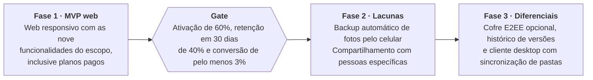
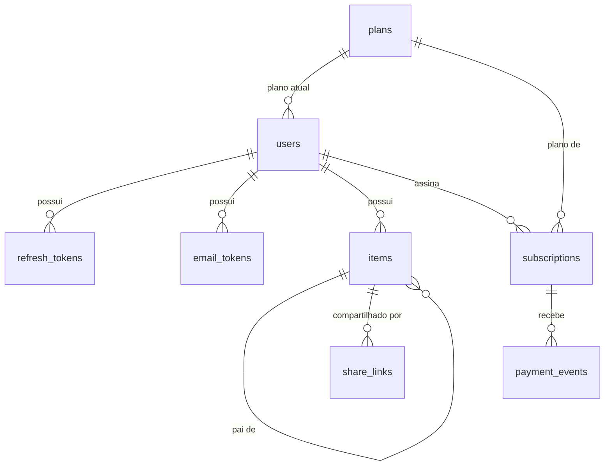
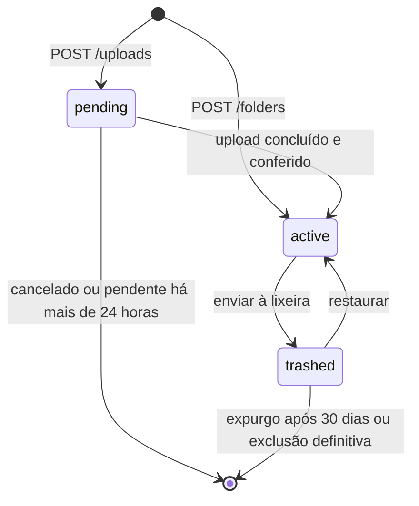

# 19 · agents.md-alinhado

- **Início:** 09/10/2026 20:43 (horário de Brasília)
- **Fim:** 09/10/2026 20:51
- **Sessão:** `85c4bcd3-4bd2-4d6c-b913-1528f50da71c`
- **Subagentes embutidos:** 0

---

## Usuário (meta) · 09/10 20:43:08

```text
<local-command-caveat>The command below was run directly in Claude Code, not sent to you as a request, and its output goes straight to the user. It's recorded here as context for later messages.</local-command-caveat>
```


## Usuário · 09/10 20:43:08

```text
<command-name>/clear</command-name>
            <command-message>clear</command-message>
            <command-args></command-args>
```

```text
<command-message>grill-me</command-message>
<command-name>/grill-me</command-name>
<command-args>quero trabalhar na especificação da funcionalidade 03</command-args>
```


## Usuário (meta) · 09/10 20:43:27

Base directory for this skill: /home/argen/.claude/skills/grill-me

Interview me relentlessly about every aspect of this plan until we reach a shared understanding. Walk down each branch of the design tree, resolving dependencies between decisions one-by-one. For each question, provide your recommended answer.

Ask the questions one at a time.

If a question can be answered by exploring the codebase, explore the codebase instead.


ARGUMENTS: quero trabalhar na especificação da funcionalidade 03


## Assistente · 09/10 20:43:30

**Ferramenta: `Bash`**

```json
{
  "command": "ls; ls docs apps apps/* 2>/dev/null; grep -rniE \"funcionalidade|^#{1,3} \" docs/product-brief.md | head -80",
  "description": "List the repo layout and find the feature list in the product brief"
}
```


## Resultado de ferramenta · 09/10 20:43:31

<details>
<summary>Resultado de <code>Bash</code></summary>

```text
AGENTS.md
GLOSSARY.md
apps
compose.dev.yaml
docs
skills-lock.json
apps:
api
web

apps/api:
AGENTS.md
Dockerfile
Dockerfile.dev
README.md
dist
nest-cli.json
node_modules
package.json
pnpm-lock.yaml
pnpm-workspace.yaml
prisma
prisma.config.ts
scripts
src
test
tsconfig.build.json
tsconfig.build.tsbuildinfo
tsconfig.json
vitest.config.e2e.ts
vitest.config.int.ts
vitest.config.ts
vitest.shared.ts

apps/web:
AGENTS.md
Dockerfile
Dockerfile.dev
README.md
app
components
e2e
eslint.config.mjs
lib
next-env.d.ts
next.config.ts
node_modules
package.json
playwright-report
playwright.config.ts
pnpm-lock.yaml
pnpm-workspace.yaml
proxy.ts
public
test-results
tsconfig.json
tsconfig.tsbuildinfo

docs:
design-system.md
hld.md
lld.md
product-brief.md
docs/product-brief.md:1:# Product Brief — Gerenciador de Arquivos (estilo Google Drive)
docs/product-brief.md:5:## Visão geral
docs/product-brief.md:13:## Problema e contexto
docs/product-brief.md:23:## Público-alvo
docs/product-brief.md:31:## Modelo de negócio e planos
docs/product-brief.md:42:## Objetivos e métricas de sucesso
docs/product-brief.md:54:## Escopo do MVP
docs/product-brief.md:56:O MVP é um aplicativo web responsivo, sem apps nativos nem cliente desktop, com nove funcionalidades:
docs/product-brief.md:68:## Fora de escopo
docs/product-brief.md:83:## Requisitos não funcionais e restrições
docs/product-brief.md:98:## Riscos, dependências e premissas
docs/product-brief.md:115:## Roadmap
docs/product-brief.md:121:    F1["<b>Fase 1 · MVP web</b><br/>Web responsivo com as nove<br/>funcionalidades do escopo,<br/>inclusive planos pagos"]
docs/product-brief.md:130:## Questões em aberto
```

</details>


## Assistente · 09/10 20:43:33

**Ferramenta: `Bash`**

```json
{
  "command": "sed -n 28,135p docs/product-brief.md; echo ----; cat GLOSSARY.md; echo ----; grep -nE \"^#{1,4} \" docs/lld.md docs/hld.md",
  "description": "Read the MVP scope, glossary and the outlines of the design docs"
}
```

**Ferramenta: `ToolSearch`**

```json
{
  "query": "select:mcp__linear-server__list_issues,mcp__linear-server__get_issue",
  "max_results": 5
}
```


## Resultado de ferramenta · 09/10 20:43:34

<details>
<summary>Resultado de <code>Bash</code></summary>

````text
- **Gatilho de compra:** o espaço gratuito acabou e o plano pago do concorrente pesa no bolso, por ser cobrado em dólar ou em moeda estrangeira.
- **Fora do foco inicial:** colaboração em equipe, com permissões avançadas e administração de contas.

## Modelo de negócio e planos

O produto segue o modelo freemium: 15 GB gratuitos atraem o usuário e três planos pagos vendem espaço adicional, sempre cobrados em reais.

- **Gratuito:** 15 GB.
- **Pago 1:** 100 GB.
- **Pago 2:** 1 TB.
- **Pago 3:** 2 TB.

A cobrança é mensal ou anual, com desconto de cerca de 15% a 20% no plano anual, e o pagamento é feito por cartão ou Pix. A meta de preço é ficar de 20% a 30% abaixo do plano equivalente do Google One. Os valores finais ficam a definir, depois de cruzar o custo real do armazenamento por GB (infraestrutura e taxas de pagamento) com os preços atuais dos concorrentes.

## Objetivos e métricas de sucesso

O sucesso é medido 6 meses após o lançamento, com cinco métricas. As metas são hipóteses iniciais, a calibrar com dados reais.

| Métrica | O que mede | Meta em 6 meses |
| --- | --- | --- |
| Contas criadas | Aquisição de novos usuários | A definir |
| Ativação | Quem faz o primeiro upload em até 24 horas após o cadastro | 60% |
| Retenção em 30 dias | Quem volta a usar o produto 30 dias depois do cadastro | 40% |
| Conversão para plano pago | Usuários gratuitos que contratam um plano | 3% a 5% |
| Margem por pagante | Receita do pagante menos o custo de armazenamento, incluindo o dos usuários gratuitos | Positiva |

## Escopo do MVP

O MVP é um aplicativo web responsivo, sem apps nativos nem cliente desktop, com nove funcionalidades:

1. Cadastro e login com e-mail e senha.
2. Upload (arrastar e soltar, vários arquivos, retomada em arquivos grandes) e download.
3. Pastas: criar, renomear, mover e excluir.
4. Lixeira com restauração (por exemplo, 30 dias).
5. Pré-visualização de imagens, PDF, vídeo, áudio e texto.
6. Busca por nome de arquivo e pasta.
7. Compartilhamento por link, somente leitura, com expiração e senha opcionais.
8. Indicador de uso da cota (15 GB gratuitos).
9. Contratação de plano pago, com cartão e Pix.

## Fora de escopo

Estes itens ficam fora do MVP e são candidatos às fases seguintes:

- Apps nativos (iOS e Android) e backup automático de fotos. Como as fotos costumam ocupar boa parte dos 15 GB, esta é uma lacuna conhecida do MVP.
- Cliente desktop com sincronização de pastas.
- Edição colaborativa de documentos, no estilo Docs e Sheets.
- Histórico de versões.
- Compartilhamento com pessoas específicas e permissões granulares.
- Comentários, favoritos e acesso offline.
- Busca por conteúdo e recursos de IA.
- Cofre com criptografia ponta a ponta (E2EE) opcional.
- Colaboração em equipe, com administração de contas.
- Moderação de conteúdo e tratamento de denúncias e abuso: não tratados neste brief.

## Requisitos não funcionais e restrições

Estes requisitos sustentam as três promessas do produto e limitam o custo dos usuários gratuitos.

| Área | Requisito |
| --- | --- |
| Privacidade | TLS em trânsito e criptografia em repouso. Sem anúncios, sem venda de dados e sem análise do conteúdo, com auditoria de acesso interno e conformidade com a LGPD. |
| Localização dos dados | Região no Brasil. |
| Armazenamento | Google Cloud Storage. O upload vai direto do navegador por URLs assinadas, sem passar pelo servidor da aplicação. |
| Metadados | Banco relacional gerenciado (PostgreSQL) para usuários, pastas e arquivos. |
| Controle de custo | Cota aplicada no servidor, que bloqueia upload acima do limite do plano, e limite de tamanho por arquivo (valor a definir). |
| Pagamentos | Gateway com cartão recorrente e Pix. |
| Plataforma | Aplicação web responsiva, sem apps nativos. |
| Prazo, equipe e orçamento | A definir. |

## Riscos, dependências e premissas

O maior risco é financeiro: os 15 GB gratuitos têm custo real desde o primeiro usuário, e só a conversão para planos pagos os sustenta.

| Risco | Mitigação |
| --- | --- |
| Custo dos usuários gratuitos acima da receita dos pagantes | Cota aplicada no servidor, limite de tamanho por arquivo e acompanhamento da margem por pagante. |
| Concorrência de Google, Apple e Dropbox, que já têm a base de usuários | Foco no público brasileiro, com preço em reais, Pix e uma promessa clara de privacidade. |
| MVP sem backup de fotos, o que mais enche a cota | Backup automático de fotos como prioridade da fase 2, e a lacuna declarada no brief. |
| Privacidade sustentada por política, e não por criptografia ponta a ponta | Auditoria de acesso interno e cofre E2EE opcional na fase 3. |
| Perda de arquivos num produto novo que guarda dados pessoais | Armazenamento com replicação e backups, e comunicação transparente sobre incidentes. |
| Prazo, equipe e orçamento ainda indefinidos | Fechar esses três pontos antes de comprometer datas do MVP. |

**Dependências:** o Google Cloud Storage, na região de São Paulo, e um gateway de pagamento com cartão recorrente e Pix.

**Premissas:** as três hipóteses da seção de problema e contexto, que ainda precisam ser validadas com usuários.

## Roadmap

O roadmap tem três fases e um gate: a fase 2 só começa quando o MVP atinge as metas de ativação, retenção e conversão. Ele não tem datas, porque o prazo do projeto ainda está a definir.



O critério de passagem da fase 2 para a fase 3 ainda não foi definido.

## Questões em aberto

Estes pontos precisam de definição antes de o MVP ser planejado em detalhe.

- [ ] Prazo de lançamento, tamanho e perfil da equipe, e orçamento mensal de infraestrutura.
- [ ] Meta de contas criadas em 6 meses.
----
# Gerenciador de Arquivos

Armazenamento de arquivos na nuvem para pessoas físicas, com um plano gratuito e planos pagos de espaço adicional.

## Language

**Usuário**:
A pessoa que tem um e-mail, uma senha, um plano e os próprios arquivos.
_Avoid_: Conta, cliente, membro

**Sessão**:
O login de um Usuário em um navegador, que dura até ele sair, expirar ou ser revogado.
_Avoid_: Token de renovação, dispositivo, login ativo
----
docs/hld.md:1:# HLD — Gerenciador de Arquivos (estilo Google Drive)
docs/hld.md:5:## 1. Contexto e objetivos
docs/hld.md:26:## 2. Requisitos que moldam a arquitetura
docs/hld.md:49:## 3. Arquitetura
docs/hld.md:105:## 4. Fluxos principais
docs/hld.md:107:### 4.1 Autenticação
docs/hld.md:119:### 4.2 Upload com reserva de cota
docs/hld.md:146:### 4.3 Download e pré-visualização
docs/hld.md:154:### 4.4 Compartilhamento por link
docs/hld.md:163:### 4.5 Lixeira
docs/hld.md:170:### 4.6 Assinatura e pagamento
docs/hld.md:180:## 5. Dados e integrações
docs/hld.md:209:## 6. Ambientes e desenvolvimento
docs/hld.md:220:### 6.1 Ambiente local
docs/hld.md:254:### 6.2 Staging, produção e entrega
docs/hld.md:273:## 7. Decisões, riscos e questões em aberto
docs/lld.md:1:# LLD — Gerenciador de Arquivos (estilo Google Drive)
docs/lld.md:7:## 1. Estrutura do código
docs/lld.md:70:## 2. Esquema do banco
docs/lld.md:89:### users
docs/lld.md:106:### refresh_tokens
docs/lld.md:119:### email_tokens
docs/lld.md:132:### items
docs/lld.md:158:### share_links
docs/lld.md:172:### plans
docs/lld.md:182:### subscriptions
docs/lld.md:199:### payment_events
docs/lld.md:210:### rate_limits
docs/lld.md:222:## 3. Contrato da API
docs/lld.md:224:### 3.1 Convenções
docs/lld.md:288:### 3.2 Autenticação e conta
docs/lld.md:306:### 3.3 Itens, lixeira e busca
docs/lld.md:323:### 3.4 Upload e download
docs/lld.md:334:### 3.5 Compartilhamento
docs/lld.md:347:### 3.6 Cobrança
docs/lld.md:357:## 4. Estados e regras
docs/lld.md:359:### 4.1 Item
docs/lld.md:378:### 4.2 Cota
docs/lld.md:405:### 4.3 Assinatura
docs/lld.md:425:### 4.4 Permissão
docs/lld.md:432:### 4.5 Tokens
docs/lld.md:448:### 4.6 Upload em chunks
docs/lld.md:495:### 4.7 Cadastro, verificação e senha
docs/lld.md:549:## 5. Tarefas do worker
docs/lld.md:568:## 6. Configuração e segurança
docs/lld.md:634:## Questões em aberto
````

</details>

<details>
<summary>Resultado de <code>ToolSearch</code></summary>

```text
[ferramenta carregada: mcp__linear-server__list_issues]
[ferramenta carregada: mcp__linear-server__get_issue]
```

</details>


## Assistente · 09/10 20:43:38

**Ferramenta: `Bash`**

```json
{
  "command": "sed -n 70,88p docs/lld.md; sed -n 132,157p docs/lld.md; sed -n 222,287p docs/lld.md; sed -n 306,333p docs/lld.md; sed -n 357,404p docs/lld.md; sed -n 425,431p docs/lld.md; sed -n 549,567p docs/lld.md; sed -n 634,660p docs/lld.md; echo ---- HLD; sed -n 163,169p docs/hld.md; echo ---- CODE; ls apps/api/src apps/api/src/* apps/api/prisma apps/web/app apps/web/app/* apps/web/components 2>/dev/null | head -120; git log --oneline | head -30",
  "description": "Read the item-related sections of the design docs and list the current code modules"
}
```

**Ferramenta: `mcp__linear-server__list_issues`**

```json
{
  "project": "gerenciador de arquivos",
  "fields": [
    "id",
    "title",
    "status",
    "parentId",
    "labels"
  ],
  "limit": 100,
  "orderBy": "createdAt"
}
```


## Resultado de ferramenta · 09/10 20:43:39

<details>
<summary>Resultado de <code>Bash</code></summary>

````text
## 2. Esquema do banco

**Convenções:** nomes em inglês e `snake_case`, chaves primárias em UUID v7 gerado pela aplicação, tamanhos em `BIGINT` (bytes), datas em `TIMESTAMPTZ` (UTC) e valores monetários em centavos.

**Extensões:** a primeira migração habilita `citext` (texto insensível a maiúsculas, usado no e-mail) e `pg_trgm` (trigramas, usados na busca). Ela não cria nenhuma tabela: cada tabela nasce na migração da funcionalidade dona dela.



### items

| Coluna | Tipo | Observação |
| --- | --- | --- |
| `id` | `UUID` | Chave primária |
| `owner_id` | `UUID` | Referência a `users`, com exclusão em cascata |
| `parent_id` | `UUID` | Referência a `items`. Nulo só na pasta raiz. |
| `type` | `TEXT` | `file` ou `folder` |
| `name` | `VARCHAR(255)` | Sem `/` nem caracteres de controle. Nomes duplicados são permitidos. |
| `status` | `TEXT` | `pending`, `active` ou `trashed` |
| `size_bytes` | `BIGINT` | 0 para pastas |
| `mime_type` | `TEXT` | Nulo para pastas |
| `object_key` | `TEXT` | Chave aleatória no bucket. Nulo para pastas. Único. |
| `upload_session_uri` | `TEXT` | Sessão retomável do Cloud Storage, enquanto `pending` |
| `thumbnail_key` | `TEXT` | Nulo se não houver miniatura |
| `trashed_at` | `TIMESTAMPTZ` | Preenchido ao enviar para a lixeira |
| `created_at`, `updated_at` | `TIMESTAMPTZ` | |

**Índices de `items`**

- `(parent_id)` filtrado por `status = 'active'`, para listar uma pasta.
- `(owner_id, status, trashed_at)`, para a lixeira e o expurgo.
- `(status, created_at)` filtrado por `status = 'pending'`, para a limpeza de uploads.
- Trigramas (`pg_trgm`, GIN) em `name`, para a busca.
- Único em `(owner_id)` filtrado por `parent_id IS NULL`, para garantir uma raiz por usuário.

## 3. Contrato da API

### 3.1 Convenções

| Convenção | Escolha |
| --- | --- |
| Prefixo e versão | `/v1` |
| Formato | JSON, com campos em `camelCase` |
| Autenticação | `Authorization: Bearer <token de acesso>` |
| Erros | RFC 9457 (`application/problem+json`), com um campo `code` estável |
| Paginação | Por cursor: `?limit=50&cursor=...`, com máximo de 200. A resposta traz `nextCursor`. |
| Ordenação de listagens | Pastas primeiro, depois por nome |
| Idempotência | Cabeçalho `Idempotency-Key` em `POST /uploads` e `POST /billing/checkout` |

**Códigos de erro**

| HTTP | `code` | Quando |
| --- | --- | --- |
| 400 | `validation_error` | Entrada inválida |
| 400 | `invalid_token` | Token de verificação ou de redefinição inexistente, expirado ou já usado |
| 400 | `invalid_move` | Mover uma pasta para dentro dela mesma ou de uma descendente |
| 400 | `max_depth_exceeded` | Mais de 50 níveis de pastas |
| 401 | `unauthenticated` | Token ausente, inválido ou expirado |
| 401 | `invalid_credentials` | E-mail ou senha incorretos |
| 403 | `email_not_verified` | Login antes da verificação do e-mail |
| 403 | `link_password_required` | Link com senha, sem token de acesso ao link |
| 404 | `not_found` | Item inexistente ou de outro dono |
| 409 | `upload_size_mismatch` | Tamanho real diferente do declarado |
| 410 | `link_expired` | Link expirado ou revogado |
| 413 | `file_too_large` | Arquivo acima de 5 GB |
| 413 | `quota_exceeded` | Sem espaço no plano |
| 429 | `rate_limited` | Limite de requisições atingido |
| 500 | `internal_error` | Falha não prevista. A resposta não traz mensagem interna nem stack trace. |

**Corpo do erro**

Todo erro sai com `Content-Type: application/problem+json` e este corpo:

```json
{
  "type": "about:blank",
  "title": "Bad Request",
  "status": 400,
  "code": "validation_error",
  "detail": "A entrada é inválida.",
  "errors": [{ "field": "email", "messages": ["email must be an email"] }]
}
```

| Campo | Conteúdo |
| --- | --- |
| `type` | Sempre `about:blank`. Quem identifica o erro é o `code`. |
| `title` | O nome padrão do status HTTP |
| `status` | O mesmo status da resposta |
| `code` | O código estável da tabela acima. É o único campo que a web usa para decidir a mensagem. |
| `detail` | Texto de apoio para quem desenvolve. Só aparece nos erros de regra de negócio e de validação. |
| `errors` | Só em `validation_error` de um corpo que não passou na validação: um item por campo, com o caminho do campo (`address.city` nos aninhados) e as mensagens |

- **Rota inexistente:** responde 404 com `not_found`.
- **Corpo malformado:** um JSON que não pode ser lido responde 400 com `validation_error`, sem `errors`.
- **Campos desconhecidos:** os campos que a rota não declara são descartados, sem erro.
- **Outros erros do framework:** um status que não está na tabela (405, 415 etc.) usa como `code` o nome do status em `snake_case`, por exemplo `method_not_allowed`.
- **Erro 5xx lançado de propósito:** quando o código responde de propósito com 501, 502, 503 ou 504, o status é mantido e o `code` é o nome dele (`service_unavailable`). A resposta continua sem `detail`, e a falha vai para o log.
- **Erro de terceiros:** só o que o framework levanta escolhe o status. Um erro de uma biblioteca ou do SDK de um fornecedor é sempre `internal_error`, mesmo que ele traga um status próprio.
- **Falha depois de a resposta começar:** se o erro acontece com a resposta já em envio, não dá mais para mandar o corpo de erro. A API registra a falha e derruba a conexão, para o cliente perceber que a resposta veio incompleta.

### 3.3 Itens, lixeira e busca

| Método e rota | Entrada | Saída |
| --- | --- | --- |
| `GET /items/{id}` | | O item e a trilha de pastas até a raiz |
| `GET /items/{id}/children` | `limit`, `cursor` | Lista de itens ativos da pasta |
| `POST /folders` | `name`, `parentId` | 201, a pasta criada |
| `PATCH /items/{id}` | `name` e/ou `parentId` | O item atualizado |
| `DELETE /items/{id}` | | 204. Envia para a lixeira. |
| `GET /trash` | `limit`, `cursor` | Itens enviados diretamente à lixeira |
| `POST /items/{id}/restore` | | O item restaurado |
| `DELETE /trash/{id}` | | 202. Exclusão definitiva, em segundo plano. |
| `DELETE /trash` | | 202. Esvazia a lixeira, em segundo plano. |
| `GET /search` | `q` (mínimo de 2 caracteres), `limit`, `cursor` | Itens ativos cujo nome contém `q` |

O id `root` é aceito como atalho para a pasta raiz do usuário.

### 3.4 Upload e download

| Método e rota | Entrada | Saída |
| --- | --- | --- |
| `POST /uploads` | `name`, `sizeBytes`, `mimeType`, `parentId` | 201: `itemId`, `uploadUrl`, `expiresAt` |
| `GET /uploads/{itemId}` | | `itemId`, `uploadUrl`, `expiresAt`, para retomar um upload `pending` |
| `POST /uploads/{itemId}/complete` | | O item, já `active` |
| `DELETE /uploads/{itemId}` | | 204. Cancela e devolve o espaço. |
| `GET /items/{id}/download-url` | `disposition` (`attachment` ou `inline`) | `url`, `expiresAt` |
| `GET /items/{id}/thumbnail-url` | | `url`, `expiresAt`, ou 404 se não houver miniatura |

## 4. Estados e regras

### 4.1 Item



- **Enviar uma pasta à lixeira** marca só a pasta. Os descendentes continuam `active`, mas ficam inacessíveis.
- **Consequência para busca e links públicos:** como os descendentes não são marcados, essas consultas precisam conferir se algum ancestral está na lixeira. A conferência é feita com uma consulta recursiva sobre a página de resultados (até 200 itens, até 50 níveis).
- **Restaurar** devolve o item à pasta de origem. Se ela não existir mais ou estiver na lixeira, o item volta para a raiz.
- **Expurgo de uma pasta** remove todos os descendentes, de baixo para cima.
- **Mover:** a API sobe pelos ancestrais do destino e rejeita o pedido se encontrar o próprio item (`invalid_move`) ou se a profundidade passar de 50 níveis.

### 4.2 Cota

A reserva é um único comando, sem bloqueio explícito:

```sql
UPDATE users u
SET used_bytes = u.used_bytes + $size
FROM plans p
WHERE u.id = $user_id
  AND p.id = u.plan_id
  AND u.used_bytes + $size <= p.storage_bytes;
```

Se nenhuma linha for afetada, a API responde `quota_exceeded`. A reserva e a criação do item `pending` ocorrem na mesma transação.

| Evento | Efeito em `used_bytes` |
| --- | --- |
| Iniciar upload | Soma o tamanho declarado |
| Cancelar upload ou limpeza de pendente | Subtrai |
| Tamanho real diferente do declarado | Subtrai, e o objeto é apagado |
| Enviar à lixeira ou restaurar | Nenhum |
| Expurgo ou exclusão definitiva | Subtrai, depois de o objeto ser apagado do storage |

Pastas e miniaturas não contam para a cota. Uma rotina diária recalcula `used_bytes` pela soma dos itens e registra as divergências.

**Conta somente leitura:** é um estado calculado (`used_bytes > storage_bytes`), não gravado. Ele bloqueia apenas o upload. Baixar, excluir, criar pastas e restaurar da lixeira continuam funcionando.

### 4.4 Permissão

- **Dono:** toda consulta filtra por `owner_id`. Não há acesso a item de outro usuário no MVP.
- **Item inexistente ou de outro dono:** a resposta é 404 nos dois casos.
- **Link público:** dá leitura ao item do link e aos descendentes ativos dele. A cada chamada, a API confere que o item pedido está abaixo do item do link.
- **Item na lixeira:** os links para ele, ou para algo abaixo dele, respondem `link_expired` até a restauração.

## 5. Tarefas do worker

O worker é a mesma imagem da API, publicada como um serviço separado do Cloud Run. Ele expõe endpoints HTTP internos, que só aceitam chamadas autenticadas (OIDC) do Cloud Tasks e do Cloud Scheduler. Todas as tarefas são idempotentes.

| Tarefa | Disparo | Em caso de falha |
| --- | --- | --- |
| Gerar miniatura de imagem | Cloud Tasks, na conclusão do upload | 3 tentativas. Depois disso, o arquivo fica sem miniatura. |
| Limpar uploads `pending` há mais de 24 horas | Cloud Scheduler, a cada hora | Tenta de novo na próxima execução |
| Expurgar itens há mais de 30 dias na lixeira | Cloud Scheduler, diário | Tenta de novo na próxima execução |
| Apagar objetos no Cloud Storage | Cloud Tasks, uma tarefa por lote | Novas tentativas com espera crescente |
| Gerar cobrança Pix | Cloud Scheduler, diário, 5 dias antes do vencimento | Nova tentativa e alerta |
| Expirar assinaturas `past_due` há mais de 7 dias e `canceled` com período encerrado | Cloud Scheduler, diário | Tenta de novo na próxima execução |
| Reconciliar `used_bytes` | Cloud Scheduler, diário | Só registra a divergência |
| Limpar tokens, links e contadores expirados | Cloud Scheduler, diário | Tenta de novo na próxima execução |

**Ordem do expurgo:** primeiro o objeto e a miniatura são apagados do Cloud Storage, e só depois a linha sai do banco e o espaço volta à cota. Na ordem inversa, uma falha no meio deixaria objetos órfãos, gerando custo sem registro.

**Miniaturas:** são geradas só para imagens de até 50 MB, com 320 px no lado maior, em WebP, e gravadas no mesmo bucket sob o prefixo `thumbnails/`.

## Questões em aberto

- [ ] Exclusão de conta pelo próprio usuário: está fora do MVP, mas a LGPD dá ao titular o direito de pedir a eliminação dos dados. Sem a função, o pedido é atendido manualmente.
- [ ] Texto dos Termos e da Política de Privacidade: depende de validação jurídica. Até lá, os links do cadastro apontam para páginas provisórias.
- [ ] Troca de e-mail pelo próprio usuário e lista de Sessões ativas: fora do MVP.
- [ ] Limpeza de usuários nunca verificados: sem rotina por enquanto. Eles não bloqueiam o cadastro do dono do e-mail.
- [ ] Captcha no cadastro e checagem da senha contra listas de senhas vazadas: fora do MVP.
- [ ] Download de pasta inteira em ZIP: fica fora do MVP, e o usuário baixa arquivo por arquivo.
- [ ] Operações em lote (mover ou excluir vários itens): o frontend faz uma chamada por item.
- [ ] Direito de arrependimento de 7 dias em compras online: precisa de validação jurídica e pode exigir reembolso.
- [ ] URL do link compartilhado visível só na criação: confirmar se esse comportamento é aceitável, ou guardar o token de forma recuperável.
- [ ] Preços dos planos, gateway de pagamento e serviço de e-mail, que continuam em aberto no brief e no HLD.
---- HLD
### 4.5 Lixeira

- Excluir marca o item com uma data de exclusão. Excluir uma pasta marca só a pasta, e os filhos somem junto.
- Restaurar desfaz a marca.
- Itens na lixeira continuam contando para a cota.
- Depois de 30 dias, o worker apaga o item, remove o objeto do Cloud Storage e devolve o espaço à cota.

---- CODE
apps/api/src/app.module.ts
apps/api/src/app.setup.ts
apps/api/src/main.ts
apps/web/app/favicon.ico
apps/web/app/globals.css
apps/web/app/layout.tsx

apps/api/prisma:
migrations
schema.prisma

apps/api/src:
app.module.ts
app.setup.ts
common
config
generated
infra
main.ts
modules

apps/api/src/common:
auth
client-ip
errors
rate-limit
validation

apps/api/src/config:
app.config.ts
auth.config.ts
config.module.int-spec.ts
config.module.ts
database.config.ts
env.schema.ts
env.ts
mail.config.ts
rate-limit.config.ts

apps/api/src/generated:
prisma

apps/api/src/infra:
database
mail

apps/api/src/modules:
auth
users

apps/web/app:
(auth)
(drive)
favicon.ico
globals.css
layout.tsx
privacidade
sessao-encerrada
termos
vitrine

apps/web/app/(auth):
actions.ts
confira-seu-email
criar-conta
email-field.tsx
entrar
esqueci-minha-senha
form-state.ts
paths.ts
pending-email.ts
redefinir-senha
request-link-form.tsx
verificar-email

apps/web/app/(drive):
actions.ts
page.tsx

apps/web/app/privacidade:
page.tsx

apps/web/app/sessao-encerrada:
route.ts

apps/web/app/termos:
page.tsx

apps/web/app/vitrine:
api
auth-card
layout.tsx
page.tsx

apps/web/components:
auth
ui
e2667db feat: add foundational skills for codebase design, PRD generation, and TDD practices
e06e5ff Merge pull request #8 from devfullcycle/feature/lui-141-limite-de-tentativas-e-ip-real
1d383df feat: attempt limits on the auth routes, keyed by the browser's real IP (LUI-141)
f7c67d0 Merge pull request #7 from devfullcycle/feature/lui-140-recuperacao-de-senha
23891dd fix: answer the reset request before issuing the token
e0b55db feat: password recovery, from the reset routes to the screens (LUI-140)
e107346 Merge pull request #6 from devfullcycle/feature/lui-139-sessao-que-se-renova
14663c9 fix: revoke every Session in the same transaction that detects token reuse
7754b61 feat: a Session that renews itself, from the refresh route to the Proxy (LUI-139)
ce1fdb9 Merge pull request #5 from devfullcycle/feature/lui-138-entrar-e-sair
f460346 fix: read the Bearer header strictly and answer 204 to a logout token of any size
d14cb48 feat: sign-in and sign-out, from the API routes to the screens (LUI-138)
83f8128 Merge pull request #4 from devfullcycle/feature/lui-137-cadastro-e-verificacao
654a5a8 fix: keep the pending e-mail out of the URL and give the link back when verification fails
6fe9609 feat: sign-up and e-mail verification, from the API routes to the screens (LUI-137)
11772b5 Merge pull request #3 from devfullcycle/feature/lui-136-base-da-web-componentes-auth
3bcaa23 fix: keep component-owned button state, style the disabled text link and give Chromium shared memory
343963a feat: web base for auth — design tokens, components, API client and browser tests (LUI-136)
cf2ab92 Merge pull request #2 from devfullcycle/feature/lui-135-fundacao-ambiente-banco-email-erros
1aa5eb0 fix: recognise body-reader errors by a closed list of types
27de142 fix: treat non-error HttpException statuses as unexpected and split the SMTP idle wait
26c5466 fix: bound the database connect wait and tighten the boot-time env checks
d475fce fix: close the remaining review findings on the foundation
2c99626 fix: fail at boot when the database is down and keep a pasted JWT key
aedab42 refactor: share the test config and helpers and validate the env in one place
d292802 chore: check postgres over TCP and record the production migration gap
8202fe1 fix: bound SMTP waits and let tests wait for a later e-mail
290b5b4 fix: read config from the validated env and parse the JWT keys for real
4e1e8d3 fix: only trust framework errors for the HTTP status of a failure
ee7d6b2 docs: describe the new services, the three test suites and the error body
````

</details>

<details>
<summary>Resultado de <code>mcp__linear-server__list_issues</code></summary>

```text
{"issues":[{"id":"LUI-150","title":"Retomada de envios","status":"Backlog","parentId":"LUI-142","labels":["ready-for-agent","Feature"]},{"id":"LUI-149","title":"Limpeza de uploads pendentes","status":"Backlog","parentId":"LUI-142","labels":["ready-for-agent","Feature"]},{"id":"LUI-148","title":"Baixar um arquivo","status":"Backlog","parentId":"LUI-142","labels":["ready-for-agent","Feature"]},{"id":"LUI-147","title":"Arrastar, vários arquivos e cancelar","status":"Backlog","parentId":"LUI-142","labels":["ready-for-agent","Feature"]},{"id":"LUI-146","title":"Enviar um arquivo","status":"Backlog","parentId":"LUI-142","labels":["ready-for-agent","Feature"]},{"id":"LUI-145","title":"Listagem da pasta raiz","status":"Backlog","parentId":"LUI-142","labels":["ready-for-agent","Feature"]},{"id":"LUI-144","title":"Telas de arquivos no Figma","status":"Backlog","parentId":"LUI-142","labels":["ready-for-agent","Feature"]},{"id":"LUI-143","title":"Validação do storage local","status":"Backlog","parentId":"LUI-142","labels":["ready-for-agent","Feature"]},{"id":"LUI-142","title":"Funcionalidade 02: upload e download de arquivos","status":"Backlog","parentId":null,"labels":["ready-for-agent","Feature"]},{"id":"LUI-141","title":"Limite de tentativas e IP real","status":"Done","parentId":"LUI-133","labels":["ready-for-agent","Feature"]},{"id":"LUI-140","title":"Recuperação de senha","status":"Done","parentId":"LUI-133","labels":["ready-for-agent","Feature"]},{"id":"LUI-139","title":"Sessão que se renova","status":"Done","parentId":"LUI-133","labels":["ready-for-agent","Feature"]},{"id":"LUI-138","title":"Entrar e sair","status":"Done","parentId":"LUI-133","labels":["ready-for-agent","Feature"]},{"id":"LUI-137","title":"Cadastro e verificação de e-mail","status":"Done","parentId":"LUI-133","labels":["ready-for-agent","Feature"]},{"id":"LUI-136","title":"Base da web: componentes de autenticação e testes no navegador","status":"Done","parentId":"LUI-133","labels":["ready-for-agent","Feature"]},{"id":"LUI-135","title":"Fundação: ambiente, banco, e-mail e formato de erro","status":"Done","parentId":"LUI-133","labels":["ready-for-agent","Feature"]},{"id":"LUI-134","title":"Telas de autenticação no Figma","status":"Done","parentId":"LUI-133","labels":["ready-for-agent","Feature"]},{"id":"LUI-133","title":"Funcionalidade 01: cadastro e login com e-mail e senha","status":"Backlog","parentId":null,"labels":["ready-for-agent","Feature"]}],"hasNextPage":false}
```

</details>


## Assistente · 09/10 20:43:42

**Ferramenta: `mcp__linear-server__get_issue`**

```json
{
  "id": "LUI-142",
  "fields": [
    "title",
    "description"
  ]
}
```

**Ferramenta: `mcp__linear-server__get_issue`**

```json
{
  "id": "LUI-145",
  "fields": [
    "title",
    "description"
  ]
}
```

**Ferramenta: `mcp__linear-server__get_issue`**

```json
{
  "id": "LUI-144",
  "fields": [
    "title",
    "description"
  ]
}
```


## Resultado de ferramenta · 09/10 20:43:43

<details>
<summary>Resultado de <code>mcp__linear-server__get_issue</code></summary>

```text
{"title":"Funcionalidade 02: upload e download de arquivos","description":"## 1. Executive Summary\n\n### Problem Statement\n\nO Usuário já consegue entrar, mas cai numa página provisória e não tem como guardar nem recuperar um único arquivo. Sem upload e download o produto não entrega a promessa central, e a métrica de ativação do brief (primeiro upload em até 24 horas) não pode nem ser medida.\n\n### Proposed Solution\n\nO Usuário envia arquivos de até 5 GB arrastando-os para a tela ou escolhendo-os pelo botão \"Enviar\", vários de uma vez, e acompanha o progresso num painel. O envio vai direto do navegador para o storage, em partes, retoma sozinho depois de uma queda de rede e pode ser retomado depois de fechar a aba. Os arquivos aparecem numa listagem da pasta raiz, de onde o Usuário os baixa. O servidor reserva o espaço antes de cada envio, de modo que ninguém passa dos 15 GB do plano gratuito.\n\n### Success Criteria\n\n| Indicador | Meta | Como é conferido |\n| -- | -- | -- |\n| Ativação | 60% dos Usuários fazem o primeiro upload em até 24 horas após o cadastro (meta do brief) | Medição em produção, 6 meses após o lançamento |\n| Retomada sem reenvio | Depois de uma queda de rede, o envio continua do byte que o storage informa ter recebido. Nenhum byte já recebido é reenviado, em arquivos de 1 byte a 5 GB | Teste no navegador com a rede cortada no meio do envio, e teste no staging com o storage real |\n| Cota inviolável | Em 100% dos casos, uploads iniciados ao mesmo tempo nunca levam os bytes usados acima do limite do plano | Teste HTTP da API com pedidos concorrentes |\n| Espaço devolvido | Todo upload abandonado devolve o espaço reservado em até 25 horas (24 horas de prazo mais uma execução horária da limpeza) | Teste HTTP da API com o prazo reduzido |\n| Latência | Iniciar upload, concluir upload e pedir a URL de download respondem em menos de 300 ms no percentil 95 (valor do HLD) | Medição no staging |\n\n## 2. User Experience & Functionality\n\n### User Personas\n\n* **Usuário pessoa física:** estourou os 15 GB gratuitos de outro serviço. Envia fotos, vídeos e documentos pessoais, muitas vezes pelo celular e com rede instável.\n* **Usuário freelancer:** envia arquivos de trabalho grandes (vídeo, projetos, PDFs pesados) pelo computador e não pode perder um envio de horas por causa de uma queda de rede.\n* **Operador:** responde pelo custo do armazenamento. Precisa que a cota valha no servidor e que uploads abandonados não prendam espaço.\n* **Desenvolvedor:** precisa do storage e do worker funcionando no ambiente local, sem conta no Google Cloud.\n\n### User Stories e Acceptance Criteria\n\nCada critério diz por onde é conferido: **\\[API\\]** é teste HTTP da API e **\\[Navegador\\]** é teste no navegador.\n\n**Listagem da raiz**\n\n1. Como Usuário, quero ver meus arquivos assim que entro, para saber o que já guardei.\n   * A página provisória pós-login dá lugar à listagem da pasta raiz, que continua mostrando o e-mail do Usuário e o botão \"Sair\". **\\[Navegador\\]**\n   * A pasta raiz é criada sob demanda, uma por Usuário, na primeira vez que é necessária. Pedidos simultâneos não criam duas. **\\[API\\]**\n   * A listagem mostra só arquivos ativos, ordenados por nome, com nome, tipo, tamanho e data de modificação. Uploads pendentes não aparecem. **\\[API\\]**\n   * A listagem é paginada por cursor, com 50 itens por padrão e no máximo 200. **\\[API\\]**\n   * Sem arquivos, a tela mostra o estado vazio \"Arraste arquivos para cá ou clique em Enviar\". **\\[Navegador\\]**\n   * Um Usuário nunca vê, pela listagem ou pelo id, um item de outro Usuário: a resposta é `not_found`. **\\[API\\]**\n2. Como Usuário, quero usar a listagem pelo celular, para enviar e baixar de onde estiver.\n   * Abaixo de 640px, a lista mostra o nome e, numa segunda linha, tamanho e data, como define o design system. **\\[Navegador\\]**\n\n**Envio**\n\n3. Como Usuário, quero arrastar arquivos para a tela, para enviá-los sem procurar um botão.\n   * Enquanto arrasto arquivos sobre a janela, a zona de soltar cobre a área de conteúdo. Ao soltar, os envios começam. **\\[Navegador\\]**\n4. Como Usuário, quero escolher arquivos pelo botão \"Enviar\", para enviar pelo celular ou sem arrastar.\n   * O botão abre o seletor do sistema, que aceita vários arquivos. **\\[Navegador\\]**\n5. Como Usuário, quero enviar vários arquivos de uma vez, para não repetir a ação.\n   * Até 3 arquivos são enviados ao mesmo tempo, e os demais esperam na fila. **\\[Navegador\\]**\n   * O cabeçalho do painel de uploads resume o andamento (\"Enviando 3 de 5\"). **\\[Navegador\\]**\n6. Como Usuário, quero ver o progresso de cada arquivo, para saber quanto falta.\n   * Cada arquivo tem uma linha no painel, com percentual e barra, nos estados enviando, retomando, concluído e falhou. **\\[Navegador\\]**\n   * Ao concluir, o arquivo aparece na listagem sem recarregar a página. **\\[Navegador\\]**\n7. Como Usuário, quero enviar arquivos de até 5 GB, para guardar vídeos e projetos grandes.\n   * Iniciar um upload acima de 5 GB responde `file_too_large`, e nada é reservado. **\\[API\\]**\n   * A web recusa o arquivo antes de chamar a API e mostra \"O arquivo passa do limite de 5 GB\". **\\[Navegador\\]**\n   * Arquivos menores que 8 MiB vão num único envio. Os demais vão em partes de 8 MiB, uma por vez. **\\[Navegador\\]**\n8. Como Usuário, quero enviar arquivos com o mesmo nome de outros, para não ter de renomear antes.\n   * Nomes duplicados na mesma pasta são aceitos e viram itens distintos. **\\[API\\]**\n   * Nome vazio, com mais de 255 caracteres, com `/` ou com caracteres de controle responde `validation_error`. **\\[API\\]**\n9. Como Usuário, quero cancelar um envio, para desistir de um arquivo errado.\n   * Cancelar remove o upload pendente, apaga o que já chegou ao storage e devolve o espaço reservado. **\\[API\\]**\n   * A linha do painel tem um botão de cancelar enquanto o arquivo está enviando. **\\[Navegador\\]**\n\n**Retomada**\n\n10. Como Usuário, quero que o envio continue sozinho depois de uma queda de rede, para não recomeçar um arquivo grande.\n    * Depois de uma falha, o navegador pergunta ao storage quanto ele recebeu e continua do byte seguinte. **\\[Navegador\\]**\n    * Cada parte é tentada até 5 vezes, com espera crescente de 1 a 30 segundos. Esgotadas as tentativas, a linha fica em \"falhou\" com o botão \"Tentar de novo\", que retoma do ponto em que parou. **\\[Navegador\\]**\n11. Como Usuário, quero retomar um envio depois de fechar a aba, para não perder o que já subiu.\n    * Ao voltar, a tela lista os envios incompletos e pede que eu selecione o arquivo de novo. **\\[Navegador\\]**\n    * Se nome, tamanho e data de modificação baterem com o que foi guardado, o envio retoma do ponto em que parou. Se não baterem, a tela avisa e não envia. **\\[Navegador\\]**\n    * O navegador guarda só o id do item e a impressão do arquivo. A URL da sessão de upload nunca é guardada. **\\[Navegador\\]**\n    * Pedir de novo a sessão de um upload pendente devolve a mesma sessão. Para um item que não está pendente ou é de outro Usuário, a resposta é `not_found`. **\\[API\\]**\n12. Como Usuário, quero que um envio com a sessão expirada recomece do zero sem eu perceber o motivo técnico, para não ficar travado.\n    * Quando o storage informa que a sessão não existe mais, o navegador cancela o upload e inicia outro para o mesmo arquivo. **\\[Navegador\\]**\n\n**Cota**\n\n13. Como Usuário gratuito, quero ser avisado antes de enviar quando o arquivo não cabe nos meus 15 GB, para não esperar um envio que vai falhar.\n    * Iniciar um upload cujo tamanho, somado aos bytes usados, passa do limite do plano responde `quota_exceeded`, e nada é criado. **\\[API\\]**\n    * A linha do painel mostra \"Sem espaço no seu plano\" e os outros arquivos da fila seguem. **\\[Navegador\\]**\n14. Como operador, quero que a cota valha no servidor, para o custo dos Usuários gratuitos ter teto.\n    * Todo Usuário, novo ou já existente, está no plano gratuito de 15 GB. **\\[API\\]**\n    * Com pedidos simultâneos, a soma dos tamanhos reservados nunca passa do limite. **\\[API\\]**\n    * Concluir um upload cujo tamanho real difere do declarado responde `upload_size_mismatch`, apaga o objeto e devolve o espaço. **\\[API\\]**\n    * Concluir um upload cujo objeto não existe no storage não o torna ativo. **\\[API\\]**\n15. Como operador, quero que uploads abandonados devolvam o espaço, para a cota não ficar presa.\n    * A limpeza remove uploads pendentes há mais de 24 horas, apaga o que chegou ao storage e devolve o espaço. Rodar a limpeza duas vezes dá o mesmo resultado. **\\[API\\]**\n    * Uploads pendentes dentro do prazo não são tocados. **\\[API\\]**\n\n**Download**\n\n16. Como Usuário, quero baixar um arquivo meu, para usá-lo fora do produto.\n    * A ação \"Baixar\" da linha inicia o download com o nome original do arquivo. **\\[Navegador\\]**\n    * A API devolve uma URL assinada de leitura, válida por 5 minutos. **\\[API\\]**\n    * Pedir a URL de um item pendente, de uma pasta, de um item inexistente ou de outro Usuário responde `not_found`. **\\[API\\]**\n    * Uma conta acima da cota continua baixando. **\\[API\\]**\n\n**Operação e desenvolvimento**\n\n17. Como desenvolvedor, quero o storage e o worker no Docker Compose, para desenvolver e testar sem conta no Google Cloud.\n    * O ambiente sobe com o emulador de storage, o bucket criado e o CORS configurado, sem passo manual. **\\[API\\]**\n    * A limpeza de pendentes é disparada por um comando, no ambiente local. **\\[API\\]**\n18. Como operador, quero trocar o storage sem alterar as regras de negócio, para não ficar preso a um fornecedor.\n    * As regras só conhecem uma interface de storage, e o Cloud Storage é um driver dela. **\\[API\\]**\n\n### Non-Goals\n\n* Criar, renomear, mover e excluir pastas, navegar entre pastas e a trilha de pastas (funcionalidade 03). Todo upload desta spec vai para a raiz.\n* Excluir arquivos, lixeira e restauração (funcionalidades 03 e 04). Nesta entrega, um arquivo enviado só sai pelo cancelamento do upload.\n* Pré-visualização e miniaturas (funcionalidade 05). A listagem mostra o ícone do tipo.\n* Busca (06), compartilhamento por link (07), indicador de uso da cota (08) e planos pagos (09). A tabela de planos nasce só com o plano gratuito.\n* Enviar uma pasta inteira arrastando-a. Só arquivos são aceitos.\n* Download de vários arquivos de uma vez ou de uma pasta em ZIP.\n* Seleção múltipla, ações em lote, alternância entre lista e grade e ordenação pelo cabeçalho da lista.\n* Fila de tarefas, novas tentativas de tarefa e a rotina de reconciliação dos bytes usados.\n* Limite geral de requisições por Usuário.\n* Dados de exemplo (seed).\n* Staging e produção: o bucket real e a autenticação das chamadas ao worker entram com a infraestrutura.\n\n## 3. AI System Requirements\n\nNão se aplica. A funcionalidade não usa IA, e o brief exclui a análise do conteúdo dos arquivos.\n\n## 4. Technical Specifications\n\n### Architecture Overview\n\nO fluxo é o \"Upload com reserva de cota\" do HLD, e os parâmetros são os da seção \"Upload em chunks\" do LLD.\n\n1. A web pede à API o início do upload, com nome, tamanho, tipo e pasta de destino.\n2. A API reserva o espaço e cria o item pendente na mesma transação, abre uma sessão de upload retomável no storage e devolve a URL da sessão.\n3. O navegador envia o arquivo em partes, direto para o storage. A API não recebe o conteúdo.\n4. A web pede a conclusão. A API confere no storage a existência e o tamanho real e torna o item ativo.\n5. No download, a API confere o dono e devolve uma URL assinada curta. O navegador baixa direto do storage.\n6. A cada hora, o worker remove os uploads pendentes vencidos.\n\n**Módulos**\n\n* **Módulo de itens (novo):** dono da tabela de itens. Cria a pasta raiz sob demanda, lista os filhos de uma pasta e devolve um item. Expõe um service público para os outros módulos.\n* **Módulo de uploads (novo):** inicia, retoma, conclui e cancela uploads, devolve a URL de download e contém a limpeza de pendentes. Acessa itens e cota só pelos services públicos dos módulos donos.\n* **Cota:** a reserva e a devolução de espaço são operações do módulo de usuários, dono dos bytes usados e do plano. A tabela de planos nasce aqui, com o plano gratuito.\n* **Storage (novo, infraestrutura):** interface com as operações de criar sessão retomável, consultar um objeto, apagar um objeto e assinar uma URL de leitura. O driver é o do Cloud Storage, que no ambiente local aponta para o emulador.\n* **Worker (novo):** a mesma imagem da API, num serviço próprio, com um endpoint interno para a limpeza de pendentes.\n* **Web:** a listagem da raiz, a zona de soltar, o painel de uploads e o cliente de upload em partes, que roda no navegador. Iniciar, concluir, cancelar e pedir a URL de download passam pelo servidor da web, como as demais chamadas à API.\n\n**Esquema**\n\n* **Itens:** como na seção \"Esquema do banco\" do LLD, com os índices de listagem de pasta, de limpeza de pendentes e de raiz única por Usuário. Os índices de lixeira e de busca ficam para as funcionalidades que os usam.\n* **Planos:** código, limite em bytes, preços e disponibilidade. Só o plano gratuito é criado, com 15 GB.\n* **Usuários:** ganham o plano e os bytes usados. A migração põe os Usuários existentes no plano gratuito, com zero bytes usados.\n\n### Integration Points\n\n**Contrato da API**, sob `/v1`, com autenticação pelo token de acesso em todas as rotas:\n\n| Rota | Entrada | Saída |\n| -- | -- | -- |\n| `GET /items/{id}` |  | O item. `root` é atalho para a pasta raiz. |\n| `GET /items/{id}/children` | `limit`, `cursor` | Itens ativos da pasta e `nextCursor` |\n| `POST /uploads` | `name`, `sizeBytes`, `mimeType`, `parentId`, e o cabeçalho `Idempotency-Key` | 201: `itemId`, `uploadUrl`, `expiresAt` |\n| `GET /uploads/{itemId}` |  | `itemId`, `uploadUrl`, `expiresAt` |\n| `POST /uploads/{itemId}/complete` |  | O item, já ativo |\n| `DELETE /uploads/{itemId}` |  | 204 |\n| `GET /items/{id}/download-url` | `disposition` (`attachment` ou `inline`) | `url`, `expiresAt` |\n\nCódigos de erro usados: `validation_error`, `unauthenticated`, `not_found`, `upload_size_mismatch`, `file_too_large` e `quota_exceeded`.\n\n* **Idempotência:** repetir o início de um upload com a mesma chave devolve o mesmo item, sem reservar espaço duas vezes.\n* **Destino:** `parentId` aceita `root` ou o id de uma pasta ativa do Usuário. Nesta entrega só a raiz existe.\n* **Disposição:** a API aceita os dois valores do contrato. A web usa só `attachment`; `inline` fica para a pré-visualização.\n\n**Storage**\n\n* O navegador fala com o storage por um endereço diferente do que a API usa entre contêineres. A URL da sessão e a URL assinada devolvidas ao navegador usam o endereço público, que é uma configuração nova.\n* O bucket é privado. O CORS aceita só a origem da web, para os métodos de upload e download, e expõe o cabeçalho que informa os bytes recebidos.\n* A sessão retomável é criada com a origem da web.\n\n**Ambiente local**\n\n* O Compose ganha os serviços de storage (emulador) e de worker.\n* As variáveis do bucket, do endereço do emulador, do endereço público do storage, do endereço do worker e do prazo de upload pendente entram no arquivo de exemplo, com valores que funcionam localmente, e na validação da subida.\n\n**Autenticação:** a Sessão da funcionalidade 01, sem mudança.\n\n### Security & Privacy\n\n* **Dono:** toda consulta filtra pelo dono. Item inexistente e item de outro Usuário respondem igual, com `not_found`.\n* **Chave do objeto:** um identificador aleatório, sem relação com o nome, a pasta ou o Usuário.\n* **URL da sessão de upload:** quem a tem consegue gravar na sessão. Ela só vai ao navegador do dono, não é guardada no `localStorage` e não aparece em log.\n* **URL de download:** assinada, válida por 5 minutos, com a disposição e o nome do arquivo fixados pela API.\n* **Tipo do arquivo:** é o declarado pelo navegador. O servidor não abre nem analisa o conteúdo, como promete o brief.\n* **Tamanho:** o declarado vale para a reserva, e o real é conferido na conclusão. Divergência apaga o objeto.\n* **Endpoint do worker:** não é publicado na máquina no ambiente local. A autenticação por OIDC entra com o staging.\n* **Localização:** os dados ficam na região de São Paulo, em staging e produção.\n\n### Testing\n\n* **HTTP da API:** os testes sobem a aplicação inteira, com o PostgreSQL e o emulador de storage reais do Compose, e fazem o papel do navegador ao enviar bytes para a sessão. Cobrem o contrato inteiro, a concorrência da reserva, a idempotência, a conferência do tamanho, o cancelamento, a limpeza com o prazo reduzido por variável de ambiente e o isolamento entre Usuários.\n* **Navegador:** o Playwright cobre arrastar e escolher arquivos, a fila de 3 simultâneos, o progresso, o cancelamento, a retomada com a rede cortada, a retomada depois de fechar a aba, os erros de cota e de tamanho e o download.\n* **Integração da infraestrutura:** a interface de storage é testada contra o emulador.\n* **Unitários:** só funções puras, como o cálculo da próxima parte a partir do que o storage recebeu e a impressão do arquivo.\n* **Telas:** passam pela validação visual do design system.\n\n## 5. Risks & Roadmap\n\n### Phased Rollout\n\n**MVP (esta spec)**, na ordem dos tickets:\n\n1. **Validação do storage local:** sobe o emulador no Compose e prova a sessão retomável, o CORS com o cabeçalho de bytes recebidos e a URL assinada. Se algum dos três falhar, a decisão volta ao responsável pelo produto antes de os outros tickets começarem.\n2. **Telas no Figma:** listagem da raiz, estado vazio, zona de soltar e painel de uploads com os estados de cada linha, em paralelo com o passo 1.\n3. **Raiz, listagem e cota:** planos, bytes usados, pasta raiz e a listagem no lugar da página provisória.\n4. **Upload de um arquivo:** iniciar, enviar em partes, concluir e cancelar, com reserva de cota e painel de uploads.\n5. **Vários arquivos e retomada:** fila de 3 simultâneos, novas tentativas, retomada após queda de rede e após fechar a aba.\n6. **Download.**\n7. **Limpeza de pendentes:** worker e comando de disparo.\n\n**v1.1:** pastas (03), lixeira (04) e pré-visualização com miniaturas (05), que acrescentam o destino do upload, a exclusão e a fila de tarefas.\n\n**v2.0:** indicador de cota (08), planos pagos (09) e, na fase 2 do brief, o backup automático de fotos pelos apps nativos, que reutiliza estas rotas.\n\n### Technical Risks\n\n| Risco | Mitigação |\n| -- | -- |\n| O emulador não suporta sessão retomável ou URL assinada como o Cloud Storage | Ticket de validação antes de todos os outros, e testes de ponta a ponta no staging, contra o serviço real |\n| O staging ainda não existe, então a divergência entre emulador e serviço real só aparece depois | Registrar a pendência e rodar a suíte de upload no staging assim que ele existir, antes do lançamento |\n| O navegador não lê o progresso da sessão por causa do CORS do bucket | Conferido no ticket de validação e coberto por teste no navegador |\n| Espaço preso por uploads abandonados | Limpeza a cada hora, com prazo de 24 horas |\n| Sem exclusão nesta entrega, o Usuário enche a cota e não libera espaço | Aceito até a funcionalidade 03, que vem em seguida. Nenhum lançamento público acontece antes dela. |\n| Bytes usados divergem da soma dos itens depois de uma falha no meio de uma operação | Reserva e criação do item na mesma transação. A rotina de reconciliação entra com o worker completo. |\n| Custo de tráfego de saída no download | Medir o custo por GB baixado no staging, como já prevê o HLD |\n| Envio de 5 GB em rede móvel leva horas e a sessão de 24 horas expira | O navegador recomeça do zero quando a sessão expira. Rever o prazo com dados reais. |\n\n### Pontos a confirmar\n\n* **Arquivo de 0 byte:** o LLD não diz se é aceito. A proposta é aceitar, por ser um arquivo válido para o Usuário.\n* **Limite de 5 GB por arquivo:** segue em aberto no HLD e é assumido aqui.\n* **Documentos a atualizar no planejamento:** o LLD diz que o plano e os bytes usados chegam com a funcionalidade de cota e que a raiz é criada pela funcionalidade de pastas, e os dois passam a nascer aqui. O endereço público do storage é uma variável nova. O glossário ainda não define \"Item\", \"Arquivo\", \"Pasta\" e \"Upload\".","id":"LUI-142"}
```

</details>

<details>
<summary>Resultado de <code>mcp__linear-server__get_issue</code></summary>

```text
{"title":"Telas de arquivos no Figma","description":"## Parent\n\n<issue id=\"36413c73-5728-4e3b-bd68-e9fbffbe663b\" href=\"https://linear.app/argentinaluiz/issue/LUI-142/funcionalidade-02-upload-e-download-de-arquivos\">LUI-142</issue>\n\n## What to build\n\nAs telas de upload e download ficam desenhadas no arquivo do Figma do projeto, prontas para a implementação. Este é um ticket de preparação: não altera código.\n\nO que é desenhado:\n\n* **Listagem da pasta raiz:** a tela do Drive com a barra superior (com o e-mail do Usuário e \"Sair\"), o botão \"Enviar\" e a lista de arquivos, com as colunas Nome, Tipo, Tamanho e Modificado em, o ícone do tipo e a ação \"Baixar\" em cada linha.\n* **Estado vazio:** \"Arraste arquivos para cá ou clique em Enviar\".\n* **Zona de soltar:** o estado \"arrastando sobre\", cobrindo a área de conteúdo.\n* **Painel de uploads:** aberto e recolhido, com o cabeçalho de resumo (\"Enviando 3 de 5\") e uma linha em cada estado: na fila, enviando (com o botão de cancelar), retomando, concluído e falhou (com a mensagem e \"Tentar de novo\"). As mensagens de falha incluem \"Sem espaço no seu plano\" e \"O arquivo passa do limite de 5 GB\".\n* **Envios incompletos:** como a tela lista os envios interrompidos ao voltar e pede que o Usuário selecione o arquivo de novo, e o aviso quando o arquivo selecionado não é o mesmo.\n\nRegras que valem aqui:\n\n* O design system do projeto é obrigatório: só os tokens e os componentes dele, na seção do Drive. Um componente que falte é acrescentado ao design system e ao Figma na mesma tarefa, seguindo o fluxo de trabalho com o Figma descrito lá.\n* Cada tela existe no tema claro e no escuro, e nas larguras de celular e de desktop, com o comportamento responsivo do design system: abaixo de 640px, a lista mostra o nome e, numa segunda linha, tamanho e data, e o painel de uploads ocupa a largura toda, ancorado ao pé da tela.\n* Fora do desenho: barra lateral de navegação entre seções, trilha de pastas, \"Nova pasta\", seleção múltipla, alternância entre lista e grade, ordenação pelo cabeçalho, miniaturas, busca e indicador de cota. A tela não mostra controles de funcionalidades que ainda não existem.\n\n## Acceptance criteria\n\n- [ ] A listagem, o estado vazio, a zona de soltar, o painel de uploads com todos os estados de linha e a lista de envios incompletos estão no arquivo do Figma do projeto.\n- [ ] Cada tela existe no tema claro e no escuro, no celular e no desktop.\n- [ ] As telas usam só variáveis e componentes do design system, sem valores soltos de cor, tipografia, espaçamento, raio ou sombra.\n- [ ] Todo componente novo ou alterado está descrito no documento do design system.\n- [ ] Os textos estão em português e usam o vocabulário do glossário.\n- [ ] As telas foram aprovadas pelo responsável pelo produto.","id":"LUI-144"}
```

</details>

<details>
<summary>Resultado de <code>mcp__linear-server__get_issue</code></summary>

```text
{"title":"Listagem da pasta raiz","description":"## Parent\n\n<issue id=\"36413c73-5728-4e3b-bd68-e9fbffbe663b\" href=\"https://linear.app/argentinaluiz/issue/LUI-142/funcionalidade-02-upload-e-download-de-arquivos\">LUI-142</issue>\n\n## What to build\n\nDepois de entrar, o Usuário cai na listagem dos próprios arquivos, no lugar da página provisória. Como ainda não há upload, ele vê o estado vazio \"Arraste arquivos para cá ou clique em Enviar\". O e-mail dele e o botão \"Sair\" continuam na tela.\n\nRegras que valem aqui:\n\n* Nasce o módulo de itens, dono da tabela de itens, com o esquema da seção \"Esquema do banco\" do LLD. Dos índices, entram o de listagem de pasta, o de limpeza de pendentes e o de raiz única por Usuário. Os de lixeira e de busca ficam para as funcionalidades que os usam.\n* A pasta raiz é criada sob demanda, na primeira vez que é necessária, uma por Usuário. Pedidos simultâneos não criam duas.\n* Duas rotas, sob autenticação: a que devolve um item e a que lista os filhos ativos de uma pasta. O id `root` é atalho para a pasta raiz do Usuário.\n* A listagem devolve só itens ativos, com pastas primeiro e depois por nome, paginada por cursor, com 50 itens por padrão e no máximo 200. Itens pendentes não aparecem.\n* Toda consulta filtra pelo dono. Item inexistente e item de outro Usuário respondem igual, com `not_found`.\n* A rota de um item devolve o item. A trilha de pastas até a raiz fica para a funcionalidade de pastas.\n* O módulo de itens expõe um service público para os outros módulos, que não acessam a tabela.\n* Na web, a página lê os dados pelo servidor, pela camada de acesso a dados que confere a Sessão.\n* O botão \"Enviar\" e a ação \"Baixar\" não fazem parte deste ticket e não aparecem ainda. A listagem com arquivos, a ordenação e a paginação são conferidas no ticket de envio, quando passa a existir como criar um arquivo.\n* Documentos atualizados na mesma tarefa: o glossário ganha \"Item\", \"Arquivo\" e \"Pasta\", e o LLD registra que a raiz nasce com esta funcionalidade e que a rota de um item ainda não devolve a trilha.\n\n## Acceptance criteria\n\n- [ ] Pedir o item `root` devolve a pasta raiz do Usuário, e pedir de novo devolve a mesma pasta (teste HTTP).\n- [ ] Pedidos simultâneos pela raiz de um Usuário recém-criado devolvem todos o mesmo id (teste HTTP).\n- [ ] Listar os filhos de `root` de um Usuário sem arquivos devolve uma lista vazia, sem `nextCursor` (teste HTTP).\n- [ ] Pedir ou listar, pelo id, a raiz de outro Usuário responde `not_found`, igual a um id inexistente (teste HTTP).\n- [ ] `limit` acima de 200 ou inválido responde `validation_error` (teste HTTP).\n- [ ] As duas rotas respondem `unauthenticated` sem token (teste HTTP).\n- [ ] No navegador, o Usuário entra e vê a listagem com o estado vazio, o próprio e-mail e o botão \"Sair\", que encerra a Sessão (teste no Playwright).\n- [ ] Os testes no navegador da funcionalidade 01 que usavam a página provisória continuam passando (teste no Playwright).\n- [ ] A tela bate com o Figma no claro e no escuro, no celular e no desktop, e a validação visual do design system foi feita.\n- [ ] O glossário e o LLD refletem as decisões deste ticket.\n- [ ] Todas as suítes de teste, a compilação do TypeScript e o lint passam na API e na web, e o build de produção da web passa, dentro dos contêineres.","id":"LUI-145"}
```

</details>


## Assistente · 09/10 20:43:48

**Ferramenta: `Bash`**

```json
{
  "command": "grep -nE \"^#{1,4} \" docs/design-system.md; grep -niE \"trilha|breadcrumb|menu|diálogo|dialog|modal|toast|desfazer|arrast\" docs/design-system.md | head -40",
  "description": "Check which Drive components the design system already defines"
}
```


## Resultado de ferramenta · 09/10 20:43:49

<details>
<summary>Resultado de <code>Bash</code></summary>

```text
1:# Design System — Gerenciador de Arquivos (estilo Google Drive)
5:## Visão geral
29:## Cores
33:### Marca e acento
43:### Superfícies
55:### Texto
63:### Linhas e bordas
70:### Cores semânticas
84:### Gradientes
88:## Tipografia
90:### Família
98:### Hierarquia
111:### Princípios
119:## Layout
121:### Sistema de espaçamento
130:### Casca e contêineres
139:### Filosofia do espaço em branco
143:## Elevação e profundidade
156:## Formas
158:### Escala de raios
170:## Ícones e miniaturas
180:## Estados de interação
197:## Componentes
199:### Navegação
213:### Arquivos
233:### Botões
247:### Campos e formulários
261:### Sobreposições e avisos
277:### Compartilhamento
283:### Planos
289:### Autenticação
301:## Faça e não faça
303:### Faça
316:### Não faça
328:## Comportamento responsivo
330:### Breakpoints
342:### Alvos de toque
349:### Estratégia de colapso
360:### Menu de contexto
364:## Tokens no Tailwind
384:## Tokens no Figma
406:## Fluxo de trabalho com o Figma
412:### Sincronia
418:### Do Figma para o código
432:### Componentes
438:### Assets
444:### Deste documento para o Figma
454:### Páginas do arquivo
469:### Validação visual
473:## Guia de iteração
484:## Lacunas conhecidas
9:Não há ornamento: sem gradientes, sem molduras decorativas, sem sombra em cartões, botões ou texto. A separação entre áreas vem da troca de superfície (`{colors.canvas}` ↔ `{colors.surface}`) e de linhas finas de 1px. A sombra aparece só no que flutua sobre o conteúdo, como menus e diálogos.
40:| `{colors.primary-soft}` | #e6f0fa | #1f354c | Fundo de linha ou cartão selecionado e de destino de arrastar e soltar. |
49:| `{colors.surface-raised}` | #ffffff | #2a2a2c | Camadas flutuantes: menu, diálogo, toast, painel de uploads. |
53:| `{colors.scrim}` | rgba(0, 0, 0, 0.4) | rgba(0, 0, 0, 0.6) | Véu atrás de diálogos e da gaveta da barra lateral. |
67:| `{colors.hairline}` | #e0e0e0 | #38383a | Linha de 1px entre linhas da lista, borda de cartões, de menus e da barra superior. |
76:| `{colors.danger}` | #d70015 | #ff453a | Texto, ícone e borda de erro: validação de campo, upload que falhou, cota cheia, ação destrutiva no menu. |
78:| `{colors.danger-soft}` | #fdecee | #3b1f1f | Fundo de banner e de toast de erro. |
82:| `{colors.success-soft}` | #e8f5ec | #1c3323 | Fundo de toast e de banner de sucesso. |
103:| `{typography.title}` | 20px | 600 | 1.3 | -0.2px | Título de diálogo, nome do plano, título de estado vazio |
106:| `{typography.ui}` | 14px | 400 | 1.43 | 0 | Nome de arquivo, itens de menu, navegação, breadcrumb |
114:- **Dois tamanhos de leitura.** 16px onde o usuário lê e decide (formulários, planos, diálogos) e 14px onde ele varre uma lista (arquivos, menus, navegação).
126:- **Padding de cartão e de diálogo:** `{spacing.lg}` (24px).
136:- **Diálogos:** largura máxima de 480px; o diálogo de compartilhamento chega a 560px.
150:| Sombra de camada | `{shadow.overlay}`: `0 5px 30px 0 rgba(0, 0, 0, 0.22)` | Menu, popover, diálogo, toast e painel de uploads |
163:| `{rounded.sm}` | 8px | Campos de texto, botões utilitários, miniaturas, itens de menu e de navegação |
164:| `{rounded.lg}` | 16px | Cartões, diálogos, menus, toasts, painel de uploads, zona de soltar |
173:- **Tamanhos:** 16px em linhas, menus e campos; 20px na barra superior, na barra lateral e nas barras de ferramentas; 48px em estados vazios.
188:| Pressionado | `transform: scale(0.95)` em botões; em linhas e itens de menu, o mesmo fundo do hover. |
193:| Arrastando sobre | Borda de 2px tracejada em `{colors.primary}` e fundo `{colors.primary-soft}`, na zona de soltar e na pasta de destino. |
195:**Movimento.** Transições de cor e de transformação duram 150ms. Menus, diálogos e toasts entram com opacidade e um deslocamento de 4px, em 200ms. Com `prefers-reduced-motion: reduce`, só a opacidade anima e o `scale(0.95)` é desligado.
201:**`app-bar`**: barra superior fixa do Drive. Fundo `{colors.canvas}` a 80% com desfoque, borda inferior de 1px em `{colors.hairline}`, altura de 56px, padding horizontal `{spacing.md}`. À esquerda, o botão de menu (só abaixo de `lg`) e a marca do produto. No centro, o `{component.search-input}`, com largura máxima de 560px. À direita, o `{component.button-primary}` "Enviar" e o `{component.account-menu}`.
207:**`breadcrumb`**: caminho da pasta atual, no topo da área de conteúdo. Segmentos em `{typography.ui}` e `{colors.ink-muted}`, separados por um ícone de seta de 16px; o último segmento fica em `{colors.ink}` e `{typography.ui-strong}`. Cada segmento é um destino de arrastar e soltar. Quando não cabe, os segmentos do meio colapsam em "…", que abre um `{component.menu}`.
209:**`toolbar`**: linha abaixo do breadcrumb, com altura de 48px. À esquerda, as ações da pasta ("Nova pasta") em `{component.button-utility}`. À direita, a alternância entre lista e grade. Com itens selecionados, a barra troca de conteúdo: mostra a contagem ("3 selecionados") e as ações em lote (baixar, mover, excluir).
211:**`account-menu`**: botão circular de 32px com a inicial do usuário, fundo `{colors.surface}` e `{rounded.full}`. Abre um `{component.menu}` com o e-mail, o plano atual e as ações "Planos" e "Sair".
217:**`file-row`**: linha da lista. Altura de 48px, fundo `{colors.canvas}`, borda inferior de 1px em `{colors.hairline}`, padding horizontal `{spacing.md}`. Da esquerda para a direita: `{component.checkbox}`, ícone do tipo ou miniatura de 32px, nome em `{typography.ui}` e `{colors.ink}` (truncado com reticências), e tipo, tamanho e data em `{typography.mono}` e `{colors.ink-muted}`. No fim da linha, um `{component.button-icon}` "Mais ações" abre o `{component.menu}`. Um clique seleciona; dois cliques abrem a pasta ou a pré-visualização.
221:**`empty-state`**: ocupa a área de conteúdo quando não há itens. Centrado, com ícone de 48px em `{colors.ink-muted}`, título em `{typography.title}`, uma frase em `{typography.body}` e `{colors.ink-muted}`, e no máximo um botão. Variações: pasta vazia ("Arraste arquivos para cá ou clique em Enviar"), lixeira vazia e busca sem resultados.
223:**`dropzone`**: cobre a área de conteúdo enquanto o usuário arrasta arquivos sobre a janela. Usa o estado "arrastando sobre", com `{rounded.lg}`, e mostra o nome da pasta de destino em `{typography.title}`.
241:**`button-danger`**: confirma uma ação destrutiva e sem volta ("Excluir definitivamente", "Esvaziar lixeira"). Igual ao `{component.button-primary}`, com fundo `{colors.danger-fill}`. Aparece só dentro de um diálogo de confirmação.
263:**`menu`**: menu de contexto e menu "Mais ações". Fundo `{colors.surface-raised}`, borda em `{colors.hairline}`, `{rounded.lg}`, `{shadow.overlay}`, padding `{spacing.xxs}` e largura mínima de 200px. Itens com 36px de altura, ícone de 16px e rótulo em `{typography.ui}`, com `{rounded.sm}`. Ações destrutivas ficam por último, depois de um separador, em `{colors.danger}`.
265:**`dialog`**: janela modal sobre `{colors.scrim}`. Fundo `{colors.surface-raised}`, `{rounded.lg}`, `{shadow.overlay}`, padding `{spacing.lg}`. Título em `{typography.title}`, corpo em `{typography.body}` e, no rodapé, os botões alinhados à direita, com o primário por último. Usos: nova pasta, renomear, mover (com árvore de pastas) e confirmação de exclusão definitiva.
267:**`toast`**: confirmação breve, no canto inferior esquerdo. Fundo `{colors.surface-raised}`, borda em `{colors.hairline}`, `{rounded.lg}`, `{shadow.overlay}`, padding 12px × 16px, texto em `{typography.ui}`. Pode ter uma ação em `{component.text-link}` ("Desfazer", depois de mover um item para a lixeira). Some sozinho em 5 segundos; os de erro ficam até o usuário fechar.
279:**`share-dialog`**: um `{component.dialog}` de até 560px. Mostra o link em um campo somente leitura, em `{typography.mono}`, com o `{component.button-primary}` "Copiar link" ao lado. Abaixo, duas opções com checkbox: "Expira em", que revela um campo de data, e "Proteger com senha", que revela um `{component.password-field}`. No rodapé, a ação "Desativar link" em `{colors.danger}`.
308:- Use `{typography.ui}` (14px) em listas, menus e navegação, e `{typography.body}` (16px) em formulários e texto corrido.
311:- Aplique `{shadow.overlay}` só em menu, popover, diálogo, toast e painel de uploads.
325:- Não use `{component.button-danger}` fora de um diálogo de confirmação.
336:| Base | < 640px | Barra lateral em gaveta; lista só com nome, e tamanho e data em uma segunda linha; grade de 2 colunas; diálogos em largura total, com margem de 16px; a busca vira um ícone que expande |
337:| `sm` | ≥ 640px | Grade de 3 colunas; coluna Tamanho volta à lista; diálogos com largura máxima |
339:| `lg` | ≥ 1024px | Barra lateral fixa de 240px; some o botão de menu; coluna Tipo volta à lista; grade de 5 colunas; padding do conteúdo sobe para 24px |
351:- **Barra lateral:** fixa a partir de `lg`; abaixo disso, gaveta aberta pelo botão de menu da `{component.app-bar}`.
355:- **Barra de ferramentas:** as ações em lote que não cabem vão para um `{component.menu}` "Mais".
```

</details>


## Assistente · 09/10 20:43:59

Li o brief, o HLD, o LLD, o design system, o glossário e a spec da funcionalidade 02 (LUI-142) no Linear. Com isso já dá para começar.

**O que já está decidido, e não vou perguntar de novo**

- **Funcionalidade 03:** pastas, com criar, renomear, mover e excluir.
- **Contrato do LLD:** `POST /folders`, `PATCH /items/{id}` com `name` e/ou `parentId`, e `DELETE /items/{id}`, que envia para a lixeira.
- **Regras do LLD:** nomes duplicados são permitidos, o limite é de 50 níveis, e mover para dentro de si mesma responde `invalid_move`.
- **O que a 02 deixou para cá:** a trilha de pastas em `GET /items/{id}`, a navegação entre pastas e o destino do upload fora da raiz.
- **Estado do código:** a 02 ainda está em Backlog, então o módulo de itens não existe. A 03 depende dela.

## Pergunta 1: o que "excluir" entrega na 03, sem a lixeira da 04?

Os documentos se contradizem em três pontos:

- O LLD diz que `DELETE /items/{id}` só marca o item como `trashed` e que itens na lixeira continuam contando para a cota.
- A tela da lixeira, a restauração, a exclusão definitiva e o expurgo são da funcionalidade 04.
- A spec da 02 aceita o risco "o Usuário enche a cota e não libera espaço" só "até a funcionalidade 03". Mas a 03, sozinha, não libera espaço nenhum.

Se a 03 entregar só o `DELETE`, o item some da listagem e o Usuário não tem como vê-lo, restaurá-lo nem recuperar o espaço até a 04.

**Minha recomendação:** a 03 entrega o envio à lixeira, de pastas e de arquivos, mais o toast "Desfazer", que já está no design system. Para isso, a rota `POST /items/{id}/restore` entra na 03, na versão simples que devolve o item à pasta de origem. A 04 fica com a tela da lixeira, a exclusão definitiva, o esvaziar, o expurgo de 30 dias e a regra de restaurar quando a pasta de origem não existe mais. O risco de cota da 02 passa a ser "aceito até a 04", e eu corrijo esse texto na spec.

As alternativas são:

- **(a)** A 03 entrega só o `DELETE`, sem desfazer.
- **(b)** A exclusão sai inteira da 03 e vai para a 04.

Você segue a recomendação ou prefere (a) ou (b)?


## Sistema · 09/10 20:51:48

Estamos especificando a funcionalidade 03 (pastas: criar, renomear, mover e excluir) e já li os documentos e a spec da 02. Falta você responder à pergunta 1: a 03 entrega o envio à lixeira com "Desfazer", ou prefere (a) ou (b)? (disable recaps in /config)

